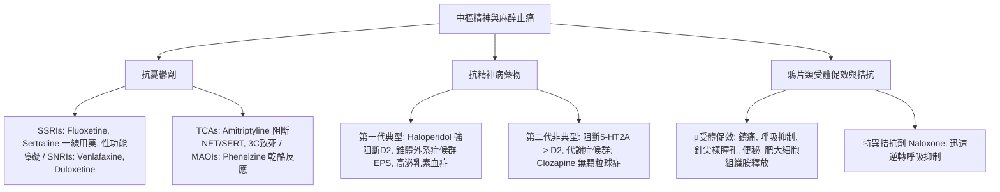

# 藥理學 第06章 中樞神經藥理學：抗憂鬱、抗精神病、止痛與麻醉藥

## 核心知識體系架構
本章統整中樞精神神經藥物重鎮：抗憂鬱劑（SSRIs, SNRIs, TCAs, MAOIs, Atypical）；抗精神病藥物（第一代典型 Haloperidol vs. 第二代非典型 Clozapine, Olanzapine, Risperidone）；鴉片類止痛劑（Morphine, Fentanyl, Methadone, Naloxone）；以及全身吸入/靜脈麻醉藥與局部麻醉劑。

---

## 主題一：抗憂鬱藥物（Antidepressants）分類與毒性

### 1. 各大抗憂鬱劑機制與特徵對比表
| 藥物類別 | 代表藥物 | 作用機轉 | 臨床特點與一線定位 | 國考必考副作用與禁忌 |
| :--- | :--- | :--- | :--- | :--- |
| **選擇性血清素再吸收抑制劑 (SSRI)** | **Fluoxetine, Sertraline, Paroxetine, Escitalopram** | 高度選擇性阻斷血清素轉運體（SERT），增加突觸間隙 5-HT 濃度 | **各大憂鬱症、焦慮症、強迫症第一線首選**（需 2~4 週起效） | **性功能障礙（Erectile dysfunction / Anorgasmia，高達 40%）**、腸胃不適、失眠。合用 MAOI 引發**致死性血清素症候群（Serotonin syndrome）**！ |
| **血清素與正腎上腺素再吸收抑制劑 (SNRI)** | **Venlafaxine, Duloxetine** | 同時阻斷 SERT 與 NET | 伴隨慢性神經病變疼痛（如糖尿病神經痛、纖維肌痛症）之憂鬱症首選 | 舒張壓升高（去甲腎上腺素效應）、心悸。 |
| **三環抗憂鬱劑 (TCA)** | **Amitriptyline, Imipramine, Nortriptyline** | 阻斷 SERT 與 NET；同時強烈阻斷 $\alpha_1, M_1, H_1$ 受體 | 二線用藥，用於偏頭痛預防、神經痛、遺尿症 | **過量中毒三大死因（3Cs）**：**C**ardiotoxicity（阻斷心臟快鈉通道致 QRS 增寬、心律不整）、**C**oma（昏迷）、**C**onvulsions（抽搐）。**心毒性解毒劑為碳酸氫鈉（$NaHCO_3$）**！ |
| **單胺氧化酶抑制劑 (MAOI)** | **Phenelzine, Tranylcypromine** | 不可逆非選擇性抑制 MAO-A 與 MAO-B | 頑固性憂鬱症最後防線 | **乾酪反應（Cheese reaction）**：進食富含酪胺食物（紅酒、乳酪），酪胺無法被腸道 MAO-A 分解，大量釋放 NE 導致**致命性高血壓危象**！ |
| **非典型抗憂鬱劑** | **Bupropion** | 阻斷 NET 與 DAT（不影響 5-HT！） | **無性功能障礙副作用**，常用於戒菸 | **降低癲癇閾值（暴食症/癲癇患者禁用！）**。 |
| | **Mirtazapine** | 阻斷突觸前 $\alpha_2$ 自體受體及 $5-HT_2 / 5-HT_3$ | 刺激食慾、增加體重、強力鎮靜（老人憂鬱消瘦失眠首選） | 嗜睡、體重顯著增加。 |

---

## 主題二：抗精神病藥物（典型 vs. 非典型）

### 1. 第一代典型（FGA）vs. 第二代非典型（SGA）抗精神病藥
- **第一代典型（Typical FGAs：氟哌啶醇 Haloperidol、氯丙嗪 Chlorpromazine）**：
  - **作用機制**：強力高親和力阻斷中腦-邊緣系統及紋狀體的 **$D_2$ 受體**。
  - **核心療效**：專門控制陽性症狀（幻覺、妄想）。
  - **特徵副作用**：
    1. **錐體外系症候群（EPS）**：
       - **急性肌張力不全（Acute dystonia，數小時至數天）**：斜頸、動眼危象。治療：**抗膽鹼藥 Benztropine 或抗組織胺 Diphenhydramine**。
       - **靜坐不能（Akathisia，數天至數週）**：無法靜坐。治療：$\beta$ 阻斷劑 Propranolol。
       - **帕金森樣症狀（Parkinsonism，數週）**：震顫、齒輪僵硬。治療：Benztropine。
       - **遲發性運動不能（Tardive dyskinesia, TD，數月至數年）**：口唇不自主咀嚼吐舌。受體超敏引起，**抗膽鹼藥會使其惡化**！治療：改換 SGA 或使用 VMAT-2 抑制劑（Valbenazine）。
    2. **高泌乳素血症（Hyperprolactinemia）**：阻斷結節漏斗路徑 $D_2$，導致乳溢、閉經、男性女乳。
    3. **抗精神病藥惡性症候群（NMS）**：高熱、鉛管樣僵硬、肌酸激酶 CK 飆升。治療：**立即停藥，給予 Dantrolene 或 Bromocriptine**。
- **第二代非典型（Atypical SGAs：Clozapine, Olanzapine, Risperidone, Quetiapine）**：
  - **作用機制**：**阻斷 $5-HT_{2A}$ 受體力量強於 $D_2$ 受體**。
  - **核心療效**：對陰性症狀（社交退縮、情感淡漠）及認知症狀改善顯著，EPS 與高泌乳素風險極低。
  - **特徵副作用**：**代謝症候群（顯著體重增加、高血糖、高血脂，以 Olanzapine 與 Clozapine 最嚴重）**。
  - **氯氮平（Clozapine）神藥與魔鬼**：頑固型思覺失調症最終王牌，且唯一被證實能**降低自殺率**之抗精神病藥！但具 **1~2% 致死性無顆粒球症（Agranulocytosis）** 與心肌炎風險，**使用期間必須每週嚴格監測絕對嗜中性球計數（ANC）**！

---

## 主題三：鴉片類藥物（Opioids）與受體藥理

### 1. 鴉片受體（$\mu, \kappa, \delta$）效應與中毒急救
- **$\mu$ 受體（MOR）促效之生理全貌**：
  - 中樞鎮痛（Supraspinal & Spinal analgesia）、鎮靜、欣快感（Euphoria，成癮核心）。
  - **呼吸抑制（Respiratory depression）**：降低腦幹呼吸中樞對 $CO_2$ 之敏感度，為**鴉片過量致死之唯一直接原因**！
  - **針尖樣瞳孔（Pinpoint pupils / 縮瞳 Miosis）**：興奮動眼神經 Edinger-Westphal 核。
  - **便秘（Constipation）**：減緩胃腸推進蠕動。
  - **不耐受性現象**：幾乎所有鴉片效應在長期使用後皆會產生耐受性（Tolerance），**唯獨「縮瞳（Miosis）」與「便秘（Constipation）」終身不產生耐受性**！
- **國考代表藥物精華**：
  - **嗎啡（Morphine）**：促進肥大細胞非免疫性釋放組織胺（血管擴張低血壓、氣喘患者慎用）。其代謝物 M6G 具強效活性，腎衰竭時易蓄積中毒。
  - **芬太尼（Fentanyl）**：脂溶性極高，鎮痛效能為嗎啡之 100 倍，幾無組織胺釋放，常用於手術麻醉與貼片。
  - **美沙冬（Methadone）**：超長半衰期（$> 24$ 小時），口服生物利用率佳，用於**鴉片成癮戒斷之替代療法**。
  - **納洛酮（Naloxone）**：純粹 $\mu$ 受體競爭性拮抗劑，IV 迅速給予逆轉呼吸抑制，挽救鴉片中毒昏迷。

---

## 歷屆國考核心真題解析

### 【國考經典真題實戰】
**【試題編號】111-第一次-med2-051**
> **題目**：下列何者是全身麻醉劑thiopental的特性？
- (A) 因在體內有再分布的情形，具有長效的作用
- (B) 屬於速效型（rapid onset）麻醉藥
- (C) 因脂溶性低不易口服吸收
- (D) 會在肝臟快速代謝成有效代謝物，而延長作用時間

> **標準答案**：`B`
> 
> **【考點深度解析與選項拆解】**：
- **(A) 選項分析**：因在體內有再分布的情形，具有長效的作用。對照中樞受體調控、抗生素抗菌光譜或抗結核抗病毒之分子標靶，驗證其正誤性。
- **(B) 選項分析**：屬於速效型（rapid onset）麻醉藥。審查細胞壁生合成阻斷、核糖體 30S/50S 次單元抑制或 CYP450 酵素誘導/抑制特性，拆解命題陷阱。
- **(C) 選項分析**：因脂溶性低不易口服吸收。檢驗臨床特異性不良反應（如椎體外系反應 EPS、紅人症候群、視神經炎或骨髓抑制），確認干擾選項。
- **(D) 選項分析**：會在肝臟快速代謝成有效代謝物，而延長作用時間。綜合抗癲癇發作型態或抗黴菌作用機轉，比對題幹之核心考查重點。
> **【國考核心解題金鑰】**：本題精確選出 **(B)**。考生須融會貫通 GABA 受體異位調節、抗生素核糖體標靶與第一線抗結核 RIPE 之副作用，即可十拿九穩。

---
### 【國考經典真題實戰】
**【試題編號】111-第一次-med2-057**
> **題目**：下列藥物何者為H1拮抗劑，也適合用於緩解藥物引起的錐體外症狀（extrapyramidal symptoms）？
- (A) famotidine
- (B) haloperidol
- (C) diphenhydramine
- (D) cetirizine

> **標準答案**：`C`
> 
> **【考點深度解析與選項拆解】**：
- **(A) 選項分析**：famotidine。對照中樞受體調控、抗生素抗菌光譜或抗結核抗病毒之分子標靶，驗證其正誤性。
- **(B) 選項分析**：haloperidol。審查細胞壁生合成阻斷、核糖體 30S/50S 次單元抑制或 CYP450 酵素誘導/抑制特性，拆解命題陷阱。
- **(C) 選項分析**：diphenhydramine。檢驗臨床特異性不良反應（如椎體外系反應 EPS、紅人症候群、視神經炎或骨髓抑制），確認干擾選項。
- **(D) 選項分析**：cetirizine。綜合抗癲癇發作型態或抗黴菌作用機轉，比對題幹之核心考查重點。
> **【國考核心解題金鑰】**：本題精確選出 **(C)**。考生須融會貫通 GABA 受體異位調節、抗生素核糖體標靶與第一線抗結核 RIPE 之副作用，即可十拿九穩。

---
### 【國考經典真題實戰】
**【試題編號】111-第一次-med2-074**
> **題目**：Methadone可用於鴉片類藥物成癮的治療，關於該藥物的藥理特性，下列敘述何者正確？
- (A) 可以經由口服投與
- (B) 沒有成癮性
- (C) 為鴉片類受體的拮抗劑
- (D) 不會產生戒斷症狀

> **標準答案**：`A`
> 
> **【考點深度解析與選項拆解】**：
- **(A) 選項分析**：可以經由口服投與。對照中樞受體調控、抗生素抗菌光譜或抗結核抗病毒之分子標靶，驗證其正誤性。
- **(B) 選項分析**：沒有成癮性。審查細胞壁生合成阻斷、核糖體 30S/50S 次單元抑制或 CYP450 酵素誘導/抑制特性，拆解命題陷阱。
- **(C) 選項分析**：為鴉片類受體的拮抗劑。檢驗臨床特異性不良反應（如椎體外系反應 EPS、紅人症候群、視神經炎或骨髓抑制），確認干擾選項。
- **(D) 選項分析**：不會產生戒斷症狀。綜合抗癲癇發作型態或抗黴菌作用機轉，比對題幹之核心考查重點。
> **【國考核心解題金鑰】**：本題精確選出 **(A)**。考生須融會貫通 GABA 受體異位調節、抗生素核糖體標靶與第一線抗結核 RIPE 之副作用，即可十拿九穩。
