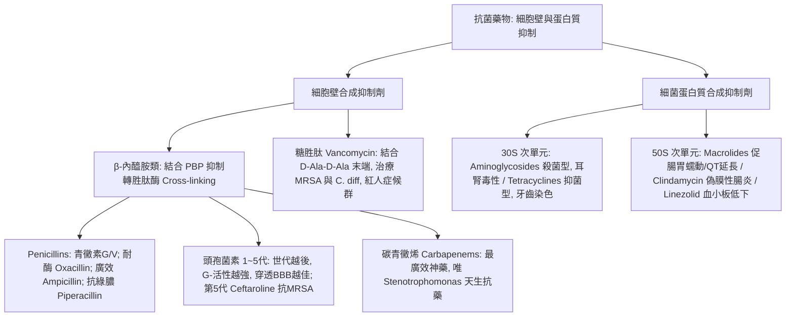

# 藥理學 第07章 抗生素藥理學：細胞壁與蛋白質合成抑制劑

## 核心知識體系架構
抗菌藥物學為微生物學與藥理學跨學科考查重心。涵蓋阻斷細菌細胞壁胜肽聚醣合成之 $\beta$-內醯胺類（Penicillins, Cephalosporins, Carbapenems, Monobactams）、糖胜肽類（Vancomycin）；以及靶向細菌核糖體抑制蛋白質合成之 30S 抑制劑（Aminoglycosides, Tetracyclines）與 50S 抑制劑（Macrolides, Clindamycin, Chloramphenicol, Linezolid）。

---

## 主題一：$\beta$-內醯胺類抗生素與萬古黴素

### 1. 五代頭孢菌素（Cephalosporins）世代演進與抗菌譜矩陣
| 世代分類 | 代表藥物 | 革蘭氏陽性菌（G+）活性 | 革蘭氏陰性菌（G-）活性 | 綠膿桿菌（P. aeruginosa）活性 | 穿透血腦屏障（BBB）能力 | 臨床關鍵首選適應症 |
| :--- | :--- | :--- | :--- | :--- | :--- | :--- |
| **第一代** | **Cefazolin（IV）, Cephalexin（PO）** | **極強**（MSSA、鏈球菌） | 弱（PEcK：Proteus, E. coli, Klebsiella） | 無 | **不可（無法入腦）** | **外科手術預防性抗生素首選（Cefazolin）**、蜂窩性組織炎。 |
| **第二代** | **Cefuroxime, Cefotetan, Cefoxitin** | 中等 | 中等（HEN PEcK：加上 Haemophilus, Enterobacter, Neisseria） | 無 | 差 | **Cefoxitin / Cefotetan** 具強抗厭氧菌（B. fragilis）活性，用於骨盆腔發炎（PID）及大腸手術。 |
| **第三代** | **Ceftriaxone, Cefotaxime, Ceftazidime** | 中等 | **極強** | **Ceftazidime 具綠膿活性**（Ceftriaxone 無抗綠膿活性！） | **極佳（能入腦）** | **細菌性腦膜炎首選（Ceftriaxone）**、淋病、嚴重院內外肺炎。Ceftriaxone 經膽道排泄，腎衰竭不需調劑量。 |
| **第四代** | **Cefepime** | **強** | **極強** | **極強（抗綠膿王牌）** | **極佳** | 嗜中性球低下發燒（Febrile neutropenia）、重症院內感染。 |
| **第五代** | **Ceftaroline** | **極強** | 良好 | 無 | 佳 | **唯一可結合變異 PBP-2a 並殺死 MRSA 之 $\beta$-內醯胺神藥**！ |

### 2. 萬古黴素（Vancomycin）作用機轉、抗藥性與毒性
- **作用機轉**：大型糖胜肽，專一性結合胜肽聚醣前驅物之 **D-丙胺醯-D-丙胺酸（D-Ala-D-Ala）末端**，以位阻立體障礙阻斷轉糖苷化與轉胜肽交聯。
- **抗藥性機轉（VRE / VRSA）**：細菌經質體介導將末端置換為 **D-Ala-D-Lac（乳酸）** 或 D-Ala-D-Ser，使 Vancomycin 結合親和力暴跌 1000 倍！
- **適應症**：**MRSA 嚴重全身感染首選（IV 給藥）**；口服不吸收，**口服劑型專門用於治療困難梭菌（C. difficile）引起的偽膜性結腸炎**。
- **特徵副作用**：
  1. **紅人症候群（Red man syndrome）**：因輸注速度過快誘發肥大細胞非免疫性釋放大量組織胺，導致全身紅斑潮紅發熱低血壓。**預防對策：減慢滴注速度（至少輸注 60 分鐘以上）或預先給予抗組織胺**。
  2. **耳毒性與腎毒性（Ototoxicity & Nephrotoxicity）**：合用 Aminoglycosides 時毒性倍增。

---

## 主題二：蛋白質合成抑制劑（30S 抑制劑 vs. 50S 抑制劑）

### 1. 抑制細菌核糖體蛋白質合成大對決
!!! tip "秒殺記憶口訣"

    **【核糖體次單元抑制劑速記口訣：Buy AT 30, CEL at 50】**
        - **30S 抑制劑**：**A**minoglycosides, **T**etracyclines。
        - **50S 抑制劑**：**C**hloramphenicol, **E**rythromycin（Macrolides）, **L**incosamides（Clindamycin）, **L**inezolid。

| 藥物分類 | 代表藥物 | 作用分子機轉 | 殺菌型 / 抑菌型 | 國考必背核心副作用與考點 |
| :--- | :--- | :--- | :--- | :--- |
| **胺基糖苷類 (Aminoglycosides)** | **Gentamicin, Tobramycin, Amikacin, Streptomycin** | 不可逆結合 **30S 次單元**，干擾校對導致 mRNA 錯讀，並阻斷多核糖體形成 | **殺菌型（Bactericidal，唯一的殺菌型蛋白抑制劑！）** | **濃度依賴性殺菌（Concentration-dependent killing）與顯著抗生素後效應（PAE）**。 四大毒性：**耳毒性（不可逆聽神經與前庭損害）、腎毒性（急性腎小管壞死 ATN）、神經肌肉阻斷（重症肌無力患者禁用！）、致畸胎**。需氧 G-桿菌專用。 |
| **四環黴素類 (Tetracyclines)** | **Doxycycline, Minocycline** | 可逆結合 **30S 次單元**，阻斷 aminoacyl-tRNA 進入核糖體 A 位點 | 抑菌型（Bacteriostatic） | **螯合多價陽離子（$Ca^{2+}, Fe^{2+}, Al^{3+}$）**，牛奶與制酸劑嚴重阻礙其吸收。 特徵毒性：**沉積於骨骼與牙齒導致牙齒永久變色及骨發育不全（孕婦及 8 歲以下兒童絕對禁用！）**、光敏感性。Doxycycline 為非典型病原體（肺炎黴漿菌、披衣菌、立克次體恙蟲病）首選！ |
| **巨環類 (Macrolides)** | **Azithromycin, Clarithromycin, Erythromycin** | 結合 **50S 次單元之 23S rRNA**，阻斷胜肽鏈移位（Translocation） | 抑菌型 | 1. 促腸胃蠕動（促胃動素受體促效，引起腹部痙攣腹瀉）。 2. **抑制肝臟 CYP3A4（除 Azithromycin 外）**，顯著推高 Theophylline, Warfarin 濃度。 3. **心臟 QT 間期延長（TdP 心室頻脈風險）**。非典型肺炎與百日咳首選。 |
| **克林達黴素 (Clindamycin)** | **Clindamycin** | 結合 **50S 次單元**，抑制胜肽基轉移酶反應 | 抑菌型 | **抗厭氧菌（橫膈膜以上厭氧菌首選）與 G+球菌**。 最惡名昭彰副作用：**徹底破壞腸道菌叢，引發困難梭菌過度增殖之偽膜性結腸炎（Pseudomembranous colitis）**！ |
| **氯黴素 (Chloramphenicol)** | **Chloramphenicol** | 結合 **50S 次單元**，阻斷胜肽基轉移酶 | 抑菌型 | 1. **灰嬰症候群（Gray baby syndrome）**：新生兒肝臟缺乏葡萄糖醛酸轉移酶（UGT），藥物蓄積引發發紺、循環衰竭。 2. 骨髓抑制（劑量相關貧血 vs. 不可逆再生不良性貧血 Aplastic anemia）。 |
| **噁唑烷酮類 (Linezolid)** | **Linezolid** | 結合 **50S 次單元之 23S 部位**，阻斷 70S 啟動複合物形成 | 抑菌型（對鏈球菌殺菌） | **抗抗藥性超級細菌（MRSA、VRE 萬古黴素抗藥性腸球菌）之王牌**。 特徵副作用：骨髓抑制（**血小板低下 Thrombocytopenia**）、周邊神經炎、**弱 MAOI 活性（合用 SSRI 誘發血清素症候群！）**。 |

---

## 歷屆國考核心真題解析

### 【國考經典真題實戰】
**【試題編號】111-第一次-med2-054**
> **題目**：關於抗生素抗藥性的成因及對抗策略，下列敘述何者錯誤？
- (A) 對vancomycin產生抗藥性的主要因素，是失去與細菌細胞壁肽聚醣（peptidoglycan）結合的能力
- (B) vancomycin合併cefotaxime可治療對penicillin產生抗藥性的肺炎鏈球菌（pneumococcus）感染
- (C) telavancin可治療對vancomycin產生耐受性的革蘭氏陽性菌感染
- (D) dalbavancin可治療對vancomycin產生抗藥性的腸球菌（enterococci）感染

> **標準答案**：`D`
> 
> **【考點深度解析與選項拆解】**：
- **(A) 選項分析**：對vancomycin產生抗藥性的主要因素，是失去與細菌細胞壁肽聚醣（peptidoglycan）結合的能力。對照中樞受體調控、抗生素抗菌光譜或抗結核抗病毒之分子標靶，驗證其正誤性。
- **(B) 選項分析**：vancomycin合併cefotaxime可治療對penicillin產生抗藥性的肺炎鏈球菌（pneumococcus）感染。審查細胞壁生合成阻斷、核糖體 30S/50S 次單元抑制或 CYP450 酵素誘導/抑制特性，拆解命題陷阱。
- **(C) 選項分析**：telavancin可治療對vancomycin產生耐受性的革蘭氏陽性菌感染。檢驗臨床特異性不良反應（如椎體外系反應 EPS、紅人症候群、視神經炎或骨髓抑制），確認干擾選項。
- **(D) 選項分析**：dalbavancin可治療對vancomycin產生抗藥性的腸球菌（enterococci）感染。綜合抗癲癇發作型態或抗黴菌作用機轉，比對題幹之核心考查重點。
> **【國考核心解題金鑰】**：本題精確選出 **(D)**。考生須融會貫通 GABA 受體異位調節、抗生素核糖體標靶與第一線抗結核 RIPE 之副作用，即可十拿九穩。

---
### 【國考經典真題實戰】
**【試題編號】111-第二次-第一階段-med2-052**
> **題目**：因肺炎鏈球菌感染導致的腦膜炎，下列藥物何者不適用？
- (A) cefuroxime
- (B) cefotaxime
- (C) ceftriaxone
- (D) vancomycin

> **標準答案**：`A`
> 
> **【考點深度解析與選項拆解】**：
- **(A) 選項分析**：cefuroxime。對照中樞受體調控、抗生素抗菌光譜或抗結核抗病毒之分子標靶，驗證其正誤性。
- **(B) 選項分析**：cefotaxime。審查細胞壁生合成阻斷、核糖體 30S/50S 次單元抑制或 CYP450 酵素誘導/抑制特性，拆解命題陷阱。
- **(C) 選項分析**：ceftriaxone。檢驗臨床特異性不良反應（如椎體外系反應 EPS、紅人症候群、視神經炎或骨髓抑制），確認干擾選項。
- **(D) 選項分析**：vancomycin。綜合抗癲癇發作型態或抗黴菌作用機轉，比對題幹之核心考查重點。
> **【國考核心解題金鑰】**：本題精確選出 **(A)**。考生須融會貫通 GABA 受體異位調節、抗生素核糖體標靶與第一線抗結核 RIPE 之副作用，即可十拿九穩。

---
### 【國考經典真題實戰】
**【試題編號】112-第一次-med2-055**
> **題目**：林先生因車禍受傷，傷口已化膿才就醫，經檢驗為β-lactamase positive金黃色葡萄球菌（Staphylococcus aureus）感染，下列何種抗生素最適合用於治療？
- (A) ampicillin
- (B) dicloxacillin
- (C) penicillin G
- (D) piperacillin

> **標準答案**：`B`
> 
> **【考點深度解析與選項拆解】**：
- **(A) 選項分析**：ampicillin。對照中樞受體調控、抗生素抗菌光譜或抗結核抗病毒之分子標靶，驗證其正誤性。
- **(B) 選項分析**：dicloxacillin。審查細胞壁生合成阻斷、核糖體 30S/50S 次單元抑制或 CYP450 酵素誘導/抑制特性，拆解命題陷阱。
- **(C) 選項分析**：penicillin G。檢驗臨床特異性不良反應（如椎體外系反應 EPS、紅人症候群、視神經炎或骨髓抑制），確認干擾選項。
- **(D) 選項分析**：piperacillin。綜合抗癲癇發作型態或抗黴菌作用機轉，比對題幹之核心考查重點。
> **【國考核心解題金鑰】**：本題精確選出 **(B)**。考生須融會貫通 GABA 受體異位調節、抗生素核糖體標靶與第一線抗結核 RIPE 之副作用，即可十拿九穩。
