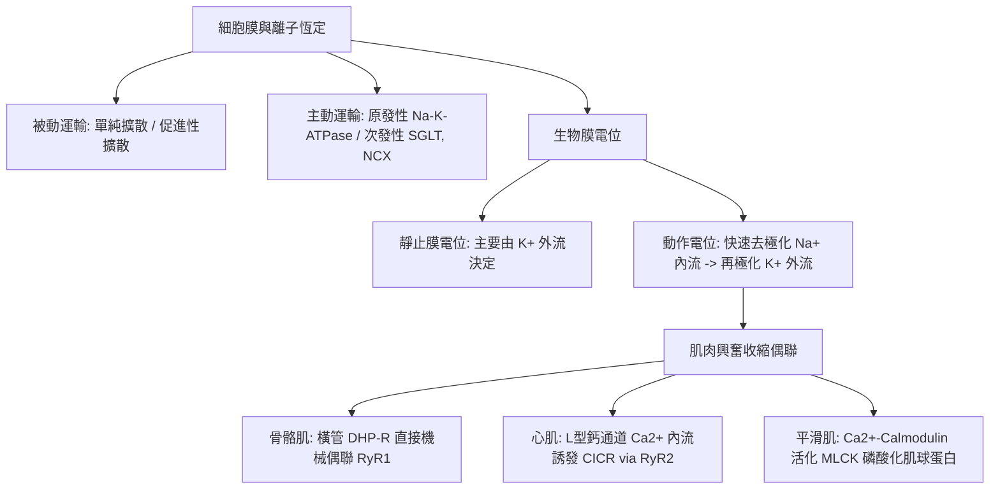
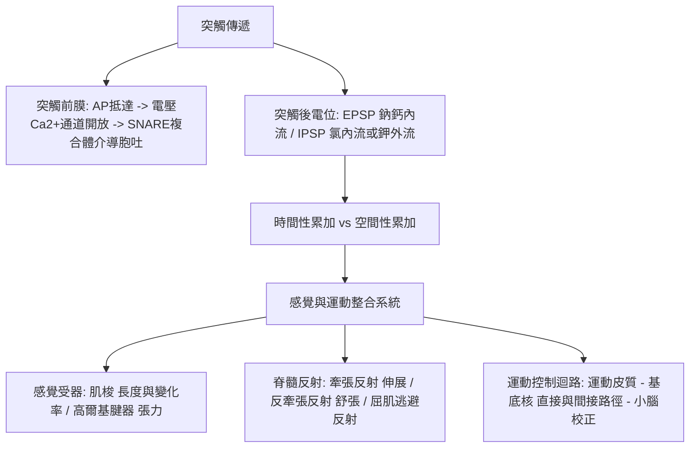
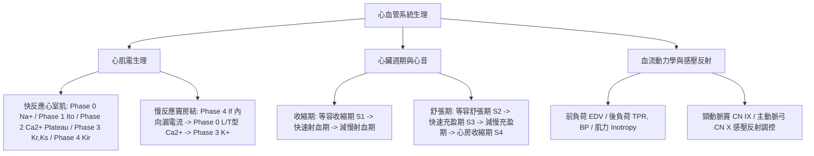
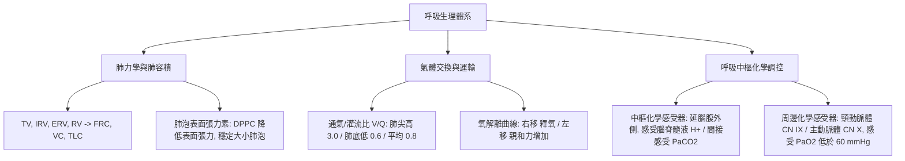
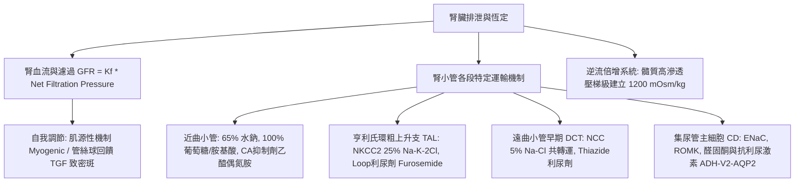
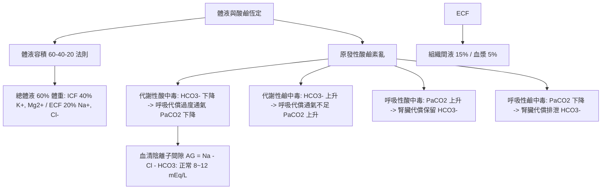
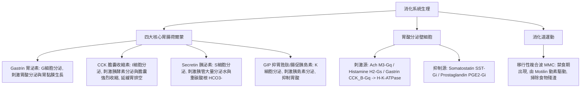
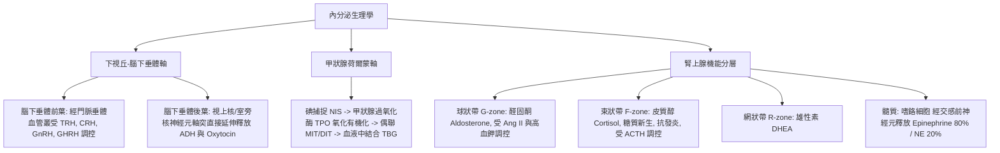
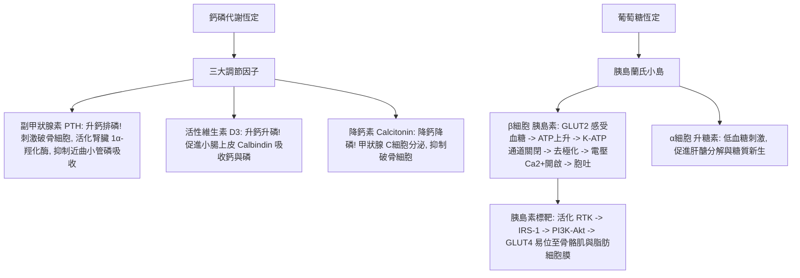
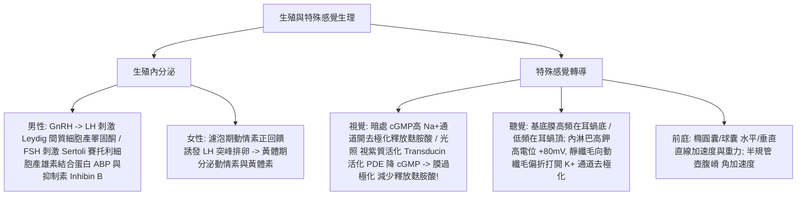

# 醫師專技高考一階段：人體生理學 考前衝刺手冊

> **考科卷別**：醫學（一） ｜ **題號範圍**：Q32 ~ Q56 (約 25 題)
>
> **複習導引**：重在心血管PV Loop、呼吸氣體交換、腎臟逆流倍增、酸鹼電解質與內分泌負回饋。

---

## 本科目章節目錄

1. [生理學 第01章 細胞生理、膜電位與肌肉收縮](#chapter-1)
2. [生理學 第02章 神經生理、突觸傳遞與感覺運動系統](#chapter-2)
3. [生理學 第03章 心血管電生理、心臟週期與血流動力學](#chapter-3)
4. [生理學 第04章 呼吸生理、肺通氣、氣體交換與化學調節](#chapter-4)
5. [生理學 第05章 腎臟生理、腎絲球過濾與管腔再吸收排泄](#chapter-5)
6. [生理學 第06章 酸鹼平衡與體液電解質調控](#chapter-6)
7. [生理學 第07章 消化生理、消化道荷爾蒙分泌與蠕動](#chapter-7)
8. [生理學 第08章 內分泌生理、下丘腦腦垂腺甲狀腺與腎上腺](#chapter-8)
9. [生理學 第09章 鈣磷代謝與胰島葡萄糖恆定](#chapter-9)
10. [生理學 第10章 生殖生理與特殊感覺神經生理](#chapter-10)

---

<a id="chapter-1"></a>

<!-- CHAPTER 1 START -->

# 生理學 第01章 細胞生理、膜電位與肌肉收縮

## 核心知識體系架構
生理學是探討人體維持內在環境恆定（Homeostasis）之物理與化學機制的學問。細胞生理為全科之基石，涵蓋膜運輸機制、靜止膜電位（RMP）、動作電位（Action Potential, AP）及骨骼肌、心肌與平滑肌的興奮收縮偶聯（Excitation-Contraction Coupling, ECC）。



---

## 主題一：物質跨膜運輸與滲透壓恆定

### 1. 跨膜運輸機制比較矩陣
| 運輸模式 | 能量需求 | 載體蛋白需求 | 飽和性（Tm）與競爭性抑制 | 典型範例與特徵 |
| :--- | :--- | :--- | :--- | :--- |
| **單純擴散 (Simple Diffusion)** | 否（順濃度差） | 否 | 無 | $O_2$、$CO_2$、$N_2$、尿素、水分子、脂溶性氣體與類固醇荷爾蒙。速度遵守 Fick's Law。 |
| **促進性擴散 (Facilitated Diffusion)** | 否（順濃度差） | 是（通道或載體） | 有 | $GLUT$ 葡萄糖轉運蛋白（GLUT1~5），順濃度梯級進入細胞。不消耗 ATP。 |
| **原發性主動運輸 (Primary Active)** | 是（直接水解 ATP） | 是（幫浦 Pump） | 有 | $Na^+/K^+$-ATPase（每消耗 1 ATP 打出 $3 Na^+$、打入 $2 K^+$）、$SERCA$（肌漿網鈣幫浦）、$H^+/K^+$-ATPase（胃壁細胞）。 |
| **次發性主動運輸 (Secondary Active)** | 是（間接依賴 $Na^+$ 梯度） | 是（共轉運 / 反向轉運） | 有 | **同向轉運 (Symport)**：SGLT-1/2（$Na^+$-葡萄糖共轉運）、NKCC2。<br>**反向轉運 (Antiport)**：$Na^+/Ca^{2+}$ 交換體（NCX）、$Na^+/H^+$ 交換體（NHE）。 |

> [!WARNING]
> **【考選部常考陷阱】**
> 1. **烏巴苷（Ouabain）與毛地黃（Digoxin）**：專一性抑制細胞膜上的 $Na^+/K^+$-ATPase，導致細胞內 $[Na^+]_i$ 上升。進而**減弱 $Na^+/Ca^{2+}$ 反向交換體（NCX）的外排驅動力**，使心肌細胞內 $[Ca^{2+}]_i$ 積聚，產生正性肌力作用（Inotropic effect）。考選部常抽換為「Digoxin 直接活化 NCX」或「增加細胞內鉀離子」，皆為錯誤選項！
> 2. **葡萄糖吸收之載體區別**：腸道與近曲小管上皮頂端膜（Apical membrane）為 **SGLT**（次發性主動運輸，逆濃度差需伴隨 $Na^+$）；基底側膜（Basolateral membrane）則為 **GLUT2**（促進性擴散，順濃度差釋放至組織間液）。

---

## 主題二：靜止膜電位與動作電位傳導

### 1. Nernst 方程式與 Goldman-Hodgkin-Katz (GHK) 方程式
- **Nernst 方程式**：計算單一離子的平衡電位（Equilibrium Potential, $E_{ion}$）：
  $$E_{ion} = \frac{61}{z} \log_{10} \frac{[ion]_{out}}{[ion]_{in}} \quad (\text{在 } 37^\circ\text{C 時, mV})$$
  - 典型哺乳類神經細胞平衡電位：$E_{K^+} \approx -90\text{ mV}$，$E_{Na^+} \approx +65\text{ mV}$，$E_{Cl^-} \approx -70\text{ mV}$，$E_{Ca^{2+}} \approx +120\text{ mV}$。
- **靜止膜電位（RMP $\approx -70\text{ mV}$）**：主要由細胞膜在靜止時對 $K^+$ 的通透性（Leak channels, $K_{ir}$）遠大於 $Na^+$（約 40:1）所決定，因此 RMP 極度貼近 $E_{K^+}$。

### 2. 神經動作電位時序與離子電導（Conductance）變化
1. **去極化相（Depolarization Phase）**：
   - 閾值（Threshold $\approx -55\text{ mV}$）觸發電壓閘門式鈉通道（$Na_v$）活化閘門（m-gate）迅猛開放。
   - $Na^+$ 湧入（Inward current），膜電位呈再生性上升（Regenerative cycle），衝向 $+35\text{ mV}$（Overshoot）。
2. **再極化相（Repolarization Phase）**：
   - $Na_v$ 去活化閘門（h-gate）自動關閉（Inactivation），鈉通道不導電。
   - 延遲整流鉀通道（Voltage-gated $K_v$）慢速開放，$K^+$ 快速外流（Outward current），使膜電位迅速復歸負值。
3. **過極化相（After-hyperpolarization Phase）**：
   - 由於 $K_v$ 關閉緩慢，膜對 $K^+$ 通透性短暫高於靜止狀態，膜電位逼近 $E_{K^+} (-90\text{ mV})$，隨後由鈉鉀幫浦與漏洩通道重置。

### 3. 不反應期（Refractory Period）精析
- **絕對不反應期（Absolute Refractory Period, ARP）**：從閾值開始直至再極化達 1/3。此時**鈉通道去活化閘門（h-gate）全數關閉鎖定**，無論施加多強之刺激皆不可能引發第二次動作電位。其生理意義在於**保證動作電位單向傳導（Unidirectional conduction）並決定最高放電頻率**。
- **相對不反應期（Relative Refractory Period, RRP）**：緊接 ARP 之後。部分鈉通道已恢復至待命閉合狀態（h-gate 重開），但鉀通道仍大量開放（$g_K$ 高）。此時給予**高於正常閾值的超強刺激（Suprathreshold stimulus）**即可誘發動作電位。

> [!TIP]
> **【動作電位神經毒素必背口訣】**
> - **河豚毒素（Tetrodotoxin, TTX）與蛤蚌毒素（Saxitoxin, STX）**：專一性阻斷電壓閘門式 $Na^+$ 通道的外側孔道，**完全壓制去極化相**，導致肌肉癱瘓與窒息。
> - **四乙基銨（Tetraethylammonium, TEA）**：專一性阻斷電壓閘門式 $K^+$ 通道，**選擇性阻斷再極化相**，使動作電位持續時間（Duration）大幅延長。

---

## 主題三：骨骼肌、心肌與平滑肌興奮收縮偶聯（ECC）大對決

### 1. 三大肌型微細結構與分子機制橫向對比表
| 比較項目 | 骨骼肌（Skeletal Muscle） | 心室肌（Cardiac Muscle） | 平滑肌（Smooth Muscle） |
| :--- | :--- | :--- | :--- |
| **外觀與調控** | 橫紋、多核周邊、隨意神經 | 橫紋、單核中央、閏盤、自主神經 | 無橫紋、梭形單核、自主神經/荷爾蒙 |
| **動作電位時程** | 短（1~5 ms） | 極長（200~300 ms，具 Plateau） | 慢波（Slow wave）或尖峰波 |
| **細胞外 $Ca^{2+}$ 依賴性** | **極低**（幾乎完全依賴 SR 內存鈣） | **高度依賴**（需外鈣內流誘發內鈣釋放） | **高度依賴**（外鈣經 L型/VOC/ROC 進入） |
| **鈣離子感應受體** | 橫管之 **DHP 受體**（電壓感應器） | 橫管之 **L 型鈣通道**（Cav1.2） | 膜受體（Gq-PLC-IP3）或電壓通道 |
| **肌漿網鈣釋放通道** | **RyR1**（與 DHP-R 直接**機械性構形偶聯**） | **RyR2**（**Ca2+-induced Ca2+ release, CICR**） | **IP3 受體（IP3R）** 及 RyR3 |
| **鈣結合標靶** | **Troponin C (TnC)** | **Troponin C (TnC)** | **Calmodulin（鈣調蛋白）** |
| **肌球蛋白活化機制** | 鈣與 TnC 結合 $\to$ 帶動 Tropomyosin 移位 $\to$ 暴露 Actin 結合位 | 鈣與 TnC 結合 $\to$ 帶動 Tropomyosin 移位 $\to$ 暴露 Actin 結合位 | 鈣-Calmodulin 複合物 $\to$ 活化 **MLCK** $\to$ 磷酸化肌球蛋白輕鏈 |
| **舒張機制** | SERCA1 將鈣泵回 SR；Calsequestrin 儲存 | SERCA2a（受 **Phospholamban** 調控）+ NCX | **MLCP**（肌球蛋白輕鏈磷酸酶）去磷酸化 + SERCA/PMCA |
| **強直收縮（Tetanus）** | **可產生**（不反應期遠短於收縮期） | **絕對不可**（ARP 與機械收縮期等長，保護心臟射血） | 可維持持久張力（Latch-state 閂鎖狀態，低耗能） |

> [!WARNING]
> **【考選部常考陷阱】**
> 1. **骨骼肌與心肌 RyR 亞型與觸發源**：骨骼肌為 **RyR1**，其開放是 DHP 受體之電壓感應結構「直接以物理拉栓方式」拉開，**即使將細胞外置於無鈣溶液中，骨骼肌在數次刺激內仍可收縮**；心肌為 **RyR2**，必須依靠橫管 L 型鈣通道流入的少量外鈣觸發 RyR2 大量放鈣（CICR），**在無鈣溶液中，心肌動作電位雖能產生但立即喪失收縮力（興奮收縮脫偶聯）**！
> 2. **平滑肌的鬆弛調控**：NO（一氧化氮）活化可溶性鳥苷酸環化酶（sGC）$\to$ 增加 **cGMP** $\to$ 活化 PKG $\to$ **刺激 MLCP** 並抑制鈣內流 $\to$ 平滑肌舒張。cGMP 被 PDE5 水解（威而鋼 Sildenafil 抑制 PDE5 延長舒張）。

---

## 歷屆國考核心真題解析

### 【國考經典真題實戰】
**【試題編號】110-第二次-第一階段-med1-045**
> **題目**：下列何者為子宮內膜（endometrium）在增生期（proliferative phase）的特徵？
- (A) 基質細胞（stromal cells）不進行分裂，而是儲存大量膠原（collagen）與基質（ground substance）
- (B) 螺旋動脈（spiral artery）已經延伸至子宮內膜（endometrium）的頂部
- (C) 上皮細胞肥大（hypertrophy），子宮內膜（endometrium）出現水腫（edema）
- (D) 子宮腺（uterine gland）基部的上皮細胞開始進行腺體重建

> **標準答案**：`D`
> 
> **【考點深度解析與選項拆解】**：
- **(A) 選項分析**：基質細胞（stromal cells）不進行分裂，而是儲存大量膠原（collagen）與基質（ground substance）。評估其在生理反應中的離子流向或分子標靶特性，符合生理學恆定準則。
- **(B) 選項分析**：螺旋動脈（spiral artery）已經延伸至子宮內膜（endometrium）的頂部。分析其電化學驅動力或受體亞型調控，確認其正確性或抽換陷阱。
- **(C) 選項分析**：上皮細胞肥大（hypertrophy），子宮內膜（endometrium）出現水腫（edema）。剖析其動力學參數或回饋抑制迴路，掌握考選部常設之逆向干擾。
- **(D) 選項分析**：子宮腺（uterine gland）基部的上皮細胞開始進行腺體重建。比對細胞膜通透性或器官特異性，確認其是否符合題幹所詢之核心生理機制。
> **【國考核心解題金鑰】**：本題精準鎖定標準答案 **(D)**。考生須牢記受體分型、離子通道電導與次發性信差之級聯放大路徑，即可於 10 秒內秒殺此類題型。

---
### 【國考經典真題實戰】
**【試題編號】110-第二次-第一階段-med1-047**
> **題目**：下列何種細胞膜結合（membrane junctions）可最嚴格管控正常消化道上皮細胞對管腔內胺基酸、 葡萄糖等物質的吸收？
- (A) 緊密結合（tight junction）
- (B) 間隙結合（gap junction）
- (C) 胞橋體（desmosome）
- (D) 接合子（connexin）

> **標準答案**：`A`
> 
> **【考點深度解析與選項拆解】**：
- **(A) 選項分析**：緊密結合（tight junction）。評估其在生理反應中的離子流向或分子標靶特性，符合生理學恆定準則。
- **(B) 選項分析**：間隙結合（gap junction）。分析其電化學驅動力或受體亞型調控，確認其正確性或抽換陷阱。
- **(C) 選項分析**：胞橋體（desmosome）。剖析其動力學參數或回饋抑制迴路，掌握考選部常設之逆向干擾。
- **(D) 選項分析**：接合子（connexin）。比對細胞膜通透性或器官特異性，確認其是否符合題幹所詢之核心生理機制。
> **【國考核心解題金鑰】**：本題精準鎖定標準答案 **(A)**。考生須牢記受體分型、離子通道電導與次發性信差之級聯放大路徑，即可於 10 秒內秒殺此類題型。

---
### 【國考經典真題實戰】
**【試題編號】110-第二次-第一階段-med1-051**
> **題目**：關於rapid eye movement（REM）sleep 的敘述，下列何者最不適當？
- (A) REM sleep 期和正常清醒期腦波之差異程度，大於non-REM sleep 期和正常清醒期腦波之差異 程度
- (B) 個體處於REM sleep 期比處於清醒時或其他期睡眠時，更可能出現pontogeniculo-occipital （PGO）spikes
- (C) 個體處於REM sleep 期，其頸部骨骼肌的肌肉張力（muscle tone）常較警醒時的張力為低
- (D) 個體處於REM sleep 期，其局部身體的活動和出現可回憶夢境的機率較其他睡眠期為高

> **標準答案**：`A`
> 
> **【考點深度解析與選項拆解】**：
- **(A) 選項分析**：REM sleep 期和正常清醒期腦波之差異程度，大於non-REM sleep 期和正常清醒期腦波之差異 程度。評估其在生理反應中的離子流向或分子標靶特性，符合生理學恆定準則。
- **(B) 選項分析**：個體處於REM sleep 期比處於清醒時或其他期睡眠時，更可能出現pontogeniculo-occipital （PGO）spikes。分析其電化學驅動力或受體亞型調控，確認其正確性或抽換陷阱。
- **(C) 選項分析**：個體處於REM sleep 期，其頸部骨骼肌的肌肉張力（muscle tone）常較警醒時的張力為低。剖析其動力學參數或回饋抑制迴路，掌握考選部常設之逆向干擾。
- **(D) 選項分析**：個體處於REM sleep 期，其局部身體的活動和出現可回憶夢境的機率較其他睡眠期為高。比對細胞膜通透性或器官特異性，確認其是否符合題幹所詢之核心生理機制。
> **【國考核心解題金鑰】**：本題精準鎖定標準答案 **(A)**。考生須牢記受體分型、離子通道電導與次發性信差之級聯放大路徑，即可於 10 秒內秒殺此類題型。


---

<br>

<a id="chapter-2"></a>

<!-- CHAPTER 2 START -->

# 生理學 第02章 神經生理、突觸傳遞與感覺運動系統

## 核心知識體系架構
神經系統生理學涵蓋突觸傳遞（化學與電突觸）、神經傳導物質受體、體感覺路徑、本體感覺受器（肌梭與高爾基腱器官）、脊髓反射弧以及大腦運動皮質與基底核調控。



---

## 主題一：化學突觸傳導與神經傳導物質

### 1. 突觸前囊泡釋放機制與神經毒素標靶
1. **動作電位到達突觸末梢** $\to$ 電壓閘門式 $Ca^{2+}$ 通道（N 型、P/Q 型）開放 $\to$ $Ca^{2+}$ 內流。
2. $Ca^{2+}$ 與 **Synaptotagmin（突觸小泡融合蛋白）** 結合，觸發構型改變。
3. **SNARE 複合體** 介導囊泡與突觸前膜對接融合（Docking & Fusion）：
   - **v-SNARE（囊泡膜）**：Synaptobrevin（又稱 VAMP）。
   - **t-SNARE（突觸前標靶膜）**：Syntaxin、SNAP-25。
4. **臨床與國考毒素機制對決**：
   - **肉毒桿菌毒素（Botulinum toxin）**：蛋白水解酶，切割周邊膽鹼能神經末梢的 SNAP-25 或 Synaptobrevin，阻斷 **Ach（乙醯膽鹼）** 釋放，導致**弛緩性麻痺（Flaccid paralysis）**。
   - **破傷風毒素（Tetanus toxin）**：經軸突逆向運輸至脊髓前角，專一性切割中樞抑制性中間神經元（Renshaw 細胞）的 Synaptobrevin，阻斷 **甘胺酸（Glycine）與 GABA** 釋放，失去抑制造成**痙攣性麻痺（Spastic paralysis / 強直陣攣）**。

### 2. 興奮性與抑制性突觸後電位（EPSP vs. IPSP）
- **EPSP（Excitatory Postsynaptic Potential）**：
  - 主要由 **Glutamate（麩胺酸）** 作用於離子型受體（AMPA、NMDA）或 Ach 作用於菸鹼型受體（Nicotinic, $N_M / N_N$）。
  - 打開 $Na^+$ 通道或非選擇性陽離子通道，產生內向去極化電流。
  - **NMDA 受體之特殊性**：在靜止膜電位下被 **$Mg^{2+}$** 堵塞通道孔；必須先經由 AMPA 受體去極化將 $Mg^{2+}$ 彈出，NMDA 才能開放讓大量 **$Ca^{2+}$** 內流，此為長期增益效應（Long-Term Potentiation, LTP）及學習記憶的神經基礎。
- **IPSP（Inhibitory Postsynaptic Potential）**：
  - 主要由 **GABA（大腦主要抑制物）** 作用於 $GABA_A$ 受體，或 **Glycine（脊髓主要抑制物）** 作用於甘胺酸受體。
  - **$GABA_A$ 與 Glycine 受體為配體閘門式 $Cl^-$ 通道**，打開後 $Cl^-$ 順電化學梯度流入細胞內，造成膜過極化（Hyperpolarization）。
  - **$GABA_B$ 受體** 為 G 蛋白偶聯受體（GPCR），經由 Gi 蛋白活化 $K^+$ 通道外流並抑制電壓 $Ca^{2+}$ 通道。

---

## 主題二：本體感覺受器與脊髓反射機制

### 1. 肌梭（Muscle Spindle）與高爾基腱器官（Golgi Tendon Organ）神經支配全對比
| 感覺受器 | 構造位置 | 感受刺激變數 | 傳入感覺神經纖維（Afferent） | 傳出運動神經纖維（Efferent） | 引發之反射弧與功能 |
| :--- | :--- | :--- | :--- | :--- | :--- |
| **肌梭 (Muscle Spindle)** | 與肌外纖維（Extrafusal fibers）**平行排列 (In parallel)** | **肌肉長度 (Length) 及長度改變速率** | **Ia 纖維**（動態與靜態，速度最快）<br>**II 纖維**（靜態長度） | **$\gamma$-運動神經元**（支配梭內肌纖維兩端收縮，維持肌梭敏感度） | **牽張反射 (Myotatic Reflex)**：單突觸反射。肌肉受牽拉時，Ia 傳入興奮 $\alpha$-運動神經元，引起**本肌收縮**（例如膝反射）。 |
| **高爾基腱器官 (GTO)** | 與肌外纖維**串聯排列 (In series)**（位於肌腱交界處） | **肌肉張力 (Tension) / 收縮力量** | **Ib 纖維** | 無直接傳出支配 | **反牽張反射 (Inverse Myotatic Reflex)**：雙突觸反射。肌張力過大時，Ib 活化抑制性中間神經元，**抑制本肌並使本肌舒張（鬆弛保護避免肌腱斷裂）**。 |

> [!TIP]
> **【反射弧速記口訣】**
> - **肌梭長、串並聯、Ia 伸、拉就縮**：肌梭與肌肉**並聯**，測**長度**，**Ia 纖維**傳入，牽拉導致**同側本肌收縮**（單突觸反射）。
> - **腱器緊、串成鏈、Ib 鬆、用力放**：腱器與肌肉**串聯**，測**張力**，**Ib 纖維**傳入，收縮張力過大引發**自體抑制放鬆**（雙突觸反射，小摺刀反射 Clasp-knife reflex）。
> - **$\alpha-\gamma$ 共活化（Coactivation）**：自主運動皮質同時活化 $\alpha$（收縮肌外纖維）與 $\gamma$（收縮梭內肌兩端），確保肌肉在縮短過程中肌梭中央感覺區不致鬆弛下垂，始終保持張力反饋敏銳度！

---

## 主題三：基底核運動迴路與神經病理

### 1. 基底核直接路徑（Direct Pathway）vs. 間接路徑（Indirect Pathway）
- **直接路徑（促進運動）**：
  皮質興奮紋狀體 $\to$ 釋放 GABA 抑制 GPi/SNr $\to$ 解除 GPi 對視丘（Thalamus）的抑制（Disinhibition） $\to$ 視丘興奮大腦皮質 $\to$ **促進軀體運動**。
- **間接路徑（抑制運動）**：
  皮質興奮紋狀體 $\to$ 釋放 GABA 抑制 GPe $\to$ 解除 GPe 對 STN（視丘下核）的抑制 $\to$ STN 興奮 GPi/SNr $\to$ GPi 大量釋放 GABA 強烈抑制視丘 $\to$ **煞車抑制不需要的動作**。
- **黑質緻密部（SNc）多巴胺（Dopamine）的雙重調節**：
  - 作用於紋狀體 **$D_1$ 受體**（Gs 偶聯）：**活化直接路徑**。
  - 作用於紋狀體 **$D_2$ 受體**（Gi 偶聯）：**抑制間接路徑**。
  - **總效應**：Dopamine 全力驅動動作啟動！
- **國考神經退化疾病對比**：
  - **巴金森氏症（Parkinson's disease）**：黑質緻密部多巴胺神經元凋亡，直接路徑減弱、間接路徑過盛。表現為**運動不能/動作遲緩（Bradykinesia）、靜止性震顫（Pill-rolling tremor）、齒輪樣僵硬（Cogwheel rigidity）**。
  - **亨丁頓氏舞蹈症（Huntington's disease）**：紋狀體投射至 GPe 的 GABA 能/腦啡肽能神經元（間接路徑）率先退化，導致間接路徑失效、運動剎車失靈，出現**不可控制的舞蹈症（Chorea）**。

---

## 歷屆國考核心真題解析

### 【國考經典真題實戰】
**【試題編號】110-第二次-第一階段-med1-048**
> **題目**：一個完全沒有視野缺失，但無法說出所見物體形狀的個案，最有可能於下列何處有神經細胞損傷？
- (A) 兩側optic radiation 的上半部神經束
- (B) 兩側Meyer's loop 的全部神經束
- (C) temporal cortex
- (D) parietal cortex

> **標準答案**：`C`
> 
> **【考點深度解析與選項拆解】**：
- **(A) 選項分析**：兩側optic radiation 的上半部神經束。評估其在生理反應中的離子流向或分子標靶特性，符合生理學恆定準則。
- **(B) 選項分析**：兩側Meyer's loop 的全部神經束。分析其電化學驅動力或受體亞型調控，確認其正確性或抽換陷阱。
- **(C) 選項分析**：temporal cortex。剖析其動力學參數或回饋抑制迴路，掌握考選部常設之逆向干擾。
- **(D) 選項分析**：parietal cortex。比對細胞膜通透性或器官特異性，確認其是否符合題幹所詢之核心生理機制。
> **【國考核心解題金鑰】**：本題精準鎖定標準答案 **(C)**。考生須牢記受體分型、離子通道電導與次發性信差之級聯放大路徑，即可於 10 秒內秒殺此類題型。

---
### 【國考經典真題實戰】
**【試題編號】110-第二次-第一階段-med1-049**
> **題目**：分布於腎上腺髓質內的交感神經末梢，主要是分泌下列何項神經傳導物質？
- (A) epinephrine
- (B) acetylcholine
- (C) calcitonin gene-related peptide
- (D) gamma-aminobutyric acid

> **標準答案**：`B`
> 
> **【考點深度解析與選項拆解】**：
- **(A) 選項分析**：epinephrine。評估其在生理反應中的離子流向或分子標靶特性，符合生理學恆定準則。
- **(B) 選項分析**：acetylcholine。分析其電化學驅動力或受體亞型調控，確認其正確性或抽換陷阱。
- **(C) 選項分析**：calcitonin gene-related peptide。剖析其動力學參數或回饋抑制迴路，掌握考選部常設之逆向干擾。
- **(D) 選項分析**：gamma-aminobutyric acid。比對細胞膜通透性或器官特異性，確認其是否符合題幹所詢之核心生理機制。
> **【國考核心解題金鑰】**：本題精準鎖定標準答案 **(B)**。考生須牢記受體分型、離子通道電導與次發性信差之級聯放大路徑，即可於 10 秒內秒殺此類題型。

---
### 【國考經典真題實戰】
**【試題編號】110-第二次-第一階段-med1-050**
> **題目**：有關丘腦神經核和具特定功能大腦皮質區的直接或單一突觸（direct or monosynaptic）聯絡配對， 下列何項錯誤？
- (A) 側膝核（lateral geniculate nucleus）和初級視覺皮質（primary visual cortex）
- (B) 腹後側核（ventral posterior lateral nucleus）和初級感覺皮質（primary somatosensory cortex）
- (C) 腹後中核（ventral posterior medial nucleus）和初級痛覺皮質（primary nociceptive cortex）
- (D) 腹前核（ventral anterior nucleus）和運動皮質（motor cortex）

> **標準答案**：`C`
> 
> **【考點深度解析與選項拆解】**：
- **(A) 選項分析**：側膝核（lateral geniculate nucleus）和初級視覺皮質（primary visual cortex）。評估其在生理反應中的離子流向或分子標靶特性，符合生理學恆定準則。
- **(B) 選項分析**：腹後側核（ventral posterior lateral nucleus）和初級感覺皮質（primary somatosensory cortex）。分析其電化學驅動力或受體亞型調控，確認其正確性或抽換陷阱。
- **(C) 選項分析**：腹後中核（ventral posterior medial nucleus）和初級痛覺皮質（primary nociceptive cortex）。剖析其動力學參數或回饋抑制迴路，掌握考選部常設之逆向干擾。
- **(D) 選項分析**：腹前核（ventral anterior nucleus）和運動皮質（motor cortex）。比對細胞膜通透性或器官特異性，確認其是否符合題幹所詢之核心生理機制。
> **【國考核心解題金鑰】**：本題精準鎖定標準答案 **(C)**。考生須牢記受體分型、離子通道電導與次發性信差之級聯放大路徑，即可於 10 秒內秒殺此類題型。


---

<br>

<a id="chapter-3"></a>

<!-- CHAPTER 3 START -->

# 生理學 第03章 心血管電生理、心臟週期與血流動力學

## 核心知識體系架構
心血管生理學為國考重點大宗，整合心肌動作電位、特殊傳導系統自律性、心電圖導極、心室容積-壓力環（P-V loop）、心輸出量（CO）之調控因子（前負荷、後負荷、肌力）以及動脈感壓反射。



---

## 主題一：心肌動作電位（快反應細胞 vs. 慢反應細胞）

### 1. 心室心肌細胞（快反應）與竇房結起搏細胞（慢反應）電生理矩陣
| 動作電位分期 | 心室心肌 / 蒲金氏纖維（快反應 Working Myocytes） | 竇房結 / 房室結（慢反應 Pacemaker Cells） |
| :--- | :--- | :--- |
| **Phase 0（去極化）** | **電壓閘門式 $Na^+$ 通道（$Na_v1.5$）** 迅猛開放，大量 $Na^+$ 內流，斜率極陡（dV/dt 最大）。 | **電壓閘門式 L 型 $Ca^{2+}$ 通道（$Ca_v1.2$）** 開放，鈣離子內流。無快速鈉通道，去極化斜率平緩傳導慢。 |
| **Phase 1（初期快速再極化）** | $Na_v$ 快速去活化，伴隨一過性外向鉀電流（**$I_{to}$**）開放。 | **無 Phase 1**。 |
| **Phase 2（平原期 Plateau）** | **L 型 $Ca^{2+}$ 通道（$I_{Ca,L}$）內流與延遲整流鉀電流（$I_K$）外流** 達成精確動態平衡。此期維持 200 ms，提供充分時間引發 CICR 並杜絕心肌強直。 | **無 Phase 2**。 |
| **Phase 3（快速再極化）** | L 型 $Ca^{2+}$ 通道去活化，延遲整流鉀通道（**$I_{Kr}$ 與 $I_{Ks}$**）完全開放，大量 $K^+$ 外流使膜電位迅速復歸。 | L 型 $Ca^{2+}$ 通道關閉，電壓閘門式 $K^+$ 通道開放，鉀外流使細胞膜再極化至最大舒張電位（MDP $\approx -65\text{ mV}$）。 |
| **Phase 4（靜止期 / 自律性舒張去極化）** | 靜止膜電位穩定於 **$-90\text{ mV}$**（靠內向整流鉀通道 **$I_{K1}$** 錨定）。無自律性。 | **具自律性自發舒張期去極化**：<br>1. **趣味電流（Funny current, $I_f$）**：超極化活化之非選擇性陽離子通道（HCN 通道），$Na^+$ 內流。<br>2. **T 型 $Ca^{2+}$ 通道（$I_{Ca,T}$）** 接棒推升至閾值（$-40\text{ mV}$）。<br>3. 伴隨 $K^+$ 外流逐漸衰減。 |

> [!WARNING]
> **【考選部常考陷阱】**
> 1. **自主神經對竇房結 Phase 4 的調控**：
>    - **交感神經（$\beta_1$ 受體 - Gs - cAMP）**：直接結合並增加 HCN 通道開放機率，使 **$I_f$ 內向電流增加**，Phase 4 去極化斜率**變陡**，心跳加快（HR 增加）。
>    - **副交感迷走神經（$M_2$ 受體 - Gi - 釋放 $G_{\beta\gamma}$）**：活化乙醯膽鹼敏感型鉀通道（**$I_{K,Ach}$**），增加 $K^+$ 外流使最大舒張電位更負（過極化），同時降低 cAMP 抑制 $I_f$ 與 $I_{Ca}$，Phase 4 斜率**變平緩**，心跳減慢。
> 2. **自律性高低階梯**：竇房結（SA node, 60~100 bpm）> 房室結（AV node, 40~60 bpm）> 希氏束/蒲金氏纖維（His-Purkinje, 20~40 bpm）。傳導速度則以**蒲金氏纖維最快（2~4 m/s）**，**房室結最慢（0.05 m/s，造成 PR 間期之生理性房室傳導延遲）**！

---

## 主題二：心臟週期（Cardiac Cycle）與壓力容積環（P-V Loop）

### 1. 心臟週期七大時期關鍵事件流
1. **等容收縮期（Isovolumetric Contraction）**：心室開始收縮，室壓急遽升高超過房壓，**房室瓣（二尖瓣/三尖瓣）關閉產生第一心音（S1）**。此時半月瓣尚未開放，**心室容積不變且壓力暴增**。
2. **快速射血期（Rapid Ejection）**：室壓超過主動脈壓，**主動脈瓣（半月瓣）開啟**，血液迅猛噴入主動脈，心室容積急劇縮小，室壓與主動脈壓達全週期頂峰。
3. **減慢射血期（Reduced Ejection）**：心室肌開始再極化（T波），射血速度趨緩。
4. **等容舒張期（Isovolumetric Relaxation）**：心室開始舒張，室壓低於主動脈壓，**主動脈瓣關閉產生第二心音（S2）**。房室瓣尚未開啟，**心室容積維持於舒張末期最小容積（ESV），室壓斷崖式驟降**。
5. **快速充盈期（Rapid Ventricular Filling）**：室壓低於心房壓，二尖瓣被動推開，心房血液被動大量奔湧入心室（佔充盈量 70%）。**若心室順應性差或容量過負荷，此時血液撞擊室壁可產生第三心音（S3，心室奔馬律）**。
6. **減慢充盈期（Reduced Filling / Diastasis）**：充盈速度放慢。
7. **心房收縮期（Atrial Systole）**：P 波之後心房主動收縮，提供最後 20~30% 之心室充盈（Atrial kick）。**若心室肥厚過度僵硬（如高血壓心臟病），心房強烈收縮對抗高阻力心室可引發第四心音（S4，心房奔馬律，正常的 S4 絕不可能出現）**。

### 2. 左心室壓力容積環（Pressure-Volume Loop）四大轉角與位移判讀
- **四個關鍵點座標**：
  - **A 點（舒張末期容積 EDV）**：二尖瓣關閉（S1 產生，約 120 mL）。
  - **B 點**：主動脈瓣開啟（約 80 mmHg）。
  - **C 點**：收縮末期最高壓力點。
  - **D 點（收縮末期容積 ESV）**：主動脈瓣關閉（S2 產生，約 50 mL）。
  - **每搏輸出量（Stroke Volume, SV）$= EDV - ESV \approx 70\text{ mL}$**。射血分數（$EF = SV/EDV \approx 55\text{--}65\%$）。

```
左室壓 (mmHg)
  120 |          C ------ D
      |         /          \
   80 |        B            \
      |        |             \
    0 |________|______________A_____
               ESV(50)      EDV(120)  左室容積 (mL)
```

| 介入生理變數改變 | P-V Loop 圖形幾何變動 | 關鍵指標變化 |
| :--- | :--- | :--- |
| **增加前負荷 (Preload / 靜脈回流 $\uparrow$)** | **A 點向右平移**（EDV 增大），環向右拓寬。 | **SV 增加**，EF 正常或略增。遵守 Frank-Starling 機制。 |
| **增加後負荷 (Afterload / 總周邊阻力 TPR $\uparrow$)** | **整個環向上升高且縮窄**，B 點上移，D 點向右平移（ESV 增加）。 | **SV 減少**，ESV 增加，EF 下降。心臟需作更多等容壓力功。 |
| **增加心肌收縮力 (Inotropy / 交感興奮)** | **收縮末期壓力容積關係斜率（ESPVR）變陡**，D 點強烈向左平移（ESV 顯著減小）。 | **SV 大幅增加**，**EF 大幅上升**。 |

---

## 主題三：動脈感壓反射（Baroreceptor Reflex）與血流動力學

### 1. 頸動脈竇（Carotid Sinus）與主動脈弓（Aortic Arch）傳導路徑對照
- **頸動脈竇（Carotid Sinus）**：
  - 感受器位於內頸動脈基底膨大處。
  - 感覺傳入神經：**舌咽神經（CN IX，竇神經 Hering's nerve）**。
  - **對血壓上升與血壓下降皆極度敏銳**（工作範圍 60~180 mmHg）。
- **主動脈弓（Aortic Arch）**：
  - 感受器位於主動脈弓壁。
  - 感覺傳入神經：**迷走神經（CN X，主動脈降壓神經 Cyon's nerve）**。
  - **主要感受血壓升高之牽張刺激**，對血壓驟降之反應較遲鈍。
- **孤立束核（NTS）中樞整合迴路**：
  血壓上升 $\to$ 感受器牽張放電增加 $\to$ CN IX/X 傳入興奮延腦 **孤立束核（NTS）**：
  1. 興奮疑核（NA）與迷走神經背核 $\to$ **副交感輸出增加** $\to$ 心跳減慢（HR $\downarrow$）。
  2. 興奮尾側腹外側延腦（CVLM） $\to$ 抑制頭側腹外側延腦（RVLM）交感中樞 $\to$ **交感輸出減少** $\to$ 心肌收縮力下降、小動脈舒張（TPR $\downarrow$）、大靜脈舒張（靜脈回流 $\downarrow$） $\to$ 血壓迅速回降至基準線。

---

## 歷屆國考核心真題解析

### 【國考經典真題實戰】
**【試題編號】110-第二次-第一階段-med1-057**
> **題目**：若以一條繩線緊綁某根手指頭根部1～2 分鐘後，移除該繩線後會發現該手指因短暫血流增加而變 紅，這現象最主要是下列何種局部控制機制所致？
- (A) 主動性充血（active hyperemia）
- (B) 反應性充血（reactive hyperemia）
- (C) 肌原反應（myogenic responses）
- (D) 對傷害的反應（response to injury）

> **標準答案**：`B`
> 
> **【考點深度解析與選項拆解】**：
- **(A) 選項分析**：主動性充血（active hyperemia）。評估其在生理反應中的離子流向或分子標靶特性，符合生理學恆定準則。
- **(B) 選項分析**：反應性充血（reactive hyperemia）。分析其電化學驅動力或受體亞型調控，確認其正確性或抽換陷阱。
- **(C) 選項分析**：肌原反應（myogenic responses）。剖析其動力學參數或回饋抑制迴路，掌握考選部常設之逆向干擾。
- **(D) 選項分析**：對傷害的反應（response to injury）。比對細胞膜通透性或器官特異性，確認其是否符合題幹所詢之核心生理機制。
> **【國考核心解題金鑰】**：本題精準鎖定標準答案 **(B)**。考生須牢記受體分型、離子通道電導與次發性信差之級聯放大路徑，即可於 10 秒內秒殺此類題型。

---
### 【國考經典真題實戰】
**【試題編號】111-第一次-med1-049**
> **題目**：下列何者是參與引發睪丸下降至陰囊（testis descent）的重要因子，而此與精子生成能力密切相關？
- (A) 激活素（activin）
- (B) 雄性素（androgen）
- (C) 沃氏管退化因子（Wolffian duct regression factor）
- (D) 血管內皮生長因子（vascular endothelial growth factor）

> **標準答案**：`B`
> 
> **【考點深度解析與選項拆解】**：
- **(A) 選項分析**：激活素（activin）。評估其在生理反應中的離子流向或分子標靶特性，符合生理學恆定準則。
- **(B) 選項分析**：雄性素（androgen）。分析其電化學驅動力或受體亞型調控，確認其正確性或抽換陷阱。
- **(C) 選項分析**：沃氏管退化因子（Wolffian duct regression factor）。剖析其動力學參數或回饋抑制迴路，掌握考選部常設之逆向干擾。
- **(D) 選項分析**：血管內皮生長因子（vascular endothelial growth factor）。比對細胞膜通透性或器官特異性，確認其是否符合題幹所詢之核心生理機制。
> **【國考核心解題金鑰】**：本題精準鎖定標準答案 **(B)**。考生須牢記受體分型、離子通道電導與次發性信差之級聯放大路徑，即可於 10 秒內秒殺此類題型。

---
### 【國考經典真題實戰】
**【試題編號】111-第一次-med1-060**
> **題目**：在正常心臟週期的等容收縮（isovolumic contraction）期中，下列各腔室的壓力排列順序何者正確？
- (A) 主動脈的壓力（aortic pressure）＞左心室的壓力（left ventricular pressure）＞左心房的壓力（left atrial pressure）
- (B) 主動脈的壓力（aortic pressure）＞左心房的壓力（left atrial pressure）＞左心室的壓力（left ventricular pressure）
- (C) 左心室的壓力（left ventricular pressure）＞ 主動脈的壓力（aortic pressure）＞ 左心房的壓力（left atrial pressure）
- (D) 左心室的壓力（left ventricular pressure）＞左心房的壓力（left atrial pressure）＞ 主動脈的壓力（aortic pressure）

> **標準答案**：`A`
> 
> **【考點深度解析與選項拆解】**：
- **(A) 選項分析**：主動脈的壓力（aortic pressure）＞左心室的壓力（left ventricular pressure）＞左心房的壓力（left atrial pressure）。評估其在生理反應中的離子流向或分子標靶特性，符合生理學恆定準則。
- **(B) 選項分析**：主動脈的壓力（aortic pressure）＞左心房的壓力（left atrial pressure）＞左心室的壓力（left ventricular pressure）。分析其電化學驅動力或受體亞型調控，確認其正確性或抽換陷阱。
- **(C) 選項分析**：左心室的壓力（left ventricular pressure）＞ 主動脈的壓力（aortic pressure）＞ 左心房的壓力（left atrial pressure）。剖析其動力學參數或回饋抑制迴路，掌握考選部常設之逆向干擾。
- **(D) 選項分析**：左心室的壓力（left ventricular pressure）＞左心房的壓力（left atrial pressure）＞ 主動脈的壓力（aortic pressure）。比對細胞膜通透性或器官特異性，確認其是否符合題幹所詢之核心生理機制。
> **【國考核心解題金鑰】**：本題精準鎖定標準答案 **(A)**。考生須牢記受體分型、離子通道電導與次發性信差之級聯放大路徑，即可於 10 秒內秒殺此類題型。


---

<br>

<a id="chapter-4"></a>

<!-- CHAPTER 4 START -->

# 生理學 第04章 呼吸生理、肺通氣、氣體交換與化學調節

## 核心知識體系架構
呼吸生理學涵蓋肺容積與容量（Lung Volumes & Capacities）、肺力學（順應性、表面張力素、氣道阻力）、肺循環與通氣/灌流比（$V/Q$ ratio）、氧氣與二氧化碳之血液運輸（氧合血紅素解離曲線），以及呼吸中樞化學感受器調控。



---

## 主題一：肺容積、容量與肺力學

### 1. 肺容積（Volumes）與容量（Capacities）精析表
- **四大基本容積（互不重疊）**：
  1. **潮氣容積（Tidal Volume, TV $\approx 500\text{ mL}$）**：平靜呼吸時每次吸入或呼出的氣量。
  2. **吸氣儲備容積（Inspiratory Reserve Volume, IRV $\approx 3000\text{ mL}$）**：平靜吸氣末額外能吸入之最大氣量。
  3. **呼氣儲備容積（Expiratory Reserve Volume, ERV $\approx 1100\text{ mL}$）**：平靜呼氣末額外能呼出之最大氣量。
  4. **殘餘容積（Residual Volume, RV $\approx 1200\text{ mL}$）**：用力最大呼氣後仍殘留在肺內的氣量。**無法以一般肺量計（Spirometer）測得，必須依靠氦氣稀釋法或身體箱式體積描記儀（Body plethysmography）測量**。
- **四大複合容量（由兩個以上容積組成）**：
  - **吸氣容量（Inspiratory Capacity, IC）$= TV + IRV \approx 3500\text{ mL}$**。
  - **功能性殘氣量（Functional Residual Capacity, FRC）$= ERV + RV \approx 2300\text{ mL}$**：平靜呼氣末肺內氣量。此時**肺組織向內彈性回縮力與胸壁向外彈性回縮力達到大小相等、方向相反的精確平衡，肋膜腔內壓（Intrapleural pressure）約為 $-5\text{ cmH}_2\text{O}$**！含 RV 故無法由肺量計直接測量。
  - **肺活量（Vital Capacity, VC）$= TV + IRV + ERV \approx 4600\text{ mL}$**。
  - **肺總量（Total Lung Capacity, TLC）$= VC + RV \approx 5800\text{ mL}$**。

### 2. 阻塞性（Obstructive）vs. 限制性（Restrictive）肺疾患診斷矩陣
| 肺功能檢測指標 | 正常值 | 阻塞性通氣障礙（COPD、氣喘） | 限制性通氣障礙（特發性肺纖維化、脊柱後側凸） |
| :--- | :--- | :--- | :--- |
| **$FEV_1 / FVC$ 比值** | $> 70\text{--}80\%$ | **顯著下降（$< 70\%$，診斷核心指標）** | **正常或上升（$\ge 80\%$）** |
| **第一秒用力呼氣容積（$FEV_1$）** | $> 80\%$ 預測值 | 大幅下降（呼氣氣流受阻） | 下降（與 FVC 等比例下降） |
| **用力肺活量（FVC）** | $> 80\%$ 預測值 | 正常或輕度下降 | **顯著下降（$< 80\%$）** |
| **殘餘容積（RV）與 FRC** | 基準值 | **大幅增加**（空氣滯留 Air-trapping） | **顯著減少** |
| **肺總量（TLC）** | 基準值 | **增加**（肺過度充氣 Hyperinflation） | **顯著降低（$< 80\%$，診斷必要條件）** |

---

## 主題二：通氣/灌流比（$V/Q$ Ratio）與氧合血紅素解離曲線

### 1. 直立人體肺臟之 $V/Q$ 空間不均一性
- 直立時受重力梯度影響，肺尖（Zone 1）與肺底（Zone 3）之通氣量（$V$）與血流量（$Q$）皆呈「由上至下遞增」，但**血流量增加之斜率遠陡於通氣量**：
  - **肺尖（Apex）**：通氣量較小但血流量極匱乏，$V/Q \approx 3.0$（高 $V/Q$）。此處 $P_A O_2$ 最高（$\approx 130\text{ mmHg}$）、$P_A CO_2$ 最低（$\approx 28\text{ mmHg}$）。**結核分枝桿菌（M. tuberculosis）為絕對好氧菌，故最易在肺尖著床繁殖**！
  - **肺底（Base）**：通氣量大且血流量更充沛，$V/Q \approx 0.6$（低 $V/Q$）。此處 $P_A O_2$ 較低（$\approx 89\text{ mmHg}$）、$P_A CO_2$ 較高（$\approx 42\text{ mmHg}$）。
  - **全肺平均**：$V/Q \approx 0.8$。
- **極端病理狀況**：
  - **$V/Q = 0$（生理性分流 Shunt）**：氣道完全阻塞（如異物吸入、肺塌陷），有血流無通氣，吸純氧無法有效改善低血氧。
  - **$V/Q \to \infty$（死腔通氣 Dead space）**：肺血管完全阻塞（如急性肺栓塞 Pulmonary embolism），有通氣無血流，浪費換氣做功。

### 2. 氧合血紅素解離曲線（Oxygen-Hemoglobin Dissociation Curve）左右移調控
- **S 型曲線（Sigmoidal shape）**：源自血紅素（Hb）四聚體之**正同構異位協同效應（Positive cooperativity）**。$P_{50}$（血紅素飽和度達 50% 時之 $P O_2$）正常值約為 **$26.6\text{ mmHg}$**。
- **曲線右移（Right Shift）$\to$ 降低 Hb 與 $O_2$ 之親和力，促進組織微血管釋放氧氣**：
  - **$P CO_2$ 上升**（Bohr 效應）
  - **$[H^+]$ 上升 / pH 下降**（酸中毒）
  - **溫度上升（Temperature $\uparrow$）**
  - **2,3-BPG（2,3-DPG）上升**（慢性缺氧、高山適應、貧血）
- **曲線左移（Left Shift）$\to$ 增加 Hb 與 $O_2$ 之親和力，抓緊氧氣不易釋放至組織**：
  - $P CO_2$ 下降、pH 上升（鹼中毒）、溫度下降、2,3-BPG 下降。
  - **胎兒血紅素（HbF）**：由 $\alpha_2 \gamma_2$ 組成，對 2,3-BPG 親和力低，曲線強烈左移，以利於胎盤處自母體（HbA）奪取氧氣。
  - **一氧化碳中毒（CO 中毒）**：CO 與 Hb 之親和力為氧氣之 240 倍。不僅霸佔結合位，且使未受阻的氧結合位**曲線強烈左移**，組織嚴重窒息缺氧！

---

## 主題三：呼吸運動之神經與化學調節

### 1. 中樞化學感受器（Central Chemoreceptors）vs. 周邊化學感受器（Peripheral Chemoreceptors）
| 比較項目 | 中樞化學感受器（Central） | 周邊化學感受器（Peripheral） |
| :--- | :--- | :--- |
| **解剖位置** | 延腦腹外側表面（Ventral medulla） | **頸動脈體（Carotid body）** 與 **主動脈體（Aortic body）** |
| **感覺傳入神經** | 直接與延腦呼吸中樞突觸連結 | 頸動脈體經 **CN IX（舌咽神經）**；主動脈體經 **CN X（迷走神經）** |
| **主要刺激源** | **腦脊髓液（CSF）與腦組織間液中的 $[H^+]$** | **動脈血 $P_a O_2$ 顯著降低（$< 60\text{ mmHg}$）** |
| **對 $CO_2$ 之感應機制** | $CO_2$ 為脂溶性氣體，可輕易穿透血腦屏障（BBB），在 CSF 內經 CA 轉化為 $H^+ + HCO_3^-$，**$H^+$ 直接活化感受器**（中樞驅動佔正常平靜通氣之 70~80%）。 | 直接感受動脈血中的 $P_a CO_2$ 上升與動脈血 $[H^+]$ 增加（提供快速即時調節，佔 20~30%）。 |
| **對缺氧（Hypoxia）反應** | **無法感受缺氧**（重度缺氧甚至會中樞抑制呼吸）。 | **專司感受缺氧之唯一防線**！當 $P_a O_2 < 60\text{ mmHg}$ 時，I 型球細胞（Glomus cells）鉀通道關閉，引發密集放電驅動過度通氣。 |

---

## 歷屆國考核心真題解析

### 【國考經典真題實戰】
**【試題編號】110-第二次-第一階段-med1-060**
> **題目**：呼吸時，膈神經（phrenic nerve）的放電頻率（firing frequency）於何時增加？
- (A) 僅平靜吸氣（quiet inspiration）時增加，用力吸氣（forced inspiration）時不增加
- (B) 僅平靜呼氣（quiet expiration）時增加，用力呼氣（forced expiration）時不增加
- (C) 平靜吸氣與用力吸氣（forced inspiration）時皆增加
- (D) 平靜呼氣與用力呼氣（forced expiration）時皆增加 高 點 醫 護 【版權所有，翻印必究】 110高點醫護｜第二次醫師考試 ‧ 高分詳解 -- -- 8

> **標準答案**：`C`
> 
> **【考點深度解析與選項拆解】**：
- **(A) 選項分析**：僅平靜吸氣（quiet inspiration）時增加，用力吸氣（forced inspiration）時不增加。審視其在呼吸換氣力學、腎小管轉運或酸鹼恆定中之生理參數，精準定位其作用環節。
- **(B) 選項分析**：僅平靜呼氣（quiet expiration）時增加，用力呼氣（forced expiration）時不增加。比對離子通道電阻、分室滲透壓或化學感受器反射之代償極限，剖析考選部命題核心。
- **(C) 選項分析**：平靜吸氣與用力吸氣（forced inspiration）時皆增加。辨析各段腎小管特異性運輸蛋白或肺泡氣體交換分壓差，釐清易混淆之干擾項目。
- **(D) 選項分析**：平靜呼氣與用力呼氣（forced expiration）時皆增加 高 點 醫 護 【版權所有，翻印必究】 110高點醫護｜第二次醫師考試 ‧ 高分詳解 -- -- 8。綜合代償公式或化學平衡常數計算，確認題幹命題意圖與生理機制吻合度。
> **【國考核心解題金鑰】**：本題標準答案為 **(C)**。牢記腎小管各段利尿劑標靶阻斷效應與呼吸力學容積變動，即可秒殺奪分。

---
### 【國考經典真題實戰】
**【試題編號】110-第二次-第一階段-med1-061**
> **題目**：甲、乙兩試管內含有相同的正常人體血液，分別灌入氣體使得兩者血液之氧分壓（PO2）均為40 mmHg，甲試管內血液之二氧化碳分壓（PCO2）為40 mmHg，乙試管內血液之二氧化碳分壓為46 mmHg。下列敘述何者正確？
- (A) 甲、乙兩試管內血液之氧氣總含量（total oxygen content）相同
- (B) 甲試管內血漿（plasma）含有的氧氣量比乙試管更多
- (C) 乙試管內血液的血氧飽和度（blood O2 saturation or hemoglobin saturation）比甲試管更少
- (D) 乙試管內血液pH 值比甲試管更高

> **標準答案**：`C`
> 
> **【考點深度解析與選項拆解】**：
- **(A) 選項分析**：甲、乙兩試管內血液之氧氣總含量（total oxygen content）相同。審視其在呼吸換氣力學、腎小管轉運或酸鹼恆定中之生理參數，精準定位其作用環節。
- **(B) 選項分析**：甲試管內血漿（plasma）含有的氧氣量比乙試管更多。比對離子通道電阻、分室滲透壓或化學感受器反射之代償極限，剖析考選部命題核心。
- **(C) 選項分析**：乙試管內血液的血氧飽和度（blood O2 saturation or hemoglobin saturation）比甲試管更少。辨析各段腎小管特異性運輸蛋白或肺泡氣體交換分壓差，釐清易混淆之干擾項目。
- **(D) 選項分析**：乙試管內血液pH 值比甲試管更高。綜合代償公式或化學平衡常數計算，確認題幹命題意圖與生理機制吻合度。
> **【國考核心解題金鑰】**：本題標準答案為 **(C)**。牢記腎小管各段利尿劑標靶阻斷效應與呼吸力學容積變動，即可秒殺奪分。

---
### 【國考經典真題實戰】
**【試題編號】111-第二次-第一階段-med1-061**
> **題目**：健康者站立，在其肺容量等於功能肺餘容量（functional residual capacity）時開始吸氣（inspiration），此時吸 入的氣體最容易進入下列何區域的肺泡（alveolus）？
- (A) 肺底（base）處
- (B) 肺中段
- (C) 肺尖（apex）處
- (D) 平均分布於肺臟各處

> **標準答案**：`A`
> 
> **【考點深度解析與選項拆解】**：
- **(A) 選項分析**：肺底（base）處。審視其在呼吸換氣力學、腎小管轉運或酸鹼恆定中之生理參數，精準定位其作用環節。
- **(B) 選項分析**：肺中段。比對離子通道電阻、分室滲透壓或化學感受器反射之代償極限，剖析考選部命題核心。
- **(C) 選項分析**：肺尖（apex）處。辨析各段腎小管特異性運輸蛋白或肺泡氣體交換分壓差，釐清易混淆之干擾項目。
- **(D) 選項分析**：平均分布於肺臟各處。綜合代償公式或化學平衡常數計算，確認題幹命題意圖與生理機制吻合度。
> **【國考核心解題金鑰】**：本題標準答案為 **(A)**。牢記腎小管各段利尿劑標靶阻斷效應與呼吸力學容積變動，即可秒殺奪分。


---

<br>

<a id="chapter-5"></a>

<!-- CHAPTER 5 START -->

# 生理學 第05章 腎臟生理、腎絲球過濾與管腔再吸收排泄

## 核心知識體系架構
腎臟生理學為內在環境恆定之核心，涵蓋腎血流量（RBF）與腎絲球過濾率（GFR）之自我調節、各段腎小管之溶質與水再吸收運輸蛋白（SGLT2, NKCC2, NCC, ENaC, AQP2），以及髓質逆流倍增系統。



---

## 主題一：腎血流量（RBF）與腎絲球過濾率（GFR）測定與調控

### 1. 腎清除率（Renal Clearance, $C_x$）與生理常數計算
$$C_x = \frac{U_x \times V}{P_x} \quad (\text{單位: mL/min})$$
- **測定 GFR 之黃金標準：菊糖清除率（Inulin Clearance）**
  - 菊糖（Inulin）具理想特性：**自由濾過、腎小管不吸收、不分泌、不代謝、無毒性**。因此 $GFR = C_{Inulin} \approx 125\text{ mL/min}$。
  - 臨床常用替代物為**內生性肌酸酐（Creatinine）**，雖有約 10% 經近曲小管微量分泌（使估算值微幅高估），但無需外源輸注，操作便捷。
- **測定腎有效血漿流量（RPF）：對胺馬尿酸清除率（PAH Clearance）**
  - PAH 於低濃度下，除自由濾過外，幾近 100% 經近曲小管有機陰離子轉運體（OAT）主動分泌至管腔中。血液單次流經腎臟即可完全清除，故 $RPF = C_{PAH} \approx 600\text{--}650\text{ mL/min}$。
- **腎血流量（Renal Blood Flow, RBF）**：
  $$RBF = \frac{RPF}{1 - \text{Hematocrit (Hct)}} \approx \frac{625}{1 - 0.45} \approx 1100\text{--}1200\text{ mL/min} \quad (\text{佔全身體心輸出量之 } 20\text{--}25\%)$$
- **濾過分數（Filtration Fraction, FF）**：
  $$FF = \frac{GFR}{RPF} \approx \frac{125}{625} = 0.20 \quad (20\%)$$

### 2. 入球小動脈與出球小動脈阻力對 GFR、RPF 與 FF 之調控影響
| 血流動力學變動因素 | 入球小動脈（Afferent）阻力 | 出球小動脈（Efferent）阻力 | 腎血漿流量（RPF） | 腎絲球過濾率（GFR） | 濾過分數（$FF = GFR/RPF$） |
| :--- | :--- | :--- | :--- | :--- | :--- |
| **入球小動脈收縮**（如高劑量交感、NE、NSAIDs） | **$\uparrow$ 上升** | 不變 | **$\downarrow$ 顯著下降** | **$\downarrow$ 下降** | **不變** |
| **出球小動脈收縮**（如低/中濃度 Angiotensin II） | 不變 | **$\uparrow$ 上升** | **$\downarrow$ 下降** | **$\uparrow$ 增加**（或維持） | **$\uparrow\uparrow$ 顯著上升** |
| **入球小動脈舒張**（如前列腺素 $PGE_2 / PGI_2$、NO） | **$\downarrow$ 下降** | 不變 | **$\uparrow$ 顯著增加** | **$\uparrow$ 增加** | **不變** |
| **出球小動脈舒張**（如 ACEI / ARB） | 不變 | **$\downarrow$ 下降** | **$\uparrow$ 增加** | **$\downarrow$ 下降** | **$\downarrow\downarrow$ 顯著下降** |

> [!WARNING]
> **【考選部常考陷阱】**
> - **NSAIDs 造成急性腎損傷之機制**：NSAIDs 抑制 COX，阻斷具有舒張入球小動脈功效之前列腺素（$PGE_2$），造成**入球小動脈強烈痙攣收縮，GFR 斷崖式暴跌**。
> - **ACEI/ARB 於雙側腎動脈狹窄病人之致命禁忌**：嚴重狹窄時，GFR 極度仰賴 Angiotensin II 收縮出球小動脈以強行維持腎絲球毛細血管靜水壓（$P_{GC}$）。若投予 ACEI/ARB，出球小動脈擴張，$P_{GC}$ 驟降，導致**急性腎衰竭**！

---

## 主題二：各段腎小管轉運機制與利尿劑作用靶點

### 1. 腎小管運輸蛋白與利尿劑全景圖
| 腎小管分段 | 關鍵膜轉運蛋白（Apical Membrane） | 溶質與水再吸收比例 | 專一性作用利尿劑與機轉 | 臨床特徵與副作用 |
| :--- | :--- | :--- | :--- | :--- |
| **近曲小管 (PT)** | - SGLT2（$Na^+$-葡萄糖共轉運）<br>- NHE3（$Na^+/H^+$ 交換）<br>- 碳酸酐酶（CA-IV / CA-II） | - 再吸收 65% $Na^+, Cl^-, H_2O$<br>- 100% 葡萄糖與胺基酸<br>- 85% $HCO_3^-$ | **Acetazolamide**（抑制碳酸酐酶）<br>**Empagliflozin**（SGLT2 抑制劑） | 抑制 $HCO_3^-$ 再吸收，引起**高氯性正常陰離子間隙代謝性酸中毒**；SGLT2i 降血糖並促進尿糖排泄。 |
| **亨利氏環粗上升支 (TAL)** | **NKCC2**（$1Na^+-1K^+-2Cl^-$ 同向轉運體）<br>ROMK 通道（$K^+$ 回漏管腔建立 $+8\text{ mV}$ 正電位） | - 25% $Na^+, K^+, Cl^-$<br>- **對水完全不通透（Diluting segment）**<br>- 經細胞旁路驅動 $Ca^{2+}, Mg^{2+}$ 再吸收 | **Furosemide / Bumetanide (Loop利尿劑)**<br>專一性可逆阻斷 NKCC2 之 $Cl^-$ 結合位 | **最強利尿劑**。破壞髓質高滲透壓梯度。導致**低血鉀、低血鈣、低血鎂、代謝性鹼中毒**與耳毒性。 |
| **遠曲小管早期 (DCT)** | **NCC**（$Na^+-Cl^-$ 共轉運體）<br>TRPV5 通道（受 PTH 活化促進鈣吸收） | - 5% $Na^+, Cl^-$<br>- 對水不通透<br>- 主動再吸收 $Ca^{2+}$ | **Thiazides**（氫氯噻嗪 Hydrochlorothiazide）<br>抑制 NCC | **高血鈣（與 Loop 劑相反！）**、**低血鉀**、低血鈉、高尿酸血症、高血糖。 |
| **皮質集尿管主細胞 (CCT Principal cells)** | **ENaC**（上皮鈉通道）<br>ROMK（管腔排鉀）<br>**AQP2**（受 ADH-V2-cAMP 驅動嵌入膜） | - 2~3% $Na^+$<br>- 水通透性受 **ADH** 調控<br>- $Na^+$ 吸收受 **Aldosterone** 調控 | **Spironolactone**（醛固酮受體拮抗劑）<br>**Amiloride / Triamterene**（直接阻斷 ENaC） | **保鉀型利尿劑（Potassium-sparing）**。導致**高血鉀（Hyperkalemia）** 與正常或低陰離子間隙酸中毒。 |

---

## 主題三：髓質逆流倍增系統（Countercurrent Multiplier System）

### 1. 建立與維持腎髓質高滲透壓梯級（1200 mOsm/kg）三大支柱
1. **逆流倍增器（Countercurrent Multiplier）：亨利氏環（Loop of Henle）**：
   - **降支細部（Thin Descending Limb）**：富含 AQP1，**對水高度通透，對溶質幾乎不通透**。管內液向下流動時水分不斷被高滲組織間液吸出，管腔滲透壓至環尖達到頂峰（$1200\text{ mOsm/kg}$）。
   - **粗上升支（Thick Ascending Limb, TAL）**：**對水完全不通透**，NKCC2 主動將大量 $Na^+, K^+, 2Cl^-$ 泵入髓質組織間液，向外提供溶質。
2. **逆流交換器（Countercurrent Exchanger）：直小血管（Vasa Recta）**：
   - 呈 U 型髮夾狀，血流極其緩慢。直小血管降支溶質進入、水分移出；升支溶質擴散回組織、水分回收進血管。**只被動維持梯級，不消耗能量破壞梯級**。
3. **尿素循環（Urea Recycling）**：
   - 內髓集尿管（IMCD）在 ADH 刺激下活化 **UT-A1 / UT-A3** 尿素轉運蛋白，將高濃度尿素排入深層髓質，**佔深層髓質滲透壓的 50%（約 600 mOsm/kg）**！

---

## 歷屆國考核心真題解析

### 【國考經典真題實戰】
**【試題編號】110-第二次-第一階段-med1-044**
> **題目**：下列何種構造的上皮，不是移形上皮（transitional epithelium）？
- (A) 腎盂（renal pelvis）
- (B) 尿道近端（proximal part of the urethra）
- (C) 膀胱（urinary bladder）
- (D) 尿道外口（external urethral orifice） 高 點 醫 護 【版權所有，翻印必究】 110高點醫護｜第二次醫師考試 ‧ 高分詳解 -- -- 6

> **標準答案**：`D`
> 
> **【考點深度解析與選項拆解】**：
- **(A) 選項分析**：腎盂（renal pelvis）。審視其在呼吸換氣力學、腎小管轉運或酸鹼恆定中之生理參數，精準定位其作用環節。
- **(B) 選項分析**：尿道近端（proximal part of the urethra）。比對離子通道電阻、分室滲透壓或化學感受器反射之代償極限，剖析考選部命題核心。
- **(C) 選項分析**：膀胱（urinary bladder）。辨析各段腎小管特異性運輸蛋白或肺泡氣體交換分壓差，釐清易混淆之干擾項目。
- **(D) 選項分析**：尿道外口（external urethral orifice） 高 點 醫 護 【版權所有，翻印必究】 110高點醫護｜第二次醫師考試 ‧ 高分詳解 -- -- 6。綜合代償公式或化學平衡常數計算，確認題幹命題意圖與生理機制吻合度。
> **【國考核心解題金鑰】**：本題標準答案為 **(D)**。牢記腎小管各段利尿劑標靶阻斷效應與呼吸力學容積變動，即可秒殺奪分。

---
### 【國考經典真題實戰】
**【試題編號】111-第一次-med1-067**
> **題目**：下列何種情況，最可能會造成遠端腎小管的鉀離子分泌減少？
- (A) 血漿總量減少
- (B) 腎小管管腔液的鈉離子增加
- (C) 醛固酮（aldosterone）降低
- (D) 飲食中的鉀離子增加

> **標準答案**：`C`
> 
> **【考點深度解析與選項拆解】**：
- **(A) 選項分析**：血漿總量減少。審視其在呼吸換氣力學、腎小管轉運或酸鹼恆定中之生理參數，精準定位其作用環節。
- **(B) 選項分析**：腎小管管腔液的鈉離子增加。比對離子通道電阻、分室滲透壓或化學感受器反射之代償極限，剖析考選部命題核心。
- **(C) 選項分析**：醛固酮（aldosterone）降低。辨析各段腎小管特異性運輸蛋白或肺泡氣體交換分壓差，釐清易混淆之干擾項目。
- **(D) 選項分析**：飲食中的鉀離子增加。綜合代償公式或化學平衡常數計算，確認題幹命題意圖與生理機制吻合度。
> **【國考核心解題金鑰】**：本題標準答案為 **(C)**。牢記腎小管各段利尿劑標靶阻斷效應與呼吸力學容積變動，即可秒殺奪分。

---
### 【國考經典真題實戰】
**【試題編號】111-第一次-med1-068**
> **題目**：成年男性之血漿中菊糖（inulin）濃度為0.25 mg/mL、尿液流量為0.6 mL/min、尿液中菊糖濃度為35 mg/mL， 則此人之菊糖清除率為多少mL/min？
- (A) 84
- (B) 106
- (C) 116
- (D) 126

> **標準答案**：`A`
> 
> **【考點深度解析與選項拆解】**：
- **(A) 選項分析**：84。審視其在呼吸換氣力學、腎小管轉運或酸鹼恆定中之生理參數，精準定位其作用環節。
- **(B) 選項分析**：106。比對離子通道電阻、分室滲透壓或化學感受器反射之代償極限，剖析考選部命題核心。
- **(C) 選項分析**：116。辨析各段腎小管特異性運輸蛋白或肺泡氣體交換分壓差，釐清易混淆之干擾項目。
- **(D) 選項分析**：126。綜合代償公式或化學平衡常數計算，確認題幹命題意圖與生理機制吻合度。
> **【國考核心解題金鑰】**：本題標準答案為 **(A)**。牢記腎小管各段利尿劑標靶阻斷效應與呼吸力學容積變動，即可秒殺奪分。


---

<br>

<a id="chapter-6"></a>

<!-- CHAPTER 6 START -->

# 生理學 第06章 酸鹼平衡與體液電解質調控

## 核心知識體系架構
體液與酸鹼平衡為臨床醫學重中之重，涵蓋細胞內外體液分佈、血漿滲透壓調節、Henderson-Hasselbalch 方程式、代謝性與呼吸性酸鹼紊亂及其代償極限、血清陰離子間隙（Anion Gap, AG）。



---

## 主題一：體液隔室（Fluid Compartments）與滲透壓平衡

### 1. 體液分佈「60-40-20 原則」
- 正常成年男性總體液量（Total Body Water, TBW）約佔體重之 **60%**（女性約 50%）。
  - **細胞內液（Intracellular Fluid, ICF）**：佔體重之 **40%**（約佔 TBW 的 2/3）。主要陽離子為 **$K^+$**（$\approx 140\text{ mEq/L}$）與 **$Mg^{2+}$**；主要陰離子為蛋白質與有機磷酸鹽。
  - **細胞外液（Extracellular Fluid, ECF）**：佔體重之 **20%**（約佔 TBW 的 1/3）。主要陽離子為 **$Na^+$**（$\approx 140\text{ mEq/L}$）；主要陰離子為 **$Cl^-$**（$\approx 100\text{ mEq/L}$）與 **$HCO_3^-$**（$\approx 24\text{ mEq/L}$）。
    - **組織間液（Interstitial Fluid, ISF）**：佔體重之 **15%**（佔 ECF 的 3/4）。
    - **血漿（Plasma）**：佔體重之 **5%**（佔 ECF 的 1/4）。含高濃度血漿白蛋白（Albumin），形成血漿膠體滲透壓（Colloid Oncotic Pressure $\approx 25\text{--}28\text{ mmHg}$）。

### 2. 體液隔室容量與滲透壓測定標記物
| 測量體液分室 | 理想測定物質（Marker）特性 | 常用指示劑 / 示蹤劑 |
| :--- | :--- | :--- |
| **總體液量 (TBW)** | 能自由穿透微血管壁及所有細胞膜，均勻分佈 | **重水（$D_2O$）**、氚水（$THO$）、**安替比林（Antipyrine）** |
| **細胞外液量 (ECF)** | 可自由穿透微血管壁，但**絕對無法穿透細胞膜進入 ICF** | **菊糖（Inulin）**、硫氰酸鹽、放射性鈉（$^{22}Na$）、甘露醇（Mannitol） |
| **血漿容積 (Plasma)** | 分子極大，**無法穿透毛細血管內皮細胞孔隙**，滯留於血管內 | **伊文氏藍（Evans Blue）**、$^{131}I$-標記人血清白蛋白（RISA） |
| **細胞內液量 (ICF)** | 無法直接測量 | **間接相減法**：$ICF = TBW - ECF$ |
| **組織間液量 (ISF)** | 無法直接測量 | **間接相減法**：$ISF = ECF - \text{Plasma Volume}$ |

---

## 主題二：酸鹼平衡評估與四原發性失衡代償公式

### 1. Henderson-Hasselbalch 方程式與生理常數
$$pH = 6.1 + \log_{10} \frac{[HCO_3^-]}{0.03 \times P_a CO_2}$$
- 正常生理值：$pH = 7.40$（7.35~7.45），$[HCO_3^-] = 24\text{ mEq/L}$，$P_a CO_2 = 40\text{ mmHg}$。

### 2. 四大原發性酸鹼紊亂與預期代償公式矩陣
| 原發性紊亂 | 原發病理化學改變 | 代償器官與方向 | 預期代償公式（Expected Compensation） | 常見臨床病因 |
| :--- | :--- | :--- | :--- | :--- |
| **代謝性酸中毒 (Metabolic Acidosis)** | **$[HCO_3^-] \downarrow$ 下降** | 呼吸代償：過度通氣驅動 **$P_a CO_2 \downarrow$** | **Winter 方程式**：<br>$\text{Expected } P_a CO_2 = (1.5 \times [HCO_3^-]) + 8 \pm 2$ | 糖尿病酮酸中毒（DKA）、乳酸中毒、腎衰竭尿毒症、嚴重腹瀉。 |
| **代謝性鹼中毒 (Metabolic Alkalosis)** | **$[HCO_3^-] \uparrow$ 上升** | 呼吸代償：呼吸抑制使 **$P_a CO_2 \uparrow$** | $[HCO_3^-]$ 每增加 $1\text{ mEq/L}$，<br>$P_a CO_2$ 增加約 $0.7\text{ mmHg}$（上限約 $55\text{ mmHg}$） | 劇烈嘔吐（流失胃酸 HCl）、大量使用利尿劑、原發性醛固酮增多症。 |
| **急性呼吸性酸中毒 (Acute Resp Acidosis)** | **$P_a CO_2 \uparrow$ 上升** | 腎臟代償（急性細胞內緩衝）：$[HCO_3^-] \uparrow$ | $P_a CO_2$ 每上升 $10\text{ mmHg}$，<br>$[HCO_3^-]$ 增加 **$1\text{ mEq/L}$** | 鴉片類藥物過量、急性呼吸道窒息、重症肌無力急性發作。 |
| **慢性呼吸性酸中毒 (Chronic Resp Acidosis)** | **$P_a CO_2 \uparrow$ 上升** | 腎臟代償（腎小管分泌 $H^+$、保留重碳酸）：$[HCO_3^-] \uparrow$ | $P_a CO_2$ 每上升 $10\text{ mmHg}$，<br>$[HCO_3^-]$ 增加 **$3.5\text{--}4\text{ mEq/L}$** | 慢性阻塞性肺疾病（COPD）、極度肥胖低通氣綜合徵。 |
| **急性呼吸性鹼中毒 (Acute Resp Alkalosis)** | **$P_a CO_2 \downarrow$ 下降** | 腎臟代償（急性細胞釋放 $H^+$）：$[HCO_3^-] \downarrow$ | $P_a CO_2$ 每下降 $10\text{ mmHg}$，<br>$[HCO_3^-]$ 減少 **$2\text{ mEq/L}$** | 換氣過度症候群（恐慌發作）、高山急症缺氧、早期敗血症。 |
| **慢性呼吸性鹼中毒 (Chronic Resp Alkalosis)** | **$P_a CO_2 \downarrow$ 下降** | 腎臟代償（腎小管減少 $H^+$ 分泌、排泄重碳酸）：$[HCO_3^-] \downarrow$ | $P_a CO_2$ 每下降 $10\text{ mmHg}$，<br>$[HCO_3^-]$ 減少 **$4\text{--}5\text{ mEq/L}$** | 長期居住高海拔高原、慢性肝病肝硬化。 |

---

## 主題三：血清陰離子間隙（Serum Anion Gap, AG）與鑑別診斷

### 1. 陰離子間隙計算與黃金病因口訣
$$AG = [Na^+] - ([Cl^-] + [HCO_3^-]) \quad (\text{正常參考值: } 8\text{--}12\text{ mEq/L})$$
- **高陰離子間隙代謝性酸中毒（High AG Metabolic Acidosis, HAGMA $> 12\text{ mEq/L}$）**：
  體內蓄積未測量之固定酸陰離子（如乳酸根、乙醯乙酸、硫酸根等），消耗血中 $HCO_3^-$，但 $Cl^-$ 濃度正常。
  > [!TIP]
  > **【HAGMA 經典英文速記口訣：MUDPILES】**
  > - **M**ethanol（甲醇中毒，產甲酸）
  > - **U**remia（尿毒症，硫酸鹽與磷酸鹽滯留）
  > - **D**KA（糖尿病酮酸中毒，$\beta$-羥丁酸）
  > - **P**ropylene glycol（丙二醇）
  > - **I**ron / INH（鐵劑 / 異煙肼中毒）
  > - **L**actic acidosis（乳酸中毒，組織缺氧）
  > - **E**thylene glycol（乙二醇中毒，產草酸致腎結石與腎衰竭）
  > - **S**alicylates（阿斯匹靈中毒，晚期酸中毒）

- **正常陰離子間隙代謝性酸中毒（Normal AG / 高氯性代謝性酸中毒 Hyperchloremic）**：
  直接流失大量 $HCO_3^-$，腎小管為維持電中性而代償性增加再吸收 $Cl^-$，使 $[Cl^-]$ 上升補足陰離子缺口，故 $AG$ 維持正常：
  - **腸道流失 $HCO_3^-$**：嚴重腹瀉（Diarrhea，腸液含大量重碳酸根）。
  - **腎臟流失 $HCO_3^-$**：腎小管酸中毒（Renal Tubular Acidosis, RTA Type 1, 2, 4）。
  - **外源性鹽水**：輸注大量生理食鹽水（$0.9\%\ NaCl$，含 $154\text{ mEq/L } Cl^-$）。

---

## 歷屆國考核心真題解析

### 【國考經典真題實戰】
**【試題編號】112-第一次-med1-046**
> **題目**：關於腦下腺的生長激素細胞（somatotropes）之敘述，下列何者正確？
- (A) 位於腦下腺後葉
- (B) 在腦下腺的內分泌細胞中的數目比例最高
- (C) 細胞質內含有許多嗜鹼性囊泡（basophilic vesicles），屬於嗜鹼性細胞
- (D) 屬於厭色性細胞（chromophobes）

> **標準答案**：`B`
> 
> **【考點深度解析與選項拆解】**：
- **(A) 選項分析**：位於腦下腺後葉。審視其在呼吸換氣力學、腎小管轉運或酸鹼恆定中之生理參數，精準定位其作用環節。
- **(B) 選項分析**：在腦下腺的內分泌細胞中的數目比例最高。比對離子通道電阻、分室滲透壓或化學感受器反射之代償極限，剖析考選部命題核心。
- **(C) 選項分析**：細胞質內含有許多嗜鹼性囊泡（basophilic vesicles），屬於嗜鹼性細胞。辨析各段腎小管特異性運輸蛋白或肺泡氣體交換分壓差，釐清易混淆之干擾項目。
- **(D) 選項分析**：屬於厭色性細胞（chromophobes）。綜合代償公式或化學平衡常數計算，確認題幹命題意圖與生理機制吻合度。
> **【國考核心解題金鑰】**：本題標準答案為 **(B)**。牢記腎小管各段利尿劑標靶阻斷效應與呼吸力學容積變動，即可秒殺奪分。

---
### 【國考經典真題實戰】
**【試題編號】113-第一次-med1-052**
> **題目**：下列何項缺損，最不可能影響人類在進入缺乏光源的暗周期期間，血液中褪黑激素（melatonin）濃度先升 後降的現象？
- (A) retinohypothalamic tract的神經束因缺血而萎縮（atrophy）
- (B) geniculate ganglion中的神經細胞因缺血而凋亡
- (C) 松果體（pineal gland）嚴重鈣化結石造成分泌細胞凋亡
- (D) 因持續服用抗癌藥物，使N-acetyltransferase活性受到強烈的抑制

> **標準答案**：`B`
> 
> **【考點深度解析與選項拆解】**：
- **(A) 選項分析**：retinohypothalamic tract的神經束因缺血而萎縮（atrophy）。審視其在呼吸換氣力學、腎小管轉運或酸鹼恆定中之生理參數，精準定位其作用環節。
- **(B) 選項分析**：geniculate ganglion中的神經細胞因缺血而凋亡。比對離子通道電阻、分室滲透壓或化學感受器反射之代償極限，剖析考選部命題核心。
- **(C) 選項分析**：松果體（pineal gland）嚴重鈣化結石造成分泌細胞凋亡。辨析各段腎小管特異性運輸蛋白或肺泡氣體交換分壓差，釐清易混淆之干擾項目。
- **(D) 選項分析**：因持續服用抗癌藥物，使N-acetyltransferase活性受到強烈的抑制。綜合代償公式或化學平衡常數計算，確認題幹命題意圖與生理機制吻合度。
> **【國考核心解題金鑰】**：本題標準答案為 **(B)**。牢記腎小管各段利尿劑標靶阻斷效應與呼吸力學容積變動，即可秒殺奪分。

---
### 【國考經典真題實戰】
**【試題編號】113-第二次-第一階段-med1-049**
> **題目**：下列關於語言優勢腦半球（dominant hemisphere）或語言互補式特化（complementary specialization） 半球的描述，下列何項最適當？
- (A) 多數人負責語言理解和製造的語言優勢腦半球皆位於右腦半球
- (B) 語言優勢腦半球和人臉及負向表情辨識的優勢腦半球通常位於不同半球
- (C) 語言優勢腦半球是一個將語言的視空間化表徵特性轉化為時間表徵特性的腦半球
- (D) Wernicke's aphasia是專指語言優勢腦半球的Wernicke's area受損，使語言的製造上出現問題，但語言理 解是正常的

> **標準答案**：`B`
> 
> **【考點深度解析與選項拆解】**：
- **(A) 選項分析**：多數人負責語言理解和製造的語言優勢腦半球皆位於右腦半球。審視其在呼吸換氣力學、腎小管轉運或酸鹼恆定中之生理參數，精準定位其作用環節。
- **(B) 選項分析**：語言優勢腦半球和人臉及負向表情辨識的優勢腦半球通常位於不同半球。比對離子通道電阻、分室滲透壓或化學感受器反射之代償極限，剖析考選部命題核心。
- **(C) 選項分析**：語言優勢腦半球是一個將語言的視空間化表徵特性轉化為時間表徵特性的腦半球。辨析各段腎小管特異性運輸蛋白或肺泡氣體交換分壓差，釐清易混淆之干擾項目。
- **(D) 選項分析**：Wernicke's aphasia是專指語言優勢腦半球的Wernicke's area受損，使語言的製造上出現問題，但語言理 解是正常的。綜合代償公式或化學平衡常數計算，確認題幹命題意圖與生理機制吻合度。
> **【國考核心解題金鑰】**：本題標準答案為 **(B)**。牢記腎小管各段利尿劑標靶阻斷效應與呼吸力學容積變動，即可秒殺奪分。


---

<br>

<a id="chapter-7"></a>

<!-- CHAPTER 7 START -->

# 生理學 第07章 消化生理、消化道荷爾蒙分泌與蠕動

## 核心知識體系架構
消化系統生理學涵蓋胃腸道荷爾蒙（胃泌素、膽囊收縮素、胰泌素、GIP）、胃酸分泌之壁細胞受體級聯調控（Ach, Histamine, Gastrin vs. Somatostatin, Prostaglandin）、胰液與膽汁分泌調控，以及消化道運動（移行性複合波 MMC、分節運動與蠕動）。



---

## 主題一：四大核心胃腸荷爾蒙對比矩陣

### 1. 胃腸荷爾蒙分泌細胞、刺激物與生理效應
| 胃腸荷爾蒙 | 分泌細胞與分佈部位 | 主要釋放刺激因子 | 核心生理效應 | 抑制釋放因子 |
| :--- | :--- | :--- | :--- | :--- |
| **胃泌素 (Gastrin)** | **胃竇（Antrum）及十二指腸之 G 細胞** | 胜肽與小分子胺基酸、胃竇擴張、迷走神經刺激（經 **GRP** 釋放，非 Ach！） | 1. 強烈刺激壁細胞分泌胃酸（$HCl$）。<br>2. **促進胃黏膜營養生長（Trophic effect）**。 | 胃內高酸度（**$pH < 1.5\text{--}2.0$**）、生長抑素（**Somatostatin**）。 |
| **膽囊收縮素 (CCK)** | **十二指腸與空腸黏膜之 I 細胞** | 小腸腔內的**小分子胜肽/胺基酸**及**長鏈脂肪酸（Monoglycerides & Fatty acids）** | 1. 刺激**膽囊平滑肌強烈收縮**。<br>2. 舒張 **Oddi 氏括約肌**（使膽汁注入腸腔）。<br>3. 刺激胰臟腺泡細胞分泌**大量富含消化酵素之胰液**。<br>4. 抑制胃排空（延緩脂肪消化）。 | 胰蛋白酶反饋降解釋放因子。 |
| **胰泌素 (Secretin)** | **十二指腸黏膜之 S 細胞** | 十二指腸腔內 **$pH < 4.5$（胃酸酸性食糜進入小腸）** 及脂肪酸 | 1. 刺激胰臟導管細胞分泌**大量富含水與 $HCO_3^-$ 的鹼性胰液**（中和胃酸）。<br>2. 刺激膽管上皮分泌 $HCO_3^-$。<br>3. 抑制胃酸分泌與胃蠕動。 | 十二指腸中和至鹼性。 |
| **葡萄糖依賴性促胰島素胜肽 (GIP)** | **十二指腸與空腸之 K 細胞** | 口服葡萄糖、蛋白質、脂肪 | 1. **腸促胰島素效應（Incretin）**：在血糖升高前強烈預先刺激胰島 $\beta$ 細胞分泌**胰島素**（口服葡萄糖比靜脈注射引發更多胰島素釋放之主因！）。<br>2. 生理高劑量下抑制胃酸分泌。 | 禁食狀態。 |

> [!WARNING]
> **【考選部常考陷阱】**
> - **迷走神經刺激 G 細胞之傳導物質**：副交感迷走神經興奮時，刺激胃竇 G 細胞釋放 Gastrin 的神經傳導物質是 **胃泌素釋放胜肽（Gastrin-Releasing Peptide, GRP / Bombesin）**，**並非乙醯膽鹼（Ach）**！因此，給予抗膽鹼藥物（如阿托品 Atropine）無法完全阻斷迷走神經引發的胃泌素釋放！
> - **促泌素分泌胰液之成分差異**：**CCK 刺激分泌「富含酵素酶類（Enzymes）」的濃稠胰液**；**Secretin 刺激分泌「富含 $HCO_3^-$ 與水分」的清稀鹼性胰液**。

---

## 主題二：胃酸分泌機制與壁細胞受體調控

### 1. 壁細胞（Parietal Cell）胃酸生成之電化學轉運
1. 壁細胞內富含**碳酸酐酶（CA-II）**：$H_2O + CO_2 \rightleftharpoons H_2CO_3 \rightleftharpoons H^+ + HCO_3^-$。
2. **頂端膜（Apical membrane）之 $H^+/K^+$-ATPase（質子幫浦 Proton Pump）**：水解 ATP，將 $H^+$ 逆極高濃度差（一百萬倍濃度梯度）打入胃腔，同時將 $K^+$ 打入細胞內。
3. **基底側膜（Basolateral membrane）之 $Cl^-/HCO_3^-$ 交換體**：將細胞內生成的 $HCO_3^-$ 轉運至血液中，同時吸納 $Cl^-$。餐後大量胃酸分泌時，胃靜脈血液中 $HCO_3^-$ 濃度顯著升高，引起一過性全身血液偏鹼，稱為**餐後鹼潮（Postprandial Alkaline Tide）**！
4. $Cl^-$ 經頂端膜氯通道擴散至胃腔，與 $H^+$ 結合成鹽酸（$HCl$）。

### 2. 壁細胞三大興奮刺激途徑與兩大抑制途徑
- **三大興奮性受體（促進胃酸）**：
  1. **乙醯膽鹼（Ach）**：作用於 **$M_3$ 受體** $\to G_q$ 蛋白 $\to$ PLC $\to IP_3 / DAG \to$ 細胞內 $[Ca^{2+}]_i$ 上升 $\to$ 活化質子幫浦。
  2. **組織胺（Histamine）**：由胃黏膜腸嗜鉻樣細胞（ECL cells）釋放，作用於 **$H_2$ 受體** $\to G_s$ 蛋白 $\to$ 腺苷酸環化酶（AC） $\to$ **$cAMP$ 上升** $\to$ PKA 活化質子幫浦。
  3. **胃泌素（Gastrin）**：經血液循環作用於壁細胞之 **$CCK_B$ 受體** $\to G_q$ 蛋白 $\to [Ca^{2+}]_i$ 上升；同時 Gastrin 亦強烈活化 ECL 細胞釋放 Histamine（最主要放大途徑）。
  - **強烈協同增效效應（Potentiation）**：Histamine 透過 cAMP 與 Ach/Gastrin 透過 $Ca^{2+}$ 途徑具互補放大效應，故阻斷 $H_2$ 受體（如 Cimetidine）可同時大幅削弱 Ach 與 Gastrin 之促酸效應。
- **兩大抑制性受體（抑制胃酸）**：
  1. **生長抑素（Somatostatin, SST）**：由 D 細胞分泌，作用於 SST 受體 $\to G_i$ 蛋白 $\to$ 抑制 AC $\to cAMP \downarrow$。
  2. **前列腺素（Prostaglandin $PGE_2$）**：作用於 EP 受體 $\to G_i$ 蛋白 $\to cAMP \downarrow$；同時刺激胃表面黏液細胞分泌黏液與 $HCO_3^-$（保護黏膜屏障）。

---

## 主題三：消化道運動與移行性複合波（MMC）

### 1. 禁食期胃腸道清道夫：移行性運動複合波（MMC）
- **發生時期**：兩餐之間或禁食期間（Interdigestive state），每隔 90~120 分鐘循環一次。
- **生理功能**：產生強烈自胃向迴腸方向推進之收縮波，**清除胃腸道內殘存之不可消化固體殘渣、脫落上皮細胞並抑制迴腸細菌逆向過度生長**。
- **調控荷爾蒙**：由十二指腸與空腸 M 細胞分泌之 **動素（Motilin）** 所引發。進食後 MMC 立即終止，轉為消化期的蠕動（Peristalsis）與分節運動（Segmentation）。

---

## 歷屆國考核心真題解析

### 【國考經典真題實戰】
**【試題編號】110-第二次-第一階段-med1-062**
> **題目**：正常生理狀況下，下列何種器官所分泌的脂肪酵素（lipase）最少？
- (A) 口腔（mouth）
- (B) 小腸（small intestine）
- (C) 胰臟（pancreas）
- (D) 膽囊（gallbladder）

> **標準答案**：`D`
> 
> **【考點深度解析與選項拆解】**：
- **(A) 選項分析**：口腔（mouth）。對照內分泌荷爾蒙軸線、胃腸道神經傳導或感光細胞生物化學信號串聯，判定其正誤性。
- **(B) 選項分析**：小腸（small intestine）。檢驗其第二信差生成路徑、受體亞型偶聯或離子驅動方向，辨析考選部經典抽換標靶。
- **(C) 選項分析**：胰臟（pancreas）。評估負回饋閾值、轉運體親和力動力學或器官微環境特性，確認其是否符合生理恆定。
- **(D) 選項分析**：膽囊（gallbladder）。綜合反饋調節迴路或突觸釋放機制，比對題幹核心詢問重點。
> **【國考核心解題金鑰】**：本題標準答案為 **(D)**。牢記荷爾蒙第二信差歸類（cAMP vs. IP3）、GLUT轉運體組織專一性及視聽轉導離子流向，即可秒殺奪分。

---
### 【國考經典真題實戰】
**【試題編號】111-第一次-med1-065**
> **題目**：刺激下列何者，對於促進胃酸生成的效果最低？
- (A) D細胞（D cell）
- (B) 類腸嗜鉻細胞（enterochromaffin-like cell, ECL cell）
- (C) G細胞（G cell）
- (D) 迷走神經（vagus nerve）

> **標準答案**：`A`
> 
> **【考點深度解析與選項拆解】**：
- **(A) 選項分析**：D細胞（D cell）。對照內分泌荷爾蒙軸線、胃腸道神經傳導或感光細胞生物化學信號串聯，判定其正誤性。
- **(B) 選項分析**：類腸嗜鉻細胞（enterochromaffin-like cell, ECL cell）。檢驗其第二信差生成路徑、受體亞型偶聯或離子驅動方向，辨析考選部經典抽換標靶。
- **(C) 選項分析**：G細胞（G cell）。評估負回饋閾值、轉運體親和力動力學或器官微環境特性，確認其是否符合生理恆定。
- **(D) 選項分析**：迷走神經（vagus nerve）。綜合反饋調節迴路或突觸釋放機制，比對題幹核心詢問重點。
> **【國考核心解題金鑰】**：本題標準答案為 **(A)**。牢記荷爾蒙第二信差歸類（cAMP vs. IP3）、GLUT轉運體組織專一性及視聽轉導離子流向，即可秒殺奪分。

---
### 【國考經典真題實戰】
**【試題編號】112-第二次-第一階段-med1-064**
> **題目**：在一般正常生理狀態下，有關胃酸分
- (A) 受胃泌素釋放胜肽（gastrin releasing
- (B) 經氫氯離子共同轉運蛋白（H +-Cl - co
- (C) 受黏液素（mucin）直接抑制Gs 蛋白
- (D) 需有碳酸酐酵素（carbonic anhydrase

> **標準答案**：`D`
> 
> **【考點深度解析與選項拆解】**：
- **(A) 選項分析**：受胃泌素釋放胜肽（gastrin releasing。對照內分泌荷爾蒙軸線、胃腸道神經傳導或感光細胞生物化學信號串聯，判定其正誤性。
- **(B) 選項分析**：經氫氯離子共同轉運蛋白（H +-Cl - co。檢驗其第二信差生成路徑、受體亞型偶聯或離子驅動方向，辨析考選部經典抽換標靶。
- **(C) 選項分析**：受黏液素（mucin）直接抑制Gs 蛋白。評估負回饋閾值、轉運體親和力動力學或器官微環境特性，確認其是否符合生理恆定。
- **(D) 選項分析**：需有碳酸酐酵素（carbonic anhydrase。綜合反饋調節迴路或突觸釋放機制，比對題幹核心詢問重點。
> **【國考核心解題金鑰】**：本題標準答案為 **(D)**。牢記荷爾蒙第二信差歸類（cAMP vs. IP3）、GLUT轉運體組織專一性及視聽轉導離子流向，即可秒殺奪分。


---

<br>

<a id="chapter-8"></a>

<!-- CHAPTER 8 START -->

# 生理學 第08章 內分泌生理、下丘腦腦垂腺甲狀腺與腎上腺

## 核心知識體系架構
內分泌系統生理學涵蓋荷爾蒙之化學分類與訊息傳遞機制（GPCR-cAMP, GPCR-IP3, 酪胺酸激酶 RTK, 核內受體）、下視丘-腦下垂體前葉/後葉軸、生長激素（GH）與 IGF-1、甲狀腺素（T3/T4）合成步驟與生理調控，以及腎上腺皮質（球狀帶醛固酮、束狀帶皮質醇、網狀帶雄素）與髓質（兒茶酚胺）。



---

## 主題一：荷爾蒙訊息傳遞受體與途徑分類表

### 1. 國考必背四大訊息路徑矩陣
| 傳遞途徑機制 | 關鍵細胞內次級信差（Second Messenger） | 典型代表荷爾蒙（國考必考分類） |
| :--- | :--- | :--- |
| **$G_s$ 蛋白 $\to$ 腺苷酸環化酶（AC） $\to$ cAMP $\uparrow$** | **cAMP / PKA** | **FLAT ChAMP**：<br>**F**SH、**L**H、**A**CTH、**T**SH、**C**RH、**h**CG、**A**DH（$V_2$ 受體）、**M**SH、**P**TH，以及 **Calcitonin**、**Glucagon**、$\beta_1, \beta_2$ 腎上腺素受體。 |
| **$G_q$ 蛋白 $\to$ 磷脂酶 C（PLC） $\to$ IP3 / DAG $\uparrow$** | **$IP_3$（釋放內鈣）/ DAG（活化 PKC）** | **GOAT HAG**：<br>**G**nRH、**O**xytocin、**A**ngiotensin II、**T**RH、**H**istamine（$H_1$）、**A**DH（$V_1$ 受體）、**G**astrin，以及 $\alpha_1$ 腎上腺素受體。 |
| **受體酪胺酸激酶（Receptor Tyrosine Kinase, RTK）** | **受體自身自體磷酸化（Autophosphorylation）** | **生長因子類**：**Insulin**、**IGF-1**、EGF、PDGF、FGF、VEGF。 |
| **細胞質 / 核內受體（Nuclear Receptors, 轉錄因子）** | **荷爾蒙-受體複合物直接結合 DNA 啟動子反應元件（HRE）** | **脂溶性荷爾蒙**：<br>**VETTT CAP**：**V**itamin D、**E**strogen、**T**estosterone、**T**hyroid hormone（$T_3/T_4$）、**C**ortisol、**A**ldosterone、**P**rogesterone。 |

---

## 主題二：甲狀腺素（T3 / T4）生合成步驟與甲狀腺過氧化酶（TPO）

### 1. 甲狀腺濾泡細胞生合成七部曲
1. **碘離子捕捉（Iodide Trapping）**：基底側膜的 **$Na^+/I^-$ 同向轉運體（NIS）** 逆極高濃度差（30:1）主動將 $I^-$ 打入細胞內。NIS 受 **高氯酸鹽（Perchlorate, $ClO_4^-$）與硫氰酸鹽（Thiocyanate, $SCN^-$）競爭性抑制**。
2. **碘外排至膠體**：經由頂端膜轉運蛋白 **Pendrin** 運入濾泡腔膠體中。
3. **碘氧化（Oxidation）**：在頂端膜由 **甲狀腺過氧化酶（Thyroid Peroxidase, TPO）** 與 $H_2O_2$ 將 $I^-$ 氧化成活性碘（$I_2$ 或 $I^\circ$）。
4. **有機化（Organification / Iodination）**：TPO 催化活性碘結合至甲狀腺球蛋白（Tg）上的酪胺酸殘基，生成**單碘酪胺酸（MIT）** 與 **雙碘酪胺酸（DIT）**。
5. **偶聯反應（Coupling）**：TPO 催化偶聯：
   - $MIT + DIT \to \mathbf{T_3}$（三碘甲狀腺原氨酸，約佔 10%）。
   - $DIT + DIT \to \mathbf{T_4}$（甲狀腺素，約佔 90%）。
6. **胞飲與水解（Endocytosis & Proteolysis）**：TSH 刺激濾泡細胞吞飲膠體小滴，溶酶體水解 Tg，釋放游離 $T_3$ 與 $T_4$ 入血。
7. **周邊去碘轉化**：$T_4$ 活性極弱（主要為前驅物），在周邊組織經 **$5'$-去碘酶（5'-deiodinase）** 脫去外環碘，轉化為具高度生物活性之 **$T_3$**（親和力高 10 倍）。若脫去內環碘則生成無活性之 **$reverse\ T_3\ (rT_3)$**。

> [!TIP]
> **【抗甲狀腺藥物作用標靶速記】**
> - **丙基硫氧嘧啶（Propylthiouracil, PTU）**：**雙重阻斷**！既抑制甲狀腺內 **TPO**（阻斷氧化、有機化與偶聯），又專一性**抑制周邊組織之 $5'$-去碘酶**（阻斷 $T_4$ 轉化為 $T_3$），為甲狀腺風暴（Thyroid storm）之首選藥物！
> - **甲硫咪唑（Methimazole / MMI）**：專一性抑制甲狀腺內 **TPO**，不影響周邊 $5'$-去碘酶。

---

## 主題三：腎上腺皮質機能與皮質醇（Cortisol）生理效應

### 1. 腎上腺皮質三層解剖分區與合成酵素缺陷
- **球狀帶（Zona Glomerulosa, 15%）**：富含醛固酮合成酶（Aldosterone synthase），合成 **醛固酮（Mineralocorticoid）**。主要受 **Angiotensin II 與血清高 $[K^+]$** 調控，幾乎不受 ACTH 支配。
- **束狀帶（Zona Fasciculata, 75%）**：含 $17\alpha$-羥化酶與 $11\beta$-羥化酶，合成 **皮質醇（Glucocorticoid）**。受 **ACTH** 絕對調控。
- **網狀帶（Zona Reticularis, 10%）**：合成腎上腺雄性素（**DHEA**、Androstenedione）。受 ACTH 調控。

### 2. 皮質醇（Cortisol）核心生理效應：抗壓力與抗發炎
1. **提升血糖與抗胰島素作用**：刺激肝臟**糖質新生（Gluconeogenesis）**、抑制周邊骨骼肌與脂肪組織吸收葡萄糖（抗胰島素），刺激蛋白質分解與脂肪分解。
2. **抗發炎與免疫抑制**：
   - 誘導合成 **Lipocortin-1（Annexin A1）**，直接**抑制磷脂酶 $A_2$（$PLA_2$）**，從源頭阻斷花生四烯酸釋放，使前列腺素與白三烯素完全無法生成！
   - 抑制 **NF-$\kappa$B** 轉錄因子，阻斷 IL-1、IL-2、TNF-$\alpha$ 生成，誘導嗜酸性球與淋巴球凋亡。
3. **維持血管張力之容許作用（Permissive Action）**：增強小動脈對兒茶酚胺（$\alpha_1$ 受體）的敏感度，維持正常血壓。

---

## 歷屆國考核心真題解析

### 【國考經典真題實戰】
**【試題編號】111-第一次-med1-058**
> **題目**：某病人患有B細胞無法形成漿細胞（plasma cells）之罕見免疫疾病，則其最有可能缺乏下列那一個細胞激素 （cytokine）？
- (A) type 1 interferons
- (B) type 2 interferons
- (C) interleukin 2
- (D) colony-stimulating factors

> **標準答案**：`C`
> 
> **【考點深度解析與選項拆解】**：
- **(A) 選項分析**：type 1 interferons。對照內分泌荷爾蒙軸線、胃腸道神經傳導或感光細胞生物化學信號串聯，判定其正誤性。
- **(B) 選項分析**：type 2 interferons。檢驗其第二信差生成路徑、受體亞型偶聯或離子驅動方向，辨析考選部經典抽換標靶。
- **(C) 選項分析**：interleukin 2。評估負回饋閾值、轉運體親和力動力學或器官微環境特性，確認其是否符合生理恆定。
- **(D) 選項分析**：colony-stimulating factors。綜合反饋調節迴路或突觸釋放機制，比對題幹核心詢問重點。
> **【國考核心解題金鑰】**：本題標準答案為 **(C)**。牢記荷爾蒙第二信差歸類（cAMP vs. IP3）、GLUT轉運體組織專一性及視聽轉導離子流向，即可秒殺奪分。

---
### 【國考經典真題實戰】
**【試題編號】111-第二次-第一階段-med1-071**
> **題目**：有關甲狀腺素功能異常的敘述，下列何者最為適當？
- (A) 甲狀腺功能低下和生長激素分泌不足，在新生兒都可造成身材矮小
- (B) 甲狀腺功能低下的病人，血中促甲狀腺素（TSH）濃度都會升高
- (C) 甲狀腺功能亢進的病人，血中T3、T4和TSH濃度都會升高
- (D) 甲狀腺功能低下和生長激素分泌不足，在新生兒都可造成智能障礙

> **標準答案**：`A`
> 
> **【考點深度解析與選項拆解】**：
- **(A) 選項分析**：甲狀腺功能低下和生長激素分泌不足，在新生兒都可造成身材矮小。對照內分泌荷爾蒙軸線、胃腸道神經傳導或感光細胞生物化學信號串聯，判定其正誤性。
- **(B) 選項分析**：甲狀腺功能低下的病人，血中促甲狀腺素（TSH）濃度都會升高。檢驗其第二信差生成路徑、受體亞型偶聯或離子驅動方向，辨析考選部經典抽換標靶。
- **(C) 選項分析**：甲狀腺功能亢進的病人，血中T3、T4和TSH濃度都會升高。評估負回饋閾值、轉運體親和力動力學或器官微環境特性，確認其是否符合生理恆定。
- **(D) 選項分析**：甲狀腺功能低下和生長激素分泌不足，在新生兒都可造成智能障礙。綜合反饋調節迴路或突觸釋放機制，比對題幹核心詢問重點。
> **【國考核心解題金鑰】**：本題標準答案為 **(A)**。牢記荷爾蒙第二信差歸類（cAMP vs. IP3）、GLUT轉運體組織專一性及視聽轉導離子流向，即可秒殺奪分。

---
### 【國考經典真題實戰】
**【試題編號】112-第一次-med1-071**
> **題目**：下列有關甲狀腺荷爾蒙生物活性（biological activity）高低之順序，何者正確？
- (A) 三碘甲狀腺素（T3）＞甲狀腺素（T4）＞逆三碘甲狀腺素（RT3）
- (B) 甲狀腺素（T4）＞三碘甲狀腺素（T3）＞逆三碘甲狀腺素（RT3）
- (C) 三碘甲狀腺素（T3）＞逆三碘甲狀腺素（RT3）＞甲狀腺素（T4）
- (D) 逆三碘甲狀腺素（RT3）＞三碘甲狀腺素（T3）＞甲狀腺素（T4）

> **標準答案**：`A`
> 
> **【考點深度解析與選項拆解】**：
- **(A) 選項分析**：三碘甲狀腺素（T3）＞甲狀腺素（T4）＞逆三碘甲狀腺素（RT3）。對照內分泌荷爾蒙軸線、胃腸道神經傳導或感光細胞生物化學信號串聯，判定其正誤性。
- **(B) 選項分析**：甲狀腺素（T4）＞三碘甲狀腺素（T3）＞逆三碘甲狀腺素（RT3）。檢驗其第二信差生成路徑、受體亞型偶聯或離子驅動方向，辨析考選部經典抽換標靶。
- **(C) 選項分析**：三碘甲狀腺素（T3）＞逆三碘甲狀腺素（RT3）＞甲狀腺素（T4）。評估負回饋閾值、轉運體親和力動力學或器官微環境特性，確認其是否符合生理恆定。
- **(D) 選項分析**：逆三碘甲狀腺素（RT3）＞三碘甲狀腺素（T3）＞甲狀腺素（T4）。綜合反饋調節迴路或突觸釋放機制，比對題幹核心詢問重點。
> **【國考核心解題金鑰】**：本題標準答案為 **(A)**。牢記荷爾蒙第二信差歸類（cAMP vs. IP3）、GLUT轉運體組織專一性及視聽轉導離子流向，即可秒殺奪分。


---

<br>

<a id="chapter-9"></a>

<!-- CHAPTER 9 START -->

# 生理學 第09章 鈣磷代謝與胰島葡萄糖恆定

## 核心知識體系架構
鈣磷平衡與葡萄糖恆定為維持神經肌肉興奮性與能量代謝之關鍵。涵蓋副甲狀腺素（PTH）、降鈣素（Calcitonin）與活性維生素 $D_3$（$1,25-(OH)_2-D_3$）對骨骼、腎臟與腸道的三重交互調控；以及胰島細胞（$\alpha, \beta, \delta$）、胰島素分泌雙相反應、GLUT 轉運蛋白家族與升糖素拮抗機制。



---

## 主題一：副甲狀腺素（PTH）vs. 活性維生素 D3 vs. 降鈣素

### 1. 鈣磷調控荷爾蒙之器官靶點效應矩陣
| 調控荷爾蒙 | 分泌器官與細胞 | 骨骼作用（Bone） | 腎臟作用（Kidney） | 腸道作用（Intestine） | 最終血清濃度變動效應 |
| :--- | :--- | :--- | :--- | :--- | :--- |
| **副甲狀腺素 (PTH)** | 副甲狀腺主細胞（Chief cells），受細胞表面鈣敏感受體 **CaSR** 負調控 | 結合於**成骨細胞**之 PTH-R $\to$ 上調 **RANKL** $\to$ 活化破骨細胞前驅物上之 RANK $\to$ **促進骨質再吸收釋放鈣與磷**。 | 1. 刺激遠曲小管 **TRPV5** 促進 $Ca^{2+}$ 再吸收。<br>2. **抑制近曲小管 NPT2a，阻斷磷酸鹽再吸收（強烈促排磷！）**。<br>3. 活化近曲小管之 **$1\alpha$-羥化酶**。 | 無直接作用，**經由活化維生素 $D_3$ 間接大幅促進腸道吸收鈣**。 | **血清 $[Ca^{2+}] \uparrow$ 升高**<br>**血清 $[\text{Phosphate}] \downarrow$ 下降** |
| **活性維生素 $D_3$ ($1,25-(OH)_2-D_3$)** | 皮膚（光化合成）$\to$ 肝臟（25-羥化）$\to$ **腎臟近曲小管（$1\alpha$-羥化）** | 協同 PTH 促進破骨細胞分化，同時提供骨骼礦質化所需之鈣磷原料。 | 促進遠端腎小管 $Ca^{2+}$ 與磷酸鹽之再吸收（弱於 PTH）。 | **核心主要作用靶點**！經核受體 VDR 誘導合成 **Calbindin-D28k** 及 TRPV6，**強烈吸收腸腔內之 $Ca^{2+}$ 與磷酸鹽**！ | **血清 $[Ca^{2+}] \uparrow$ 升高**<br>**血清 $[\text{Phosphate}] \uparrow$ 升高** |
| **降鈣素 (Calcitonin)** | 甲狀腺濾泡旁細胞（Parafollicular / **C 細胞**），受高血鈣刺激釋放 | **直接結合破骨細胞**上之降鈣素受體 $\to$ 強烈抑制破骨細胞活性與骨質溶解。 | 抑制腎小管對 $Ca^{2+}$ 與磷酸鹽之再吸收，促進尿鈣與尿磷排泄。 | 無明顯直接作用。 | **血清 $[Ca^{2+}] \downarrow$ 降低**<br>**血清 $[\text{Phosphate}] \downarrow$ 降低** |

> [!WARNING]
> **【考選部常考陷阱】**
> - **PTH 對成骨細胞 vs. 破骨細胞之直接受體分佈**：破骨細胞（Osteoclasts）表面**根本沒有 PTH 受體**！PTH 只能直接結合於**成骨細胞（Osteoblasts）**，刺激成骨細胞分泌 **RANKL** 與巨噬細胞集落刺激因子（M-CSF），RANKL 結合至破骨前驅細胞的 RANK 受體，才促使其融合成成熟破骨細胞！

---

## 主題二：胰島素分泌之分子感應機轉與 GLUT 轉運體

### 1. 胰島 $\beta$ 細胞刺激-分泌偶聯（Stimulus-Secretion Coupling）
1. 血液中葡萄糖經基底側膜 **GLUT2** 順濃度差促進性擴散進入 $\beta$ 細胞。
2. 葡萄糖經細胞內**葡萄糖激酶（Glucokinase, 血糖感應器）** 磷酸化為 G6P，進入醣解作用與檸檬酸循環，生成大量 **ATP**。
3. 細胞內 **$[ATP]/[ADP]$ 比值顯著升高** $\to$ 專一性結合併**關閉 ATP 敏感型鉀通道（$K_{ATP}$ channel，由 Kir6.2 與 SUR1 次單元組成）**。
4. $K^+$ 外流受阻 $\to$ 細胞膜產生**去極化（Depolarization）**。
5. 膜去極化觸發電壓閘門式 **L 型 $Ca^{2+}$ 通道開放** $\to Ca^{2+}$ 猛烈內流。
6. 細胞內高濃度 $[Ca^{2+}]_i$ 觸發儲存胰島素的囊泡與細胞膜對接融合，經胞吐作用（Exocytosis）釋放胰島素與 **C-胜肽（C-peptide）**。
- **磺醯尿素類降血糖藥（Sulfonylureas）**：如 Glipizide，直接阻斷 **$K_{ATP}$ 通道之 SUR1 次單元**，人為強行關閉鉀通道，引發去極化與鈣內流，促進胰島素分泌。

### 2. 葡萄糖轉運蛋白（GLUT 家族）分佈與胰島素相依性
| 轉運蛋白 | 主要組織器官分佈 | 運轉動力學特性 | 胰島素相依性（Insulin-dependent） |
| :--- | :--- | :--- | :--- |
| **GLUT1** | **紅血球（RBC）、血腦屏障內皮（BBB）**、胎盤、視網膜 | 基礎葡萄糖吸收，高親和力（$K_m$ 低） | **非胰島素相依**（低血糖下仍能供腦與紅血球用糖） |
| **GLUT2** | **肝臟肝細胞、胰島 $\beta$ 細胞、小腸黏膜基底側、腎近曲小管** | 雙向轉運，低親和力、高容量（**$K_m$ 極高**） | **非胰島素相依**（專職感受高血糖與雙向釋糖） |
| **GLUT3** | **神經元（Neurons）大腦實質** | 極高親和力（$K_m$ 最低） | **非胰島素相依**（優先保障大腦神經元獲取葡萄糖） |
| **GLUT4** | **骨骼肌（Skeletal Muscle）、心肌、脂肪組織（Adipose）** | 靜止時儲存於細胞內微囊泡，需受活化 | **絕對胰島素相依（唯一的胰島素相依 GLUT！）**<br>Insulin 結合受體活化 Akt，促使 GLUT4 囊泡**易位（Translocation）並嵌入質膜**！ |
| **GLUT5** | **小腸上皮頂端膜、精子** | 專一性轉運**果糖（Fructose）**，不轉運葡萄糖 | **非胰島素相依** |

---

## 歷屆國考核心真題解析

### 【國考經典真題實戰】
**【試題編號】112-第一次-med1-069**
> **題目**：有關維生素D3（vitamin D3）的敘述，下列何者最為適當？
- (A) 又稱為25-hydroxycholecalciferol
- (B) 在肝臟製造合成
- (C) 維生素D3經1α-hydroxylase 作用，形成有活性的代謝產物
- (D) 維生素D3可由食物中攝取補充

> **標準答案**：`D`
> 
> **【考點深度解析與選項拆解】**：
- **(A) 選項分析**：又稱為25-hydroxycholecalciferol。對照內分泌荷爾蒙軸線、胃腸道神經傳導或感光細胞生物化學信號串聯，判定其正誤性。
- **(B) 選項分析**：在肝臟製造合成。檢驗其第二信差生成路徑、受體亞型偶聯或離子驅動方向，辨析考選部經典抽換標靶。
- **(C) 選項分析**：維生素D3經1α-hydroxylase 作用，形成有活性的代謝產物。評估負回饋閾值、轉運體親和力動力學或器官微環境特性，確認其是否符合生理恆定。
- **(D) 選項分析**：維生素D3可由食物中攝取補充。綜合反饋調節迴路或突觸釋放機制，比對題幹核心詢問重點。
> **【國考核心解題金鑰】**：本題標準答案為 **(D)**。牢記荷爾蒙第二信差歸類（cAMP vs. IP3）、GLUT轉運體組織專一性及視聽轉導離子流向，即可秒殺奪分。

---
### 【國考經典真題實戰】
**【試題編號】113-第一次-med1-057**
> **題目**：面對一位患有惡性貧血的患者，下列營養補充劑中，何者最適合用來改善症狀？
- (A) 維生素A
- (B) 維生素B12
- (C) 維生素D
- (D) 維生素K

> **標準答案**：`B`
> 
> **【考點深度解析與選項拆解】**：
- **(A) 選項分析**：維生素A。對照內分泌荷爾蒙軸線、胃腸道神經傳導或感光細胞生物化學信號串聯，判定其正誤性。
- **(B) 選項分析**：維生素B12。檢驗其第二信差生成路徑、受體亞型偶聯或離子驅動方向，辨析考選部經典抽換標靶。
- **(C) 選項分析**：維生素D。評估負回饋閾值、轉運體親和力動力學或器官微環境特性，確認其是否符合生理恆定。
- **(D) 選項分析**：維生素K。綜合反饋調節迴路或突觸釋放機制，比對題幹核心詢問重點。
> **【國考核心解題金鑰】**：本題標準答案為 **(B)**。牢記荷爾蒙第二信差歸類（cAMP vs. IP3）、GLUT轉運體組織專一性及視聽轉導離子流向，即可秒殺奪分。

---
### 【國考經典真題實戰】
**【試題編號】113-第二次-第一階段-med1-071**
> **題目**：下列何者促進血鈣濃度升高的能力最強？
- (A) calcitonin
- (B) parathyroid hormone
- (C) prolactin
- (D) oxytocin

> **標準答案**：`B`
> 
> **【考點深度解析與選項拆解】**：
- **(A) 選項分析**：calcitonin。對照內分泌荷爾蒙軸線、胃腸道神經傳導或感光細胞生物化學信號串聯，判定其正誤性。
- **(B) 選項分析**：parathyroid hormone。檢驗其第二信差生成路徑、受體亞型偶聯或離子驅動方向，辨析考選部經典抽換標靶。
- **(C) 選項分析**：prolactin。評估負回饋閾值、轉運體親和力動力學或器官微環境特性，確認其是否符合生理恆定。
- **(D) 選項分析**：oxytocin。綜合反饋調節迴路或突觸釋放機制，比對題幹核心詢問重點。
> **【國考核心解題金鑰】**：本題標準答案為 **(B)**。牢記荷爾蒙第二信差歸類（cAMP vs. IP3）、GLUT轉運體組織專一性及視聽轉導離子流向，即可秒殺奪分。


---

<br>

<a id="chapter-10"></a>

<!-- CHAPTER 10 START -->

# 生理學 第10章 生殖生理與特殊感覺神經生理

## 核心知識體系架構
本章統整男女生殖內分泌調控（下視丘-腦下垂體-性腺軸 HPG axis、精子生成、卵巢月經週期與排卵、妊娠內分泌 hCG），以及視覺、聽覺與前庭平衡之特殊感覺器官微細信號轉導機制。



---

## 主題一：男性與女性生殖內分泌調控

### 1. 男性睪丸雙細胞調控系統（Leydig vs. Sertoli）
- **間質細胞（Leydig cells）**：
  - 受腦下垂體前葉 **LH（黃體生成素）** 刺激。
  - 核心功能：合成並分泌 **睪固酮（Testosterone）**。睪固酮進入血液對下視丘 GnRH 及腦下垂體 LH 產生負回饋抑制。
- **賽托利細胞（Sertoli cells / 支持細胞）**：
  - 受腦下垂體前葉 **FSH（濾泡刺激素）** 刺激。
  - 核心功能：
    1. 構成**血-睪屏障（Blood-Testis Barrier）** 之緊密連接，保護單倍體生殖細胞。
    2. 分泌 **雄素結合蛋白（Androgen-Binding Protein, ABP）**，將細精管管腔內睪固酮維持於高濃度（為血漿之 100 倍），保障**精子生成（Spermatogenesis）**。
    3. 分泌 **抑制素 B（Inhibin B）**，專一性**負回饋抑制腦下垂體分泌 FSH**。

### 2. 女性月經週期荷爾蒙動力學與 LH 突峰（LH Surge）
1. **濾泡期（Follicular Phase, Day 1~14）**：
   - 早期：FSH 刺激一群濾泡發育。濾泡顆粒細胞（Granulosa cells）在 FSH 驅動下合成芳香酶（Aromatase），將內膜細胞（Theca cells，受 LH 刺激）生成的雄烯二酮轉化為 **動情素（Estradiol, $E_2$）**。
   - 晚期（排卵前 24~36 小時）：優勢濾泡分泌極高濃度之動情素（$> 200\text{ pg/mL}$ 持續 48 小時以上）。此時動情素對下視丘/垂體之回饋由抑制轉變為**罕見之正回饋（Positive Feedback）**，誘發腦下垂體釋放爆發性之 **LH 突峰（LH surge）**。
   - **LH 突峰之關鍵結果**：促成初級卵母細胞完成第一次減數分裂，並於 36 小時後誘發**排卵（Ovulation）**！
2. **黃體期（Luteal Phase, Day 15~28）**：
   - 排卵後萎縮之濾泡壁細胞轉化為**黃體（Corpus Luteum）**。
   - 黃體大量分泌 **黃體素（Progesterone）** 與動情素。高濃度黃體素對 GnRH、LH、FSH 產生強烈負回饋抑制，防止新濾泡發育。同時使子宮內膜由增生期進入**分泌期（Secretory Phase）**，富含肝醣腺體利於胚胎著床。
   - **黃體素之中樞致熱作用**：黃體素直接作用於下視丘體溫調節中樞，使排卵後**基礎體溫升高 $0.3\text{--}0.5^\circ\text{C}$**！

---

## 主題二：特殊感覺信號轉導機制（視、聽、前庭）

### 1. 視網膜光轉導（Visual Phototransduction）之「過極化」逆向奇蹟
- **黑暗狀態（Dark state）**：
  感光細胞（桿細胞 Rods / 錐細胞 Cones）內鳥苷酸環化酶活性高，**$cGMP$ 濃度極高** $\to$ 打開外節質膜的 cGMP 閘門式非選擇性陽離子通道 $\to Na^+$ 與 $Ca^{2+}$ 持續湧入（**暗電流 Dark current**） $\to$ 細胞膜處於**去極化狀態（$-40\text{ mV}$）** $\to$ 突觸末梢持續大量釋放神經傳導物質 **Glutamate（麩胺酸）**！
- **光照刺激（Light exposure）**：
  1. 光子擊中視紫質（Rhodopsin），使 **11-順式視黃醛（11-cis retinal）** 光異構化為 **全反式視黃醛（all-trans retinal）**。
  2. 視紫質活化 G 蛋白 **Transducin（$G_t$）**。
  3. $G_t$ 活化 **磷酸二酯酶（PDE）**，快速將 cGMP 水解為 5'-GMP。
  4. cGMP 濃度暴跌 $\to$ 陽離子通道關閉 $\to$ 暗電流中斷，而內節 $K^+$ 仍持續外流 $\to$ **感光細胞膜產生「過極化（Hyperpolarization）」**！
  5. 電壓 $Ca^{2+}$ 通道關閉 $\to$ **減少釋放神經傳導物質 Glutamate**！

> [!WARNING]
> **【考選部常考陷阱】**
> - 多數人直覺認為「神經受器受刺激應去極化」，但**感光細胞接受光照時的反應是「膜過極化」且「減少釋放神經傳導物質」**！考選部常以此逆向思維設下陷阱。

### 2. 聽覺內耳柯蒂氏器（Organ of Corti）與前庭平衡系統
- **內淋巴液（Endolymph）之奇異高鉀環境**：
  - 骨迷路之外淋巴液似細胞外液（高 $Na^+$、低 $K^+$）；而膜迷路之內淋巴液由血管紋（Stria vascularis）主動分泌，**富含極高濃度 $K^+$（$\approx 150\text{ mM}$）且電位高達 $+80\text{ mV}$（內耳電位 Endocochlear potential）**！
  - **毛細胞去極化機制**：當基底膜震動導致毛細胞之靜纖毛（Stereocilia）朝向最高之動纖毛（Kinocilium）偏折時，頂端連接絲（Tip link）拉開陽離子通道，**高電位內淋巴液中的 $K^+$ 順電化學梯度奔湧流入毛細胞內引發去極化**（絕非 $Na^+$ 內流！）。
- **耳蝸頻率編碼（Tonotopic Organization）**：
  - **卵圓窗/耳蝸底部（Base）**：基底膜**窄而僵硬（Narrow and stiff）**，專門響應**高頻聲音（High frequency）**。
  - **耳蝸頂部（Apex / Helicotrema）**：基底膜**寬而柔軟（Wide and compliant）**，專門響應**低頻聲音（Low frequency）**。
- **前庭重力與加速度感受器分工**：
  - **半規管（Semicircular canals）壺腹嵴（Crista ampullaris）**：感受**旋轉角加速度（Rotational / Angular acceleration）**。
  - **耳石器官（Otolithic organs：橢圓囊 Utricle / 球囊 Saccule）之斑（Macula）**：內含碳酸鈣耳石，感受**重力與直線加速度（Linear acceleration）**（橢圓囊主司水平方向，球囊主司垂直方向如搭電梯）。

---

## 歷屆國考核心真題解析

### 【國考經典真題實戰】
**【試題編號】110-第二次-第一階段-med1-046**
> **題目**：細精管（seminiferous tubules）中的細胞，下列何者最靠近管腔底部？
- (A) 精原細胞（spermatogonium）
- (B) 精母細胞（spermatocyte）
- (C) 精細胞（spermatid）
- (D) 睪丸間質細胞（Leydig cell）

> **標準答案**：`A`
> 
> **【考點深度解析與選項拆解】**：
- **(A) 選項分析**：精原細胞（spermatogonium）。對照內分泌荷爾蒙軸線、胃腸道神經傳導或感光細胞生物化學信號串聯，判定其正誤性。
- **(B) 選項分析**：精母細胞（spermatocyte）。檢驗其第二信差生成路徑、受體亞型偶聯或離子驅動方向，辨析考選部經典抽換標靶。
- **(C) 選項分析**：精細胞（spermatid）。評估負回饋閾值、轉運體親和力動力學或器官微環境特性，確認其是否符合生理恆定。
- **(D) 選項分析**：睪丸間質細胞（Leydig cell）。綜合反饋調節迴路或突觸釋放機制，比對題幹核心詢問重點。
> **【國考核心解題金鑰】**：本題標準答案為 **(A)**。牢記荷爾蒙第二信差歸類（cAMP vs. IP3）、GLUT轉運體組織專一性及視聽轉導離子流向，即可秒殺奪分。

---
### 【國考經典真題實戰】
**【試題編號】111-第一次-med1-052**
> **題目**：個案因長期酗酒而出現有突然想不起來本來計畫好要做的事情、想不起來一個名字熟識的人其臉孔的特徵、 想用過去學過的詞彙來進行溝通，卻怎麼也想不起來那些詞彙要怎麼說等症狀的Korsakoff syndrome，但該個 案長久以來所建立的聽覺相關記憶卻無明顯缺損。下列何項腦區和該個案之功能缺損症狀最不相關？
- (A) prefrontal cortex
- (B) parahippocampal cortex
- (C) mammillary body
- (D) planum temporale

> **標準答案**：`D`
> 
> **【考點深度解析與選項拆解】**：
- **(A) 選項分析**：prefrontal cortex。對照內分泌荷爾蒙軸線、胃腸道神經傳導或感光細胞生物化學信號串聯，判定其正誤性。
- **(B) 選項分析**：parahippocampal cortex。檢驗其第二信差生成路徑、受體亞型偶聯或離子驅動方向，辨析考選部經典抽換標靶。
- **(C) 選項分析**：mammillary body。評估負回饋閾值、轉運體親和力動力學或器官微環境特性，確認其是否符合生理恆定。
- **(D) 選項分析**：planum temporale。綜合反饋調節迴路或突觸釋放機制，比對題幹核心詢問重點。
> **【國考核心解題金鑰】**：本題標準答案為 **(D)**。牢記荷爾蒙第二信差歸類（cAMP vs. IP3）、GLUT轉運體組織專一性及視聽轉導離子流向，即可秒殺奪分。

---
### 【國考經典真題實戰】
**【試題編號】111-第二次-第一階段-med1-045**
> **題目**：下列有關黃體（corpus luteum）的敘述，何者錯誤？
- (A) 顆粒層黃體細胞（granulosa lutein cells）的直徑，比卵泡鞘黃體細胞（theca lutein cells）為長
- (B) 若無受精發生，則黃體逐漸退化而成白體（corpus albicans）
- (C) 若有受精及著床發生，黃體在懷孕初期時會持續生長且變大
- (D) 次級卵泡（secondary follicle）之顆粒層細胞（granulosa cells）及內鞘層（theca interna）細胞在排卵前已完 全分化為黃體細胞（luteal cells）

> **標準答案**：`D`
> 
> **【考點深度解析與選項拆解】**：
- **(A) 選項分析**：顆粒層黃體細胞（granulosa lutein cells）的直徑，比卵泡鞘黃體細胞（theca lutein cells）為長。對照內分泌荷爾蒙軸線、胃腸道神經傳導或感光細胞生物化學信號串聯，判定其正誤性。
- **(B) 選項分析**：若無受精發生，則黃體逐漸退化而成白體（corpus albicans）。檢驗其第二信差生成路徑、受體亞型偶聯或離子驅動方向，辨析考選部經典抽換標靶。
- **(C) 選項分析**：若有受精及著床發生，黃體在懷孕初期時會持續生長且變大。評估負回饋閾值、轉運體親和力動力學或器官微環境特性，確認其是否符合生理恆定。
- **(D) 選項分析**：次級卵泡（secondary follicle）之顆粒層細胞（granulosa cells）及內鞘層（theca interna）細胞在排卵前已完 全分化為黃體細胞（luteal cells）。綜合反饋調節迴路或突觸釋放機制，比對題幹核心詢問重點。
> **【國考核心解題金鑰】**：本題標準答案為 **(D)**。牢記荷爾蒙第二信差歸類（cAMP vs. IP3）、GLUT轉運體組織專一性及視聽轉導離子流向，即可秒殺奪分。


---

<br>

