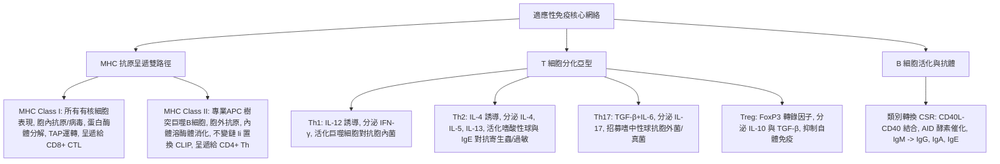
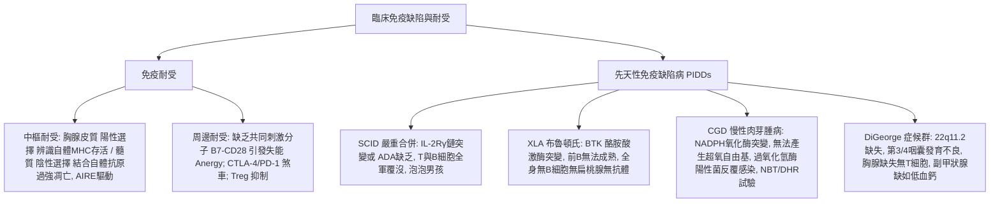
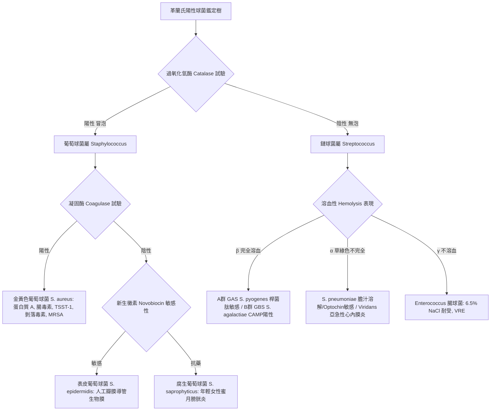
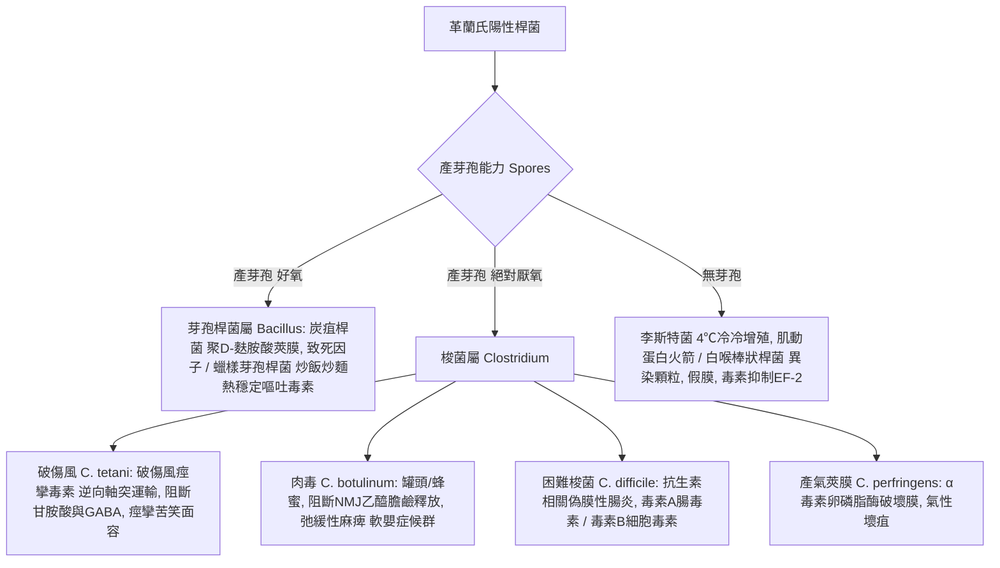
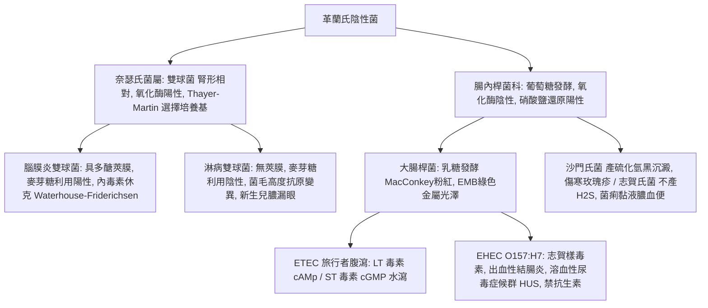
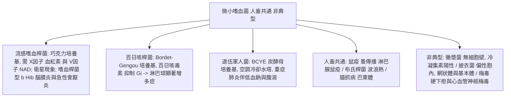
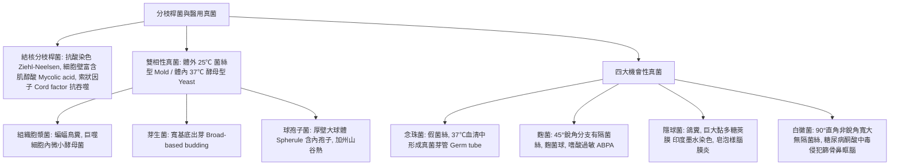
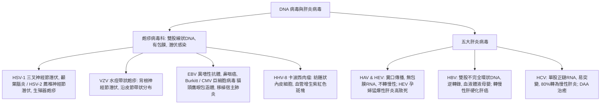
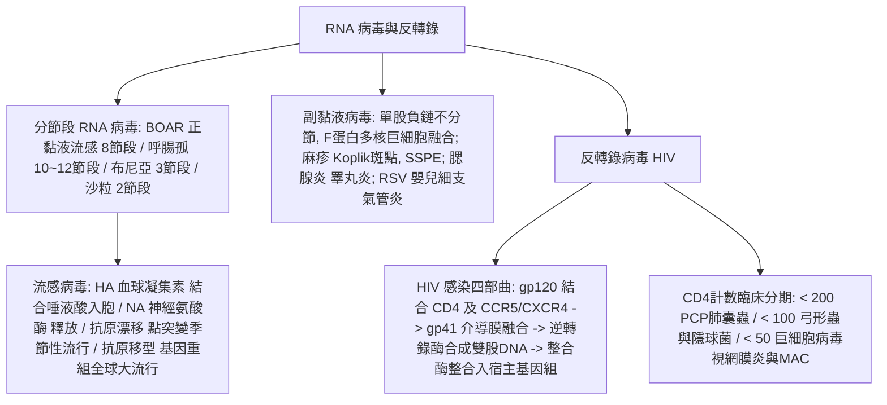

# 醫師專技高考一階段：微生物學與免疫學 考前衝刺手冊

> **考科卷別**：醫學（一） ｜ **題號範圍**：Q57 ~ Q94 (約 38 題)
>
> **複習導引**：題數最多投報率最高！掌握革蘭氏陰陽性菌毒力、病毒分類、補體系統與T/B細胞免疫。

---

## 本科目章節目錄

1. [微生物與免疫學 第01章 基礎免疫學：固有免疫、模式識別受體與補體系統](#chapter-1)
2. [微生物與免疫學 第02章 基礎免疫學：體液與細胞適應性免疫、MHC與細胞激素](#chapter-2)
3. [微生物與免疫學 第03章 臨床免疫學：免疫耐受、自體免疫與先天免疫缺陷病](#chapter-3)
4. [微生物與免疫學 第04章 細菌學總論與革蘭氏陽性球菌](#chapter-4)
5. [微生物與免疫學 第05章 革蘭氏陽性桿菌與厭氧菌](#chapter-5)
6. [微生物與免疫學 第06章 革蘭氏陰性球菌與腸內桿菌科](#chapter-6)
7. [微生物與免疫學 第07章 人畜共通小桿菌、螺桿菌與非典型菌群](#chapter-7)
8. [微生物與免疫學 第08章 分枝桿菌屬與醫用真菌學](#chapter-8)
9. [微生物與免疫學 第09章 醫用病毒學：DNA 病毒與肝炎病毒](#chapter-9)
10. [微生物與免疫學 第10章 醫用病毒學：RNA 病毒與反轉錄病毒](#chapter-10)

---

<a id="chapter-1"></a>

<!-- CHAPTER 1 START -->

# 微生物與免疫學 第01章 基礎免疫學：固有免疫、模式識別受體與補體系統

## 核心知識體系架構
免疫學是人體對抗病原體入侵與維持自體恆定之防衛科學。固有免疫（Innate Immunity）為第一道防線，涵蓋物理化學屏障；模式識別受體（PRRs：TLRs, NLRs/發炎體 Inflammasome）；固有免疫細胞（嗜中性球、巨噬細胞、樹突細胞 DC、自然殺手細胞 NK）；以及補體系統（三條活化途徑、攻膜複合體 MAC、調節蛋白與遺傳缺陷）。

```mermaid
flowchart TD
    Innate[固有免疫系統體系] --> PRR[模式識別受體 PRRs]
    PRR --> TLRs[類鐸受體 TLRs: TLR4 結合 LPS 內毒素 / TLR3 dsRNA / TLR7/8 ssRNA / TLR9 CpG DNA]
    PRR --> NLRs[NOD樣受體 NLRs: NLRP3 發炎體 活化 Caspase-1 -> 剪切成熟 IL-1β 與 IL-18]
    Innate --> Cells[固有免疫細胞]
    Cells --> Phagocytes[吞噬細胞: 嗜中性球 呼吸爆發 NADPH氧化酶 / 巨噬細胞 抗原呈遞]
    Cells --> NK[NK細胞: 穿孔素/顆粒酶; 殺手活化受體 KAR vs. 殺手抑制受體 KIR 辨識 MHC I 喪失]
    Innate --> Complement[補體系統三途徑]
    Complement --> Classical[古典途徑: 免疫複合物 IgM/IgG 結合 C1q -> C4b2a C3轉化酶]
    Complement --> Lectin[凝集素途徑: MBL 結合細菌甘露糖 -> MASP -> C4b2a]
    Complement --> Alternative[替代途徑: 自發性水解 C3(H2O) -> 結合因子B -> C3bBb C3轉化酶]
    Complement --> Terminal[末端共同途徑: C5轉化酶 -> C5b 招募 C6~C9 形成 MAC 溶菌孔道]
```

---

## 主題一：模式識別受體（PRRs）與病原相關分子模式（PAMPs）

### 1. 類鐸受體（Toll-Like Receptors, TLRs）分佈與配體矩陣
| TLR 受體型別 | 細胞定位（細胞膜表面 vs. 胞內內體 Endosome） | 專一性辨識之病原體配體（PAMPs） | 胞內信號轉接蛋白 | 最終活化之轉錄因子與效應 |
| :--- | :--- | :--- | :--- | :--- |
| **TLR4** | **細胞膜表面（Cell surface）**（需輔助蛋白 MD-2 與 CD14） | **革蘭氏陰性菌外膜之脂多醣（Lipopolysaccharide, LPS / 內毒素）** | **MyD88** 與 TRIF 雙途徑 | 活化 **NF-$\kappa$B** $\to$ 爆發性分泌促炎細胞因子（TNF-$\alpha$, IL-1, IL-6），引發敗血性休克！ |
| **TLR2** | 細胞膜表面（常與 TLR1 或 TLR6 形成異二聚體） | 革蘭氏陽性菌**胜肽聚醣（Peptidoglycan）**、脂磷壁酸（LTA）、分枝桿菌脂阿拉伯甘露聚糖 | MyD88 | 活化 NF-$\kappa$B，促進抗菌胜肽生成。 |
| **TLR5** | 細胞膜表面 | **細菌鞭毛蛋白（Flagellin）** | MyD88 | 啟動黏膜防禦。 |
| **TLR3** | **細胞內胞內體膜（Endosomal membrane）** | **病毒雙股 RNA（dsRNA）**（許多 RNA 病毒複製中間產物） | **TRIF 途徑（唯一的非 MyD88 相依 TLR！）** | 活化 **IRF3** $\to$ 大量誘導合成抗病毒之 **I 型干擾素（IFN-$\alpha$ / IFN-$\beta$）**！ |
| **TLR7 / TLR8** | **細胞內胞內體膜** | **病毒單股 RNA（ssRNA）**（如流感病毒、HIV） | MyD88 | 誘導生成 IFN-$\alpha$。 |
| **TLR9** | **細胞內胞內體膜** | **未甲基化之胞嘧啶-鳥嘌呤二核苷酸（Unmethylated CpG DNA）**（細菌與 DNA 病毒特徵） | MyD88 | 活化漿細胞樣樹突細胞（pDCs）產生巨量 I 型干擾素。 |

---

## 主題二：補體系統（Complement System）三大活化途徑與調節缺陷

### 1. 補體三途徑關鍵分子酶複合物對照表
| 活化途徑特徵 | 古典途徑（Classical Pathway） | 凝集素途徑（Lectin Pathway） | 替代途徑（Alternative Pathway） |
| :--- | :--- | :--- | :--- |
| **起始觸發刺激物** | **抗原-抗體免疫複合物**（**1 個分子 $IgM$ 或至少 2 個相鄰 $IgG$** [$IgG3 > IgG1 > IgG2$] 結合於 C1q） | **甘露糖結合凝集素（MBL）** 結合於微生物表面之甘露糖或 $N$-乙醯葡萄糖胺殘基 | **細菌/真菌表面多糖外壁**（自發性慢速水解「滴答（Tickover）」產生 $C3(H_2O)$） |
| **專屬起始活化酶** | **C1 複合物（$C1q, C1r, C1s$）** | **MASP-1 與 MASP-2**（MBL 相關絲胺酸蛋白酶） | **因子 B（Factor B）與因子 D（Factor D）** |
| **C3 轉化酶（C3 Convertase）** | **$C4b2a$**（裂解大量 C3 為 C3a 與 C3b） | **$C4b2a$** | **$C3bBb$**（極不穩定，需 **Properdin 備解素** 結合穩定） |
| **C5 轉化酶（C5 Convertase）** | **$C4b2a3b$**（裂解 C5 為 C5a 與 C5b） | **$C4b2a3b$** | **$C3bBb3b$** |
| **末端攻膜複合體（MAC）** | **$C5b + C6 + C7 + C8 + \text{多聚 } C9$** $\to$ 形成直徑 $10\text{ nm}$ 穿膜水溶性孔道，水與離子湧入導致靶細胞滲透性溶解！ |
| **三大過敏毒素活性** | **$C5a > C3a > C4a$**（促肥大細胞脫顆粒釋放組織胺，增加血管通透性；**$C5a$ 同時為最強嗜中性球趨化因子**！）。 |
| **調理作用（Opsonization）** | **$C3b$ 與 $iC3b$**（結合於細菌表面，被吞噬細胞表面 CR1 受體辨識，大幅促進吞噬）。 |

### 2. 補體調節蛋白缺陷與臨床疾病
- **C1 酯酶抑制劑（C1-INH）缺乏**：
  - **遺傳性血管水腫（Hereditary Angioedema, HAE）**：常染色體顯性遺傳。缺乏 C1-INH 導致激肽釋放酶過度活化，**緩激肽（Bradykinin）大量生成**，引發反覆急性非凹陷性皮下水腫、腹痛及致命性**喉頭水腫窒息（無蕁麻疹發癢！）**。
- **衰變加速因子（DAF / CD55）與反應性溶血抑制物（CD59 / MIRL）缺乏**：
  - **陣發性夜間血紅素尿症（PNH）**：造血幹細胞後天體細胞 **$PIGA$ 基因突變**，導致 GPI 錨定蛋白合成缺陷，紅血球表面失去 CD55 與 CD59 防護，**紅血球在夜間微酸環境下被自身補體 MAC 溶解**！表現為清晨茶色尿、血栓形成。
- **末端補體成分（C5 ~ C9）缺乏**：
  - 無法組裝 MAC，病人對 **奈瑟氏菌屬（Neisseria meningitidis 腦膜炎雙球菌、N. gonorrhoeae 淋病雙球菌）反覆侵襲性感染極度易感**！

---

## 主題三：自然殺手細胞（NK Cells）之「自我丟失（Missing-Self）」假說

### 1. NK 細胞活化與抑制平衡
- **標記分子**：**CD16（Fc$\gamma$RIII）** 及 **CD56**（NCAM），不具備 TCR 或 CD3。
- **雙重受體調控體系**：
  - **殺手抑制受體（Killer Inhibitory Receptors, KIRs）**：專一性結合正常自體細胞表面的 **MHC Class I 分子（HLA-A, B, C）**。正常細胞高表現 MHC I，發出強烈「別吃我/別殺我」抑制信號。
  - **殺手活化受體（Killer Activating Receptors, KARs）**：結合異常細胞表面應激分子（如 MICA, MICB）。
- **「丟失自我」辨識殺傷**：
  - 當病毒感染或癌變細胞為了逃避 CD8+ CTL 追殺而故意「下調或隱藏表面 MHC Class I」時，NK 細胞的 KIR 抑制信號瞬間解除，活化信號佔據主導，NK 細胞立即釋放 **穿孔素（Perforin）與顆粒酶（Granzyme）** 將該細胞溶解消滅！
- **抗體依賴性細胞毒性（ADCC）**：
  - NK 細胞表面之 **CD16** 專一性結合已結合於標靶細胞表面之 **$IgG$ 抗體的 Fc 段**，引發專一性直接定向殺傷！

---

## 歷屆國考核心真題解析

### 【國考經典真題實戰】
**【試題編號】110-第二次-第一階段-med2-001**
> **題目**：患者經電腦斷層掃描發現肝膿瘍（liver abscesses），從膿瘍處培養出一株厭氧性革蘭氏陰性菌，具 多形性（pleomorphic）的形態，此菌會產生一種外毒素（exotoxin）屬於鋅螯合蛋白酶（Zinc metalloprotease）。最可能是下列何種菌株？
- (A) 痤瘡丙酸桿菌（Propionibacterium acnes）
- (B) 動物雙岐桿菌（Bifidobacterium animalis）
- (C) 脆弱擬桿菌（Bacteroides fragilis）
- (D) 牙齦紫質單胞菌（Porphyromonas gingivalis）

> **標準答案**：`C`
> 
> **【考點深度解析與選項拆解】**：
- **(A) 選項分析**：痤瘡丙酸桿菌（Propionibacterium acnes）。核對免疫細胞表面分子標記（如 CD 分子）、抗體亞型特性或補體途徑活化順序，驗證其符合度。
- **(B) 選項分析**：動物雙岐桿菌（Bifidobacterium animalis）。比對細胞激素（Cytokine）特異性功能、MHC 分子呈遞限制性或免疫缺陷致病基因，剖析誘答盲區。
- **(C) 選項分析**：脆弱擬桿菌（Bacteroides fragilis）。檢驗中樞與周邊耐受機制（AIRE / FoxP3 Treg）或過敏反應型別，排除干擾選項。
- **(D) 選項分析**：牙齦紫質單胞菌（Porphyromonas gingivalis）。綜合抗原辨識受體重組（RAG1/2）或胞內殺菌活性氧生成，確認題幹命題之免疫學核心。
> **【國考核心解題金鑰】**：本題標準答案為 **(C)**。考生須融會貫通補體三條途徑 C3 轉化酶、Th1/Th2/Th17 細胞因子網絡及原發免疫缺陷病之特徵，即可秒殺奪冠。

---
### 【國考經典真題實戰】
**【試題編號】110-第二次-第一階段-med2-002**
> **題目**：下列何種類型的痲瘋病主要會造成臉部損害變形？
- (A) 類結核型痲瘋病（tuberculoid leprosy）
- (B) 中間型痲瘋病（intermediate leprosy）
- (C) 腫瘤型痲瘋病（lepromatous leprosy）
- (D) 丘疹型痲瘋病（papular leprosy）

> **標準答案**：`C`
> 
> **【考點深度解析與選項拆解】**：
- **(A) 選項分析**：類結核型痲瘋病（tuberculoid leprosy）。核對免疫細胞表面分子標記（如 CD 分子）、抗體亞型特性或補體途徑活化順序，驗證其符合度。
- **(B) 選項分析**：中間型痲瘋病（intermediate leprosy）。比對細胞激素（Cytokine）特異性功能、MHC 分子呈遞限制性或免疫缺陷致病基因，剖析誘答盲區。
- **(C) 選項分析**：腫瘤型痲瘋病（lepromatous leprosy）。檢驗中樞與周邊耐受機制（AIRE / FoxP3 Treg）或過敏反應型別，排除干擾選項。
- **(D) 選項分析**：丘疹型痲瘋病（papular leprosy）。綜合抗原辨識受體重組（RAG1/2）或胞內殺菌活性氧生成，確認題幹命題之免疫學核心。
> **【國考核心解題金鑰】**：本題標準答案為 **(C)**。考生須融會貫通補體三條途徑 C3 轉化酶、Th1/Th2/Th17 細胞因子網絡及原發免疫缺陷病之特徵，即可秒殺奪冠。

---
### 【國考經典真題實戰】
**【試題編號】110-第二次-第一階段-med2-003**
> **題目**：磺胺類藥物（sulfonamides）能選擇性抑制細菌生長，對哺乳類細胞不具有明顯毒性之原因為：
- (A) 哺乳類細胞無胜肽聚糖結構（peptidoglycan）
- (B) 哺乳類細胞膜不含固醇（sterols）
- (C) 哺乳類細胞不合成葉酸（folic acid）
- (D) 哺乳類細胞具有核糖體（ribosome）

> **標準答案**：`C`
> 
> **【考點深度解析與選項拆解】**：
- **(A) 選項分析**：哺乳類細胞無胜肽聚糖結構（peptidoglycan）。核對免疫細胞表面分子標記（如 CD 分子）、抗體亞型特性或補體途徑活化順序，驗證其符合度。
- **(B) 選項分析**：哺乳類細胞膜不含固醇（sterols）。比對細胞激素（Cytokine）特異性功能、MHC 分子呈遞限制性或免疫缺陷致病基因，剖析誘答盲區。
- **(C) 選項分析**：哺乳類細胞不合成葉酸（folic acid）。檢驗中樞與周邊耐受機制（AIRE / FoxP3 Treg）或過敏反應型別，排除干擾選項。
- **(D) 選項分析**：哺乳類細胞具有核糖體（ribosome）。綜合抗原辨識受體重組（RAG1/2）或胞內殺菌活性氧生成，確認題幹命題之免疫學核心。
> **【國考核心解題金鑰】**：本題標準答案為 **(C)**。考生須融會貫通補體三條途徑 C3 轉化酶、Th1/Th2/Th17 細胞因子網絡及原發免疫缺陷病之特徵，即可秒殺奪冠。


---

<br>

<a id="chapter-2"></a>

<!-- CHAPTER 2 START -->

# 微生物與免疫學 第02章 基礎免疫學：體液與細胞適應性免疫、MHC與細胞激素

## 核心知識體系架構
適應性免疫（Adaptive Immunity）具備高度抗原專一性（Specificity）與免疫記憶性（Memory）。本章統整 MHC Class I 與 Class II 抗原呈遞雙軌路徑；T 細胞發育（胸腺陽性與陰性選擇）與 TCR 基因重組（$V(D)J$ 重排）；輔助性 T 細胞分化亞型（Th1, Th2, Th17, Treg, Tfh）與特異性細胞因子網絡；B 細胞發育、抗體類別轉換（Class Switch Recombination, CSR）與體細胞高頻突變（SHM）。



---

## 主題一：MHC Class I vs. MHC Class II 抗原加工與呈遞雙軌對比

### 1. MHC 結構、分佈與呈遞路徑精密矩陣
| 比較維度 | MHC Class I | MHC Class II |
| :--- | :--- | :--- |
| **分子結構組成** | **一條重鏈（$\alpha$ 鏈，由 HLA-A, B, C 編碼，含 $\alpha_1, \alpha_2, \alpha_3$）** 合併 **一條非多態性 $\beta_2$-微球蛋白（$\beta_2$-microglobulin，第 15 號染色體）** | **一條 $\alpha$ 鏈（$\alpha_1, \alpha_2$）** 與 **一條 $\beta$ 鏈（$\beta_1, \beta_2$）**（由 HLA-DP, DQ, DR 編碼） |
| **抗原結合裂隙（Peptide-binding cleft）** | 由 **$\alpha_1$ 與 $\alpha_2$ 結構域** 閉合構成，容納 **8 ~ 10 個胺基酸** 短胜肽 | 由 **$\alpha_1$ 與 $\beta_1$ 結構域** 開放兩端構成，容納 **13 ~ 25 個胺基酸** 較長胜肽 |
| **細胞分佈範圍** | **人體所有有核細胞（All nucleated cells）及血小板**（成熟無核紅血球完全不表現！） | **僅限專業抗原呈遞細胞（Professional APCs）：樹突細胞（DCs，最強！）、巨噬細胞、B 淋巴球** |
| **抗原來源與加工途徑** | **內源性抗原（Endogenous antigens）**（細胞質合成的病毒蛋白、胞內菌、腫瘤突變蛋白） | **外源性抗原（Exogenous antigens）**（經吞噬/胞飲攝入的胞外菌、真菌、可溶性抗原） |
| **抗原消化水解工廠** | 細胞質內的 **蛋白酶體（Proteasome）** 水解為胜肽短鏈 | 內體-溶酶體（Endosome-Lysosome）內之酸性蛋白酶水解 |
| **胜肽運載與裝載器** | 經 **TAP（抗原加工相關轉運體）** 主動泵入粗糙內質網（RER），裝載於剛組裝的 MHC I 上 | RER 內 MHC II 與 **不變鏈（Invariant chain, Ii）** 結合堵塞裂隙，進入溶酶體被消化保留 **CLIP**，經 **HLA-DM** 催化將 CLIP 卸下並換上外源胜肽！ |
| **呈遞受體與對接共受體** | 呈遞給 **CD8+ 細胞毒性 T 淋巴球（CTL）**；CD8 直接結合於 MHC I 的 **$\alpha_3$ 結構域** | 呈遞給 **CD4+ 輔助性 T 淋巴球（Th）**；CD4 直接結合於 MHC II 的 **$\beta_2$ 結構域** |

> [!TIP]
> **【MHC 乘法法則口訣：CD $\times$ MHC = 8】**
> - $CD4 \times MHC\ II = 8$
> - $CD8 \times MHC\ I = 8$

---

## 主題二：輔助性 T 細胞（CD4+ Helper T Cells）五大亞型

### 1. Th1, Th2, Th17, Treg 與 Tfh 免疫極化全景圖
| T 輔助細胞亞型 | 誘發分化之關鍵細胞因子 | 特異性主控轉錄因子（Master Regulator） | 特徵分泌之代表性細胞激素（Signature Cytokines） | 核心免疫防禦功能與相關病理 |
| :--- | :--- | :--- | :--- | :--- |
| **Th1 細胞** | **IL-12**（樹突細胞/巨噬細胞分泌）及 **IFN-$\gamma$** | **T-bet** | **IFN-$\gamma$、IL-2、TNF-$\alpha$** | **細胞介導免疫（Cell-mediated）**：IFN-$\gamma$ 強烈活化巨噬細胞，專司消滅**胞內病原體（結核分枝桿菌、李斯特菌、利什曼原蟲）**；介導 Type IV 延遲型過敏與肉芽腫。 |
| **Th2 細胞** | **IL-4** | **GATA-3** | **IL-4、IL-5、IL-13** | **體液與黏膜防禦**：<br>- **IL-4**：誘導 B 細胞進行 **$IgE$ 類別轉換**。<br>- **IL-5**：活化並招募 **嗜酸性球（Eosinophils）**。<br>- **IL-13**：促進杯狀細胞分泌黏液與平滑肌收縮。<br>專門對抗**寄生蠕蟲（Helminths）**；介導氣喘與過敏性鼻炎。 |
| **Th17 細胞** | **TGF-$\beta$ 合併 IL-6**（維持依賴 IL-23） | **ROR$\gamma t$** | **IL-17（IL-17A/F）、IL-22** | **招募大量嗜中性球**：抵禦**胞外細菌（金黃色葡萄球菌）與真菌（念珠菌 Candida）**。過度活化參與乾癬、類風濕性關節炎及僵直性脊椎炎。 |
| **Treg（調節性 T 細胞）** | **TGF-$\beta$ 及 IL-2** | **FoxP3** | **IL-10、TGF-$\beta$** | **主動免疫抑制**：維持周邊自身免疫耐受，防止自體免疫疾病。**FoxP3 突變引發 IPEX 症候群**（幼童嚴重自體免疫腸病變、第 1 型糖尿病、濕疹）。表面標記為 **CD4+ CD25+ FoxP3+**。 |
| **Tfh（濾泡輔助 T 細胞）** | IL-6 | Bcl-6 | IL-21 | 進入淋巴濾泡生發中心，協助 B 細胞活化、體細胞高頻突變與親和力成熟。表面標記 CXCR5。 |

---

## 主題三：B 細胞活化與免疫球蛋白（IgG, IgA, IgM, IgE, IgD）

### 1. 免疫球蛋白五大同種型（Isotypes）生物學特性矩陣
| 抗體同種型 | 分子存在形式（單體 vs. 多聚體） | 血清含量佔比 | 半衰期 | 胎盤穿透性 | 補體古典途徑活化能力 | 核心特異功能與臨床考點 |
| :--- | :--- | :--- | :--- | :--- | :--- | :--- |
| **$IgG$** | **單體（Monomer）** | **最高（佔 75~80%）** | 最長（約 23 天） | **唯一能穿透胎盤之抗體！**（經滋養層 FcRn 主動轉運，保護新生兒前 6 個月） | 強（$IgG3 > IgG1 > IgG2$） | 次發性免疫應答之主力抗體；具強大調理作用（Opsonization）與 ADCC 殺傷。 |
| **$IgA$** | 血液中為單體；**外分泌液中為雙體（Dimer）**（含 **J 鏈** 與 **分泌成分 Secretory component**） | 次高（佔 10~15%） | 約 6 天 | 否 | 無（可活化替代途徑） | **黏膜免疫絕對主角**！大量存在於**初乳（Colostrum）、唾液、淚液、呼吸道及腸胃道分泌液**，阻止病原體黏附於黏膜上皮。分泌成分防止其被消化酶降解。 |
| **$IgM$** | B 細胞膜表面為單體（BCR）；**血清中為巨型五聚體（Pentamer）**（含 **J 鏈**，具 10 個抗原結合位） | 佔 5~10% | 約 5 天 | 否 | **最強（單一分子 IgM 即可活化 C1q！）** | **初次免疫應答（Primary response）最先產生的抗體**！宮內感染（TORCH）之特異確診標記（因分子量達 90 萬無法跨越胎盤）。 |
| **$IgE$** | 單體（Monomer） | 血清含量最低（$< 0.001\%$） | 最短（約 2 天） | 否 | 無 | 高親和力結合肥大細胞與嗜鹼性球表面 $Fc\epsilon RI$；介導 **Type I 立即型過敏反應** 與 **對抗寄生蟲感染**。 |
| **$IgD$** | 單體 | 微量 | 約 3 天 | 否 | 無 | 與 IgM 共同表現於**未接觸抗原的成熟初始 B 細胞（Naive B cells）表面**，作為抗原受體（BCR）。 |

---

## 歷屆國考核心真題解析

### 【國考經典真題實戰】
**【試題編號】111-第一次-med2-002**
> **題目**：培養下列何種微生物只能在含氮氣的操作箱中操作，或以厭氧系統培養才可生長？
- (A) 仙人掌桿菌（Bacillus cereus）
- (B) 破傷風桿菌（Clostridium tetani）
- (C) 金黃色葡萄球菌（Staphylococcus aureus）
- (D) 李斯特菌（Listeria monocytogenes）

> **標準答案**：`B`
> 
> **【考點深度解析與選項拆解】**：
- **(A) 選項分析**：仙人掌桿菌（Bacillus cereus）。核對免疫細胞表面分子標記（如 CD 分子）、抗體亞型特性或補體途徑活化順序，驗證其符合度。
- **(B) 選項分析**：破傷風桿菌（Clostridium tetani）。比對細胞激素（Cytokine）特異性功能、MHC 分子呈遞限制性或免疫缺陷致病基因，剖析誘答盲區。
- **(C) 選項分析**：金黃色葡萄球菌（Staphylococcus aureus）。檢驗中樞與周邊耐受機制（AIRE / FoxP3 Treg）或過敏反應型別，排除干擾選項。
- **(D) 選項分析**：李斯特菌（Listeria monocytogenes）。綜合抗原辨識受體重組（RAG1/2）或胞內殺菌活性氧生成，確認題幹命題之免疫學核心。
> **【國考核心解題金鑰】**：本題標準答案為 **(B)**。考生須融會貫通補體三條途徑 C3 轉化酶、Th1/Th2/Th17 細胞因子網絡及原發免疫缺陷病之特徵，即可秒殺奪冠。

---
### 【國考經典真題實戰】
**【試題編號】111-第一次-med2-003**
> **題目**：白喉桿菌（Corynebacterium diphtheriae）的白喉毒素的B次單元與宿主細胞接受器結合，接著A次單元進入細 胞，與細胞的那一個蛋白質結合，進而抑制蛋白質合成？
- (A) 核糖體（Ribosome）40S次單元（subunit）
- (B) 核糖體（Ribosome）60S次單元（subunit）
- (C) 延長因子（Elongation factor）-2（EF-2）
- (D) 延長因子（Elongation factor）-3（EF-3）

> **標準答案**：`C`
> 
> **【考點深度解析與選項拆解】**：
- **(A) 選項分析**：核糖體（Ribosome）40S次單元（subunit）。核對免疫細胞表面分子標記（如 CD 分子）、抗體亞型特性或補體途徑活化順序，驗證其符合度。
- **(B) 選項分析**：核糖體（Ribosome）60S次單元（subunit）。比對細胞激素（Cytokine）特異性功能、MHC 分子呈遞限制性或免疫缺陷致病基因，剖析誘答盲區。
- **(C) 選項分析**：延長因子（Elongation factor）-2（EF-2）。檢驗中樞與周邊耐受機制（AIRE / FoxP3 Treg）或過敏反應型別，排除干擾選項。
- **(D) 選項分析**：延長因子（Elongation factor）-3（EF-3）。綜合抗原辨識受體重組（RAG1/2）或胞內殺菌活性氧生成，確認題幹命題之免疫學核心。
> **【國考核心解題金鑰】**：本題標準答案為 **(C)**。考生須融會貫通補體三條途徑 C3 轉化酶、Th1/Th2/Th17 細胞因子網絡及原發免疫缺陷病之特徵，即可秒殺奪冠。

---
### 【國考經典真題實戰】
**【試題編號】111-第一次-med2-004**
> **題目**：下列何種抗生素不是經由抑制細菌蛋白質生合成，達到抑制細菌生長或殺菌之作用？
- (A) 卡納黴素（kanamycin）
- (B) 克林黴素（clindamycin）
- (C) 硝基甲嘧唑乙醇（metronidazole）
- (D) 四環素（tetracycline）

> **標準答案**：`C`
> 
> **【考點深度解析與選項拆解】**：
- **(A) 選項分析**：卡納黴素（kanamycin）。核對免疫細胞表面分子標記（如 CD 分子）、抗體亞型特性或補體途徑活化順序，驗證其符合度。
- **(B) 選項分析**：克林黴素（clindamycin）。比對細胞激素（Cytokine）特異性功能、MHC 分子呈遞限制性或免疫缺陷致病基因，剖析誘答盲區。
- **(C) 選項分析**：硝基甲嘧唑乙醇（metronidazole）。檢驗中樞與周邊耐受機制（AIRE / FoxP3 Treg）或過敏反應型別，排除干擾選項。
- **(D) 選項分析**：四環素（tetracycline）。綜合抗原辨識受體重組（RAG1/2）或胞內殺菌活性氧生成，確認題幹命題之免疫學核心。
> **【國考核心解題金鑰】**：本題標準答案為 **(C)**。考生須融會貫通補體三條途徑 C3 轉化酶、Th1/Th2/Th17 細胞因子網絡及原發免疫缺陷病之特徵，即可秒殺奪冠。


---

<br>

<a id="chapter-3"></a>

<!-- CHAPTER 3 START -->

# 微生物與免疫學 第03章 臨床免疫學：免疫耐受、自體免疫與先天免疫缺陷病

## 核心知識體系架構
臨床免疫學為國考必考高難度單元。涵蓋中樞耐受（胸腺陽性與陰性選擇、自體免疫調節因子 AIRE）vs. 周邊耐受（失能 Anergy、Treg 抑制、凋亡）；HLA 與自體免疫疾病強烈關聯（HLA-B27, DR2, DR3, DR4）；以及原發性先天免疫缺陷病（PIDDs：嚴重合併免疫缺陷 SCID、X 性聯無丙種球蛋白血症 XLA、慢性肉芽腫病 CGD、高 IgM 症候群、DiGeorge 症候群）。



---

## 主題一：原發性先天免疫缺陷疾病（PIDDs）精密診斷矩陣

### 1. 國考五大經典免疫缺陷病病因與特徵表
| 疾病名稱 | 遺傳模式與突變分子標靶 | 缺陷免疫細胞族群 | 臨床感染特徵與發病時間 | 實驗室檢查與特異診斷標記 |
| :--- | :--- | :--- | :--- | :--- |
| **嚴重合併免疫缺陷症 (SCID)** | 1. **X 性聯隱性（佔 50%）**：**$IL2RG$ 基因突變**（$\gamma_c$ 共有鏈缺陷，IL-2, 4, 7, 9, 15, 21 受體均失效）。<br>2. **體染色體隱性**：**腺苷脫氨酶（ADA）缺乏**（毒性 dATP 蓄積毒死淋巴球）。 | **T 細胞與 NK 細胞完全缺失**；B 細胞數目正常或下降但**完全無功能（無抗體）** | 嬰兒出生數月內（母體抗體衰減後）即出現**反覆致死性嚴重全身感染（細菌、病毒、真菌念珠菌、PCP 肺炎）**、頑固性腹瀉、生長遲滯。 | **胸腺影完全缺如（Absent thymic shadow）**、淋巴結無生發中心；血液白血球計數中淋巴球極度低下。需嚴格無菌隔離（泡泡兒），造血幹細胞移植為唯一治癒途徑。 |
| **X 性聯無丙種球蛋白血症 (XLA / Bruton's Disease)** | **X 性聯隱性遺傳**；**$BTK$（布魯頓酪胺酸激酶）基因突變** | **前 B 細胞（Pre-B）無法發育成熟為初始 B 細胞**。T 細胞數目與功能完全正常！ | 男嬰於 6 個月大後反覆發生**有莢膜化膿性細菌（肺炎鏈球菌、流感嗜血桿菌）之呼吸道感染**；對腸病毒易感。 | **血液中所有同種型免疫球蛋白（IgG, A, M, E, D）幾乎為零**！周邊血 **CD19+ / CD20+ B 細胞數目幾乎為 0**！**扁桃腺與周邊淋巴結極度微小發育不全**。 |
| **慢性肉芽腫病 (CGD / Chronic Granulomatous Disease)** | **X 性聯隱性為主（佔 70%）**；**$CYBB$ 突變缺陷導致 $NADPH$ 氧化酶（Phagocyte Oxidase）功能喪失** | 吞噬細胞（嗜中性球與巨噬細胞）數目正常，但**無法產生超氧陰離子（$O_2^-$）與活性氧（ROS），呼吸爆發（Respiratory burst）完全癱瘓**！ | 反覆發生化膿性感染與多器官肉芽腫形成（淋巴結、肝、肺、骨骼）。**專門對 5 大「過氧化氫酶陽性菌（Catalase-positive）」極度易感**！ | **過氧化氫酶陽性菌五天王（國考必考！）**：<br>1. **金黃色葡萄球菌（S. aureus）**<br>2. **綠膿桿菌（P. aeruginosa）**<br>3. **洋蔥伯克氏菌（B. cepacia）**<br>4. **諾卡氏菌（Nocardia）**<br>5. **麴菌（Aspergillus）**。<br>**確診試驗**：二氫羅丹明試驗（DHR 流式細胞儀）無螢光，或四氮唑藍試驗（NBT）不變色。 |
| **高 IgM 症候群 (Hyper-IgM Syndrome)** | **X 性聯隱性**；活化 T 細胞表面之 **$CD40L$（CD154）基因突變** | B 細胞數目正常，但**無法進行免疫球蛋白類別轉換（CSR）與體細胞高頻突變** | 嬰幼兒期反覆嚴重細菌感染與機會性感染（PCP 肺囊蟲肺炎首選好發！）。 | **血清 $IgM$ 濃度正常或顯著異常飆升**；但 **$IgG$、$IgA$、$IgE$ 極度低下甚至測不到**！生發中心缺失。 |
| **迪喬治症候群 (DiGeorge Syndrome)** | **第 22 號染色體長臂微缺失（22q11.2 microdeletion）**；胚胎發育異常 | **第 3 與第 4 咽囊（Pharyngeal pouches）發育不全** $\to$ **胸腺發育不全或缺如（Thymic aplasia）** $\to$ **T 細胞成熟障礙**；B 細胞數目正常但缺乏 T 輔助。 | 易患病毒、真菌與細胞內病原體感染；副甲狀腺缺如導致**嚴重低血鈣與手足抽搐（Tetany）**；伴隨先天性心臟畸形（法洛氏四重症、主動脈弓異常）。 | **X 光下胸腺影完全消失**；CD3+ T 細胞極度低下；血鈣過低、血磷過高、PTH 為零。 |

---

## 主題二：人類白血球抗原（HLA）與自體免疫疾病強烈關聯

### 1. 國考必背 HLA 對偶基因與疾病速查表
- **HLA-B27（Class I 分子，關聯度最高！）**：
  - **血清陰性脊椎關節病變（Seronegative Spondyloarthropathies, PAIR）**：
    - **P**soriatic arthritis（乾癬性關節炎）
    - **A**nkylosing spondylitis（**僵直性脊椎炎，關聯度高達 90~95%！**）
    - **I**BD-associated arthritis（發炎性腸道疾病關節炎）
    - **R**eactive arthritis（反應性關節炎 / Reiter 症候群：尿道炎、結膜炎、關節炎三聯徵）。
- **HLA-DR4（Class II 分子）**：
  - **類風濕性關節炎（Rheumatoid Arthritis, RA）**
  - **第 1 型糖尿病（Type 1 Diabetes Mellitus, T1DM）**。
- **HLA-DR3**：
  - 第 1 型糖尿病（DR3/DR4 雜合子風險最高！）、全身性紅斑狼瘡（SLE）、Hashimoto 甲狀腺炎。
- **HLA-DR2**：
  - 多發性硬化症（Multiple Sclerosis, MS）、古德帕斯徹症候群（Goodpasture syndrome）。
- **HLA-DQ2 / HLA-DQ8**：
  - **乳糜瀉（Celiac Disease / 麩質敏感性腸病）**（陰性預測值幾近 100%）。

---

## 歷屆國考核心真題解析

### 【國考經典真題實戰】
**【試題編號】111-第一次-med2-012**
> **題目**：新型抗流感病毒藥物紓伏效（baloxavir marboxil）抑制對象為何？
- (A) PB2
- (B) M2
- (C) HA
- (D) NA

> **標準答案**：`#`
> 
> **【考點深度解析與選項拆解】**：
- **(A) 選項分析**：PB2。核對免疫細胞表面分子標記（如 CD 分子）、抗體亞型特性或補體途徑活化順序，驗證其符合度。
- **(B) 選項分析**：M2。比對細胞激素（Cytokine）特異性功能、MHC 分子呈遞限制性或免疫缺陷致病基因，剖析誘答盲區。
- **(C) 選項分析**：HA。檢驗中樞與周邊耐受機制（AIRE / FoxP3 Treg）或過敏反應型別，排除干擾選項。
- **(D) 選項分析**：NA。綜合抗原辨識受體重組（RAG1/2）或胞內殺菌活性氧生成，確認題幹命題之免疫學核心。
> **【國考核心解題金鑰】**：本題標準答案為 **(#)**。考生須融會貫通補體三條途徑 C3 轉化酶、Th1/Th2/Th17 細胞因子網絡及原發免疫缺陷病之特徵，即可秒殺奪冠。

---
### 【國考經典真題實戰】
**【試題編號】111-第一次-med2-013**
> **題目**：有關疱疹病毒（Herpesvirus）與其相關疾病之配對，下列何者錯誤？
- (A) 單純疱疹病毒一型（HSV-1）：疱疹性腦炎（herpes encephalitis）
- (B) EB病毒（Epstein-Barr virus）：單核球增多症（mononucleosis）
- (C) 水痘病毒（VZV）：帶狀疱疹
- (D) 人類疱疹病毒六型（HHV-6）：疱疹性咽峽炎（herpangina）

> **標準答案**：`D`
> 
> **【考點深度解析與選項拆解】**：
- **(A) 選項分析**：單純疱疹病毒一型（HSV-1）：疱疹性腦炎（herpes encephalitis）。核對免疫細胞表面分子標記（如 CD 分子）、抗體亞型特性或補體途徑活化順序，驗證其符合度。
- **(B) 選項分析**：EB病毒（Epstein-Barr virus）：單核球增多症（mononucleosis）。比對細胞激素（Cytokine）特異性功能、MHC 分子呈遞限制性或免疫缺陷致病基因，剖析誘答盲區。
- **(C) 選項分析**：水痘病毒（VZV）：帶狀疱疹。檢驗中樞與周邊耐受機制（AIRE / FoxP3 Treg）或過敏反應型別，排除干擾選項。
- **(D) 選項分析**：人類疱疹病毒六型（HHV-6）：疱疹性咽峽炎（herpangina）。綜合抗原辨識受體重組（RAG1/2）或胞內殺菌活性氧生成，確認題幹命題之免疫學核心。
> **【國考核心解題金鑰】**：本題標準答案為 **(D)**。考生須融會貫通補體三條途徑 C3 轉化酶、Th1/Th2/Th17 細胞因子網絡及原發免疫缺陷病之特徵，即可秒殺奪冠。

---
### 【國考經典真題實戰】
**【試題編號】111-第一次-med2-014**
> **題目**：有關伊波拉病毒（Ebola virus）的敘述，下列何者錯誤？
- (A) 病毒穩定，主要透過腸胃道傳染
- (B) 病毒可以感染內皮細胞、單核球（monocyte）和其它細胞，並快速複製，造成多種細胞壞死
- (C) 病毒感染細胞之後，會引起細胞激素風暴（cytokine storm）
- (D) 病毒感染內皮細胞之後，使細胞失去附著性，導致血管通透性增加，造成內出血

> **標準答案**：`A`
> 
> **【考點深度解析與選項拆解】**：
- **(A) 選項分析**：病毒穩定，主要透過腸胃道傳染。核對免疫細胞表面分子標記（如 CD 分子）、抗體亞型特性或補體途徑活化順序，驗證其符合度。
- **(B) 選項分析**：病毒可以感染內皮細胞、單核球（monocyte）和其它細胞，並快速複製，造成多種細胞壞死。比對細胞激素（Cytokine）特異性功能、MHC 分子呈遞限制性或免疫缺陷致病基因，剖析誘答盲區。
- **(C) 選項分析**：病毒感染細胞之後，會引起細胞激素風暴（cytokine storm）。檢驗中樞與周邊耐受機制（AIRE / FoxP3 Treg）或過敏反應型別，排除干擾選項。
- **(D) 選項分析**：病毒感染內皮細胞之後，使細胞失去附著性，導致血管通透性增加，造成內出血。綜合抗原辨識受體重組（RAG1/2）或胞內殺菌活性氧生成，確認題幹命題之免疫學核心。
> **【國考核心解題金鑰】**：本題標準答案為 **(A)**。考生須融會貫通補體三條途徑 C3 轉化酶、Th1/Th2/Th17 細胞因子網絡及原發免疫缺陷病之特徵，即可秒殺奪冠。


---

<br>

<a id="chapter-4"></a>

<!-- CHAPTER 4 START -->

# 微生物與免疫學 第04章 細菌學總論與革蘭氏陽性球菌

## 核心知識體系架構
細菌學為微生物學核心。本章涵蓋細菌微細結構（胜肽聚醣細胞壁、革蘭陽性厚壁磷壁酸 vs. 革蘭陰性外膜 LPS 脂多醣內毒素 Lipid A）；外毒素（Exotoxins A-B 毒素）vs. 內毒素（Endotoxin）；葡萄球菌屬（Staphylococcus aureus 蛋白質 A、凝固酶陽性、TSST-1 超抗原 vs. S. epidermidis 生物膜 vs. S. saprophyticus 尿道感染）；以及鏈球菌屬（Streptococcus pyogenes GAS, S. agalactiae GBS, S. pneumoniae, Viridans group, Enterococcus）。



---

## 主題一：葡萄球菌屬（Staphylococcus）病原學精析

### 1. 金黃色葡萄球菌（Staphylococcus aureus）核心毒力因子
- **蛋白質 A（Protein A）**：細胞壁表面特異蛋白，**專一性結合 $IgG$ 抗體的 Fc 段**（顛倒結合！），使 IgG 的 Fab 抗原結合端朝外，**徹底阻斷吞噬細胞的 Fc 受體辨識，強力抗調理吞噬**！
- **凝固酶（Coagulase）**：使血漿纖維蛋白原轉化為不溶性纖維蛋白，在細菌周圍形成保護性網狀血凝塊防禦吞噬（**金黃色葡萄球菌為唯一凝固酶陽性葡萄球菌！**）。
- **三大特異外毒素**：
  1. **毒性休克症候群毒素-1（TSST-1）**：**超級抗原（Superantigen）**！直接非特異性跨越橋聯 MHC Class II 與 TCR 的 $V\beta$ 鏈，無需抗原加工呈遞即可**強行活化多達 20% 的全身 CD4+ T 細胞**，引發「細胞激素風暴（Cytokine Storm：TNF-$\alpha$, IL-1, IL-2 爆發）」，引發高燒、瀰漫性紅斑脫屑、低血壓休克多器官衰竭（典型病史：女性長時間置入高吸收性衛生棉條）。
  2. **表皮剝脫毒素（Exfoliatin A & B）**：絲胺酸蛋白酶，專一性切割表皮棘狀層細胞間的 **橋粒核心糖蛋白-1（Desmoglein-1）**，導致表皮大片鬆弛剝脫水泡，引發 **葡萄球菌燙傷樣皮膚症候群（SSSS）**，Nikolsky 徵陽性。
  3. **腸毒素（Enterotoxin A~E）**：耐熱耐胃蛋白酶（加熱 $100^\circ\text{C}$ 30 分鐘不被破壞），進食受污染含蛋奶美乃滋食物後 **1 ~ 6 小時內極速引發劇烈噁心嘔吐（毒素預先形成 Preformed toxin！）**。

---

## 主題二：鏈球菌屬（Streptococcus）與腸球菌屬鑑別

### 1. 鏈球菌三大溶血族群鑑定矩陣
| 溶血型態 | 代表菌種 | 關鍵生化鑑定特徵 | 主要致病毒力因子 | 典型臨床疾病與後遺症 |
| :--- | :--- | :--- | :--- | :--- |
| **$\beta$-溶血（完全溶血，培養基透明環）** | **化膿性鏈球菌 (S. pyogenes / A群 GAS)** | **桿菌肽（Bacitracin）敏感（A盤敏感）**；PYR 試驗陽性 | **M 蛋白（抗吞噬、分子擬態引發風濕熱）**；鏈球菌溶血素 O（ASO 效價升高）；致熱外毒素（猩紅熱草莓舌） | 咽喉炎、膿痂疹、蜂窩織炎、壞死性筋膜炎；**晚期併發症：風濕熱（僅繼發於咽喉炎）** vs. **急性腎絲球腎炎（PSGN，咽喉炎或皮膚感染皆可引發！）**。 |
| | **無乳鏈球菌 (S. agalactiae / B群 GBS)** | **桿菌肽抗藥**；**CAMP 試驗陽性**（與 S. aureus 劃線交界處產生典型箭頭狀擴大溶血）；馬尿酸水解陽性 | 多醣莢膜 | **新生兒腦膜炎、敗血症與肺炎第一位元兇！**（母體產道定殖，孕婦懷孕 35~37 週需常規篩檢預防性給予 Ampicillin）。 |
| **$\alpha$-溶血（草綠色不完全溶血）** | **肺炎鏈球菌 (S. pneumoniae / 肺炎雙球菌)** | **雙球狀矛尖形（Lancet-shaped）**；**Optochin 敏感（P盤敏感）**；**膽汁溶解試驗陽性（Bile soluble）**；莢膜腫脹試驗（Quellung）陽性 | **多醣莢膜（最主要毒力因子，84種以上血清型）**；IgA 蛋白酶 | **社區型肺炎第一位（大葉性肺炎、鐵鏽色痰）**；成人細菌性腦膜炎首位；中耳炎、鼻竇炎。 |
| | **草綠色鏈球菌群 (Viridans streptococci：S. mutans, S. mitis)** | **Optochin 抗藥**；**膽汁溶解陰性（不溶解）** | 合成細胞外多醣**右旋糖酐（Dextran）**，黏附牙齒與心臟纖維蛋白 | 口腔齲齒（蛀牙）；拔牙後細菌入血黏附於受損瓣膜，引起**亞急性感染性心內膜炎（SBE）**。 |
| **$\gamma$-溶血（不溶血）** | **糞腸球菌 (E. faecalis) 與屎腸球菌 (E. faecium)** | **能在 $40\%$ 膽鹽及 $6.5\%\ NaCl$ 高鹽環境中頑強生長**；膽汁七葉苷水解黑色 | 廣泛固有抗藥性 | 院內泌尿道感染、膽道感染、菌血症。**萬古黴素抗藥性腸球菌（VRE）** 為院內超級感染核心。 |

---

## 歷屆國考核心真題解析

### 【國考經典真題實戰】
**【試題編號】111-第一次-med2-022**
> **題目**：調理作用（opsonization）產生原因之一是因為吞噬細胞（phagocytic cell）表面上具有下列何種受體，以辨識 附著於病菌上的調理素（opsonin）？
- (A) Toll-like receptors
- (B) complement receptors
- (C) lectin-like receptors
- (D) chemokine receptors

> **標準答案**：`B`
> 
> **【考點深度解析與選項拆解】**：
- **(A) 選項分析**：Toll-like receptors。核對細菌染色型態（革蘭陽性/陰性、球菌/桿菌）、培養基特異成分或外毒素分子作用機制，確認其符合性。
- **(B) 選項分析**：complement receptors。審查細菌生化鑑定試驗（過氧化氫酶 Catalase、凝固酶 Coagulase、溶血性、膽汁溶解度），拆解考選部常設陷阱。
- **(C) 選項分析**：lectin-like receptors。辨析毒素胞內標靶（如 ADP-核糖基化 EF-2 或 Gs 蛋白、破壞 SNARE 蛋白），排除干擾選項。
- **(D) 選項分析**：chemokine receptors。綜合臨床症狀表現與傳染流行病學特徵，驗證題幹核心命題本旨。
> **【國考核心解題金鑰】**：本題精準鎖定標準答案 **(B)**。考生須精通葡萄球菌與鏈球菌鑑別流程、厭氧梭菌毒素機制及腸內桿菌抗原分型，即可秒殺奪冠。

---
### 【國考經典真題實戰】
**【試題編號】111-第一次-med2-023**
> **題目**：共濟失調微血管擴張症候群（ataxia-telangiectasia）會出現免疫系統異常，導致B細胞與 T細胞數量減少。主 要因為下列何種機轉所致？
- (A) V(D)J重組過程出現缺陷
- (B) 無法產生IgM抗體
- (C) MHC class I辨識產生缺陷
- (D) MHC class II辨識產生缺陷

> **標準答案**：`A`
> 
> **【考點深度解析與選項拆解】**：
- **(A) 選項分析**：V(D)J重組過程出現缺陷。核對細菌染色型態（革蘭陽性/陰性、球菌/桿菌）、培養基特異成分或外毒素分子作用機制，確認其符合性。
- **(B) 選項分析**：無法產生IgM抗體。審查細菌生化鑑定試驗（過氧化氫酶 Catalase、凝固酶 Coagulase、溶血性、膽汁溶解度），拆解考選部常設陷阱。
- **(C) 選項分析**：MHC class I辨識產生缺陷。辨析毒素胞內標靶（如 ADP-核糖基化 EF-2 或 Gs 蛋白、破壞 SNARE 蛋白），排除干擾選項。
- **(D) 選項分析**：MHC class II辨識產生缺陷。綜合臨床症狀表現與傳染流行病學特徵，驗證題幹核心命題本旨。
> **【國考核心解題金鑰】**：本題精準鎖定標準答案 **(A)**。考生須精通葡萄球菌與鏈球菌鑑別流程、厭氧梭菌毒素機制及腸內桿菌抗原分型，即可秒殺奪冠。

---
### 【國考經典真題實戰】
**【試題編號】111-第一次-med2-024**
> **題目**：B細胞抗原接受器的基因重組（gene rearrangement）對B細胞早期發育十分重要，有關B細胞抗原接受器也就 是免疫球蛋白（immunoglobulin）的基因重組，下列敘述何者錯誤？
- (A) 免疫球蛋白基因重組是發生在B細胞發育的早期，而且先從重鏈基因的D和J片段開始重組，接著才是V-DJ的 片段重組
- (B) 免疫球蛋白基因的輕鏈先從κ輕鏈基因做V及J片段的重組，如果兩個染色體都重組失敗才會做λ輕鏈基因的 重組
- (C) VDJ或VJ片段重組的交接位置所做出來的蛋白剛好就是在重鏈或輕鏈CDR1、CDR2及CDR3的位置，因此這 三個區域的胺基酸序列的歧異度最大，也是抗原的結合位
- (D) 當第一條染色體的免疫球蛋白基因的重鏈或輕鏈基因完成重組後，第二條染色體的免疫球蛋白基因就停止重 組，因此一個B細胞只會表現一種抗原受體，這種機制稱為對偶基因排除現象（allelic exclusion）

> **標準答案**：`C`
> 
> **【考點深度解析與選項拆解】**：
- **(A) 選項分析**：免疫球蛋白基因重組是發生在B細胞發育的早期，而且先從重鏈基因的D和J片段開始重組，接著才是V-DJ的 片段重組。核對細菌染色型態（革蘭陽性/陰性、球菌/桿菌）、培養基特異成分或外毒素分子作用機制，確認其符合性。
- **(B) 選項分析**：免疫球蛋白基因的輕鏈先從κ輕鏈基因做V及J片段的重組，如果兩個染色體都重組失敗才會做λ輕鏈基因的 重組。審查細菌生化鑑定試驗（過氧化氫酶 Catalase、凝固酶 Coagulase、溶血性、膽汁溶解度），拆解考選部常設陷阱。
- **(C) 選項分析**：VDJ或VJ片段重組的交接位置所做出來的蛋白剛好就是在重鏈或輕鏈CDR1、CDR2及CDR3的位置，因此這 三個區域的胺基酸序列的歧異度最大，也是抗原的結合位。辨析毒素胞內標靶（如 ADP-核糖基化 EF-2 或 Gs 蛋白、破壞 SNARE 蛋白），排除干擾選項。
- **(D) 選項分析**：當第一條染色體的免疫球蛋白基因的重鏈或輕鏈基因完成重組後，第二條染色體的免疫球蛋白基因就停止重 組，因此一個B細胞只會表現一種抗原受體，這種機制稱為對偶基因排除現象（allelic exclusion）。綜合臨床症狀表現與傳染流行病學特徵，驗證題幹核心命題本旨。
> **【國考核心解題金鑰】**：本題精準鎖定標準答案 **(C)**。考生須精通葡萄球菌與鏈球菌鑑別流程、厭氧梭菌毒素機制及腸內桿菌抗原分型，即可秒殺奪冠。


---

<br>

<a id="chapter-5"></a>

<!-- CHAPTER 5 START -->

# 微生物與免疫學 第05章 革蘭氏陽性桿菌與厭氧菌

## 核心知識體系架構
本章涵蓋具產芽孢能力之革蘭氏陽性桿菌（Bacillus 炭疽桿菌/蠟樣芽孢桿菌；Clostridium 破傷風梭菌/肉毒桿菌/困難梭菌/產氣莢膜梭菌）；無芽孢革蘭氏陽性桿菌（Listeria monocytogenes 單核球增多性李斯特菌、Corynebacterium diphtheriae 白喉棒狀桿菌）；以及其分泌之強效神經毒素與細胞毒素。



---

## 主題一：梭菌屬（Clostridium）四大致命神經與組織毒素

### 1. 破傷風 vs. 肉毒桿菌 vs. 困難梭菌 vs. 產氣莢膜梭菌
- **破傷風梭菌（Clostridium tetani）**：
  - 顯微形態：端生圓形芽孢，外觀呈典型 **「鼓槌狀（Drumstick appearance）」**，專性厭氧。
  - **破傷風痙攣毒素（Tetanospasmin）**：A-B 型神經外毒素。經創口感染後，由運動神經元軸突末梢吸收，經 **軸突逆行性運輸（Retrograde axonal transport）** 到達脊髓前角和腦幹。專一性剪切抑制性中間神經元（Renshaw 細胞）的 **Synaptobrevin（VAMP / v-SNARE）**，徹底阻斷抑制性神經傳導物質 **甘胺酸（Glycine）與 GABA** 之釋放！失去中樞抑制引發運動神經元持續無阻礙放電，呈現全身肌群強直痙攣：**牙關緊閉（Trismus / Lockjaw）、苦笑面容（Risus sardonicus）、角弓反張（Opisthotonos）**。
- **肉毒桿菌（Clostridium botulinum）**：
  - **肉毒毒素（Botulinum Toxin）**：自然界毒性最強的生物毒素！為**預先形成外毒素（Preformed toxin）**，常存在於未經充分高壓滅菌的家庭自製罐頭醃肉中。
  - **致病機制**：毒素經胃腸吸收進入血液循環，到達周邊神經肌肉交界處（NMJ），重鏈結合受體，輕鏈剪切 SNAP-25 或 Synaptobrevin，**專一性阻斷周邊突觸前釋放「乙醯膽鹼（Ach）」**！
  - **臨床特徵**：引發下行性對稱性 **弛緩性麻痺（Flaccid paralysis）**（複視、視物模糊、上瞼下垂、吞嚥困難，直至呼吸肌麻痺）。
  - **嬰兒肉毒桿菌病（Floppy baby syndrome / 軟嬰症候群）**：嬰兒腸道菌叢尚未發育完全，進食**含肉毒桿菌芽孢的天然蜂蜜（Honey）** 後，芽孢在腸道內萌發並釋放毒素，引發便秘、肌張力極度低下（1歲以下嬰兒絕對嚴禁食用蜂蜜！）。
- **困難梭菌（Clostridioides difficile）**：
  - 長期廣泛使用廣效抗生素（如 Clindamycin, 氟喹諾酮, 3代頭孢）後，腸道正常厭氧菌叢被大舉破壞，C. diff 趁機過度繁殖。
  - **毒素 A（Enterotoxin A）** 損傷黏膜細胞引起腹瀉；**毒素 B（Cytotoxin B）** 解聚肌動蛋白引發上皮細胞壞死脫落，纖維蛋白與發炎細胞在結腸黏膜形成黃白色偽膜，即 **偽膜性結腸炎（Pseudomembranous colitis）**。治療首選口服 Vancomycin 或 Fidaxomicin。

---

## 主題二：李斯特菌與白喉桿菌病理學

### 1. 單核球增多性李斯特菌（Listeria monocytogenes）
- **關鍵微生物特徵**：革蘭氏陽性短桿菌、兼性胞內寄生菌。
  1. **冷增殖特性（Cold growth）**：能在 **$4^\circ\text{C}$ 低溫冰箱中持續繁殖生長**！典型傳染途徑為食用受污染的未殺菌牛奶、軟乾酪、熱狗熟食冷肉。
  2. **翻滾運動（Tumbling motility）**：在室溫 $25^\circ\text{C}$ 表現典型翻滾動力，在 $37^\circ\text{C}$ 則無動力。
  3. **肌動蛋白火箭（Actin rockets）**：被吞噬後釋放溶血素 O 逃出吞噬泡，在宿主細胞質內誘導宿主肌動蛋白重組聚合成「火箭尾推進（Actin polymerization）」，**直接穿透至相鄰細胞，完全無需暴露於細胞外液，完美躲避體液中抗體與補體攻擊**！
- **易感族群與疾病**：孕婦（引發流產早產或死胎）、**新生兒與免疫低下/老年人（化膿性腦膜炎第一位非典型桿菌元兇！）**。經驗性治療必須加用 Ampicillin！

### 2. 白喉棒狀桿菌（Corynebacterium diphtheriae）
- **顯微形態與染色**：呈 V 字形或 Y 字形排列（宛如中文字或排列的火柴棒）。亞甲藍染色或 Albert 染色可見顆粒深染的 **異染顆粒（Metachromatic granules / Babes-Ernst bodies）**。
- **白喉毒素（Diphtheria Toxin）**：由溶原性 $\beta$-噬菌體編碼之 A-B 外毒素。A 活性次單元催化 NAD+ 將 **ADP-核糖轉移至延伸因子-2（EF-2）上（ADP-ribosylation of EF-2）**，徹底阻斷宿主細胞胜肽鏈延伸與蛋白質合成，引發細胞壞死！
- **臨床特徵**：咽喉部形成由壞死組織、纖維蛋白與細菌組成的 **緻密灰白色厚假膜（Pseudomembrane）**，強行剝離會引起劇烈出血；假膜脫落可阻塞氣道窒息；毒素吸收入血可引發致死性 **中毒性心肌炎**。

---

## 歷屆國考核心真題解析

### 【國考經典真題實戰】
**【試題編號】111-第二次-第一階段-med2-005**
> **題目**：當細菌培養液只含有乳糖，此時抑制子（repressor）和代謝基因活化蛋白質（catabolite gene-activator protein , CAP）之活性，以及調節乳糖操縱子（lac operon）表現的敘述，下列何者正確？
- (A) 抑制子的功能被抑制，且CAP 不活化，促使乳糖操縱子表現
- (B) 抑制子的功能被抑制，且CAP 不活化，導致乳糖操縱子不表現
- (C) 抑制子的功能被抑制，且CAP 被活化，導致乳糖操縱子不表現
- (D) 抑制子的功能被抑制，且CAP 被活化，促使乳糖操縱子表現

> **標準答案**：`D`
> 
> **【考點深度解析與選項拆解】**：
- **(A) 選項分析**：抑制子的功能被抑制，且CAP 不活化，促使乳糖操縱子表現。核對細菌染色型態（革蘭陽性/陰性、球菌/桿菌）、培養基特異成分或外毒素分子作用機制，確認其符合性。
- **(B) 選項分析**：抑制子的功能被抑制，且CAP 不活化，導致乳糖操縱子不表現。審查細菌生化鑑定試驗（過氧化氫酶 Catalase、凝固酶 Coagulase、溶血性、膽汁溶解度），拆解考選部常設陷阱。
- **(C) 選項分析**：抑制子的功能被抑制，且CAP 被活化，導致乳糖操縱子不表現。辨析毒素胞內標靶（如 ADP-核糖基化 EF-2 或 Gs 蛋白、破壞 SNARE 蛋白），排除干擾選項。
- **(D) 選項分析**：抑制子的功能被抑制，且CAP 被活化，促使乳糖操縱子表現。綜合臨床症狀表現與傳染流行病學特徵，驗證題幹核心命題本旨。
> **【國考核心解題金鑰】**：本題精準鎖定標準答案 **(D)**。考生須精通葡萄球菌與鏈球菌鑑別流程、厭氧梭菌毒素機制及腸內桿菌抗原分型，即可秒殺奪冠。

---
### 【國考經典真題實戰】
**【試題編號】111-第二次-第一階段-med2-006**
> **題目**：有關無乳鏈球菌（Streptococcus agalactiae）的敘述，下列何者錯誤？
- (A) 屬於B 群鏈球菌（Group B streptococci）
- (B) 血清學鑑定的三個主要標誌為 Lancefield group B 抗原（antigen）、型特異性莢膜多醣體（type-specific capsular polysaccharides）、表面蛋白質（surface proteins）
- (C) 主要棲居在人體上呼吸道
- (D) 此菌可經由產婦生產時感染嬰兒

> **標準答案**：`C`
> 
> **【考點深度解析與選項拆解】**：
- **(A) 選項分析**：屬於B 群鏈球菌（Group B streptococci）。核對細菌染色型態（革蘭陽性/陰性、球菌/桿菌）、培養基特異成分或外毒素分子作用機制，確認其符合性。
- **(B) 選項分析**：血清學鑑定的三個主要標誌為 Lancefield group B 抗原（antigen）、型特異性莢膜多醣體（type-specific capsular polysaccharides）、表面蛋白質（surface proteins）。審查細菌生化鑑定試驗（過氧化氫酶 Catalase、凝固酶 Coagulase、溶血性、膽汁溶解度），拆解考選部常設陷阱。
- **(C) 選項分析**：主要棲居在人體上呼吸道。辨析毒素胞內標靶（如 ADP-核糖基化 EF-2 或 Gs 蛋白、破壞 SNARE 蛋白），排除干擾選項。
- **(D) 選項分析**：此菌可經由產婦生產時感染嬰兒。綜合臨床症狀表現與傳染流行病學特徵，驗證題幹核心命題本旨。
> **【國考核心解題金鑰】**：本題精準鎖定標準答案 **(C)**。考生須精通葡萄球菌與鏈球菌鑑別流程、厭氧梭菌毒素機制及腸內桿菌抗原分型，即可秒殺奪冠。

---
### 【國考經典真題實戰】
**【試題編號】111-第二次-第一階段-med2-007**
> **題目**：關於白喉桿菌（Corynebacterium diphtheriae）的敘述，下列何者錯誤？
- (A) 主要的致病因子為白喉毒素（diptheria toxin），作用於轉譯延長因子（elongation factor-2 , EF-2）
- (B) 造成疾病的主要生物型（biotype）是gravis biotype
- (C) 細胞壁上含有短鏈分枝菌酸（short-chain mycolic acids）
- (D) 主要造成呼吸道或皮膚的疾病

> **標準答案**：`B`
> 
> **【考點深度解析與選項拆解】**：
- **(A) 選項分析**：主要的致病因子為白喉毒素（diptheria toxin），作用於轉譯延長因子（elongation factor-2 , EF-2）。核對細菌染色型態（革蘭陽性/陰性、球菌/桿菌）、培養基特異成分或外毒素分子作用機制，確認其符合性。
- **(B) 選項分析**：造成疾病的主要生物型（biotype）是gravis biotype。審查細菌生化鑑定試驗（過氧化氫酶 Catalase、凝固酶 Coagulase、溶血性、膽汁溶解度），拆解考選部常設陷阱。
- **(C) 選項分析**：細胞壁上含有短鏈分枝菌酸（short-chain mycolic acids）。辨析毒素胞內標靶（如 ADP-核糖基化 EF-2 或 Gs 蛋白、破壞 SNARE 蛋白），排除干擾選項。
- **(D) 選項分析**：主要造成呼吸道或皮膚的疾病。綜合臨床症狀表現與傳染流行病學特徵，驗證題幹核心命題本旨。
> **【國考核心解題金鑰】**：本題精準鎖定標準答案 **(B)**。考生須精通葡萄球菌與鏈球菌鑑別流程、厭氧梭菌毒素機制及腸內桿菌抗原分型，即可秒殺奪冠。


---

<br>

<a id="chapter-6"></a>

<!-- CHAPTER 6 START -->

# 微生物與免疫學 第06章 革蘭氏陰性球菌與腸內桿菌科

## 核心知識體系架構
本章統整革蘭氏陰性雙球菌（奈瑟氏菌屬：Neisseria meningitidis 腦膜炎雙球菌 vs. N. gonorrhoeae 淋病雙球菌）；腸內桿菌科（Enterobacteriaceae）抗原系統（O菌體、H鞭毛、K莢膜抗原）；致病性大腸桿菌（ETEC, EHEC O157:H7, EPEC, EIEC）；志賀氏桿菌（Shigella）vs. 沙門氏菌（Salmonella）；以及非發酵菌王牌綠膿桿菌（Pseudomonas aeruginosa）與霍亂弧菌（Vibrio cholerae）。



---

## 主題一：奈瑟氏菌屬（Neisseria：腦膜炎雙球菌 vs. 淋病雙球菌）

### 1. 腦膜炎雙球菌 vs. 淋病雙球菌生物學特性大對決
| 鑑別指標 | 腦膜炎雙球菌（N. meningitidis） | 淋病雙球菌（N. gonorrhoeae） |
| :--- | :--- | :--- |
| **多醣莢膜（Capsule）** | **有莢膜（Capsulated，最強毒力因子）**，具抗吞噬作用（分 A, B, C, Y, W135 亞型；B 亞型弱抗原性） | **無莢膜（Non-capsulated）** |
| **醣類發酵利用特性** | **葡萄糖利用陽性、麥芽糖（Maltose）利用陽性**（口訣：**M**eningitidis 利用 **M**altose） | **葡萄糖利用陽性、麥芽糖利用陰性** |
| **外膜毒素** | 含大量 **脂寡糖（Lipooligosaccharide, LOS）**，無 O 抗原，內毒素活性極強 | 同樣富含 LOS |
| **抗原變異性** | 莢膜多醣型別固定 | **菌毛（Pili）蛋白高頻抗原變異（Antigenic variation）**，機體終生無法產生保護性免疫！ |
| **典型臨床疾病** | 流行性腦脊髓膜炎（青年軍營、宿舍群聚）；**華-佛氏症候群（Waterhouse-Friderichsen syndrome）**：暴發性 LOS 菌血症誘發 DIC 與**雙側腎上腺大出血壞死，急性腎上腺衰竭猝死**！ | 男性化膿性尿道炎（排尿刺痛黃色膿液）；女性子宮頸炎、骨盆腔發炎（PID）；**新生兒淋菌性結膜炎（膿漏眼，出生即點紅黴素眼膏預防）**。 |

---

## 主題二：致病性大腸桿菌（Diarrheagenic E. coli）五大軍團

### 1. 國考五大腸道致病性大腸桿菌機制與特徵
| 菌株類型 | 縮寫 | 致病分子機制與外毒素 | 臨床排便特徵與流行病學 |
| :--- | :--- | :--- | :--- |
| **產腸毒素型大腸桿菌** | **ETEC** | 1. **熱不穩定腸毒素（LT）**：ADP-核糖基化 $G_s$ 蛋白 $\to$ **$cAMP\uparrow$** $\to$ CFTR 氯通道持續開放，水與電解質大量分泌。<br>2. **熱穩定腸毒素（ST）**：結合鳥苷酸環化酶 C $\to$ **$cGMP\uparrow$** $\to$ 減少腸道吸收水鈉。 | **旅行者腹瀉（Traveler's Diarrhea）最常見病因**！大量水樣便（Watery diarrhea），無血無膿，自限性。 |
| **腸道出血型大腸桿菌** | **EHEC** | **志賀樣毒素（Shiga-like toxin / Stx-1, Stx-2）**：A-B 外毒素，A 鏈裂解宿主核糖體 **28S rRNA**，阻斷蛋白質合成。最常見血清型為 **O157:H7**。 | 進食未煮熟漢堡絞肉引發劇烈腹痛伴**大量鮮紅血便（Hemorrhagic colitis）**。<br>**溶血性尿毒症候群（HUS 三聯徵：微血管病性溶血性貧血 + 血小板低下 + 急性腎衰竭）**！**絕對禁用抗生素（會誘發噬菌體溶解爆發性釋放大量 Stx 毒素，惡化 HUS 致死！）**。山梨醇 MacConkey 培養基（SMAC）不發酵。 |
| **腸道致病型大腸桿菌** | **EPEC** | 經微纖毛黏附上皮，III 型分泌系統注入 Tir，導致微絨毛脫落、形成肌動蛋白基座（Attaching and effacing lesions） | **開發中國家嬰幼兒嚴重水瀉水便**。 |
| **腸道侵襲型大腸桿菌** | **EIEC** | 侵襲大腸黏膜上皮細胞並在胞質內橫向擴散（似 Shigella） | 黏液膿血便，伴隨發燒與裏急後重。 |

---

## 主題三：綠膿桿菌與霍亂弧菌

### 1. 綠膿桿菌（Pseudomonas aeruginosa）
- **生物學特徵**：專性需氧、革蘭氏陰性桿菌、無芽孢、單端鞭毛、**氧化酶（Oxidase）陽性**。MacConkey 不發酵乳糖（無色）。產生藍綠色水溶性**綠膿素（Pyocyanin）** 及螢光素，培養物具甜水果葡萄香味。
- **外毒素 A（Exotoxin A）**：分子致病機制**與白喉毒素完全相同**！催化 **EF-2 之 ADP-核糖基化**，阻斷宿主蛋白質合成，引發組織廣泛壞死。
- **高危族群與臨床表現（口訣：PSEUDO）**：
  - **P**ulmonary（囊性纖維化 CF 患者慢性肺部反覆感染、呼吸器相關肺炎）
  - **S**epsis（壞疽性臁瘡 Ecthyma gangrenosum，黑色壞疽潰瘍皮膚病變）
  - **E**xternal otitis（惡性外耳炎，糖尿病老人）
  - **U**TI（留置導尿管感染）
  - **D**rug use / **D**iabetic foot
  - **O**steomyelitis（穿球鞋踩到生鏽釘子穿透性刺傷足底骨髓炎）/ 嚴重燒傷創面感染首位。

### 2. 霍亂弧菌（Vibrio cholerae）
- **形態與培養**：革蘭氏陰性逗點狀弧菌，單鞭毛魚群樣極速穿梭運動。嗜鹼性（在鹼性蛋白腖水或 **TCBS 培養基上長出黃色蔗糖發酵菌落**）。
- **霍亂毒素（Cholera Toxin / Choleragen）**：A-B 型腸毒素。A1 次單元將 ADP-核糖共價轉移至 **$G_{\alpha s}$ 蛋白** 上，**鎖死 $G_s$ 於持續活化狀態** $\to$ 腺苷酸環化酶（AC）不可逆狂暴活化 $\to$ 腸黏膜細胞內 **$cAMP$ 暴增數千倍** $\to$ CFTR 氯通道極度開放，大量分泌 $Cl^-$ 與水，超過腸道吸收極限。
- **臨床特徵**：引發無痛性暴發性排便，呈現微腥無臭的典型 **「米泔水樣便（Rice-water stools）」**（每日排水量可高達 10~20 公升！），迅速引發致死性重度脫水與低血容量休克。治療核心為立即**口服或靜脈補液鹽（ORS）**。

---

## 歷屆國考核心真題解析

### 【國考經典真題實戰】
**【試題編號】111-第二次-第一階段-med2-015**
> **題目**：下列那一種藥物，主要抑制C 型肝炎病毒（hepatitis C virus）的聚合酶（polymerase）？
- (A) 索華迪（sofosbuvir）
- (B) 波普瑞韋（boceprevir）
- (C) 拉米夫定（lamivudine）
- (D) 聚乙二醇干擾素（pegylated interferon）

> **標準答案**：`A`
> 
> **【考點深度解析與選項拆解】**：
- **(A) 選項分析**：索華迪（sofosbuvir）。核對細菌染色型態（革蘭陽性/陰性、球菌/桿菌）、培養基特異成分或外毒素分子作用機制，確認其符合性。
- **(B) 選項分析**：波普瑞韋（boceprevir）。審查細菌生化鑑定試驗（過氧化氫酶 Catalase、凝固酶 Coagulase、溶血性、膽汁溶解度），拆解考選部常設陷阱。
- **(C) 選項分析**：拉米夫定（lamivudine）。辨析毒素胞內標靶（如 ADP-核糖基化 EF-2 或 Gs 蛋白、破壞 SNARE 蛋白），排除干擾選項。
- **(D) 選項分析**：聚乙二醇干擾素（pegylated interferon）。綜合臨床症狀表現與傳染流行病學特徵，驗證題幹核心命題本旨。
> **【國考核心解題金鑰】**：本題精準鎖定標準答案 **(A)**。考生須精通葡萄球菌與鏈球菌鑑別流程、厭氧梭菌毒素機制及腸內桿菌抗原分型，即可秒殺奪冠。

---
### 【國考經典真題實戰】
**【試題編號】111-第二次-第一階段-med2-016**
> **題目**：近年來基質輔助雷射脫附飛行時間質譜儀（matrix-assisted laser desorption ionization-time of flight mass spectrometry, MALDI-TOF MS）廣泛應用在微生物的鑑定上，其主要的偵測標的物為何？
- (A) 蛋白質
- (B) 核酸
- (C) 粒線體
- (D) 微量元素

> **標準答案**：`A`
> 
> **【考點深度解析與選項拆解】**：
- **(A) 選項分析**：蛋白質。核對細菌染色型態（革蘭陽性/陰性、球菌/桿菌）、培養基特異成分或外毒素分子作用機制，確認其符合性。
- **(B) 選項分析**：核酸。審查細菌生化鑑定試驗（過氧化氫酶 Catalase、凝固酶 Coagulase、溶血性、膽汁溶解度），拆解考選部常設陷阱。
- **(C) 選項分析**：粒線體。辨析毒素胞內標靶（如 ADP-核糖基化 EF-2 或 Gs 蛋白、破壞 SNARE 蛋白），排除干擾選項。
- **(D) 選項分析**：微量元素。綜合臨床症狀表現與傳染流行病學特徵，驗證題幹核心命題本旨。
> **【國考核心解題金鑰】**：本題精準鎖定標準答案 **(A)**。考生須精通葡萄球菌與鏈球菌鑑別流程、厭氧梭菌毒素機制及腸內桿菌抗原分型，即可秒殺奪冠。

---
### 【國考經典真題實戰】
**【試題編號】111-第二次-第一階段-med2-017**
> **題目**：下列何者具有寬大菌絲，且沒有或較少細胞中隔（septum）？
- (A) Fusarium spp.
- (B) Trichosporon spp.
- (C) Rhizopus spp.
- (D) Scedosporium spp.

> **標準答案**：`C`
> 
> **【考點深度解析與選項拆解】**：
- **(A) 選項分析**：Fusarium spp.。核對細菌染色型態（革蘭陽性/陰性、球菌/桿菌）、培養基特異成分或外毒素分子作用機制，確認其符合性。
- **(B) 選項分析**：Trichosporon spp.。審查細菌生化鑑定試驗（過氧化氫酶 Catalase、凝固酶 Coagulase、溶血性、膽汁溶解度），拆解考選部常設陷阱。
- **(C) 選項分析**：Rhizopus spp.。辨析毒素胞內標靶（如 ADP-核糖基化 EF-2 或 Gs 蛋白、破壞 SNARE 蛋白），排除干擾選項。
- **(D) 選項分析**：Scedosporium spp.。綜合臨床症狀表現與傳染流行病學特徵，驗證題幹核心命題本旨。
> **【國考核心解題金鑰】**：本題精準鎖定標準答案 **(C)**。考生須精通葡萄球菌與鏈球菌鑑別流程、厭氧梭菌毒素機制及腸內桿菌抗原分型，即可秒殺奪冠。


---

<br>

<a id="chapter-7"></a>

<!-- CHAPTER 7 START -->

# 微生物與免疫學 第07章 人畜共通小桿菌、螺桿菌與非典型菌群

## 核心知識體系架構
本章匯集需特殊生長因子的微小桿菌（流感嗜血桿菌、百日咳桿菌、退伍軍人菌）；人畜共通傳染病（布氏桿菌、土倫病桿菌、鼠疫耶氏菌、巴東體）；幽門螺旋桿菌；非典型病原體（肺炎黴漿菌、披衣菌）；以及螺旋體（梅毒螺旋體、萊姆病伯氏疏螺旋體、瘦端螺旋體）。



---

## 主題一：流感嗜血桿菌、百日咳桿菌與退伍軍人菌

### 1. 三大特殊培養微小桿菌關鍵鑑別表
| 細菌名稱 | 特殊培養基需求與生長特性 | 主要毒力因子 | 典型臨床疾病與特徵表現 |
| :--- | :--- | :--- | :--- |
| **流感嗜血桿菌 (Haemophilus influenzae)** | 無法在一般血液培養基生長；必須在**巧克力培養基（加熱溶解紅血球釋放因子）** 培養，**嚴格需要兩大生長因子**：<br>1. **X 因子（Heads / 氯化血紅素 Hemin）**<br>2. **V 因子（Vitamin / $NAD^+$）**<br>**衛星現象（Satellitism）**：在金黃色葡萄球菌菌落周圍長出較大菌落（S. aureus 分泌 V 因子供其生長）。 | **多醣莢膜（分為 a~f 型）**：以 **Hib（b 型）毒力最強**，由**聚核糖醇磷酸（PRP）** 組成；產生 IgA 蛋白酶。 | **小兒急性會厭炎（Acute epiglottitis）**（突發高熱、吸氣性哮鳴、流涎、X 光呈「拇指徵 Thumb sign」，需防窒息）；嬰幼兒化膿性腦膜炎、中耳炎。Hib 結合疫苗（PRP 結合破傷風類毒素）已大幅降低發病率。 |
| **百日咳桿菌 (Bordetella pertussis)** | 革蘭氏陰性小球桿菌。需使用富含馬血或馬鈴薯甘油的 **Bordet-Gengou 培養基** 或 **Regan-Lowe 培養基**。 | 1. **百日咳毒素（Pertussis Toxin）**：A-B 外毒素，**ADP-核糖基化抑制性 $G_i$ 蛋白**，阻斷 Gi 活性 $\to$ 胞內 **$cAMP\uparrow$** $\to$ 抑制趨化並引起**顯著白血球增多伴絕對淋巴球增多症（Lymphocytosis，高達數萬！）**。<br>2. 氣管細胞毒素（破壞纖毛）。 | **百日咳三大分期**：卡他期（傳染性最高） $\to$ 痙咳期（**陣發性連續劇烈咳嗽伴吸氣性高調「雞鳴樣吸氣吼聲 Whooping」**，伴隨咳嗽後嘔吐） $\to$ 恢復期。百日咳無細胞疫苗（aP）。 |
| **退伍軍人菌 (Legionella pneumophila)** | 革蘭氏陰性桿菌（常規革蘭氏染色著色極弱，銀染色最佳）。**絕對嚴格需要「富含 L-半胱胺酸（L-cysteine）與鐵離子」的 BCYE 緩衝炭酵母浸膏培養基**！自然界存在於水生環境（**大樓中央空調冷卻水塔、熱水管道、噴霧器**）。 | 胞內寄生於巨噬細胞中，阻止吞噬小泡與溶酶體融合。 | **退伍軍人病（Legionnaires' disease）**：重度非典型肺炎，好發於老年吸菸者；**臨床特徵四聯徵（國考必考！）**：高燒伴**相對心搏過緩（Pulse-temperature dissociation）**、**神經精神混亂頭痛**、**水瀉腹痛**，以及實驗室特徵性 **重度低血鈉（Hyponatremia）**！尿液抗原檢測（Urine antigen test）為快速確診首選。 |

---

## 主題二：非典型菌群（黴漿菌、披衣菌）與螺旋體

### 1. 肺炎黴漿菌（Mycoplasma pneumoniae）
- **無細胞壁特徵**：為可在無生命培養基獨立生長之最小游離微生物。**完全缺乏細胞壁（無胜肽聚醣）**，質膜內含有固醇（Sterols）維持穩定。**對所有作用於細胞壁的 $\beta$-內醯胺類抗生素天然抗藥**！首選巨環類（Macrolides）或四環黴素。
- **行走性肺炎（Walking pneumonia）**：好發於年輕人、軍隊、大學宿舍群聚。症狀頑固乾咳、低燒，胸部 X 光呈現雙側瀰漫間質性浸潤，其影像嚴重程度遠超過患者臨床表現。
- **冷凝集素試驗陽性（Cold agglutinins）**：患者體內產生針對人類紅血球表面 I 抗原的 **$IgM$ 自體抗體**，在 $4^\circ\text{C}$ 低溫下誘發紅血球凝集，可能合併一過性溶血性貧血。

### 2. 披衣菌屬（Chlamydia）之發育雙型態
- **偏性細胞內寄生（Obligate intracellular）**，無法自行合成 ATP（能量寄生）。
- **生命週期兩大形態轉換（國考必考！）**：
  1. **基本體（Elementary Body, EB）**：**具感染性（Enfectious）**，體積小、壁緻密，在細胞外穩定存活，負責尋找並感染宿主上皮細胞。
  2. **網狀體（Reticulate Body, RB）**：**具繁殖代謝活性（Replicating）**，體積大、無感染性，在細胞質吞噬泡內二分裂大量繁殖，隨後濃縮轉化為 EB 釋放。
- **砂眼披衣菌（C. trachomatis）血清型與疾病**：
  - **A, B, Ba, C 型**：引發 **砂眼（Trachoma）**，為全球非創傷性失明第一死因（濾泡性結膜炎導致眼瞼內翻倒睫摩擦角膜潰瘍）。
  - **D ~ K 型**：全球最常見之性傳染病（STI），引發非淋菌性尿道炎（NGU）、骨盆腔發炎（PID）、**輸卵管性不孕症與異位妊娠**；母嬰垂直傳播引起新生兒包涵體結膜炎與間質性肺炎。
  - **L1, L2, L3 型**：引發 **花柳性淋巴肉芽腫（LGV）**，腹股溝淋巴結無痛性化膿破潰形成瘻管。

---

## 歷屆國考核心真題解析

### 【國考經典真題實戰】
**【試題編號】111-第二次-第一階段-med2-025**
> **題目**：已開發國家中第一型過敏性疾病（如氣喘與季節性鼻炎等）的盛行率逐年升高，研究發現環境因子扮演重要 角色，下列那一項理論最能解釋這一個現象？
- (A) 群體免疫（herd immunity）
- (B) 衛生假說（hygiene hypothesis）
- (C) 連結辨識（linked recognition）
- (D) 正向篩選（positive selection）

> **標準答案**：`B`
> 
> **【考點深度解析與選項拆解】**：
- **(A) 選項分析**：群體免疫（herd immunity）。核對細菌染色型態（革蘭陽性/陰性、球菌/桿菌）、培養基特異成分或外毒素分子作用機制，確認其符合性。
- **(B) 選項分析**：衛生假說（hygiene hypothesis）。審查細菌生化鑑定試驗（過氧化氫酶 Catalase、凝固酶 Coagulase、溶血性、膽汁溶解度），拆解考選部常設陷阱。
- **(C) 選項分析**：連結辨識（linked recognition）。辨析毒素胞內標靶（如 ADP-核糖基化 EF-2 或 Gs 蛋白、破壞 SNARE 蛋白），排除干擾選項。
- **(D) 選項分析**：正向篩選（positive selection）。綜合臨床症狀表現與傳染流行病學特徵，驗證題幹核心命題本旨。
> **【國考核心解題金鑰】**：本題精準鎖定標準答案 **(B)**。考生須精通葡萄球菌與鏈球菌鑑別流程、厭氧梭菌毒素機制及腸內桿菌抗原分型，即可秒殺奪冠。

---
### 【國考經典真題實戰】
**【試題編號】111-第二次-第一階段-med2-026**
> **題目**：假設有種臨床藥物X，某群孩童經過多年使用治療相關症狀後，皆出現類似自體免疫疾病之副作用，例如： 脾臟及淋巴結腫大、出現自體抗體等，最近的研究顯示藥物X 可能藉由干擾某個分子的正常功能，而導致這 些副作用，請選出最不可能的分子？
- (A) CTLA-4
- (B) FasL
- (C) FoxP3
- (D) CD23

> **標準答案**：`D`
> 
> **【考點深度解析與選項拆解】**：
- **(A) 選項分析**：CTLA-4。核對細菌染色型態（革蘭陽性/陰性、球菌/桿菌）、培養基特異成分或外毒素分子作用機制，確認其符合性。
- **(B) 選項分析**：FasL。審查細菌生化鑑定試驗（過氧化氫酶 Catalase、凝固酶 Coagulase、溶血性、膽汁溶解度），拆解考選部常設陷阱。
- **(C) 選項分析**：FoxP3。辨析毒素胞內標靶（如 ADP-核糖基化 EF-2 或 Gs 蛋白、破壞 SNARE 蛋白），排除干擾選項。
- **(D) 選項分析**：CD23。綜合臨床症狀表現與傳染流行病學特徵，驗證題幹核心命題本旨。
> **【國考核心解題金鑰】**：本題精準鎖定標準答案 **(D)**。考生須精通葡萄球菌與鏈球菌鑑別流程、厭氧梭菌毒素機制及腸內桿菌抗原分型，即可秒殺奪冠。

---
### 【國考經典真題實戰】
**【試題編號】111-第二次-第一階段-med2-027**
> **題目**：預防子宮頸癌發生是用下列那一種血清型（serotype）的人類乳突病毒（human papilloma virus, HPV )疫苗？
- (A) HPV-1
- (B) HPV-4
- (C) HPV-8
- (D) HPV-16

> **標準答案**：`D`
> 
> **【考點深度解析與選項拆解】**：
- **(A) 選項分析**：HPV-1。核對細菌染色型態（革蘭陽性/陰性、球菌/桿菌）、培養基特異成分或外毒素分子作用機制，確認其符合性。
- **(B) 選項分析**：HPV-4。審查細菌生化鑑定試驗（過氧化氫酶 Catalase、凝固酶 Coagulase、溶血性、膽汁溶解度），拆解考選部常設陷阱。
- **(C) 選項分析**：HPV-8。辨析毒素胞內標靶（如 ADP-核糖基化 EF-2 或 Gs 蛋白、破壞 SNARE 蛋白），排除干擾選項。
- **(D) 選項分析**：HPV-16。綜合臨床症狀表現與傳染流行病學特徵，驗證題幹核心命題本旨。
> **【國考核心解題金鑰】**：本題精準鎖定標準答案 **(D)**。考生須精通葡萄球菌與鏈球菌鑑別流程、厭氧梭菌毒素機制及腸內桿菌抗原分型，即可秒殺奪冠。


---

<br>

<a id="chapter-8"></a>

<!-- CHAPTER 8 START -->

# 微生物與免疫學 第08章 分枝桿菌屬與醫用真菌學

## 核心知識體系架構
本章涵蓋抗酸性分枝桿菌（Mycobacterium tuberculosis 索狀因子、Ghon 氏複合體、原發 vs. 續發性肺結核；M. leprae 痲瘋結核樣型 vs. 瘤腫型）；雙相性真菌（Histoplasma, Blastomyces, Coccidioides）；以及機會致病性真菌（Candida albicans 念珠菌芽管、Aspergillus 麴菌 $45^\circ$ 分叉、Cryptococcus 隱球菌厚莢膜印度墨水染色、Mucor 白黴菌 $90^\circ$ 直角無隔菌絲）。



---

## 主題一：結核分枝桿菌（Mycobacterium tuberculosis）致病機轉

### 1. 細胞壁微細構造與毒力因子
- **抗酸染色（Acid-Fast Stain / Ziehl-Neelsen 染色）**：
  - 細胞壁富含高達 60% 的脂質，核心為 **肌醇酸（Mycolic acid）** 及蠟質脂質。常規革蘭氏染色無法著色；以熱石炭酸複紅染色後，能抵抗 **3% 鹽酸酒精（Acid-alcohol）之強烈脫色**，菌體呈現鮮豔的**纖細紅染桿菌**（背景為亞甲藍複染之藍色）。
- **三大核心毒力因子**：
  1. **索狀因子（Cord Factor / 海藻糖雙肌醇酸酯）**：使結核菌在液體培養基中平行排列成繩索狀。**抑制巨噬細胞移行並破壞粒線體氧化磷酸化**，誘導巨噬細胞分泌 TNF-$\alpha$ 引起惡病質惡瘦（Cachexia）。
  2. **硫脂（Sulfatides）**：抑制吞噬泡（Phagosome）與溶酶體（Lysosome）之融合，確保細菌在巨噬細胞內長期存活繁殖。
  3. **蠟質 D（Wax D）**：弗氏完全佐劑之活性成分，誘導遲發型過敏與肉芽腫。
- **原發性（Primary）vs. 續發性（Secondary / Post-primary）肺結核**：
  - **原發性肺結核**：初次感染，通常發生於**中下肺葉近肋膜處**（原發病灶 Ghon 灶）伴隨同側肺門淋巴結腫大，兩者合稱 **Ghon 氏複合體（Ghon Complex）**。多數纖維化鈣化痊癒（Ranke 複合體）。
  - **續發性肺結核（再活化性）**：當宿主免疫力低下（如高齡、使用抗 TNF 藥物、HIV 感染）時，潛伏於巨噬細胞內的細菌重新甦醒。**好發於「兩側肺尖部（Apex）」（因肺尖高 $V/Q \approx 3.0$、氧分壓最高，最利於好氧之結核菌生長）**！形成大片乾酪樣壞死與空洞，咳血且具強傳染性。

---

## 主題二：四大伺機性真菌（Opportunistic Mycoses）

### 1. 形態學鑑別與高危臨床情境矩陣
| 真菌名稱 | 顯微鏡下組織病理特徵 | 特異診斷染色或試驗 | 易感好發族群與典型臨床病徵 |
| :--- | :--- | :--- | :--- |
| **白色念珠菌 (Candida albicans)** | 卵圓形出芽酵母細胞，在組織中形成**假菌絲（Pseudohyphae）** 與真菌絲 | **芽管試驗（Germ tube test）陽性**（$37^\circ\text{C}$ 血清溫育 2~3 小時即長出真芽管） | 鵝口瘡（Oral thrush，刮除見紅斑基底）、念珠菌食道炎（HIV CD4 $< 100$ 定義疾病）、尿布疹、全身念珠菌血症。 |
| **煙麴黴菌 (Aspergillus fumigatus)** | **具隔膜（Septate）菌絲**，呈典型 **$45^\circ$ 銳角雙叉分支（Dichotomous branching at $45^\circ$）** | 銀染色（GMS）或 PAS 染色陽性 | 1. **麴菌球（Aspergilloma）**：在預存的舊肺空洞（如舊肺結核空洞）內形成重力依賴之真菌球。<br>2. **過敏性支氣管肺麴菌病（ABPA）**：氣喘或 CF 患者伴隨極高 IgE 與嗜酸性球。<br>3. 侵襲性麴菌病（嚴重嗜中性球低下者，侵犯血管梗塞出血）。 |
| **新型隱球菌 (Cryptococcus neoformans)** | 圓形窄基底出芽酵母菌，外周包被 **極巨大之黏多糖莢膜（Thick polysaccharide capsule）** | **印度墨水染色（India ink）**：黑色背景中透出透亮透光光暈；**黏液卡紅染色（Mucicarmine）呈鮮紅染** | 存在於**鴿糞（Pigeon droppings）** 與土壤中，經呼吸道吸入。HIV/AIDS 患者（CD4 $< 100$）化膿性腦膜炎首位！腦實質微血管周圍擴張形成典型 **「肥皂泡樣病灶（Soap-bubble lesions）」**。 |
| **白黴菌屬 (Mucor & Rhizopus)** | **寬大無隔膜（Non-septate）或稀疏隔膜菌絲**，呈 **$90^\circ$ 直角粗大不規則分支（Right-angle branching）** | 活檢組織切片迅速確診 | **糖尿病酮酸中毒（DKA）或嚴重白血病患者之致命急症**！吸入孢子在富含酮體與葡萄糖環境中瘋狂繁殖，**親血管性極強（Angioinvasive）**，快速穿透篩骨骨板，引發 **犀牛-眶-腦毛黴菌病（Rhino-orbito-cerebral mucormycosis）**，面部黑痂壞死，死亡率極高！ |

---

## 歷屆國考核心真題解析

### 【國考經典真題實戰】
**【試題編號】112-第一次-med2-008**
> **題目**：有關破傷風桿菌（Clostridium tetani）的敘述，下列何者最不適當？
- (A) 破傷風類毒素（toxoid）可當做有效的疫苗
- (B) 有群體免疫（herd immunity）的現象存在，可降低感染罹病的機會
- (C) 造成痙攣性的肌肉麻痺
- (D) 此菌可產生內孢子（endospore）

> **標準答案**：`B`
> 
> **【考點深度解析與選項拆解】**：
- **(A) 選項分析**：破傷風類毒素（toxoid）可當做有效的疫苗。核對病毒核酸型別（DNA vs. RNA、單股/雙股）、包膜（Envelope）存在與否或真菌形態特徵，評估其正確性。
- **(B) 選項分析**：有群體免疫（herd immunity）的現象存在，可降低感染罹病的機會。比對肝炎血清標記（如 HBsAg, 抗-HBc IgM 空窗期判定）或 HIV 感染 CD4 門檻值，拆解考選部常設陷阱。
- **(C) 選項分析**：造成痙攣性的肌肉麻痺。辨析抗原漂移（Drift）與抗原移型（Shift）之基因重組機制，排除混淆選項。
- **(D) 選項分析**：此菌可產生內孢子（endospore）。綜合特異性染色（抗酸性染色、印度墨水、KOH 鏡檢），確認題幹之核心命題考點。
> **【國考核心解題金鑰】**：本題精準選出標準答案 **(B)**。考生須融會貫通皰疹病毒科潛伏感染部位、B型肝炎五項抗原抗體解讀及流行性感冒基因重排，即可秒殺奪分。

---
### 【國考經典真題實戰】
**【試題編號】112-第一次-med2-009**
> **題目**：下列何者細菌屬於生長緩慢、菌落無色素（nonpigmented colonies），顯微鏡下呈聚集現象（aggregation）的抗 酸性（acid-fast）桿菌？
- (A) 金黃色葡萄球菌（Staphylococcus aureus）
- (B) 結核分枝桿菌（Mycobacterium tuberculosis）
- (C) 綠膿桿菌（Pseudomonas aeruginosa）
- (D) 鬆脆類桿菌（Bacteroides fragilis）

> **標準答案**：`B`
> 
> **【考點深度解析與選項拆解】**：
- **(A) 選項分析**：金黃色葡萄球菌（Staphylococcus aureus）。核對病毒核酸型別（DNA vs. RNA、單股/雙股）、包膜（Envelope）存在與否或真菌形態特徵，評估其正確性。
- **(B) 選項分析**：結核分枝桿菌（Mycobacterium tuberculosis）。比對肝炎血清標記（如 HBsAg, 抗-HBc IgM 空窗期判定）或 HIV 感染 CD4 門檻值，拆解考選部常設陷阱。
- **(C) 選項分析**：綠膿桿菌（Pseudomonas aeruginosa）。辨析抗原漂移（Drift）與抗原移型（Shift）之基因重組機制，排除混淆選項。
- **(D) 選項分析**：鬆脆類桿菌（Bacteroides fragilis）。綜合特異性染色（抗酸性染色、印度墨水、KOH 鏡檢），確認題幹之核心命題考點。
> **【國考核心解題金鑰】**：本題精準選出標準答案 **(B)**。考生須融會貫通皰疹病毒科潛伏感染部位、B型肝炎五項抗原抗體解讀及流行性感冒基因重排，即可秒殺奪分。

---
### 【國考經典真題實戰】
**【試題編號】112-第一次-med2-010**
> **題目**：抗C型肝炎病毒（HCV）的藥物雷巴威林（Ribavirin），是抑制該病毒複製的那一項步驟？
- (A) 接觸（attachment）
- (B) 穿過細胞膜及解散外殼
- (C) 病毒RNA的生合成
- (D) 蛋白質合成

> **標準答案**：`C`
> 
> **【考點深度解析與選項拆解】**：
- **(A) 選項分析**：接觸（attachment）。核對病毒核酸型別（DNA vs. RNA、單股/雙股）、包膜（Envelope）存在與否或真菌形態特徵，評估其正確性。
- **(B) 選項分析**：穿過細胞膜及解散外殼。比對肝炎血清標記（如 HBsAg, 抗-HBc IgM 空窗期判定）或 HIV 感染 CD4 門檻值，拆解考選部常設陷阱。
- **(C) 選項分析**：病毒RNA的生合成。辨析抗原漂移（Drift）與抗原移型（Shift）之基因重組機制，排除混淆選項。
- **(D) 選項分析**：蛋白質合成。綜合特異性染色（抗酸性染色、印度墨水、KOH 鏡檢），確認題幹之核心命題考點。
> **【國考核心解題金鑰】**：本題精準選出標準答案 **(C)**。考生須融會貫通皰疹病毒科潛伏感染部位、B型肝炎五項抗原抗體解讀及流行性感冒基因重排，即可秒殺奪分。


---

<br>

<a id="chapter-9"></a>

<!-- CHAPTER 9 START -->

# 微生物與免疫學 第09章 醫用病毒學：DNA 病毒與肝炎病毒

## 核心知識體系架構
醫用病毒學涵蓋 DNA 病毒科（皰疹病毒科 Herpesviridae 八大成員、痘病毒 Poxvirus、腺病毒 Adenovirus、乳突病毒 Papillomavirus、細小病毒 Parvovirus B19）；以及五大肝炎病毒（HAV, HBV, HCV, HDV, HEV）之傳播途徑、慢性化機率與 B 型肝炎血清標記（Serology）解讀金鑰。



---

## 主題一：皰疹病毒科（Herpesviridae）八大成員潛伏部位與病理

### 1. 人類皰疹病毒（HHV-1 ~ HHV-8）精確對比矩陣
| 病毒名稱 | 病毒縮寫 | 初次感染疾病表徵 | 終身潛伏神經節或細胞位置 | 典型特徵組織病理學與臨床考點 |
| :--- | :--- | :--- | :--- | :--- |
| **單純皰疹病毒 1 型** | **HSV-1** | 皰疹性齒齦口腔炎、唇皰疹（Cold sores） | **三叉神經節（Trigeminal ganglion）** | **散發性致死性病毒性腦炎最常見病因**！專一性侵犯**單側顳葉（Temporal lobe坏死出血）**；Tzanck 抹片見多核巨細胞伴核內 **Cowdry A 型包涵體**。 |
| **單純皰疹病毒 2 型** | **HSV-2** | 疼痛性生殖器皰疹（Genital herpes） | **薦椎神經節（Sacral ganglia）** | 經性接觸或產道垂直感染；常引發無菌性腦膜炎。 |
| **水痘-帶狀皰疹病毒** | **VZV (HHV-3)** | 兒童水痘（全身離心性向心性水泡、紅斑、結痂同存） | **背根神經節（Dorsal root ganglia）** | 再活化引起**帶狀皰疹（Shingles）**：沿單側單一皮節（Dermatome）分佈之劇痛水泡，不越過身體中線；伴隨皰疹後神經痛（PHN）。 |
| **EB 病毒** | **EBV (HHV-4)** | **傳染性單核球增多症（Infectious Mononucleosis）** | **B 淋巴球（經 CD21 受體入胞）** | 臨床三聯徵：高燒、咽喉炎、**淋巴結腫大合併脾腫大（嚴禁劇烈運動以防脾破裂！）**。<br>**異嗜性抗體（Heterophile antibodies / Monospot 試驗）陽性**。<br>血液抹片見**非典型淋巴球（Atypical / Downey lymphocytes，實為活化的 CD8+ CTL！）**。<br>相關腫瘤：**伯基特淋巴瘤、鼻咽癌（NPC）、霍奇金淋巴瘤**。 |
| **巨細胞病毒** | **CMV (HHV-5)** | 免疫正常者輕度單核球增多症（**Monospot 試驗陰性！**） | 單核球、巨噬細胞及骨髓幹細胞 | **器官移植受者最危險病毒**（間質性肺炎、移植失敗）；HIV 患者視網膜炎（失明）；顯微鏡下見巨大細胞內核伴巨大深染之 **「貓頭鷹眼包涵體（Owl-eye intranuclear inclusions）」**。 |
| **人類皰疹病毒 6/7 型** | **HHV-6 / 7** | **嬰兒玫瑰疹（Roseola infantum / 猝發疹）** | T 淋巴球 | 幼兒持續 3~5 天極高燒，**高燒驟退時全身瞬間爆發斑丘疹（熱退疹出！）**。 |
| **人類皰疹病毒 8 型** | **HHV-8** | **卡波西肉瘤（Kaposi Sarcoma, KS）** | 內皮細胞、B 細胞 | 血管內皮多中心梭形細胞惡性增生，皮膚與胃腸道呈現紫紅色無痛斑塊結節；好發於愛滋病患。 |

---

## 主題二：B 型肝炎病毒（HBV）血清標記判定解密

### 1. 五大抗原抗體解讀金牌法則
- **HBsAg（表面抗原）**：血清中存在即代表**體內有活病毒感染（急性或慢性感染）**。持續超過 6 個月定義為慢性 B 型肝炎。
- **Anti-HBs / HBsAb（表面抗體）**：**保護性中和抗體**！代表**已具備免疫力（康復痊癒或成功施打疫苗）**。
- **HBeAg（e 抗原）**：病毒活躍複製與高傳染性之黃金指標！
- **Anti-HBe / HBeAb（e 抗體）**：血清轉換，代表病毒複製活性降低、傳染性下降。
- **Anti-HBc / HBcAb（核心抗體）**：
  - **IgM Anti-HBc**：**急性感染唯一可靠標記**！在 **「空窗期（Window Period：HBsAg 剛消失但 Anti-HBs 尚未出現）」** 期間，**IgM Anti-HBc 是體內能檢測到的唯一陽性標記**！
  - **IgG Anti-HBc**：代表曾經感染過（不論已痊癒還是轉為慢性，終身陽性）。**施打疫苗者體內絕對沒有 Anti-HBc**！

### 2. 國考最高頻「HBV 血清判讀對照表」
| 臨床狀態 | HBsAg | Anti-HBs | HBeAg | Anti-HBe | IgM Anti-HBc | IgG Anti-HBc |
| :--- | :--- | :--- | :--- | :--- | :--- | :--- |
| **急性 B 型肝炎（早期高傳染）** | **(+) 陽性** | (-) 陰性 | **(+) 陽性** | (-) 陰性 | **(+) 陽性** | (-) 陰性 |
| **急性感染之「空窗期 (Window Period)」** | **(-) 陰性** | **(-) 陰性** | (-) 陰性 | (+/-) | **(+) 陽性（唯一標記！）** | (-) 陰性 |
| **急性感染自然康復（終身免疫）** | (-) 陰性 | **(+) 陽性** | (-) 陰性 | (+) 陽性 | (-) 陰性 | **(+) 陽性** |
| **成功接種 B 肝疫苗（疫苗免疫）** | (-) 陰性 | **(+) 陽性** | (-) 陰性 | (-) 陰性 | (-) 陰性 | **(-) 陰性（無核心抗體！）** |
| **慢性 B 型肝炎（高複製傳染）** | **(+) 陽性** | (-) 陰性 | **(+) 陽性** | (-) 陰性 | (-) 陰性 | **(+) 陽性** |
| **慢性 B 型肝炎（低複製帶原）** | **(+) 陽性** | (-) 陰性 | (-) 陰性 | **(+) 陽性** | (-) 陰性 | **(+) 陽性** |

---

## 歷屆國考核心真題解析

### 【國考經典真題實戰】
**【試題編號】112-第一次-med2-018**
> **題目**：大部分的免疫細胞都是由骨髓中的造血幹細胞發育而來，這些免疫細胞又可以依據它們的發育源頭進一步分 成骨髓系（myeloid lineage）或淋巴系（lymphoid lineage），下列那一種細胞可以由骨髓系及淋巴系前驅細胞 產生？
- (A) 樹突細胞（dendritic cell）
- (B) 先天淋巴細胞（innate lymphoid cell, ILC）
- (C) 紅血球（red blood cell）
- (D) 巨噬細胞（macrophage）

> **標準答案**：`A`
> 
> **【考點深度解析與選項拆解】**：
- **(A) 選項分析**：樹突細胞（dendritic cell）。核對病毒核酸型別（DNA vs. RNA、單股/雙股）、包膜（Envelope）存在與否或真菌形態特徵，評估其正確性。
- **(B) 選項分析**：先天淋巴細胞（innate lymphoid cell, ILC）。比對肝炎血清標記（如 HBsAg, 抗-HBc IgM 空窗期判定）或 HIV 感染 CD4 門檻值，拆解考選部常設陷阱。
- **(C) 選項分析**：紅血球（red blood cell）。辨析抗原漂移（Drift）與抗原移型（Shift）之基因重組機制，排除混淆選項。
- **(D) 選項分析**：巨噬細胞（macrophage）。綜合特異性染色（抗酸性染色、印度墨水、KOH 鏡檢），確認題幹之核心命題考點。
> **【國考核心解題金鑰】**：本題精準選出標準答案 **(A)**。考生須融會貫通皰疹病毒科潛伏感染部位、B型肝炎五項抗原抗體解讀及流行性感冒基因重排，即可秒殺奪分。

---
### 【國考經典真題實戰】
**【試題編號】112-第一次-med2-019**
> **題目**：發炎通常是在局部感染或受傷初期所產生的免疫反應，有關發炎的敘述下列何者錯誤？
- (A) 產生發炎的目的是藉由免疫效應分子（immune effector molecule）的增加去攻擊病原菌並促進傷口的癒合
- (B) 發炎所伴隨的紅、腫、熱、痛是由病原菌在複製過程中所釋放的毒力因子（virulence factor）直接造成的結 果
- (C) 發炎會增加血管壁的通透性，使血液中的補體成分進入發炎組織中，促進宿主的免疫反應清除病原菌
- (D) 如果病原菌透過血液傳播至各個器官而引發全身性細菌感染或敗血症（sepsis）時，則會因過度發炎反應產 生大量TNF-α而導致敗血性休克（septic shock）

> **標準答案**：`B`
> 
> **【考點深度解析與選項拆解】**：
- **(A) 選項分析**：產生發炎的目的是藉由免疫效應分子（immune effector molecule）的增加去攻擊病原菌並促進傷口的癒合。核對病毒核酸型別（DNA vs. RNA、單股/雙股）、包膜（Envelope）存在與否或真菌形態特徵，評估其正確性。
- **(B) 選項分析**：發炎所伴隨的紅、腫、熱、痛是由病原菌在複製過程中所釋放的毒力因子（virulence factor）直接造成的結 果。比對肝炎血清標記（如 HBsAg, 抗-HBc IgM 空窗期判定）或 HIV 感染 CD4 門檻值，拆解考選部常設陷阱。
- **(C) 選項分析**：發炎會增加血管壁的通透性，使血液中的補體成分進入發炎組織中，促進宿主的免疫反應清除病原菌。辨析抗原漂移（Drift）與抗原移型（Shift）之基因重組機制，排除混淆選項。
- **(D) 選項分析**：如果病原菌透過血液傳播至各個器官而引發全身性細菌感染或敗血症（sepsis）時，則會因過度發炎反應產 生大量TNF-α而導致敗血性休克（septic shock）。綜合特異性染色（抗酸性染色、印度墨水、KOH 鏡檢），確認題幹之核心命題考點。
> **【國考核心解題金鑰】**：本題精準選出標準答案 **(B)**。考生須融會貫通皰疹病毒科潛伏感染部位、B型肝炎五項抗原抗體解讀及流行性感冒基因重排，即可秒殺奪分。

---
### 【國考經典真題實戰】
**【試題編號】112-第一次-med2-020**
> **題目**：下列何種蛋白與MHC class II分子的抗原呈獻過程有重要關聯？
- (A) Calnexin
- (B) Calreticulin
- (C) Invariant chain
- (D) Transporters associated with antigen processing（TAPs）

> **標準答案**：`C`
> 
> **【考點深度解析與選項拆解】**：
- **(A) 選項分析**：Calnexin。核對病毒核酸型別（DNA vs. RNA、單股/雙股）、包膜（Envelope）存在與否或真菌形態特徵，評估其正確性。
- **(B) 選項分析**：Calreticulin。比對肝炎血清標記（如 HBsAg, 抗-HBc IgM 空窗期判定）或 HIV 感染 CD4 門檻值，拆解考選部常設陷阱。
- **(C) 選項分析**：Invariant chain。辨析抗原漂移（Drift）與抗原移型（Shift）之基因重組機制，排除混淆選項。
- **(D) 選項分析**：Transporters associated with antigen processing（TAPs）。綜合特異性染色（抗酸性染色、印度墨水、KOH 鏡檢），確認題幹之核心命題考點。
> **【國考核心解題金鑰】**：本題精準選出標準答案 **(C)**。考生須融會貫通皰疹病毒科潛伏感染部位、B型肝炎五項抗原抗體解讀及流行性感冒基因重排，即可秒殺奪分。


---

<br>

<a id="chapter-10"></a>

<!-- CHAPTER 10 START -->

# 微生物與免疫學 第10章 醫用病毒學：RNA 病毒與反轉錄病毒

## 核心知識體系架構
RNA 病毒學涵蓋正鏈 vs. 負鏈 RNA 病毒；分節段 RNA 病毒（BOAR：布尼亞、正黏液、沙粒、呼腸孤）；正黏液病毒科流行性感冒病毒（抗原漂移 Antigenic drift vs. 抗原移型 Antigenic shift）；副黏液病毒科（麻疹、腮腺炎、RSV）；狂犬病毒（Negri 小體）；冠狀病毒；以及反轉錄病毒人類免疫缺乏病毒（HIV-1 複製週期、輔助受體 CCR5/CXCR4、Opportunistic 感染與 CD4 閾值）。



---

## 主題一：流行性感冒病毒（Influenza Virus）與抗原變異

### 1. 病毒構造與分節段基因組特性
- **所屬科別**：正黏液病毒科（Orthomyxoviridae）。
- **核酸特性**：**單股負鏈 RNA（-ssRNA），具有 8 個獨立的分節段（Segmented RNA）**！
- **表面兩大關鍵醣蛋白刺突**：
  1. **血球凝集素（Hemagglutinin, HA）**：專一性結合宿主上皮細胞表面之 **唾液酸（Sialic acid）受體**，介導病毒吸附與穿入；引發紅血球凝集。
  2. **神經氨酸酶（Neuraminidase, NA）**：水解宿主細胞膜上的唾液酸，**促使新生病毒顆粒從感染細胞出芽釋放**；防止病毒自我聚集（抗病毒藥 **Oseltamivir 克流感** 之專一抑制標靶！）。

### 2. 抗原漂移（Antigenic Drift）vs. 抗原移型（Antigenic Shift）大對決
| 變異型態 | 遺傳分子突變機制 | 發生的病毒型別 | 表面抗原改變幅度 | 流行病學臨床結果 |
| :--- | :--- | :--- | :--- | :--- |
| **抗原漂移 (Antigenic Drift)** | 病毒 RNA 聚合酶缺乏校對功能，在複製過程中產生自發性 **隨機點突變（Point mutations）**，導致 HA 或 NA 胺基酸微幅微小改變 | **A 型、B 型、C 型流感病毒均可發生** | **微小漸進改變（Minor change）** | 造成**每年或每幾年的季節性局部小流行（Epidemic）**！這就是為什麼**流感疫苗必須每年重新預測抗原株並每年重新接種**之原因！ |
| **抗原移型 (Antigenic Shift)** | 當**兩種不同來源的流感病毒株（如禽流感與人流感）同時感染同一個宿主細胞（如豬或人體「混合容器」）時，獨立的 RNA 節段發生「隨機基因重組交換（Reassortment of genomic segments）」**！ | **僅發生於 A 型流感病毒（Influenza A only！）**（因 B 型僅感染人類，缺乏動物宿主儲藏庫） | **劇烈突變（Major change）**，出現人類免疫完全空白的全新 HA 或 NA 亞型（如 H1N1 驟變為 H5N1） | 引發**全球性毀滅性大流行（Pandemic）**（如 1918 西班牙大流感、2009 H1N1 新型流感）！致死率極高。 |

---

## 主題二：人類免疫缺乏病毒（HIV）複製週期與伺機感染時序

### 1. HIV 分子結構與感染入侵核心標靶
- **結構蛋白與功能**：
  - **gp120（表面包膜醣蛋白）**：結合宿主細胞表面 **CD4 分子**；隨後與趨化因子輔助受體結合：
    - **CCR5**（主要存在於巨噬細胞上，巨噬細胞嗜性 M-tropic，為 **HIV 早期感染傳播主力**；CCR5 基因 $\Delta 32$ 同型純合突變個體對 HIV 具先天完全免疫抵抗力！）。
    - **CXCR4**（主要存在於 T 細胞上，T-tropic，見於 HIV 晚期惡化階段）。
  - **gp41（跨膜包膜醣蛋白）**：介導病毒包膜與宿主質膜融合穿入。
  - **p24（核衣殼衣殼蛋白）**：血清學早期診斷檢測核心抗原。
  - **三大特異酶類**：逆轉錄酶（Reverse Transcriptase）、整合酶（Integrase）、蛋白酶（Protease）。

### 2. CD4+ T 細胞計數下降與伺機感染疾病分期對照
| CD4+ T 細胞計數 (cells/$\mu$L) | 特異好發之伺機性感染病原體與腫瘤 | 臨床特徵表現 | 預防性投藥建議首選 |
| :--- | :--- | :--- | :--- |
| **CD4 $< 500$** | 口腔白色念珠菌感染（鵝口瘡）、帶狀皰疹（VZV）、子宮頸癌、卡波西肉瘤（HHV-8） | 頻發黏膜感染 | 立即啟動抗反轉錄病毒療法（ART） |
| **CD4 $< 200$（正式定義進入 AIDS 期！）** | **肺囊蟲肺炎（Pneumocystis jirovecii / PCP）**、JC 病毒（進行性多灶性白質腦病 PML） | 呼吸困難、乾咳、胸部 X 光雙側蝴蝶翼對稱間質浸潤；銀染色見壓扁乒乓球樣囊胞 | **第一線預防首選：口服 TMP-SMX (Bactrim)**！ |
| **CD4 $< 100$** | **弓形蟲腦病（Toxoplasma gondii）**<br>**新型隱球菌腦膜炎（Cryptococcus neoformans）** | 弓形蟲引發頭痛發燒神經缺損，**頭部 MRI 見多發性「環狀顯影病灶（Ring-enhancing lesions）」**；隱球菌腦膜炎發熱頭痛 | 弓形蟲預防：**TMP-SMX**；隱球菌治療：Amphotericin B + Flucytosine，維持期 Fluconazole。 |
| **CD4 $< 50$** | **鳥型分枝桿菌複合群（Mycobacterium avium complex, MAC）**<br>**巨細胞病毒（CMV）** | MAC 引發全身消耗高燒貧血肝脾腫大；**CMV 引發壞死性視網膜炎（Retinitis，視野棉絮斑、火焰狀出血，導致永久失明）**、食道線狀潰瘍 | MAC 預防：每週口服 **Azithromycin**；CMV 治療：**Ganciclovir** 或 Foscarnet。 |

---

## 歷屆國考核心真題解析

### 【國考經典真題實戰】
**【試題編號】112-第二次-第一階段-med2-001**
> **題目**：關於類結核型痲瘋病（tuberculoid leprosy）與腫瘤型痲瘋病（lepromatous leprosy）的敘述，下列何者最不適 當？
- (A) 兩種病人都會對痲瘋菌素（lepromin）有高度的免疫反應
- (B) 類結核型痲瘋病體內免疫球蛋白量是正常的
- (C) 腫瘤型痲瘋病會出現結節性紅斑（erythema nodosum）
- (D) 腫瘤型痲瘋病傳染力比較高

> **標準答案**：`A`
> 
> **【考點深度解析與選項拆解】**：
- **(A) 選項分析**：兩種病人都會對痲瘋菌素（lepromin）有高度的免疫反應。核對病毒核酸型別（DNA vs. RNA、單股/雙股）、包膜（Envelope）存在與否或真菌形態特徵，評估其正確性。
- **(B) 選項分析**：類結核型痲瘋病體內免疫球蛋白量是正常的。比對肝炎血清標記（如 HBsAg, 抗-HBc IgM 空窗期判定）或 HIV 感染 CD4 門檻值，拆解考選部常設陷阱。
- **(C) 選項分析**：腫瘤型痲瘋病會出現結節性紅斑（erythema nodosum）。辨析抗原漂移（Drift）與抗原移型（Shift）之基因重組機制，排除混淆選項。
- **(D) 選項分析**：腫瘤型痲瘋病傳染力比較高。綜合特異性染色（抗酸性染色、印度墨水、KOH 鏡檢），確認題幹之核心命題考點。
> **【國考核心解題金鑰】**：本題精準選出標準答案 **(A)**。考生須融會貫通皰疹病毒科潛伏感染部位、B型肝炎五項抗原抗體解讀及流行性感冒基因重排，即可秒殺奪分。

---
### 【國考經典真題實戰】
**【試題編號】112-第二次-第一階段-med2-002**
> **題目**：33歲患者反覆高燒入院，發現有細菌性肝膿瘍（liver abscess），從引流出來組織液培養細菌，在馬康機瓊脂 （MacConkey agar）上產生粉紅色菌落，且表面具有高度黏性的特質。這株菌最有可能是：
- (A) 大腸桿菌（Escherichia coli）
- (B) 創傷弧菌（Vibrio vulnificus）
- (C) 霍亂弧菌（Vibrio cholerae）
- (D) 克雷伯氏菌（Klebsiella pneumoniae）

> **標準答案**：`D`
> 
> **【考點深度解析與選項拆解】**：
- **(A) 選項分析**：大腸桿菌（Escherichia coli）。核對病毒核酸型別（DNA vs. RNA、單股/雙股）、包膜（Envelope）存在與否或真菌形態特徵，評估其正確性。
- **(B) 選項分析**：創傷弧菌（Vibrio vulnificus）。比對肝炎血清標記（如 HBsAg, 抗-HBc IgM 空窗期判定）或 HIV 感染 CD4 門檻值，拆解考選部常設陷阱。
- **(C) 選項分析**：霍亂弧菌（Vibrio cholerae）。辨析抗原漂移（Drift）與抗原移型（Shift）之基因重組機制，排除混淆選項。
- **(D) 選項分析**：克雷伯氏菌（Klebsiella pneumoniae）。綜合特異性染色（抗酸性染色、印度墨水、KOH 鏡檢），確認題幹之核心命題考點。
> **【國考核心解題金鑰】**：本題精準選出標準答案 **(D)**。考生須融會貫通皰疹病毒科潛伏感染部位、B型肝炎五項抗原抗體解讀及流行性感冒基因重排，即可秒殺奪分。

---
### 【國考經典真題實戰】
**【試題編號】112-第二次-第一階段-med2-003**
> **題目**：革蘭氏陰性菌其DNA旋轉酶的A次單元（gyrase-A subunit）出現突變，則此菌株最有可能對何種抗生素降低敏 感性或抗藥性之特性？
- (A) 環丙沙星（ciprofloxacin）
- (B) 安比西林（ampicillin）
- (C) 頭芽孢菌素（cephalosporin）
- (D) 克林黴素（clindamycin）

> **標準答案**：`A`
> 
> **【考點深度解析與選項拆解】**：
- **(A) 選項分析**：環丙沙星（ciprofloxacin）。核對病毒核酸型別（DNA vs. RNA、單股/雙股）、包膜（Envelope）存在與否或真菌形態特徵，評估其正確性。
- **(B) 選項分析**：安比西林（ampicillin）。比對肝炎血清標記（如 HBsAg, 抗-HBc IgM 空窗期判定）或 HIV 感染 CD4 門檻值，拆解考選部常設陷阱。
- **(C) 選項分析**：頭芽孢菌素（cephalosporin）。辨析抗原漂移（Drift）與抗原移型（Shift）之基因重組機制，排除混淆選項。
- **(D) 選項分析**：克林黴素（clindamycin）。綜合特異性染色（抗酸性染色、印度墨水、KOH 鏡檢），確認題幹之核心命題考點。
> **【國考核心解題金鑰】**：本題精準選出標準答案 **(A)**。考生須融會貫通皰疹病毒科潛伏感染部位、B型肝炎五項抗原抗體解讀及流行性感冒基因重排，即可秒殺奪分。


---

<br>

