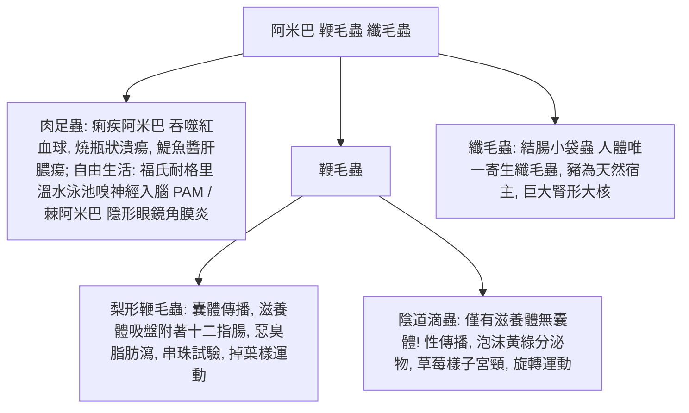
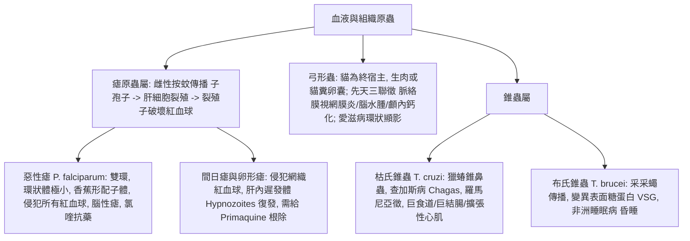
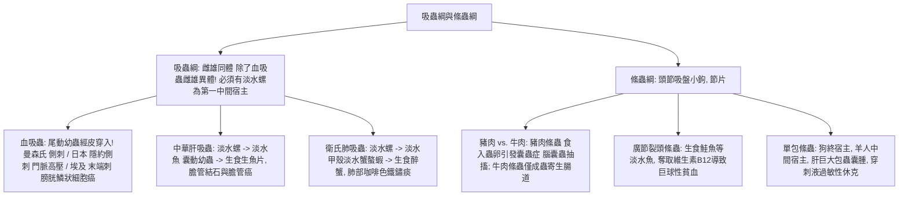
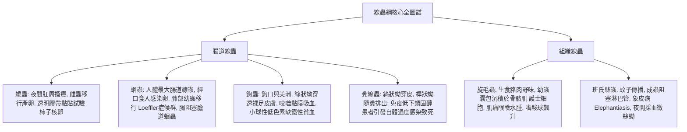

# 醫師專技高考一階段：醫用寄生蟲學 考前衝刺手冊

> **考科卷別**：醫學（一） ｜ **題號範圍**：Q95 ~ Q100 (約 6 題)
>
> **複習導引**：原蟲與蠕蟲生活史、中間宿主、感染型態與首選治療用藥。

---

## 本科目章節目錄

1. [寄生蟲學 第01章 醫用原蟲學：阿米巴、鞭毛蟲與纖毛蟲](#chapter-1)
2. [寄生蟲學 第02章 醫用原蟲學：血液與組織原蟲](#chapter-2)
3. [寄生蟲學 第03章 醫用蠕蟲學：吸蟲綱與絛蟲綱](#chapter-3)
4. [寄生蟲學 第04章 醫用蠕蟲學：線蟲綱與組織線蟲](#chapter-4)

---

<!-- CHAPTER 1 START -->

# 寄生蟲學 第01章 醫用原蟲學：阿米巴、鞭毛蟲與纖毛蟲

## 核心知識體系架構
醫用原蟲學（Protozoology）為單細胞真核微生物。本章涵蓋消化道與泌尿生殖道之肉足蟲綱（阿米巴：痢疾阿米巴 Entamoeba histolytica 吞噬紅血球、燒瓶樣潰瘍、鯷魚醬樣肝膿瘍；自由生活阿米巴：福氏耐格里阿米巴 Naegleria fowleri 原發性阿米巴腦膜腦炎 PAM、棘阿米巴 Acanthamoeba 角膜炎）；鞭毛蟲綱（梨形鞭毛蟲 Giardia lamblia 掉葉樣運動、脂肪瀉；陰道滴蟲 Trichomonas vaginalis 旋轉運動、草莓樣宮頸）；以及纖毛蟲綱（結腸小袋纖毛蟲 Balantidium coli 人體唯一寄生纖毛蟲）。

---

## 主題一：阿米巴原蟲（Amebae）致病機轉與臨床病理

### 1. 痢疾阿米巴（Entamoeba histolytica）vs. 同形共生阿米巴（E. dispar）
- **生活史雙型態**：
  - **包囊（Cyst，感染型）**：具堅韌抗胃酸囊壁，成熟包囊含有 **4 個細胞核** 及兩端鈍圓的擬染色體（Chromatoid bodies），經糞口途徑污染食物或水源傳播。
  - **滋養體（Trophozoite，致病與繁殖型）**：單核，核中央具微小圓形核仁，染色質顆粒均勻排列於核膜內側。**顯微鏡下診斷金標準：胞質內吞噬有宿主紅血球（Erythrophagocytosis / Ingested RBCs，為與無害共生的 E. dispar 鑑別之絕對唯一依據！）**。
- **特異組織病理學特徵**：
  1. **腸道病變**：分泌半胱胺酸蛋白酶溶解黏膜上皮，並在黏膜下層向兩側廣泛蔓延侵蝕，形成經典 **「燒瓶樣潰瘍（Flask-shaped ulcers）」**；引發排泄含黏液與血液之阿米巴痢疾（Amebic dysentery）。
  2. **腸外阿米巴病（阿米巴肝膿瘍 Amebic Liver Abscess）**：滋養體侵犯腸繫膜小靜脈，經門脈系統血行播散至肝臟（好發右葉），引起大片液化性壞死，穿刺抽取物呈現特徵性 **「鯷魚醬樣 / 巧克力色濃稠無臭膿液（Anchovy paste-like fluid）」**。
  3. **治療首選**：**甲硝唑（Metronidazole）** 殺滅組織滋養體，接續給予 **巴洛黴素（Paromomycin）** 或碘喹酚清除腸腔內包囊。

### 2. 自由生活阿米巴（Free-Living Amebae）之致命感染
- **福氏耐格里阿米巴（Naegleria fowleri / 「食腦阿米巴」）**：
  - 存在於溫暖的淡水湖泊、溫泉及未加氯消毒的游泳池。
  - **侵入途徑**：跳水或游泳時，阿米巴經鼻腔黏膜穿透**篩骨篩板（Cribriform plate）**，沿嗅神經軸突逆行直衝大腦。
  - **臨床急症**：**原發性阿米巴腦膜腦炎（Primary Amebic Meningoencephalitis, PAM）**，數天內迅猛進展至顱內壓飆升、昏迷與腦疝死亡（死亡率 $> 98\%$）。腦脊髓液（CSF）濕片可見具偽足活動之滋養體。
- **棘阿米巴屬（Acanthamoeba spp.）**：
  - 配戴軟性隱形眼鏡者使用自來水清洗或在泳池配戴，引發劇痛之 **棘阿米巴角膜炎（Acanthamoeba keratitis）**，角膜呈環狀浸潤潰瘍。免疫低下者引發肉芽腫性阿米巴腦炎（GAE）。

---

## 主題二：梨形鞭毛蟲與陰道滴蟲

### 1. 梨形鞭毛蟲（Giardia lamblia / G. duodenalis）
- **形態學特徵**：
  - **滋養體**：呈縱切之半梨形或淚滴狀，背面隆起，腹面具有大型 **吸盤（Ventral sucking disk）**；含 **2 個對稱細胞核**，宛如「戴眼鏡的老爺爺」；具有 4 對鞭毛，在顯微鏡下呈典型 **「落葉樣緩慢搖擺運動（Falling-leaf motility）」**。
  - **成熟包囊**：橢圓形，含 **4 個細胞核**。
- **致病機制與臨床特點**：
  - 滋養體利用腹部吸盤牢固吸附於 **十二指腸與近端空腸黏膜表面**，機械性覆蓋刷狀緣上皮，阻礙脂肪與脂溶性維生素（A, D, E, K）吸收。
  - **排便特徵**：引發惡臭、油膩、漂浮於水面的 **脂肪瀉（Steatorrhea / Malabsorption diarrhea）**，伴隨腹脹腹絞痛與噯氣硫磺味，無紅血球無發燒。
  - **診斷與治療**：糞便鏡檢見包囊或滋養體；十二指腸引流液或腸線試驗（Entero-Test / String test）。治療首選 **Metronidazole**。

### 2. 陰道滴蟲（Trichomonas vaginalis）
- **極關鍵生物學特徵**：**生活史中「僅有滋養體（Trophozoite）期，完全沒有包囊期（No cyst stage！）」**！
- **形態**：梨形，前端具 4 根前鞭毛，體側具波動膜（Undulating membrane），顯微鏡下呈 **「劇烈旋轉擺動運動（Jerky / Twisting motility）」**。
- **傳染與臨床病徵**：
  - **主要經由性接觸直接傳播（STI）**。
  - 男性多為無症狀尿道帶原者；女性陰道感染後陰道分泌物大量增多，呈現 **稀薄泡沫狀、黃綠色、具強烈惡臭魚腥味之白帶**，伴隨嚴重外陰部搔癢與排尿刺痛。
  - **婦科內視鏡經典表徵**：陰道壁與子宮頸黏膜廣泛點狀出血，呈現特徵性 **「草莓樣子宮頸（Strawberry cervix）」**！
  - **治療原則**：**男女雙方性伴侶必須同時接受口服 Metronidazole 治療**，以杜絕乒乓球式反覆交叉感染！

---

## 歷屆國考核心真題解析

### 【國考經典真題實戰】
**【試題編號】111-第一次-med2-028**
> **題目**：T細胞與B細胞都參與氣喘或是異位性皮膚炎等過敏性疾病的病理機制，此類病人體內最常檢測到：
- (A) 高比例可分泌IL-5的T細胞與血清中高濃度IgA
- (B) 高比例可分泌IL-5的T細胞與血清中高濃度IgE
- (C) 高比例可分泌IFN-γ的T細胞與血清中高濃度IgA
- (D) 高比例可分泌IFN-γ的T細胞與血清中高濃度IgE

> **標準答案**：`B`
> 
> **【考點深度解析與選項拆解】**：
- **(A) 選項分析**：高比例可分泌IL-5的T細胞與血清中高濃度IgA。核對寄生蟲生活史感染型（Infective stage）與診斷型（Diagnostic stage）、中間宿主或終宿主歸屬，評估其正確性。
- **(B) 選項分析**：高比例可分泌IL-5的T細胞與血清中高濃度IgE。比對蟲卵顯微鏡特徵（如側刺/末端刺、卵蓋、受精卵厚壁）或滋養體形態，剖析命題陷阱。
- **(C) 選項分析**：高比例可分泌IFN-γ的T細胞與血清中高濃度IgA。檢驗臨床特徵病變（如阿米巴肝膿瘍、微小低色素貧血、巨球性貧血或象皮病），排除干擾選項。
- **(D) 選項分析**：高比例可分泌IFN-γ的T細胞與血清中高濃度IgE。綜合首選驅蟲藥物（Praziquantel, Albendazole, Metronidazole, Primaquine），驗證題幹核心命題本旨。
> **【國考核心解題金鑰】**：本題精準鎖定標準答案 **(B)**。考生須融會貫通原蟲與蠕蟲之傳播媒介（螺類、蚊、黑蠅、采采蠅）、致病機制及典型蟲卵形態，即可秒殺奪冠。

---
### 【國考經典真題實戰】
**【試題編號】111-第一次-med2-029**
> **題目**：林先生之前到中國旅遊時吃了淡水魚的生魚片，不久後出現腹痛，回國後眼眶附近浮腫，很幸運的在浮腫部 位摘除將近4 mm大小的蟲體，林先生最有可能感染下列何種寄生蟲？
- (A) 蟠尾絲蟲（Onchocerca volvulus）
- (B) 有棘頜口線蟲（Gnathostoma spinigerum）
- (C) 東方眼蟲（Thelazia callipaeda）
- (D) 麥地那線蟲 （Dracunculus medinensis）

> **標準答案**：`B`
> 
> **【考點深度解析與選項拆解】**：
- **(A) 選項分析**：蟠尾絲蟲（Onchocerca volvulus）。核對寄生蟲生活史感染型（Infective stage）與診斷型（Diagnostic stage）、中間宿主或終宿主歸屬，評估其正確性。
- **(B) 選項分析**：有棘頜口線蟲（Gnathostoma spinigerum）。比對蟲卵顯微鏡特徵（如側刺/末端刺、卵蓋、受精卵厚壁）或滋養體形態，剖析命題陷阱。
- **(C) 選項分析**：東方眼蟲（Thelazia callipaeda）。檢驗臨床特徵病變（如阿米巴肝膿瘍、微小低色素貧血、巨球性貧血或象皮病），排除干擾選項。
- **(D) 選項分析**：麥地那線蟲 （Dracunculus medinensis）。綜合首選驅蟲藥物（Praziquantel, Albendazole, Metronidazole, Primaquine），驗證題幹核心命題本旨。
> **【國考核心解題金鑰】**：本題精準鎖定標準答案 **(B)**。考生須融會貫通原蟲與蠕蟲之傳播媒介（螺類、蚊、黑蠅、采采蠅）、致病機制及典型蟲卵形態，即可秒殺奪冠。

---
### 【國考經典真題實戰】
**【試題編號】111-第一次-med2-030**
> **題目**：有關鞭蟲（Trichuris trichiura）感染人體的敘述，下列何者錯誤？
- (A) 幼蟲直接在腸道發育為成蟲
- (B) 成蟲主要寄生在大腸
- (C) 會引起自體感染（autoinfection）
- (D) 幼童重度感染可能會引起脫肛（rectum prolapse）

> **標準答案**：`C`
> 
> **【考點深度解析與選項拆解】**：
- **(A) 選項分析**：幼蟲直接在腸道發育為成蟲。核對寄生蟲生活史感染型（Infective stage）與診斷型（Diagnostic stage）、中間宿主或終宿主歸屬，評估其正確性。
- **(B) 選項分析**：成蟲主要寄生在大腸。比對蟲卵顯微鏡特徵（如側刺/末端刺、卵蓋、受精卵厚壁）或滋養體形態，剖析命題陷阱。
- **(C) 選項分析**：會引起自體感染（autoinfection）。檢驗臨床特徵病變（如阿米巴肝膿瘍、微小低色素貧血、巨球性貧血或象皮病），排除干擾選項。
- **(D) 選項分析**：幼童重度感染可能會引起脫肛（rectum prolapse）。綜合首選驅蟲藥物（Praziquantel, Albendazole, Metronidazole, Primaquine），驗證題幹核心命題本旨。
> **【國考核心解題金鑰】**：本題精準鎖定標準答案 **(C)**。考生須融會貫通原蟲與蠕蟲之傳播媒介（螺類、蚊、黑蠅、采采蠅）、致病機制及典型蟲卵形態，即可秒殺奪冠。

---

 

<!-- CHAPTER 2 START -->

# 寄生蟲學 第02章 醫用原蟲學：血液與組織原蟲

## 核心知識體系架構
血液與組織原蟲為寄生蟲學最高分重點。涵蓋瘧原蟲屬（Plasmodium：惡性瘧、間日瘧、卵形瘧、三日瘧之生活史、紅內期 vs. 紅外期、遲發體 Hypnozoites、耐藥性與抗瘧藥選擇）；巴貝氏蟲（Babesia microti 馬爾他十字）；弓形蟲（Toxoplasma gondii 貓終宿主、先天感染三聯徵、愛滋病環狀顯影腦病變）；利什曼原蟲（Leishmania 白蛉傳播、黑熱病）；以及錐蟲屬（Trypanosoma 枯氏錐蟲美洲錐蟲病/Chagas 病 vs. 布氏錐蟲非洲睡眠病）。

---

## 主題一：瘧原蟲（Plasmodium）四大菌種生活史與顯微鑑別

### 1. 瘧疾生活史關鍵發育節點
1. **蚊體內有性生殖（Sporogony）**：**雌性按蚊（Female Anopheles mosquito）為終宿主（Definitive host）**！雌蚊叮咬人體吸血時，將具感染性的 **子孢子（Sporozoites）** 注入人體微血管。
2. **人體內無性裂殖（Schizogony，人為中間宿主 Intermediate host）**：
   - **紅血球外期（Exoerythrocytic stage，肝臟）**：子孢子於 30 分鐘內隨血流侵入肝實質細胞，經裂體增殖發育為成熟裂殖體，釋放成千上萬個裂殖子（Merozoites）入血。
     - **遲發體（休眠子 Hypnozoites）**：**僅存在於「間日瘧原蟲（P. vivax）」與「卵形瘧原蟲（P. ovale）」**！部分子孢子在肝細胞內進入休眠狀態，可在數月至數年後甦醒活化引發**瘧疾復發（Relapse）**！根除休眠子**必須專一性使用伯氨喹（Primaquine，用藥前需常規檢驗 G6PD 活性以防急性溶血！）**。
   - **紅血球內期（Erythrocytic stage）**：裂殖子侵犯紅血球 $\to$ 滋養體（環狀體 Ring form） $\to$ 裂殖體 $\to$ 紅血球破裂釋放裂殖子與瘧色素，引發**週期性寒顫、高燒與出汗三聯徵**！

### 2. 四大瘧原蟲顯微鏡鑑別與臨床特徵表
| 瘧原蟲種類 | 紅血球破裂發熱週期 | 侵犯紅血球偏好性 | 顯微鏡下薄血抹片關鍵特徵 | 臨床嚴重度與抗瘧用藥 |
| :--- | :--- | :--- | :--- | :--- |
| **惡性瘧原蟲 (P. falciparum)** | **不規則或每 36~48 小時** | **可侵犯「所有年齡期之紅血球（紅血球全殺）」**！原蟲血症密度極高 | 1. 一顆紅血球內常見**多個微小環狀體（Multiple ring forms）** 及貼邊滋養體（Accolé forms）。 2. 配子體呈特徵性 **「新月形 / 香蕉形（Crescent / Banana-shaped）」**！ 3. 外周血抹片中絕無晚期滋養體或裂殖體（因被隔離在深部微血管）。 | **最凶險、致死率最高之瘧疾**！感染紅血球表面表現 PfEMP1 黏附血管內皮，導致微血管阻塞缺血，引發致死性 **腦性瘧疾（Cerebral malaria）**、**黑水熱（Blackwater fever，急性血管內大溶血伴血紅素尿）**。全球多數對 Chloroquine 抗藥，首選 **青蒿素複方（ACT：Artemether-Lumefantrine）**。 |
| **間日瘧原蟲 (P. vivax)** | **每 48 小時（隔日發作，良性三日瘧）** | **僅侵犯幼嫩之「網織紅血球（Reticulocytes）」**（利用 Duffy 血型抗原受體入胞） | 被寄生紅血球明顯**腫大變形、蒼白**；胞質內見細小粉紅色之 **許氏點（Schüffner's dots）**；滋養體呈多形阿米巴樣。 | 肝內有休眠子，**極易復發**。治療需 **Chloroquine + Primaquine（根除肝內休眠子）**。 |
| **卵形瘧原蟲 (P. ovale)** | 每 48 小時 | 僅侵犯網織紅血球 | 被寄生紅血球呈**橢圓形、邊緣呈流蘇狀撕裂（Fringed / Fimbriated edges）**；見粗大詹森氏點（James's dots）。 | 肝內有休眠子，同樣需 **Primaquine** 根治。 |
| **三日瘧原蟲 (P. malariae)** | **每 72 小時（四日瘧 Quartan）** | **僅侵犯衰老成熟之老齡紅血球** | 紅血球大小正常；滋養體呈橫跨紅血球中央之 **「帶狀滋養體（Band forms）」**；成熟裂殖體呈精緻如花瓣的 **「花冠狀 / 菊花狀（Rosette pattern）」**。 | 慢性無症狀低度感染可持續數十年，可引發免疫複合物性腎病症候群。無休眠子。 |

---

## 主題二：剛地弓形蟲（Toxoplasma gondii）

### 1. 宿主生活史與傳染途徑
- **終宿主（Definitive host）**：**貓科動物（Felines）**！僅在貓腸道上皮細胞中進行有性生殖，隨貓糞排出傳染性 **卵囊（Oocysts）**。
- **中間宿主（Intermediate host）**：人、羊、豬、牛、鳥等所有溫血動物。
- **三大人類傳染途徑**：
  1. 誤食被貓糞卵囊污染的食物或未洗淨蔬菜、接觸貓砂。
  2. 進食**未完全煮熟的牛羊豬肉（肉中含有假囊/組織囊胞 Tissue cysts / 緩殖子 Bradyzoites）**。
  3. **母嬰垂直胎盤傳播**：孕婦於懷孕期間**初次急性感染**弓形蟲，速殖子（Tachyzoites）穿透胎盤感染胎兒。

### 2. 兩大高危臨床族群病變
- **先天性弓形蟲病（Congenital Toxoplasmosis）**：
  - **經典三聯徵（Classic Triad，國考必背！）**：
    1. **脈絡膜視網膜炎（Chorioretinitis）**：眼底黃斑部壞死性色素疤痕，視力喪失。
    2. **腦水腫（Hydrocephalus）**。
    3. **顱內瀰漫性鈣化（Intracranial calcifications）**（伴隨抽搐痙攣與智力障礙）。
- **愛滋病患（HIV/AIDS，CD4 $< 100$ cells/$\mu$L）腦弓形蟲病**：
  - 潛伏體內組織囊胞重新活化，造成多發性壞死性腦炎。
  - **腦部增強 MRI 顯像金特徵**：大腦基底核與皮質下白質見典型 **「多發性環狀顯影病灶（Multiple ring-enhancing lesions）」**！
  - 治療首選：**乙胺嘧啶（Pyrimethamine）+ 磺胺嘧啶（Sulfadiazine）**，常規加用 **Leucovorin（亞葉酸）** 救援骨髓抑制。

---

## 主題三：美洲錐蟲病（Chagas Disease）vs. 非洲睡眠病

### 1. 枯氏錐蟲（Trypanosoma cruzi）與查加斯病（Chagas Disease）
- **傳播媒介昆蟲**：**錐鼻蟲 / 獵蝽（Reduviid bug / "Kissing bug"）**。夜間叮咬面部皮膚吸血，並在叮咬傷口附近排便，感染性後循環錐鞭毛體（Metacyclic trypomastigotes）經搔抓揉入傷口或結膜黏膜。
- **急性期表現**：叮咬處紅腫無痛性硬結硬塊；若感染眼結膜引發特異性單側眼瞼無痛性紫紅色浮腫，稱為 **羅馬尼亞徵（Romaña's sign）**。
- **慢性期三大不可逆器官毀滅病變（數十年後）**：
  - 錐蟲在心肌與神經節內形成無鞭毛體（Amastigotes）破壞自主神經元：
    1. **擴張型心肌病變（Dilated Cardiomyopathy）**：心肌纖維化、心律不整、心尖室壁瘤（Apical aneurysm）、頑固心衰竭致死。
    2. **巨大食道症（Megaesophagus）**：食道肌層神經叢（Auerbach 神經叢）被徹底破壞，失去蠕動導致賁門失弛緩症（Achalasia）、吞嚥困難。
    3. **巨大結腸症（Megacolon）**：結腸自主神經節喪失，結腸極度擴張積糞穿孔。

---

## 歷屆國考核心真題解析

### 【國考經典真題實戰】
**【試題編號】112-第一次-med2-029**
> **題目**：下列有關棘頜口線蟲（Gnathostoma spinigerum）感染的敘述，何者錯誤？
- (A) 成蟲可寄生於貓的胃壁
- (B) 完成生活史需2個中間宿主
- (C) 感染人體後只侵犯皮下組織
- (D) 食入未熟帶蟲之淡水魚而被感染

> **標準答案**：`C`
> 
> **【考點深度解析與選項拆解】**：
- **(A) 選項分析**：成蟲可寄生於貓的胃壁。核對寄生蟲生活史感染型（Infective stage）與診斷型（Diagnostic stage）、中間宿主或終宿主歸屬，評估其正確性。
- **(B) 選項分析**：完成生活史需2個中間宿主。比對蟲卵顯微鏡特徵（如側刺/末端刺、卵蓋、受精卵厚壁）或滋養體形態，剖析命題陷阱。
- **(C) 選項分析**：感染人體後只侵犯皮下組織。檢驗臨床特徵病變（如阿米巴肝膿瘍、微小低色素貧血、巨球性貧血或象皮病），排除干擾選項。
- **(D) 選項分析**：食入未熟帶蟲之淡水魚而被感染。綜合首選驅蟲藥物（Praziquantel, Albendazole, Metronidazole, Primaquine），驗證題幹核心命題本旨。
> **【國考核心解題金鑰】**：本題精準鎖定標準答案 **(C)**。考生須融會貫通原蟲與蠕蟲之傳播媒介（螺類、蚊、黑蠅、采采蠅）、致病機制及典型蟲卵形態，即可秒殺奪冠。

---
### 【國考經典真題實戰】
**【試題編號】112-第一次-med2-030**
> **題目**：下列何種寄生蟲感染，最有可能造成一種咽喉型的病症（halzoun），導致咽喉劇烈疼痛、出血及呼吸困難？
- (A) 牛羊肝吸蟲（Fasciola hepatica）
- (B) 貓肝吸蟲（Opisthorchis felineus）
- (C) 槍狀肝吸蟲（Dicrocoelium dendriticum）
- (D) 泰國肝吸蟲（Opisthorchis viverrini）

> **標準答案**：`A`
> 
> **【考點深度解析與選項拆解】**：
- **(A) 選項分析**：牛羊肝吸蟲（Fasciola hepatica）。核對寄生蟲生活史感染型（Infective stage）與診斷型（Diagnostic stage）、中間宿主或終宿主歸屬，評估其正確性。
- **(B) 選項分析**：貓肝吸蟲（Opisthorchis felineus）。比對蟲卵顯微鏡特徵（如側刺/末端刺、卵蓋、受精卵厚壁）或滋養體形態，剖析命題陷阱。
- **(C) 選項分析**：槍狀肝吸蟲（Dicrocoelium dendriticum）。檢驗臨床特徵病變（如阿米巴肝膿瘍、微小低色素貧血、巨球性貧血或象皮病），排除干擾選項。
- **(D) 選項分析**：泰國肝吸蟲（Opisthorchis viverrini）。綜合首選驅蟲藥物（Praziquantel, Albendazole, Metronidazole, Primaquine），驗證題幹核心命題本旨。
> **【國考核心解題金鑰】**：本題精準鎖定標準答案 **(A)**。考生須融會貫通原蟲與蠕蟲之傳播媒介（螺類、蚊、黑蠅、采采蠅）、致病機制及典型蟲卵形態，即可秒殺奪冠。

---
### 【國考經典真題實戰】
**【試題編號】112-第一次-med2-031**
> **題目**：下列何種寄生蟲感染會導致人類肺部的病變？
- (A) 犬複殖器絛蟲（Dipylidium caninum）
- (B) 顆粒性包生絛蟲（Echinococcus granulosus）
- (C) 廣節裂頭絛蟲（Diphyllobothrium latum）
- (D) 短小包膜絛蟲（Hymenolepis nana）

> **標準答案**：`B`
> 
> **【考點深度解析與選項拆解】**：
- **(A) 選項分析**：犬複殖器絛蟲（Dipylidium caninum）。核對寄生蟲生活史感染型（Infective stage）與診斷型（Diagnostic stage）、中間宿主或終宿主歸屬，評估其正確性。
- **(B) 選項分析**：顆粒性包生絛蟲（Echinococcus granulosus）。比對蟲卵顯微鏡特徵（如側刺/末端刺、卵蓋、受精卵厚壁）或滋養體形態，剖析命題陷阱。
- **(C) 選項分析**：廣節裂頭絛蟲（Diphyllobothrium latum）。檢驗臨床特徵病變（如阿米巴肝膿瘍、微小低色素貧血、巨球性貧血或象皮病），排除干擾選項。
- **(D) 選項分析**：短小包膜絛蟲（Hymenolepis nana）。綜合首選驅蟲藥物（Praziquantel, Albendazole, Metronidazole, Primaquine），驗證題幹核心命題本旨。
> **【國考核心解題金鑰】**：本題精準鎖定標準答案 **(B)**。考生須融會貫通原蟲與蠕蟲之傳播媒介（螺類、蚊、黑蠅、采采蠅）、致病機制及典型蟲卵形態，即可秒殺奪冠。

---

 

<!-- CHAPTER 3 START -->

# 寄生蟲學 第03章 醫用蠕蟲學：吸蟲綱與絛蟲綱

## 核心知識體系架構
醫用蠕蟲學（Helminthology）之扁形動物門涵蓋吸蟲綱（Trematoda：血吸蟲、中華肝吸蟲、衛氏肺吸蟲；中間宿主淡水螺類）與絛蟲綱（Cestoda：豬肉絛蟲囊蟲症、牛肉絛蟲、廣節裂頭絛蟲維生素 B12 缺乏貧血、單包絛蟲包蟲囊袋）。

---

## 主題一：三大血吸蟲（Schistosoma）病理與蟲卵形態鑑別

### 1. 曼森氏 vs. 日本 vs. 埃及血吸蟲大對決
- **共性生物學特徵**：
  - 吸蟲中**唯一的「雌雄異體（Dioecious）」**！雄蟲腹面具有抱雌溝（Gynecophoral canal），雌蟲長條狀棲息於溝內合抱交配。
  - **唯一「不需食入、經由尾動幼蟲（Cercariae）直接穿透健康人體皮膚感染」之吸蟲**！
  - **蟲卵不具卵蓋（Operculum）**（其餘吸蟲卵均具卵蓋）。
- **三大血吸蟲精密對比表**：
| 血吸蟲種類 | 成蟲主要寄生解剖血管部位 | 蟲卵典型顯微形態（國考必考！） | 主要病理變化與晚期惡性後遺症 | 卵隨排泄物排出途徑 |
| :--- | :--- | :--- | :--- | :--- |
| **曼森氏血吸蟲 (Schistosoma mansoni)** | **腸繫膜下靜脈叢（Inferior mesenteric veins）** | **長橢圓形，具顯著銳利的「巨大側刺（Prominent lateral spine）」**！ | 蟲卵逆流沉積於肝臟門脈小分支周圍，形成肉芽腫與纖維化，呈典型 **「煙斗管樣肝纖維化（Symmers' pipestem fibrosis）」**、門脈高壓、巨脾症。 | 隨**糞便（Stool）** 排出 |
| **日本血吸蟲 (Schistosoma japonicum)** | **腸繫膜上靜脈叢（Superior mesenteric veins）** | 較圓，側壁具一個**微小不明顯的小側刺或小突起（Small inconspicuous knob/spine）** | 產卵量極大（為曼森氏的 10 倍！），更凶猛引發嚴重肉芽腫性結腸炎與重度煙斗管樣肝硬化。 | 隨**糞便（Stool）** 排出 |
| **埃及血吸蟲 (Schistosoma haematobium)** | **膀胱與骨盆腔靜脈叢（Vesical venous plexus）** | 橢圓形，**正頂端具有顯著銳利的「末端刺（Terminal spine）」**！ | 蟲卵沉積於膀胱黏膜下層，引發慢性潰瘍肉芽腫，典型臨床特徵為**終末無痛性肉眼血尿（Painless terminal hematuria）**！長期慢性發炎誘發膀胱 **「鱗狀細胞癌（Squamous Cell Carcinoma of Bladder，極罕見腺癌！）」**！ | 隨**尿液（Urine）** 排出 |

---

## 主題二：組織寄生絛蟲病（Cysticercosis & Hydatid Disease）

### 1. 豬肉絛蟲（Taenia solium）之兩種完全不同感染型態
- **型態一：腸道絛蟲病（Taeniasis）**：
  - **感染途徑**：進食**未煮熟含有囊尾幼蟲（Cysticercus cellulosae / 米豬肉）的豬肉**。
  - **致病機制**：囊尾幼蟲在人小腸內翻出頭節（具 4 個吸盤與雙排小鉤），發育成數公尺長之成蟲。成蟲寄生腸道，症狀輕微（消化不良、肛門排出節片）。
- **型態二：囊蟲症 / 囊尾幼蟲病（Cysticercosis，致命危險！）**：
  - **感染途徑**：**誤食了「豬肉絛蟲的蟲卵（Eggs）」**（自身自體體內逆蠕動反流、或糞口途徑污染食物）！
  - **致病機制**：人成為豬肉絛蟲的**中間宿主**！蟲卵在人胃內孵出六鉤蚴，穿透腸壁經血液循環播散至全身實質器官發育成囊尾幼蟲囊腫。
  - **神經囊蟲症（Neurocysticercosis, NCC）**：囊蟲寄生於大腦實質或腦室，囊腫退變死亡引發劇烈發炎水腫，為開發中國家**成人晚發型癲癇發作（Adult-onset Seizures）第一位病因**！頭部 CT/MRI 呈「靶眼徵（Swiss-cheese appearance / scolex in cyst）」。

### 2. 廣節裂頭絛蟲（Diphyllobothrium latum）
- **感染來源**：生食含有裂頭蚴之淡水魚（如鮭魚、鱒魚）。成蟲長達 10~15 公尺，寄生於迴腸。
- **特異致病機轉**：絛蟲成蟲具有極強之親和力，能**大量奪取腸腔內多達 80% 的維生素 $B_{12}$（Cobalamin）**！
- **特徵臨床表現**：導致宿主維生素 $B_{12}$ 嚴重缺乏，引發典型 **巨球性貧血（Megaloblastic anemia）伴隨亞急性脊髓聯合退化症（SCD）**！

---

## 歷屆國考核心真題解析

### 【國考經典真題實戰】
**【試題編號】113-第一次-med2-030**
> **題目**：人類感染下列何種寄生蟲，必須先經由心肺移行，才能到達小腸發育為成蟲？
- (A) 犬蛔蟲（Toxocara canis）
- (B) 海獸胃線蟲（Anisakis spp.）
- (C) 十二指腸鉤蟲（Ancylostoma duodenale）
- (D) 有棘頜口線蟲（Gnathostoma spinigerum）

> **標準答案**：`C`
> 
> **【考點深度解析與選項拆解】**：
- **(A) 選項分析**：犬蛔蟲（Toxocara canis）。核對寄生蟲生活史感染型（Infective stage）與診斷型（Diagnostic stage）、中間宿主或終宿主歸屬，評估其正確性。
- **(B) 選項分析**：海獸胃線蟲（Anisakis spp.）。比對蟲卵顯微鏡特徵（如側刺/末端刺、卵蓋、受精卵厚壁）或滋養體形態，剖析命題陷阱。
- **(C) 選項分析**：十二指腸鉤蟲（Ancylostoma duodenale）。檢驗臨床特徵病變（如阿米巴肝膿瘍、微小低色素貧血、巨球性貧血或象皮病），排除干擾選項。
- **(D) 選項分析**：有棘頜口線蟲（Gnathostoma spinigerum）。綜合首選驅蟲藥物（Praziquantel, Albendazole, Metronidazole, Primaquine），驗證題幹核心命題本旨。
> **【國考核心解題金鑰】**：本題精準鎖定標準答案 **(C)**。考生須融會貫通原蟲與蠕蟲之傳播媒介（螺類、蚊、黑蠅、采采蠅）、致病機制及典型蟲卵形態，即可秒殺奪冠。

---
### 【國考經典真題實戰】
**【試題編號】113-第一次-med2-031**
> **題目**：下列有關血吸蟲（blood flukes）之致病機制敘述，何者最適當？
- (A) 曼森血吸蟲（Schistosoma mansoni）成蟲主要寄生於人體之膀胱靜脈叢
- (B) 埃及血吸蟲（Schistosoma haematobium）成蟲主要寄生於人體之腸繫膜靜脈叢
- (C) 血吸蟲蟲卵經血流、異位陷入（ectopic trapped）腎臟而導致肉芽腫（granuloma）
- (D) 日本血吸蟲（Schistosoma japonicum）成蟲之每日產卵量（egg deposition）最多可超過3000 顆

> **標準答案**：`D`
> 
> **【考點深度解析與選項拆解】**：
- **(A) 選項分析**：曼森血吸蟲（Schistosoma mansoni）成蟲主要寄生於人體之膀胱靜脈叢。核對寄生蟲生活史感染型（Infective stage）與診斷型（Diagnostic stage）、中間宿主或終宿主歸屬，評估其正確性。
- **(B) 選項分析**：埃及血吸蟲（Schistosoma haematobium）成蟲主要寄生於人體之腸繫膜靜脈叢。比對蟲卵顯微鏡特徵（如側刺/末端刺、卵蓋、受精卵厚壁）或滋養體形態，剖析命題陷阱。
- **(C) 選項分析**：血吸蟲蟲卵經血流、異位陷入（ectopic trapped）腎臟而導致肉芽腫（granuloma）。檢驗臨床特徵病變（如阿米巴肝膿瘍、微小低色素貧血、巨球性貧血或象皮病），排除干擾選項。
- **(D) 選項分析**：日本血吸蟲（Schistosoma japonicum）成蟲之每日產卵量（egg deposition）最多可超過3000 顆。綜合首選驅蟲藥物（Praziquantel, Albendazole, Metronidazole, Primaquine），驗證題幹核心命題本旨。
> **【國考核心解題金鑰】**：本題精準鎖定標準答案 **(D)**。考生須融會貫通原蟲與蠕蟲之傳播媒介（螺類、蚊、黑蠅、采采蠅）、致病機制及典型蟲卵形態，即可秒殺奪冠。

---
### 【國考經典真題實戰】
**【試題編號】113-第一次-med2-032**
> **題目**：水生植物可當何種寄生蟲之中間宿主？ћ牛羊肝吸蟲（Fasciola hepatica） ќ薑片蟲（Fasciolopsis buski） ѝ中華肝吸蟲（Clonorchis sinensis） ў槍狀肝吸蟲（Dicrocoelium dendriticum）
- (A) ћќ
- (B) ѝў
- (C) ћѝ
- (D) ќў

> **標準答案**：`A`
> 
> **【考點深度解析與選項拆解】**：
- **(A) 選項分析**：ћќ。核對寄生蟲生活史感染型（Infective stage）與診斷型（Diagnostic stage）、中間宿主或終宿主歸屬，評估其正確性。
- **(B) 選項分析**：ѝў。比對蟲卵顯微鏡特徵（如側刺/末端刺、卵蓋、受精卵厚壁）或滋養體形態，剖析命題陷阱。
- **(C) 選項分析**：ћѝ。檢驗臨床特徵病變（如阿米巴肝膿瘍、微小低色素貧血、巨球性貧血或象皮病），排除干擾選項。
- **(D) 選項分析**：ќў。綜合首選驅蟲藥物（Praziquantel, Albendazole, Metronidazole, Primaquine），驗證題幹核心命題本旨。
> **【國考核心解題金鑰】**：本題精準鎖定標準答案 **(A)**。考生須融會貫通原蟲與蠕蟲之傳播媒介（螺類、蚊、黑蠅、采采蠅）、致病機制及典型蟲卵形態，即可秒殺奪冠。

---

 

<!-- CHAPTER 4 START -->

# 寄生蟲學 第04章 醫用蠕蟲學：線蟲綱與組織線蟲

## 核心知識體系架構
線蟲綱（Nematoda）為兩側對稱、圓柱形、雌雄異體之假體腔動物。涵蓋腸道線蟲（蟯蟲 Enterobius 膠帶黏貼、蛔蟲 Ascaris 腸道穿孔膽道蛔蟲症、鞭蟲 Trichuris 脫肛、十二指腸鉤蟲 Ancylostoma 缺鐵性貧血、糞線蟲 Strongyloides 體內自體感染）；以及組織線蟲（旋毛蟲 Trichinella 護士細胞、班氏絲蟲 Wuchereria 象皮病、麥地那龍線蟲、犬蛔蟲內臟幼蟲移行症 VLM）。

---

## 主題一：腸道線蟲感染途徑與臨床病徵大對決

### 1. 腸道五大線蟲傳染途徑、檢體與特徵卵鑑別
| 線蟲名稱 | 感染途徑與感染期（Infective stage） | 體內是否經「心-肺移行（Lung migration）」 | 顯微鏡下確診黃金檢體與蟲卵特徵 | 臨床特徵與致命併發症 |
| :--- | :--- | :--- | :--- | :--- |
| **蟯蟲 (Enterobius vermicularis)** | **食入含胚感染性蟲卵**（經手-口自身反覆感染、玩具、塵埃） | **否（無肺移行！）** | **清晨便前「肛周透明膠帶試驗（Scotch tape test）」**！常規糞便檢驗極難查見蟲卵！蟲卵呈**不對稱的平凸形（柿子核樣，一側扁平一側隆起）**。 | **夜間肛門周圍與會陰部劇烈奇癢（Pruritus ani）**（雌蟲夜間爬出肛門產卵並分泌黏液刺激所致）；失眠、小兒磨牙。全家需同時投藥（Mebendazole/Pyrantel pamoate）。 |
| **蛔蟲 (Ascaris lumbricoides)** | **食入受污染土壤蔬菜中之含蚴卵（Infective egg）** | **是（經小腸壁 $\to$ 門脈 $\to$ 心 $\to$ 肺泡 $\to$ 氣管 $\to$ 咽部吞入小腸）** | 糞便塗片查見受精卵：**寬橢圓形，外被一層凹凸不平粗糙的黃褐色蛋白質膜（Mammillated coat）**。人體最大腸道線蟲（長達 20~35 公分）。 | 1. 肺移行期：發熱、咳嗽、血痰、胸部游走性浸潤、嗜酸性球顯著升高之 **呂弗勒症候群（Löffler's syndrome）**。 2. 腸道成蟲：大量成蟲扭結引發**機械性腸阻塞**；成蟲鑽入膽道引發**膽道蛔蟲症（Biliary ascariasis，突發右上腹鑽頂樣劇痛）** 及急性胰臟炎。 |
| **十二指腸鉤蟲與美洲鉤蟲 (Hookworms)** | **感染性絲狀蚴（Filariform larvae）經裸露皮膚（如赤腳踩土）主動穿透人體**！ | **是（有心-肺移行）** | 糞便見蟲卵：橢圓形、卵殼極薄透明，內含 4~8 個卵裂球。 | 成蟲齒板或板齒咬嚼小腸黏膜微血管持續吸血，並分泌抗凝物質：引發**慢性失血性「小球性低色素缺鐵性貧血（Microcytic hypochromic iron deficiency anemia）」** 及嚴重低蛋白血症水腫。皮膚穿透處引發刺癢「地癢（Ground itch）」。 |
| **糞線蟲 (Strongyloides stercoralis)** | **絲狀蚴主動穿透皮膚** | **是（有心-肺移行）** | **糞便中查見的是「幼蟲（桿狀蚴 Rhabditiform larvae）」，極罕見查見蟲卵！** | **體內自體感染（Autoinfection）能力**：桿狀蚴在腸道內即可直接蛻皮變為具感染力的絲狀蚴穿透腸黏膜入血！在**長期使用類固醇免疫抑制患者體內引發致死性「過度感染症候群（Hyperinfection syndrome）」**，幼蟲瀰漫侵犯肺、腦引發革蘭陰性菌敗血性休克！治療首選 **伊維菌素（Ivermectin）**。 |
| **鞭蟲 (Trichuris trichiura)** | 食入含蚴蟲卵 | 否（無肺移行） | 蟲卵呈典型 **「紡錘形 / 美式橄欖球樣」，兩端具半透明隆起的蓋栓（Polar plugs）**。 | 成蟲前部纖細如鞭埋入盲腸大腸黏膜，重度感染小兒引發慢性黏液血便與**直腸脫垂（Rectal prolapse）**。 |

---

## 主題二：組織寄生線蟲（旋毛蟲與班氏絲蟲）

### 1. 旋毛蟲（Trichinella spiralis）
- **獨特生活史**：**成蟲與幼蟲寄生於「同一個宿主」體內**！
- **感染途徑**：進食**未經完全煮熟的含有囊包幼蟲（Encysted larvae）的豬肉或野生動物肉（熊肉、野豬肉）**。
- **組織病理與護士細胞**：
  - 幼蟲鑽入小腸黏膜發育為成蟲，交配後產出新生幼蟲。
  - 新生幼蟲穿入淋巴管入血，播散至全身**橫紋肌（骨骼肌：咬肌、膈肌、腓腸肌）** 內。
  - 幼蟲誘導骨骼肌細胞重編程失去橫紋，轉化為提供幼蟲營養的特異結構——**護士細胞（Nurse cell）**，形成石灰化纖維包囊。
- **特徵臨床三聯徵**：
  1. **劇烈骨骼肌疼痛與壓痛（Myalgia）**。
  2. **雙側眼眶周圍水腫（Periorbital edema）**。
  3. **外周血嗜酸性球極度飆升（Eosinophilia，常高達 20~50%！）**、甲下線狀出血。

### 2. 班氏絲蟲（Wuchereria bancrofti）
- **傳播媒介**：**蚊子（熱帶家蚊 Culex、斑蚊 Aedes）** 叮咬人體傳播感染性絲狀蚴。
- **寄生部位與致病**：成蟲寄生於人體**深部淋巴系統（腹股溝與睪丸精索淋巴管）**。成蟲分泌毒素與死亡引發反覆急性淋巴管炎與淋巴結炎，導致淋巴管完全阻塞纖維化。
- **晚期病理後遺症**：
  - **象皮病（Elephantiasis）**：下肢與陰囊淋巴液回流受阻，真皮結締組織重度肥厚纖維化、皮膚粗糙如大象皮。
  - **乳糜尿（Chyluria）**：腹膜後淋巴管破裂入泌尿道，尿液呈乳白色牛奶樣。
  - **鞘膜積液（Hydrocele）**。
- **確診採血黃金法則**：微絲蚴（Microfilariae）具有嚴格的 **「夜間週期性（Nocturnal periodicity）」**（白天躲在肺毛細血管，夜間 22:00 ~ 02:00 奔湧至外周血液！），**因此必須在「午夜深宵採血抹片鏡檢」才能抓到微絲蚴**！治療首選 **乙胺嗪（DEC / Diethylcarbamazine）**。

---

## 歷屆國考核心真題解析

### 【國考經典真題實戰】
**【試題編號】114-第一次-med2-031**
> **題目**：下列何種寄生蟲之蟲卵於小腸孵化後，可以藉由自體感染（autoinfection）方式重新感染同一宿 主？
- (A) 短小包膜絛蟲（Hymenolepis nana）
- (B) 縮小包膜絛蟲（Hymenolepis diminuta）
- (C) 顆粒性包生絛蟲（Echinococcus granulosus）
- (D) 犬複殖器絛蟲（Dipylidium caninum）

> **標準答案**：`A`
> 
> **【考點深度解析與選項拆解】**：
- **(A) 選項分析**：短小包膜絛蟲（Hymenolepis nana）。核對寄生蟲生活史感染型（Infective stage）與診斷型（Diagnostic stage）、中間宿主或終宿主歸屬，評估其正確性。
- **(B) 選項分析**：縮小包膜絛蟲（Hymenolepis diminuta）。比對蟲卵顯微鏡特徵（如側刺/末端刺、卵蓋、受精卵厚壁）或滋養體形態，剖析命題陷阱。
- **(C) 選項分析**：顆粒性包生絛蟲（Echinococcus granulosus）。檢驗臨床特徵病變（如阿米巴肝膿瘍、微小低色素貧血、巨球性貧血或象皮病），排除干擾選項。
- **(D) 選項分析**：犬複殖器絛蟲（Dipylidium caninum）。綜合首選驅蟲藥物（Praziquantel, Albendazole, Metronidazole, Primaquine），驗證題幹核心命題本旨。
> **【國考核心解題金鑰】**：本題精準鎖定標準答案 **(A)**。考生須融會貫通原蟲與蠕蟲之傳播媒介（螺類、蚊、黑蠅、采采蠅）、致病機制及典型蟲卵形態，即可秒殺奪冠。

---
### 【國考經典真題實戰】
**【試題編號】114-第一次-med2-032**
> **題目**：豬肉絛蟲（Taenia solium）比牛肉絛蟲（Taenia saginata）對人類造成的病變更為嚴重，最主要 原因是：
- (A) 前者的頭節具額嘴（rostellum）及小鉤，對腸黏膜的破壞較大
- (B) 前者吸收較多營養，導致宿主衰弱
- (C) 前者分泌的毒素（toxin）作用較強，造成宿主產生病變
- (D) 前者會造成人類的囊尾幼蟲症（human cysticercosis）

> **標準答案**：`D`
> 
> **【考點深度解析與選項拆解】**：
- **(A) 選項分析**：前者的頭節具額嘴（rostellum）及小鉤，對腸黏膜的破壞較大。核對寄生蟲生活史感染型（Infective stage）與診斷型（Diagnostic stage）、中間宿主或終宿主歸屬，評估其正確性。
- **(B) 選項分析**：前者吸收較多營養，導致宿主衰弱。比對蟲卵顯微鏡特徵（如側刺/末端刺、卵蓋、受精卵厚壁）或滋養體形態，剖析命題陷阱。
- **(C) 選項分析**：前者分泌的毒素（toxin）作用較強，造成宿主產生病變。檢驗臨床特徵病變（如阿米巴肝膿瘍、微小低色素貧血、巨球性貧血或象皮病），排除干擾選項。
- **(D) 選項分析**：前者會造成人類的囊尾幼蟲症（human cysticercosis）。綜合首選驅蟲藥物（Praziquantel, Albendazole, Metronidazole, Primaquine），驗證題幹核心命題本旨。
> **【國考核心解題金鑰】**：本題精準鎖定標準答案 **(D)**。考生須融會貫通原蟲與蠕蟲之傳播媒介（螺類、蚊、黑蠅、采采蠅）、致病機制及典型蟲卵形態，即可秒殺奪冠。

---
### 【國考經典真題實戰】
**【試題編號】114-第一次-med2-033**
> **題目**：有關枯西氏錐蟲（Trypanosoma cruzi）及其造成的疾病，下列敘述何者最為適當？
- (A) 當病媒椿象（triatoma bug）叮咬人類後，無鞭毛體（amastigote）會進入體內，藉由連續分裂方 式形成偽囊體（pseudocyst）後留在組織中
- (B) 患者會出現眼瞼浮腫、結膜腫大，臨床上稱為後頸淋巴結腫大（Winterbottom's sign）
- (C) 患者出現的巨食道症（megaesophagus）或是巨結腸症（megacolon）等症狀，係肇因於補體 （complement）攻擊神經節後的結果
- (D) 性行為與輸血均可傳播本疾病

> **標準答案**：`D`
> 
> **【考點深度解析與選項拆解】**：
- **(A) 選項分析**：當病媒椿象（triatoma bug）叮咬人類後，無鞭毛體（amastigote）會進入體內，藉由連續分裂方 式形成偽囊體（pseudocyst）後留在組織中。核對寄生蟲生活史感染型（Infective stage）與診斷型（Diagnostic stage）、中間宿主或終宿主歸屬，評估其正確性。
- **(B) 選項分析**：患者會出現眼瞼浮腫、結膜腫大，臨床上稱為後頸淋巴結腫大（Winterbottom's sign）。比對蟲卵顯微鏡特徵（如側刺/末端刺、卵蓋、受精卵厚壁）或滋養體形態，剖析命題陷阱。
- **(C) 選項分析**：患者出現的巨食道症（megaesophagus）或是巨結腸症（megacolon）等症狀，係肇因於補體 （complement）攻擊神經節後的結果。檢驗臨床特徵病變（如阿米巴肝膿瘍、微小低色素貧血、巨球性貧血或象皮病），排除干擾選項。
- **(D) 選項分析**：性行為與輸血均可傳播本疾病。綜合首選驅蟲藥物（Praziquantel, Albendazole, Metronidazole, Primaquine），驗證題幹核心命題本旨。
> **【國考核心解題金鑰】**：本題精準鎖定標準答案 **(D)**。考生須融會貫通原蟲與蠕蟲之傳播媒介（螺類、蚊、黑蠅、采采蠅）、致病機制及典型蟲卵形態，即可秒殺奪冠。

---

 

