# 醫師專技高考一階段：基礎與臨床藥理學 考前衝刺手冊

> **考科卷別**：醫學（二） ｜ **題號範圍**：Q28 ~ Q54 (約 27 題)
>
> **複習導引**：自律神經受體、心血管用藥、中樞神經藥、抗生素靶點抗藥性與標靶化療藥物。

---

## 本科目章節目錄

1. [藥理學 第01章 自主神經藥理學：膽鹼能擬似與阻斷劑](#chapter-1)
2. [藥理學 第02章 自主神經藥理學：腎上腺素能促效與阻斷劑](#chapter-2)
3. [藥理學 第03章 心血管藥理學：抗高血壓、利尿劑與血管擴張劑](#chapter-3)
4. [藥理學 第04章 心血管藥理學：抗心律不整、抗心衰竭與降血脂藥](#chapter-4)
5. [藥理學 第05章 中樞神經藥理學：鎮靜安眠、抗癲癇與巴金森藥物](#chapter-5)
6. [藥理學 第06章 中樞神經藥理學：抗憂鬱、抗精神病、止痛與麻醉藥](#chapter-6)
7. [藥理學 第07章 抗生素藥理學：細胞壁與蛋白質合成抑制劑](#chapter-7)
8. [藥理學 第08章 抗生素藥理學：核酸抑制、抗結核、抗黴菌與抗病毒](#chapter-8)
9. [藥理學 第09章 抗腫瘤化療、標靶藥物與免疫調節抑制劑](#chapter-9)
10. [藥理學 第10章 內分泌藥理學：糖尿病、甲狀腺與皮質類固醇](#chapter-10)
11. [藥理學 第11章 自泌素、呼吸、消化、抗痛風與抗發炎藥理學](#chapter-11)
12. [藥理學 第12章 毒理學、臨床解毒劑與藥動藥效動力學](#chapter-12)

---

<!-- CHAPTER 1 START -->

# 藥理學 第01章 自主神經藥理學：膽鹼能擬似與阻斷劑

## 核心知識體系架構
自主神經系統（ANS）為藥理學奠基之石。膽鹼能神經系統涵蓋乙醯膽鹼（Ach）之合成、儲存、釋放與降解；蕈毒鹼型受體（$M_1, M_2, M_3$）與菸鹼型受體（$N_M, N_N$）；直接/間接作用之副交感擬似劑（Cholinomimetics）；抗膽鹼酯酶劑（AChEI）與重症肌無力應用；以及阿托品類抗蕈毒鹼藥物（Antimuscarinics）與神經肌肉阻斷劑（NMBAs）。

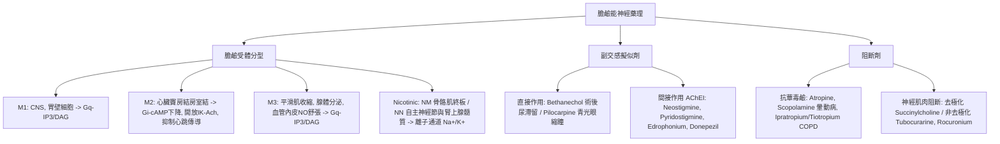

---

## 主題一：膽鹼能受體亞型與第二信差分佈全覽

### 1. 蕈毒鹼（Muscarinic）與菸鹼（Nicotinic）受體精準矩陣
| 受體類型 | G 蛋白偶聯 / 傳導機轉 | 主要組織分佈 | 典型促效生理效應 | 專一性拮抗劑 / 臨床備註 |
| :--- | :--- | :--- | :--- | :--- |
| **$M_1$ 受體** | **$G_q$**（活化 PLC $\to IP_3/DAG \to Ca^{2+}\uparrow$） | 中樞神經系統、胃壁細胞、自主神經節 | 促進認知、刺激胃酸分泌 | **Pirenzepine**（選擇性 $M_1$ 阻斷劑，曾用於治療消化性潰瘍） |
| **$M_2$ 受體** | **$G_i$**（抑制 AC $\to cAMP\downarrow$；開放 $I_{K,Ach}$） | **心臟竇房結（SA node）、房室結（AV node）**、心房肌 | **負性變時（HR $\downarrow$）、負性變傳導（AV 傳導延遲）**、微弱負性變力 | **Atropine**（非選擇性阻斷，解除迷走抑制使心跳加快，用於竇性心搏過緩） |
| **$M_3$ 受體** | **$G_q$**（活化 PLC $\to IP_3/DAG \to Ca^{2+}\uparrow$） | **外分泌腺體、瞳孔括約肌、睫狀肌、支氣管/胃腸/膀胱平滑肌、血管內皮** | 1. 腺體分泌 $\uparrow$（唾液、汗水、淚液）。 2. 瞳孔括約肌收縮（**縮瞳 Miosis**）與睫狀肌收縮（**調節痙攣，適應近視**，拉開小梁網降眼壓）。 3. 支氣管收縮、腸道蠕動 $\uparrow$、逼尿肌收縮。 4. **血管內皮釋放 NO $\to$ 平滑肌舒張**。 | **Darifenacin, Solifenacin**（選擇性 $M_3$ 阻斷劑，治療膀胱過動症 OAB）；**Ipratropium**（治療氣喘與 COPD） |
| **$N_M$ 受體** | **配體閘門式離子通道**（$Na^+/K^+$ 內向去極化） | **神經肌肉交界處（NMJ）骨骼肌終板** | 骨骼肌終板去極化（EPP），引發骨骼肌收縮 | **Tubocurarine, Rocuronium**（非去極化阻斷）；**Succinylcholine**（去極化阻斷） |
| **$N_N$ 受體** | **配體閘門式離子通道**（$Na^+/K^+$ 內向去極化） | **自主神經節（交感與副交感神經節）、腎上腺髓質嗜鉻細胞** | 神經節節後神經元去極化興奮；促進腎上腺髓質釋放兒茶酚胺（Epi/NE） | **Hexamethonium, Mecamylamine**（神經節阻斷劑） |

---

## 主題二：抗膽鹼酯酶抑制劑（AChEI）與重症肌無力診斷治療

### 1. 乙醯膽鹼酯酶抑制劑家族大對決
- **短效診斷劑：Edrophonium（Tensilon）**
  - 四級銨化合物，與 AChE 催化中心**非共價靜電結合**，作用極短（5~15 分鐘）。
  - **Tensilon 試驗**：鑑別重症肌無力患者之「肌無力危象（Myasthenic crisis，藥量不足）」vs.「膽鹼能危象（Cholinergic crisis，藥量過量）」：
    - 給予 Edrophonium 後肌力**顯著改善** $\to$ **肌無力危象**（需增加 AChEI 劑量）。
    - 肌力**惡化甚至呼吸肌麻痺** $\to$ **膽鹼能危象**（需立即停用 AChEI 並給予 Atropine）。
- **中長效治療劑：Neostigmine vs. Pyridostigmine vs. Physostigmine**
  - **新斯的明（Neostigmine）**：**四級銨（不穿過血腦屏障 BBB）**。除抑制 AChE 外，**還能直接促效骨骼肌 $N_M$ 受體**！用於治療重症肌無力、逆轉非去極化肌肉鬆弛劑（術後拮抗 Tubocurarine）及術後腸麻痺/尿滯留。
  - **吡斯的明（Pyridostigmine）**：四級銨（不穿透 BBB），口服吸收佳、半衰期較 Neostigmine 長（4~6 小時），為**重症肌無力長期口服維持治療之首選**！
  - **毒扁豆鹼（Physostigmine）**：**三級胺（脂溶性高，能輕易穿透 BBB 進入 CNS）**！專一性用於**阿托品中毒（Atropine overdose）及抗膽鹼藥物中樞毒性之首選解毒劑**！
- **阿茲海默症中樞 AChEI：Donepezil, Rivastigmine, Galantamine**
  - 高脂溶性穿透 BBB，提升大腦皮質基底核膽鹼能活性，延緩認知衰退。
- **不可逆有機磷酸酯（Organophosphates：農藥 Parathion/Malathion、神經毒氣 Sarin）中毒與解毒**：
  - 共價結合 AChE 絲胺酸殘基形成磷酸化複合物，若未及時處理將發生「**老化（Aging）**」，形成永久性不可逆共價鍵。
  - **中毒症狀（DUMBBELLS 口訣）**：**D**iarrhea, **U**rination, **M**iosis, **B**ronchospasm, **B**radycardia, **E**mesis, **L**acrimation, **L**ethargy, **S**alivation。
  - **黃金解毒雙搭檔**：
    1. **Atropine**：競爭性阻斷 $M$ 受體，挽救心跳與肺水腫（對 $N$ 受體骨骼肌麻痺無效！）。
    2. **Pralidoxime（2-PAM）**：**膽鹼酯酶再活化劑**。強親核基團，搶奪有機磷酸酯中的磷酸基，必須在「老化前」儘早給予，能有效恢復骨骼肌 $N_M$ 受體功能！

---

## 主題三：神經肌肉阻斷劑（NMBAs：去極化 vs. 非去極化）

### 1. 骨骼肌鬆弛劑機轉與特性大對比
| 比較項目 | 去極化神經肌肉阻斷劑（Depolarizing） | 非去極化神經肌肉阻斷劑（Nondepolarizing） |
| :--- | :--- | :--- |
| **代表藥物** | **琥珀膽鹼（Succinylcholine, SCh）** | **筒箭毒鹼（Tubocurarine）、羅庫溴銨（Rocuronium）、順阿曲庫銨（Cisatracurium）** |
| **作用機制** | 與 $N_M$ 結合促發持續去極化，不易被 AChE 水解，受體脫敏（Desensitization）。 | 與 Ach 競爭骨骼肌終板 $N_M$ 受體之**競爭性拮抗劑（Competitive antagonist）**。 |
| **肌肉震顫（Fasciculations）** | **有**（起效前出現短暫短肌纖維震顫） | **無**（平滑進行性肌肉弛緩） |
| **Phase I 阻斷特性** | 持續去極化，**給予 AChEI（Neostigmine）會「加重延長阻斷」**！ | 競爭性阻斷，**給予 AChEI（Neostigmine）能「完全逆轉拮抗阻斷」**！ |
| **Phase II 阻斷特性** | 長時間或高劑量給予後，膜再極化但受體脫敏（表現似非去極化阻斷，此時可被 AChEI 逆轉）。 | 不適用。 |
| **代謝途徑** | 由血漿中之**偽膽鹼酯酶（Pseudocholinesterase / BChE）** 極速水解（作用 5~10 分鐘）。 | 肝腎代謝；**Cisatracurium 經自發性 Hofmann 消除（不依賴肝腎功能，器官衰竭首選）**。 |
| **致命不良反應** | 1. **高血鉀（Hyperkalemia）**：燒傷、廣泛神經創傷患者禁用。 2. **惡性高熱（Malignant Hyperthermia）**：合併吸入麻醉劑（Halothane）誘發 RyR1 突變者大量放鈣，**解毒劑為 Dantrolene**！ 3. 胃內壓升高與眼內壓升高。 | 組織胺釋放引發低血壓與支氣管痙攣（Tubocurarine 最顯著；Vecuronium, Cisatracurium 幾無此副作用）。 |

---

## 歷屆國考核心真題解析

### 【國考經典真題實戰】
**【試題編號】111-第一次-med2-067**
> **題目**：下列膽鹼酯酶抑制劑（cholinesterase inhibitors）， 何者不適合用於治療重症肌無力（myasthenia gravis）？
- (A) pyridostigmine
- (B) physostigmine
- (C) neostigmine
- (D) ambenonium

> **標準答案**：`B`
> 
> **【考點深度解析與選項拆解】**：
- **(A) 選項分析**：pyridostigmine。評估其受體亞型專一性、訊息傳遞路徑或臨床適應症，符合藥理學藥理作用機轉。
- **(B) 選項分析**：physostigmine。比對化學結構特異性、代謝酶（CYP）催化或受體親和力，分析考選部典型誘答陷阱。
- **(C) 選項分析**：neostigmine。辨析常見副作用（如姿位性低血壓、反射性心搏過速或電解質失衡），釐清藥物交互作用。
- **(D) 選項分析**：ambenonium。核對臨床解毒對策或首選適應症，驗證題幹核心命題旨趣。
> **【國考核心解題金鑰】**：本題精準鎖定標準答案 **(B)**。考生須精熟受體亞型分佈（M1~M3, N, α1, α2, β1~β3）與其偶聯之 G 蛋白（Gs, Gi, Gq），即可在考場瞬間破題。

---
### 【國考經典真題實戰】
**【試題編號】111-第一次-med2-069**
> **題目**：下列用於治療慢性阻塞性肺病（COPD）病人的藥物中，何者是屬於muscarinic receptor antagonists，而且是長 效型？
- (A) atropine
- (B) ipratropium
- (C) tiotropium
- (D) formoterol

> **標準答案**：`C`
> 
> **【考點深度解析與選項拆解】**：
- **(A) 選項分析**：atropine。評估其受體亞型專一性、訊息傳遞路徑或臨床適應症，符合藥理學藥理作用機轉。
- **(B) 選項分析**：ipratropium。比對化學結構特異性、代謝酶（CYP）催化或受體親和力，分析考選部典型誘答陷阱。
- **(C) 選項分析**：tiotropium。辨析常見副作用（如姿位性低血壓、反射性心搏過速或電解質失衡），釐清藥物交互作用。
- **(D) 選項分析**：formoterol。核對臨床解毒對策或首選適應症，驗證題幹核心命題旨趣。
> **【國考核心解題金鑰】**：本題精準鎖定標準答案 **(C)**。考生須精熟受體亞型分佈（M1~M3, N, α1, α2, β1~β3）與其偶聯之 G 蛋白（Gs, Gi, Gq），即可在考場瞬間破題。

---
### 【國考經典真題實戰】
**【試題編號】111-第二次-第一階段-med2-067**
> **題目**：急性腦損傷的病人常會發生壓力性潰瘍（stress ulcer），以致出現胃出血或胃痛等症狀，此時應優先考慮給與 下列何種藥物，以快速改善病人胃痛或出血症狀？
- (A) pantoprazole
- (B) ketoprofen
- (C) pilocarpine
- (D) meclizine

> **標準答案**：`A`
> 
> **【考點深度解析與選項拆解】**：
- **(A) 選項分析**：pantoprazole。評估其受體亞型專一性、訊息傳遞路徑或臨床適應症，符合藥理學藥理作用機轉。
- **(B) 選項分析**：ketoprofen。比對化學結構特異性、代謝酶（CYP）催化或受體親和力，分析考選部典型誘答陷阱。
- **(C) 選項分析**：pilocarpine。辨析常見副作用（如姿位性低血壓、反射性心搏過速或電解質失衡），釐清藥物交互作用。
- **(D) 選項分析**：meclizine。核對臨床解毒對策或首選適應症，驗證題幹核心命題旨趣。
> **【國考核心解題金鑰】**：本題精準鎖定標準答案 **(A)**。考生須精熟受體亞型分佈（M1~M3, N, α1, α2, β1~β3）與其偶聯之 G 蛋白（Gs, Gi, Gq），即可在考場瞬間破題。

---

 

<!-- CHAPTER 2 START -->

# 藥理學 第02章 自主神經藥理學：腎上腺素能促效與阻斷劑

## 核心知識體系架構
腎上腺素能（Adrenergic）神經系統涵蓋兒茶酚胺（Dopamine $\to$ NE $\to$ Epinephrine）之生合成途徑、酪胺酸羥化酶限速步驟、VMAT-2 囊泡儲存、NET 突觸再攝取；腎上腺素受體分型（$\alpha_1, \alpha_2, \beta_1, \beta_2, \beta_3$）；直接與間接促效劑；以及臨床廣泛應用之 $\alpha$ 阻斷劑與 $\beta$ 阻斷劑（$\beta$-blockers）。

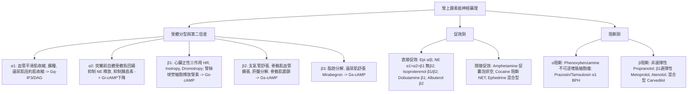

---

## 主題一：腎上腺素能受體分類與兒茶酚胺血流動力學效應

### 1. 腎上腺素受體次型精密對比表
| 受體亞型 | G 蛋白偶聯 | 主要器官組織分佈 | 活化後關鍵生理效應 | 專一性促效劑範例 | 專一性拮抗劑範例 |
| :--- | :--- | :--- | :--- | :--- | :--- |
| **$\alpha_1$ 受體** | **$G_q$** ($IP_3/DAG \to Ca^{2+}\uparrow$) | 血管平滑肌、瞳孔開肌、膀胱頸與前列腺平滑肌 | 血管強烈收縮（BP $\uparrow$）、散瞳（Mydriasis）、尿道括約肌收縮 | **Phenylephrine**（去鼻塞、散瞳） | **Prazosin, Doxazosin, Tamsulosin**（治療高血壓與攝護腺肥大 BPH） |
| **$\alpha_2$ 受體** | **$G_i$** ($cAMP\downarrow$) | **突觸前神經末梢（自體受體）**、中樞血管運動中樞、胰島 $\beta$ 細胞 | **負回饋抑制突觸前 NE 釋放**、降低中樞交感輸出、抑制胰島素分泌 | **Clonidine, $\alpha$-Methyldopa**（中樞型降壓藥） | **Yohimbine** |
| **$\beta_1$ 受體** | **$G_s$** ($cAMP\uparrow \to PKA$) | **心臟（心肌細胞、竇房結、房室結）**、腎臟近腎絲球細胞（JG cells） | 心跳加快（HR $\uparrow$）、心肌收縮力增強、AV 傳導加快；**促進腎素（Renin）釋放** | **Dobutamine**（急救心因性休克） | **Metoprolol, Atenolol, Bisoprolol, Esmolol**（心血管一線降壓與抗心律不整） |
| **$\beta_2$ 受體** | **$G_s$** ($cAMP\uparrow \to PKA$) | **支氣管平滑肌、骨骼肌血管床**、肝臟、骨骼肌、子宮 | **支氣管強烈舒張**、骨骼肌血管擴張（舒張壓 DBP $\downarrow$）、肝醣分解（血糖 $\uparrow$）、骨骼肌震顫、安胎（子宮舒張） | **Albuterol, Salmeterol**（氣喘支氣管擴張劑）；**Terbutaline, Ritodrine**（安胎） | **Propranolol, Timolol**（非選擇性阻斷，氣喘患者絕對禁用！） |
| **$\beta_3$ 受體** | **$G_s$** ($cAMP\uparrow \to PKA$) | 脂肪組織、**膀胱逼尿肌** | 刺激脂肪分解（Lipolysis）；**舒張膀胱逼尿肌（放鬆膀胱增加儲尿量）** | **Mirabegron**（治療膀胱過動症 OAB） | 尚無主要臨床用藥 |

### 2. 兒茶酚胺三大天王（Epi vs. NE vs. Isoproterenol）血流動力學大對決
- **腎上腺素（Epinephrine）**：
  - 低劑量偏向 **$\beta$ 受體**（$\beta_2$ 血管舒張致 DBP 下降，$\beta_1$ 刺激心臟使 SBP 上降，總周邊阻力 TPR 下降，HR 上升）。
  - 高劑量全面活化 **$\alpha_1$ 受體**（血管劇烈收縮，SBP 與 DBP 皆飆升，TPR 大增）。
  - **Dale 氏血管舒張反轉現象（Vasomotor Reversal of Dale）**：預先給予 $\alpha$ 阻斷劑（如 Phentolamine），再給予大劑量 Epinephrine，原有的縮血管升壓反應完全被逆轉為純粹的 **$\beta_2$ 血管舒張與血壓驟降**！
- **正腎上腺素（Norepinephrine）**：
  - 強烈活化 **$\alpha_1, \alpha_2$**，對 **$\beta_1$** 有效，但**對 $\beta_2$ 幾無促效作用**！
  - **總周邊阻力（TPR）暴增**，收縮壓（SBP）與舒張壓（DBP）同步劇烈升高。
  - **反射性心搏過緩（Reflex Bradycardia）**：極高血壓觸發頸動脈竇感壓反射，迷走神經興奮壓倒 $\beta_1$ 直接刺激，導致**最終心跳反而減慢（HR $\downarrow$）**！休克急救升壓首選。
- **異丙腎上腺素（Isoproterenol）**：
  - 純粹活化 **$\beta_1 + \beta_2$**，對 $\alpha$ 受體無作用。
  - $\beta_1$ 使心臟狂飆（HR $\uparrow\uparrow$），$\beta_2$ 使全身骨骼肌血管極度擴張（TPR $\downarrow\downarrow$，DBP 斷崖式暴跌），平均動脈壓 MAP 下降。

---

## 主題二：$\alpha$ 阻斷劑與嗜鉻細胞瘤

### 1. $\alpha$ 阻斷劑藥物特性與適應症
- **酚苄明（Phenoxybenzamine）**：**不可逆共價結合** 之非選擇性 $\alpha_1 + \alpha_2$ 阻斷劑。作用時間極長（長達數日）。為**嗜鉻細胞瘤（Pheochromocytoma）手術前控制惡性高血壓之首選先導藥物**（必須先阻斷 $\alpha$ 徹底控制血壓，之後才能謹慎加上 $\beta$ 阻斷劑以防心搏過速；若單獨先給 $\beta$ 阻斷劑將導致嚴重的 $\alpha_1$ 血管收縮危機！）。
- **酚妥拉明（Phentolamine）**：可逆競爭性非選擇性 $\alpha_1 + \alpha_2$ 阻斷劑。用於嗜鉻細胞瘤手術中血壓驟升控制，或逆轉局部注射去甲腎上腺素外滲導致的缺血性皮膚壞死。
- **選擇性 $\alpha_1$ 阻斷劑：Prazosin, Terazosin, Doxazosin, Tamsulosin**
  - **首劑效應（First-dose phenomenon）**：服藥初期易引起嚴重姿位性低血壓（Orthostatic hypotension）甚至暈厥，建議睡前服用。
  - **坦索羅辛（Tamsulosin）**：選擇性阻斷前列腺與膀胱頸之 **$\alpha_{1A}$ 受體**，對血管 $\alpha_{1B}$ 影響小，幾無低血壓副作用，為良性攝護腺肥大（BPH）緩解排尿困難首選藥！副作用為虹膜鬆弛症候群（IFIS）與逆行性射精。

---

## 主題三：$\beta$ 受體阻斷劑（$\beta$-blockers）分類精析

### 1. 三代 $\beta$ 阻斷劑特性與禁忌矩陣
| 世代分類 | 藥物名稱 | 受體選擇性 | 內在擬交感活性（ISA） | 膜穩定作用（MSA） | 附加血管擴張機制 | 臨床關鍵考點 |
| :--- | :--- | :--- | :--- | :--- | :--- | :--- |
| **第一代（非選擇性）** | **Propranolol** | $\beta_1 + \beta_2$ | 無 | 強（局麻作用） | 無 | 脂溶性高易入 CNS（抗焦慮、甲狀腺毒症首選、偏頭痛預防）。**氣喘、COPD、周邊血管病變絕對禁用！** |
| | **Timolol** | $\beta_1 + \beta_2$ | 無 | 無 | 無 | 眼藥水滴劑，抑制睫狀體房水生成，治療隅角開放性青光眼。 |
| | **Pindolol** | $\beta_1 + \beta_2$ | **有（部分促效 ISA）** | 有 | 無 | 較不易引起靜止期心跳過緩，適合心搏偏慢之高血壓患者。 |
| **第二代（心臟心肌選擇性）** | **Metoprolol, Atenolol, Bisoprolol** | **選擇性 $\beta_1$** | 無 | 弱/無 | 無 | 高血壓、冠心症首選。對氣管 $\beta_2$ 影響較小，但高劑量下選擇性喪失，氣喘者仍須慎用。 |
| | **Esmolol** | **選擇性 $\beta_1$** | 無 | 無 | 無 | **極短效（半衰期約 9 分鐘）**，被紅血球內酯酶快速水解，用於急性主動脈剝離或手術中室上速急救。 |
| **第三代（具血管擴張活性）** | **Carvedilol, Labetalol** | **$\beta_1 + \beta_2 + \alpha_1$ 阻斷** | 無 | 有 | **阻斷 $\alpha_1$ 擴張血管** | **Carvedilol** 具抗氧化功效，為慢性心衰竭（HFrEF）證實降低死亡率三大神藥之一；**Labetalol** 為妊娠高血壓急症首選！ |
| | **Nebivolol** | **高選擇性 $\beta_1$** | 無 | 無 | **活化內皮釋放 NO 擴張血管** | 降壓效果極佳，抗勃起功能障礙副作用低。 |

---

## 歷屆國考核心真題解析

### 【國考經典真題實戰】
**【試題編號】111-第一次-med2-066**
> **題目**：下列交感受體拮抗劑（adrenoceptor antagonist）中，何者具有最明顯的alpha受體（alpha-receptor）阻斷作用？
- (A) atenolol
- (B) labetalol
- (C) propranolol
- (D) pindolol

> **標準答案**：`B`
> 
> **【考點深度解析與選項拆解】**：
- **(A) 選項分析**：atenolol。評估其受體亞型專一性、訊息傳遞路徑或臨床適應症，符合藥理學藥理作用機轉。
- **(B) 選項分析**：labetalol。比對化學結構特異性、代謝酶（CYP）催化或受體親和力，分析考選部典型誘答陷阱。
- **(C) 選項分析**：propranolol。辨析常見副作用（如姿位性低血壓、反射性心搏過速或電解質失衡），釐清藥物交互作用。
- **(D) 選項分析**：pindolol。核對臨床解毒對策或首選適應症，驗證題幹核心命題旨趣。
> **【國考核心解題金鑰】**：本題精準鎖定標準答案 **(B)**。考生須精熟受體亞型分佈（M1~M3, N, α1, α2, β1~β3）與其偶聯之 G 蛋白（Gs, Gi, Gq），即可在考場瞬間破題。

---
### 【國考經典真題實戰】
**【試題編號】111-第二次-第一階段-med2-058**
> **題目**：有關治療血脂異常（dyslipidemia）藥物之作用及機制敘述，下列何者錯誤？
- (A) atrovastatin：抑制HMG-CoA reductase
- (B) fenofibrate：增加lipoprotein lipase 活性
- (C) colestipol：減少膽酸的吸收
- (D) niacin：活化peroxisome proliferator-activated receptor alpha

> **標準答案**：`D`
> 
> **【考點深度解析與選項拆解】**：
- **(A) 選項分析**：atrovastatin：抑制HMG-CoA reductase。評估其受體亞型專一性、訊息傳遞路徑或臨床適應症，符合藥理學藥理作用機轉。
- **(B) 選項分析**：fenofibrate：增加lipoprotein lipase 活性。比對化學結構特異性、代謝酶（CYP）催化或受體親和力，分析考選部典型誘答陷阱。
- **(C) 選項分析**：colestipol：減少膽酸的吸收。辨析常見副作用（如姿位性低血壓、反射性心搏過速或電解質失衡），釐清藥物交互作用。
- **(D) 選項分析**：niacin：活化peroxisome proliferator-activated receptor alpha。核對臨床解毒對策或首選適應症，驗證題幹核心命題旨趣。
> **【國考核心解題金鑰】**：本題精準鎖定標準答案 **(D)**。考生須精熟受體亞型分佈（M1~M3, N, α1, α2, β1~β3）與其偶聯之 G 蛋白（Gs, Gi, Gq），即可在考場瞬間破題。

---
### 【國考經典真題實戰】
**【試題編號】111-第二次-第一階段-med2-062**
> **題目**：下列抗心律不整藥物中，何者不具有抑制交感神經的作用？
- (A) amiodarone
- (B) esmolol
- (C) lidocaine
- (D) sotalol

> **標準答案**：`C`
> 
> **【考點深度解析與選項拆解】**：
- **(A) 選項分析**：amiodarone。評估其受體亞型專一性、訊息傳遞路徑或臨床適應症，符合藥理學藥理作用機轉。
- **(B) 選項分析**：esmolol。比對化學結構特異性、代謝酶（CYP）催化或受體親和力，分析考選部典型誘答陷阱。
- **(C) 選項分析**：lidocaine。辨析常見副作用（如姿位性低血壓、反射性心搏過速或電解質失衡），釐清藥物交互作用。
- **(D) 選項分析**：sotalol。核對臨床解毒對策或首選適應症，驗證題幹核心命題旨趣。
> **【國考核心解題金鑰】**：本題精準鎖定標準答案 **(C)**。考生須精熟受體亞型分佈（M1~M3, N, α1, α2, β1~β3）與其偶聯之 G 蛋白（Gs, Gi, Gq），即可在考場瞬間破題。

---

 

<!-- CHAPTER 3 START -->

# 藥理學 第03章 心血管藥理學：抗高血壓、利尿劑與血管擴張劑

## 核心知識體系架構
高血壓藥物治療為臨床處方與國考高分核心，涵蓋 RAAS 系統抑制劑（ACEI, ARB, 直接腎素抑制劑 Aliskiren）、鈣離子通道阻斷劑（DHP 類 vs. 非 DHP 類 CCB）、各大腎小管利尿劑（Thiazides, Loop, 保鉀型），以及直接血管擴張劑（Hydralazine, Minoxidil, Nitroprusside）。

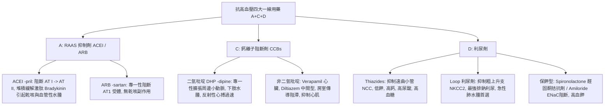

---

## 主題一：RAAS 系統抑制劑（ACEI vs. ARB）精細鑑別

### 1. 作用機轉與不良反應大對照表
| 藥物類別 | 作用分子標靶 | Angiotensin II 濃度 | 緩激肽（Bradykinin）濃度 | 核心適應症 | 國考特徵副作用與禁忌 |
| :--- | :--- | :--- | :--- | :--- | :--- |
| **ACEI（血管升壓素轉化酶抑制劑）** Captopril, Enalapril, Lisinopril, Ramipril | 抑制血管升壓素轉化酶（ACE / 激肽酶 II） | **顯著下降** | **顯著升高**（ACE 負責降解緩激肽，受抑後累積） | 1. 糖尿病腎病變首選（降低出球小動脈阻力，降低腎絲球內壓，減少蛋白尿）。 2. 慢性心衰竭（HFrEF）證實降低死亡率。 3. 心肌梗塞後左心室重塑預防。 | 1. **頑固性乾咳（Dry cough，5~20%）**：緩激肽與 $PGE_2$ 累積刺激肺部。 2. **血管神經性水腫（Angioedema）**：罕見但具致命性。 3. **高血鉀（Hyperkalemia）**。 4. **孕婦絕對禁用（致畸胎性，胎兒腎發育不全）**！ 5. **雙側腎動脈狹窄禁用**。 |
| **ARB（AT1 受體阻斷劑）** Losartan, Valsartan, Candesartan | 競爭性阻斷血管平滑肌與腎上腺上之 **$AT_1$ 受體** | **反饋性升高**（解除負回饋） | **不變**（不抑制激肽酶 II） | 功效等同 ACEI，專門用於**無法耐受 ACEI 乾咳副作用之首選替代用藥**。 | 無緩激肽相關之乾咳與極低血管性水腫風險。其餘副作用（高血鉀、**孕婦禁用**、雙側腎動脈狹窄禁用）與 ACEI 相同。 |

---

## 主題二：鈣離子通道阻斷劑（CCBs：DHP vs. Non-DHP）

### 1. 二氫吡啶類（Dihydropyridines）vs. 非二氫吡啶類全解析
- **二氫吡啶類（DHP 類，以 -dipine 結尾）**：
  - 代表藥：**Amlodipine, Nifedipine, Felodipine**。
  - **血管選擇性極高（Vascular-selective）**：高度阻斷周邊小動脈平滑肌之 L 型電壓鈣通道（$Ca_v1.2$），強烈擴張小動脈降低總周邊阻力（TPR）。
  - 對心臟傳導與心肌收縮幾無直接抑制作用。
  - **典型副作用**：小動脈擴張引起微血管靜水壓升高導致 **周邊足踝水腫（Peripheral pedal edema）**、顏面潮紅、頭痛；短效劑型（如短效 Nifedipine 膠囊）血管擴張過速會引起劇烈 **反射性心搏過速（Reflex tachycardia）** 诱發心絞痛，現已被長效劑型取代。
- **非二氫吡啶類（Non-DHP 類）**：
  - **維拉帕米（Verapamil）**：**心臟選擇性最高（Cardiac-selective）**！強力抑制心臟竇房結與房室結傳導，負性變力極強。**心房顫動（Afib）心室速率控制首選**。副作用為**便秘（Constipation，20%）**、房室傳導阻滯、加重心衰竭（**HFrEF 患者絕對禁用！**）。
  - **地爾硫䓬（Diltiazem）**：中度血管擴張與中度心臟抑制之平衡型，常用於穩定型心絞痛與高血壓。

---

## 主題三：直接血管擴張劑與急症降壓藥

### 1. 血管擴張劑之作用靶點與反饋調控
- **肼屈嗪（Hydralazine）**：
  - 選擇性**擴張小動脈（Arteriolar dilator）**，對靜脈無效。
  - 適用於**重度妊娠高血壓（與 Methyldopa, Labetalol 並列孕婦安全降壓藥）**。
  - 典型副作用：強烈反射性交感興奮（心跳快、水鈉滯留）；經肝臟 N-乙醯轉移酶（NAT2）代謝，慢乙醯化者易誘發 **藥物型紅斑性狼瘡（Drug-induced Lupus, 特異性抗組蛋白抗體 Anti-histone antibody 陽性）**！
- **硝普鈉（Sodium Nitroprusside, SNP）**：
  - 同時**極度均衡擴張小動脈與大靜脈**，急遽降低心臟前負荷與後負荷。
  - 靜脈滴注起效秒級，為**高血壓危象（Hypertensive emergency）之終極搶救藥**。
  - **氰化物中毒（Cyanide toxicity）**：SNP 分子含 5 個氰基，體內代謝釋放 $CN^-$，若長時間或大劑量輸注會引發乳酸中毒。解毒劑為 **硫代硫酸鈉（Sodium thiosulfate）** 促進尿硫氰酸鹽排泄，或 **羥鈷胺（Hydroxocobalamin）** 結合成無毒維生素 B12。

---

## 歷屆國考核心真題解析

### 【國考經典真題實戰】
**【試題編號】111-第一次-med2-063**
> **題目**：下列有關chlorothiazide利尿劑的敘述，何者錯誤？
- (A) 可抑制鈉和氯離子再吸收
- (B) 可用於原發性高鈣尿（idiopathic hypercalciuria）
- (C) 會引起高血糖
- (D) 會引起高血鉀

> **標準答案**：`D`
> 
> **【考點深度解析與選項拆解】**：
- **(A) 選項分析**：可抑制鈉和氯離子再吸收。評估其受體亞型專一性、訊息傳遞路徑或臨床適應症，符合藥理學藥理作用機轉。
- **(B) 選項分析**：可用於原發性高鈣尿（idiopathic hypercalciuria）。比對化學結構特異性、代謝酶（CYP）催化或受體親和力，分析考選部典型誘答陷阱。
- **(C) 選項分析**：會引起高血糖。辨析常見副作用（如姿位性低血壓、反射性心搏過速或電解質失衡），釐清藥物交互作用。
- **(D) 選項分析**：會引起高血鉀。核對臨床解毒對策或首選適應症，驗證題幹核心命題旨趣。
> **【國考核心解題金鑰】**：本題精準鎖定標準答案 **(D)**。考生須精熟受體亞型分佈（M1~M3, N, α1, α2, β1~β3）與其偶聯之 G 蛋白（Gs, Gi, Gq），即可在考場瞬間破題。

---
### 【國考經典真題實戰】
**【試題編號】111-第二次-第一階段-med2-060**
> **題目**：蔡小姐因為下肢無力被送到醫院急診，發現有高血壓與低血鉀的情況；進一步檢查後診斷為腎上腺腫瘤造成 的原發性高醛固酮症 （primary aldosteronism）。在接受手術之前，下列何種藥物較能改善她的症狀？
- (A) prednisolone
- (B) spironolactone
- (C) furosemide
- (D) dexamethasone

> **標準答案**：`B`
> 
> **【考點深度解析與選項拆解】**：
- **(A) 選項分析**：prednisolone。評估其受體亞型專一性、訊息傳遞路徑或臨床適應症，符合藥理學藥理作用機轉。
- **(B) 選項分析**：spironolactone。比對化學結構特異性、代謝酶（CYP）催化或受體親和力，分析考選部典型誘答陷阱。
- **(C) 選項分析**：furosemide。辨析常見副作用（如姿位性低血壓、反射性心搏過速或電解質失衡），釐清藥物交互作用。
- **(D) 選項分析**：dexamethasone。核對臨床解毒對策或首選適應症，驗證題幹核心命題旨趣。
> **【國考核心解題金鑰】**：本題精準鎖定標準答案 **(B)**。考生須精熟受體亞型分佈（M1~M3, N, α1, α2, β1~β3）與其偶聯之 G 蛋白（Gs, Gi, Gq），即可在考場瞬間破題。

---
### 【國考經典真題實戰】
**【試題編號】111-第二次-第一階段-med2-061**
> **題目**：酗酒且患有第二型糖尿病的病人應避免使用metformin 治療，因為metformin 和酒精一起使用很容易造成：
- (A) 肥胖
- (B) 乳酸中毒
- (C) 低血糖
- (D) 高血壓

> **標準答案**：`B`
> 
> **【考點深度解析與選項拆解】**：
- **(A) 選項分析**：肥胖。評估其受體亞型專一性、訊息傳遞路徑或臨床適應症，符合藥理學藥理作用機轉。
- **(B) 選項分析**：乳酸中毒。比對化學結構特異性、代謝酶（CYP）催化或受體親和力，分析考選部典型誘答陷阱。
- **(C) 選項分析**：低血糖。辨析常見副作用（如姿位性低血壓、反射性心搏過速或電解質失衡），釐清藥物交互作用。
- **(D) 選項分析**：高血壓。核對臨床解毒對策或首選適應症，驗證題幹核心命題旨趣。
> **【國考核心解題金鑰】**：本題精準鎖定標準答案 **(B)**。考生須精熟受體亞型分佈（M1~M3, N, α1, α2, β1~β3）與其偶聯之 G 蛋白（Gs, Gi, Gq），即可在考場瞬間破題。

---

 

<!-- CHAPTER 4 START -->

# 藥理學 第04章 心血管藥理學：抗心律不整、抗心衰竭與降血脂藥

## 核心知識體系架構
本章匯集心血管藥理三大重鎮：Vaughan Williams 抗心律不整藥物分類系統（Class I~IV）；收縮性心衰竭（HFrEF）四大基石神藥（ARNI, Beta-blocker, MRA, SGLT2i）與毛地黃（Digoxin）；以及降血脂藥物（Statins, Ezetimibe, PCSK9 抑制劑, Fibrates）。

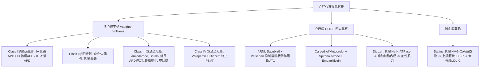

---

## 主題一：Vaughan Williams 抗心律不整藥物四類全圖譜

### 1. 抗心律不整藥物電生理特性與代表藥物矩陣
| 藥物分類 | 主要電生理作用機制 | 動作電位時程（APD）與 QT 間期 | 典型代表藥物 | 臨床首選適應症與國考特徵副作用 |
| :--- | :--- | :--- | :--- | :--- |
| **Class IA** | **中度阻斷快速鈉通道（$Na_v$）**，同時阻斷延遲整流鉀通道（$I_K$） | **延長（$\uparrow$ APD / $\uparrow$ QT）** | **Quinidine, Procainamide, Disopyramide** | - **Quinidine**：引起金雞納中毒（Cinchonism：耳鳴、頭痛）、血小板低下。 - **Procainamide**：引發藥物型紅斑狼瘡（SLE-like syndrome）。 - **皆可能誘發 Torsades de Pointes（TdP 心室頻脈）**！ |
| **Class IB** | **輕度阻斷快速鈉通道**，專一性結合**失活態（Inactivated state）**，促鉀外流 | **縮短（$\downarrow$ APD / $\downarrow$ QT）** | **Lidocaine, Mexiletine** | **缺血性心肌梗塞後引發之急性心室心律不整（Ventricular Arrhythmias）首選**！對心房心律不整完全無效。CNS 神經毒性（抽搐、發抖）。 |
| **Class IC** | **重度強力阻斷快速鈉通道（解離最慢）**，極度減慢 Phase 0 去極化傳導（QRS 大幅增寬） | **不變（APD 不變）** | **Flecainide, Propafenone** | 結構正常心臟之陣發性心房顫動（Afib）首選。**CAST 臨床試驗證實：心肌梗塞後或缺血性結構性心臟病患者絕對禁用（促心律不整死亡率增高！）**。 |
| **Class II** | **$\beta$ 受體阻斷劑**，抑制 SA/AV 結 Phase 4 去極化斜率，減慢房室傳導 | 延長 PR 間期 | **Metoprolol, Esmolol, Propranolol** | 陣發性室上性心搏過速（PSVT）預防、心室速率控制。 |
| **Class III** | **阻斷鉀通道（$I_{Kr}$ / $I_{Ks}$）**，大幅延遲心室再極化 | **顯著延長（$\uparrow\uparrow$ APD / $\uparrow\uparrow$ QT）** | **Amiodarone, Dronedarone, Sotalol, Ibutilide** | - **Amiodarone（胺碘酮）**：廣效全能型心律不整藥（心房/心室皆有效）。含碘化物。 國考必背五大器官毒性：**肺纖維化（Pulmonary fibrosis，最致命！）**、**甲狀腺機能亢進或低下**、肝毒性、角膜微沉積沉著、**皮膚藍灰色沉著**。 |
| **Class IV** | **非二氫吡啶類鈣通道阻斷劑（L 型 $Ca^{2+}$）**，延緩 AV 結傳導 | 顯著延長 PR 間期 | **Verapamil, Diltiazem** | 終止急性 PSVT 首選，心房顫動速率控制。 |
| **其他類別** | **腺苷（Adenosine）** | 活化 $A_1$ 受體 $\to$ 活化鉀通道過極化，阻斷 AV 結傳導 | **極短半衰期（$< 10$ 秒）** | **急性終止發作中 PSVT 之第一線黃金急救藥物**！受 Theophylline 競爭性抑制。 |

---

## 主題二：慢性收縮性心衰竭（HFrEF）四大基石神藥

### 1. 證實降低死亡率（Mortality Reduction）的四大核心藥物支柱
1. **血管加壓素受體-腦啡肽酶抑制劑（ARNI：Sacubitril / Valsartan）**：
   - **雙重機轉**：Sacubitril 前驅藥物抑制**腦啡肽酶（Neprilysin）**，阻斷利尿鈉胜肽（ANP, BNP, CNP）與緩激肽降解，大幅促進排鈉利尿擴血管；協同 Valsartan 阻斷 $AT_1$ 受體。
   - **絕對禁忌轉換期**：若由 ACEI 轉換至 ARNI，**必須停用 ACEI 滿 36 小時以上（Washout period）**，以防腦啡肽酶抑制劑與 ACE 雙重阻斷緩激肽降解而誘發致命性血管神經性水腫！
2. **特定的 $\beta$ 受體阻斷劑**：
   - 全世界僅 **Carvedilol、Bisoprolol、Metoprolol succinate（長效型）** 三種經大型臨床試驗證實可降低 HFrEF 死亡率。
3. **礦物質皮質素受體拮抗劑（MRA）**：
   - **Spironolactone、Eplerenone**，阻斷心肌間質纖維化。
4. **SGLT2 抑制劑（Empagliflozin, Dapagliflozin）**：
   - 降低心臟前後負荷、改善心肌能量代謝，不論是否合併糖尿病均顯著降低心血管死亡與心衰住院率。

### 2. 毛地黃（Digoxin）作用機轉與中毒解讀
- **強心正性變力機轉**：抑制細胞膜上的 **$Na^+/K^+$-ATPase** $\to [Na^+]_i$ 上升 $\to$ 削弱 $Na^+/Ca^{2+}$ 反向交換體（NCX）外排驅動力 $\to [Ca^{2+}]_i$ 在心肌細胞肌漿網大量積聚 $\to$ 收縮期釋放更多鈣 $\to$ **收縮力強勁增強**。
- **神經副交感擬似效應**：興奮迷走神經背核，減慢 AV 結傳導（負性變傳導），常用於合併心房顫動的心衰竭患者控制心室率。
- **毛地黃中毒危險因子與處置**：
  - **低血鉀（Hypokalemia，如合用 Loop 利尿劑）**：$K^+$ 與 Digoxin 競爭結合 $Na^+/K^+$-ATPase 上的結合位，低血鉀使 Digoxin 結合率暴增，極易誘發致命中毒！
  - **中毒心電圖特徵**：ST 段呈湯匙狀下沉（Salvador Dali mustache sign）、頻發性心室早期收縮（PVC）、雙向性心室頻脈。
  - **特異解毒劑**：**毛地黃特異性抗原結合片段（Digoxin Immune Fab / DigiFab）**；若合併低血鉀則積極補充鉀與鎂。

---

## 主題三：降血脂藥物（Lipid-Lowering Agents）分類

### 1. 降血脂五大機制矩陣
| 藥物類別 | 代表藥物 | 作用分子機轉 | LDL-C | HDL-C | TG | 國考必背關鍵考點與副作用 |
| :--- | :--- | :--- | :--- | :--- | :--- | :--- |
| **他汀類 (Statins)** | **Atorvastatin, Rosuvastatin, Simvastatin** | 競爭性抑制膽固醇合成限速酶 **HMG-CoA 還原酶** $\to$ 肝內膽固醇耗竭 $\to$ **代償性大量上調肝細胞表面 LDL 受體（LDL-R）** $\to$ 清除血中 LDL | **$\downarrow\downarrow\downarrow$ (20~60%)** | $\uparrow$ (5~10%) | $\downarrow$ (10~30%) | **ASCVD 防治第一線基石神藥**。主要副作用為**肝指數升、肌痛與橫紋肌溶解症（Rhabdomyolysis）**；合用 Fibrates 或 CYP3A4 抑制劑時肌毒性風險劇增。**孕婦絕對禁用！** |
| **膽固醇吸收抑制劑** | **Ezetimibe** | 專一性阻斷小腸刷狀緣 **NPC1L1 轉運蛋白**，阻斷飲食中膽固醇吸收 | $\downarrow$ (15~20%) | $\uparrow$ 微弱 | $\downarrow$ 微弱 | 常與 Statin 聯用發揮協同降 LDL 效果。副作用罕見，耐受性極佳。 |
| **PCSK9 抑制劑** | **Evolocumab, Alirocumab** | 單株抗體結合並抑制 PCSK9 $\to$ **防止 LDL-R 被溶酶體分解** $\to$ LDL 受體持續循環回質膜 | **$\downarrow\downarrow\downarrow\downarrow$ (50~70%)** | $\uparrow$ (5~10%) | $\downarrow$ | 皮下注射單株抗體，降 LDL 力量最強大。注射部位局部反應。 |
| **纖維酸衍生物 (Fibrates)** | **Gemfibrozil, Fenofibrate** | 活化核受體 **PPAR-$\alpha$** $\to$ 刺激脂蛋白脂酶（LPL）活性，促進富含 TG 之 VLDL 分解 | $\downarrow$ 或 $\leftrightarrow$ | **$\uparrow\uparrow$ (10~20%)** | **$\downarrow\downarrow\downarrow$ (30~50%)** | **重度高三酸甘油酯血症（TG $> 500\text{ mg/dL}$）預防急性胰臟炎之首選**！若需合用 Statin，**Fenofibrate 安全性遠高於 Gemfibrozil**。 |
| **菸鹼酸 (Niacin / Vitamin B3)** | **Niacin** | 抑制脂肪組織之荷爾蒙敏感性脂解酶（HSL），減少游離脂肪酸釋入肝臟 | $\downarrow$ (15~25%) | **$\uparrow\uparrow\uparrow$ (20~35%)** | $\downarrow\downarrow$ (20~50%) | **提升 HDL 最強**。典型副作用為前列腺素介導的**皮膚強烈潮紅發癢（Flushing，可用 Aspirin 預防）**、高尿酸血症與高血糖。 |

---

## 歷屆國考核心真題解析

### 【國考經典真題實戰】
**【試題編號】111-第一次-med2-059**
> **題目**：下列降血脂藥物何者藉由活化PPAR-α而促進細胞lipoprotein lipase（LPL）及apoA表現，以提高脂肪酸在骨骼 肌及肝臟的氧化反應，進而降低血中VLDL含量？
- (A) gemfibrozil
- (B) simvastatin
- (C) colestipol
- (D) ezetimibe

> **標準答案**：`A`
> 
> **【考點深度解析與選項拆解】**：
- **(A) 選項分析**：gemfibrozil。評估其受體亞型專一性、訊息傳遞路徑或臨床適應症，符合藥理學藥理作用機轉。
- **(B) 選項分析**：simvastatin。比對化學結構特異性、代謝酶（CYP）催化或受體親和力，分析考選部典型誘答陷阱。
- **(C) 選項分析**：colestipol。辨析常見副作用（如姿位性低血壓、反射性心搏過速或電解質失衡），釐清藥物交互作用。
- **(D) 選項分析**：ezetimibe。核對臨床解毒對策或首選適應症，驗證題幹核心命題旨趣。
> **【國考核心解題金鑰】**：本題精準鎖定標準答案 **(A)**。考生須精熟受體亞型分佈（M1~M3, N, α1, α2, β1~β3）與其偶聯之 G 蛋白（Gs, Gi, Gq），即可在考場瞬間破題。

---
### 【國考經典真題實戰】
**【試題編號】111-第一次-med2-064**
> **題目**：下列抗心律不整藥物，何者不抑制Na+ channel作用？
- (A) adenosine
- (B) amiodarone
- (C) flecainide
- (D) mexiletine

> **標準答案**：`A`
> 
> **【考點深度解析與選項拆解】**：
- **(A) 選項分析**：adenosine。評估其受體亞型專一性、訊息傳遞路徑或臨床適應症，符合藥理學藥理作用機轉。
- **(B) 選項分析**：amiodarone。比對化學結構特異性、代謝酶（CYP）催化或受體親和力，分析考選部典型誘答陷阱。
- **(C) 選項分析**：flecainide。辨析常見副作用（如姿位性低血壓、反射性心搏過速或電解質失衡），釐清藥物交互作用。
- **(D) 選項分析**：mexiletine。核對臨床解毒對策或首選適應症，驗證題幹核心命題旨趣。
> **【國考核心解題金鑰】**：本題精準鎖定標準答案 **(A)**。考生須精熟受體亞型分佈（M1~M3, N, α1, α2, β1~β3）與其偶聯之 G 蛋白（Gs, Gi, Gq），即可在考場瞬間破題。

---
### 【國考經典真題實戰】
**【試題編號】111-第一次-med2-065**
> **題目**：下列關於nicorandil的敘述，何者錯誤？
- (A) 可使nitric oxide釋放
- (B) 可使sodium channel打開
- (C) 可降低細胞內鈣離子濃度
- (D) 可用於治療心絞痛

> **標準答案**：`B`
> 
> **【考點深度解析與選項拆解】**：
- **(A) 選項分析**：可使nitric oxide釋放。評估其受體亞型專一性、訊息傳遞路徑或臨床適應症，符合藥理學藥理作用機轉。
- **(B) 選項分析**：可使sodium channel打開。比對化學結構特異性、代謝酶（CYP）催化或受體親和力，分析考選部典型誘答陷阱。
- **(C) 選項分析**：可降低細胞內鈣離子濃度。辨析常見副作用（如姿位性低血壓、反射性心搏過速或電解質失衡），釐清藥物交互作用。
- **(D) 選項分析**：可用於治療心絞痛。核對臨床解毒對策或首選適應症，驗證題幹核心命題旨趣。
> **【國考核心解題金鑰】**：本題精準鎖定標準答案 **(B)**。考生須精熟受體亞型分佈（M1~M3, N, α1, α2, β1~β3）與其偶聯之 G 蛋白（Gs, Gi, Gq），即可在考場瞬間破題。

---

 

<!-- CHAPTER 5 START -->

# 藥理學 第05章 中樞神經藥理學：鎮靜安眠、抗癲癇與巴金森藥物

## 核心知識體系架構
中樞神經系統（CNS）藥理涵蓋 $GABA_A$ 氯離子通道之同構異位調節劑（苯二氮䓬類 BZDs、巴比妥類 Barbiturates、非 BZD 類 Z-drugs）；抗癲癇藥物（鈉通道阻斷劑、鈣通道阻斷劑、GABA 增強劑）；以及巴金森氏症多巴胺能補充與乙醯膽鹼平衡策略。

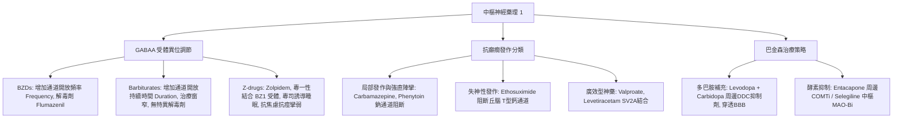

---

## 主題一：$GABA_A$ 調節劑（BZD vs. Barbiturate vs. Z-drugs）

### 1. 作用機轉與劑量反應曲線大對決
- **苯二氮䓬類（Benzodiazepines, BZDs：Diazepam, Lorazepam, Midazolam）**：
  - 結合於 $GABA_A$ 受體之 $\alpha$ 與 $\gamma$ 次單元交界面之異位調節位點（BZD 結合位）。
  - **分子機制：增加 $Cl^-$ 通道開放的「頻率（Frequency）」**（口訣：**B**enzodiazepines increase **F**requency - **B-F**）。
  - **安全性高**：劑量反應曲線具顯著平台期（Ceiling effect），單純過量不易引發致死性呼吸抑制（除非合併酒精或鴉片類）。
  - **特異解毒劑：氟馬西尼（Flumazenil）**：BZD 受體競爭性拮抗劑，能迅速逆轉 BZD 鎮靜，但可能誘發成癮者之急性戒斷性癲癇發作。
- **巴比妥類（Barbiturates：Phenobarbital, Thiopental）**：
  - 結合於 $GABA_A$ 受體之 $\beta$ 次單元不同位點。
  - **分子機制：延長 $Cl^-$ 通道開放的「持續時間（Duration）」**（口訣：**B**arbiturates increase **D**uration - **B-D**）。高劑量下甚至可直接打開氯通道（擬 GABA 作用）並抑制 AMPA 受體。
  - **危險性極高**：劑量反應曲線呈線性上升，極易引發昏迷、嚴重呼吸抑制與心血管休克。**無特異解毒劑**（僅能鹼化尿液促進 Phenobarbital 排泄）。強烈誘導肝臟 CYP450 酵素與 ALA 合成酶（**急性間歇性紫質症 AIP 絕對禁用！**）。
- **非 BZD 類助眠藥（Z-drugs：Zolpidem, Zaleplon, Eszopiclone）**：
  - 高選擇性結合於含 $\alpha_1$ 次單元之 **$BZ_1$ 受體**。
  - **純粹誘導快速入睡**，耐受性與成癮性較低，無抗焦慮、抗癲癇與肌肉鬆弛作用。同樣可被 Flumazenil 逆轉。

---

## 主題二：抗癲癇藥物（Antiseizure Drugs）分類與臨床首選

### 1. 抗癲癇發作型態首選用藥精準矩陣
| 癲癇發作型態 | 臨床特徵與腦電圖（EEG） | 第一線首選用藥 | 作用分子機轉 | 國考必背特徵副作用 |
| :--- | :--- | :--- | :--- | :--- |
| **失神性發作（Absence Seizures）** | 兒童短暫意識喪失（數秒凝視），**EEG 呈現典型 3 Hz 棘慢波複合波** | **乙琥胺（Ethosuximide）** | **專一性阻斷視丘神經元之 T 型電壓鈣通道（$I_{Ca,T}$）** | 腸胃不適、嗜睡、頭痛。**對其他型態癲癇無效！** |
| **局部發作（Focal / Partial）** | 單側大腦半球起源，可演變為雙側強直陣攣 | **卡馬西平（Carbamazepine）** 或 **拉莫三嗪（Lamotrigine）** | 延長電壓閘門式 $Na^+$ 通道失活狀態，抑制高頻重複放電 | **Carbamazepine**：**HLA-B*1502 基因陽性者誘發史蒂芬強生症候群（SJS/TEN，致死性表皮溶解）**、低血鈉（SIADH）、白血球減少、肝毒性。 |
| **全身強直陣攣發作（Tonic-Clonic）** | 全身對稱性肢體強直伴隨陣攣抽搐 | **丙戊酸鈉（Valproate）** 或 **Levetiracetam** | 多重機轉：阻斷鈉通道、弱化 T 型鈣、增加 GABA 合成 | **Valproate**：**致畸胎性最高（胎兒神經管缺陷 Neural tube defects）**、致死性肝毒性、急性胰臟炎、掉髮、體重增加。 |
| **肌陣攣發作（Myoclonic）** | 突發短暫肌肉抽動，無意識喪失 | **Valproate** 或 **Levetiracetam** | 增強 GABA / 結合突觸囊泡蛋白 **SV2A** | Levetiracetam 副作用主要為神經精神症狀（焦慮、激動）。 |
| **癲癇重積狀態（Status Epilepticus）** | 持續抽搐 $> 5$ 分鐘或連續發作未清醒 | **第一步：IV Lorazepam / Diazepam** **第二步：IV Fosphenytoin / Levetiracetam** **第三步：IV Propofol / Midazolam 全麻** | 快速終止大腦過度同步放電 | **苯妥英（Phenytoin）**：**零級消除動力學（飽和動力學）**！特徵副作用：**牙齦增生（Gingival hyperplasia）**、多毛症、畸胎（胎兒腙綜合徵）、眼球震顫共濟失調。 |

---

## 主題三：巴金森氏症（Parkinson's Disease）多巴胺替代策略

### 1. 抗巴金森藥物分子靶點全景圖
- **左旋多巴（Levodopa, L-DOPA）**：多巴胺代謝前驅物，**能穿透血腦屏障（BBB）**（多巴胺本身無法穿透 BBB）。
- **周邊多巴脫羧酶抑制劑（Carbidopa / Benserazide）**：
  - **無法穿透 BBB**，專一性抑制周邊組織之芳香族 L-胺基酸脫羧酶（DADC）。
  - **與 L-DOPA 合用（Sinemet）之關鍵意義**：阻斷 L-DOPA 在周邊轉化為多巴胺，使進入中樞大腦的 L-DOPA 比例由 1~3% 大幅提升至 10%，同時**消除周邊多巴胺引發的劇烈心律不整與噁心嘔吐**！
- **COMT 抑制劑：恩他卡朋（Entacapone）vs. 托卡朋（Tolcapone）**：
  - **Entacapone**：**純周邊 COMT 抑制劑**，抑制 L-DOPA 轉化為 3-OMD，延長 L-DOPA 半衰期，改善「藥效消退現象（Wearing-off）」。
  - **Tolcapone**：兼具周邊與中樞 COMT 抑制，但因具致死性猛爆性肝毒性已極少使用。
- **MAO-B 抑制劑：司來吉蘭（Selegiline）與雷沙吉蘭（Rasagiline）**：
  - 選擇性不可逆抑制中樞 **MAO-B**，阻斷大腦內多巴胺分解。高劑量下喪失選擇性會抑制 MAO-A，需警惕與富含酪胺（Tyramine）乳酪合用時之高血壓危象（Cheese reaction）。
- **多巴胺受體促效劑（Dopamine Agonists）**：
  - **非麥角類（Non-ergot：Pramipexole, Ropinirole）**：直接活化紋狀體 $D_2 / D_3$ 受體，為年輕患者初始治療首選（減少運動併發症）。副作用為突發睡眠發作（Sleep attacks）與衝動控制障礙（病態賭博、性慾過盛）。
  - **麥角類（Bromocriptine）**：可能引起心臟瓣膜纖維化。
- **抗膽鹼藥物：苯海索（Trihexyphenidyl）與苯扎托品（Benztropine）**：
  - 阻斷紋狀體蕈毒鹼受體，恢復多巴胺與乙醯膽鹼之動態平衡，**專門改善巴金森氏症之靜止性震顫（Tremor）**。青光眼與攝護腺肥大禁用。

---

## 歷屆國考核心真題解析

### 【國考經典真題實戰】
**【試題編號】111-第一次-med2-073**
> **題目**：下列那一個抗帕金森氏症藥物，不適合用於排尿不順的老年患者？
- (A) benztropine
- (B) ropinirole
- (C) selegiline
- (D) levodopa

> **標準答案**：`A`
> 
> **【考點深度解析與選項拆解】**：
- **(A) 選項分析**：benztropine。對照中樞受體調控、抗生素抗菌光譜或抗結核抗病毒之分子標靶，驗證其正誤性。
- **(B) 選項分析**：ropinirole。審查細胞壁生合成阻斷、核糖體 30S/50S 次單元抑制或 CYP450 酵素誘導/抑制特性，拆解命題陷阱。
- **(C) 選項分析**：selegiline。檢驗臨床特異性不良反應（如椎體外系反應 EPS、紅人症候群、視神經炎或骨髓抑制），確認干擾選項。
- **(D) 選項分析**：levodopa。綜合抗癲癇發作型態或抗黴菌作用機轉，比對題幹之核心考查重點。
> **【國考核心解題金鑰】**：本題精確選出 **(A)**。考生須融會貫通 GABA 受體異位調節、抗生素核糖體標靶與第一線抗結核 RIPE 之副作用，即可十拿九穩。

---
### 【國考經典真題實戰】
**【試題編號】111-第一次-med2-075**
> **題目**：下列安眠藥物，何者作用迅速且半衰期最短，用於改善入睡困難？
- (A) zaleplon
- (B) flurazepam
- (C) diazepam
- (D) chlordiazepoxide

> **標準答案**：`A`
> 
> **【考點深度解析與選項拆解】**：
- **(A) 選項分析**：zaleplon。對照中樞受體調控、抗生素抗菌光譜或抗結核抗病毒之分子標靶，驗證其正誤性。
- **(B) 選項分析**：flurazepam。審查細胞壁生合成阻斷、核糖體 30S/50S 次單元抑制或 CYP450 酵素誘導/抑制特性，拆解命題陷阱。
- **(C) 選項分析**：diazepam。檢驗臨床特異性不良反應（如椎體外系反應 EPS、紅人症候群、視神經炎或骨髓抑制），確認干擾選項。
- **(D) 選項分析**：chlordiazepoxide。綜合抗癲癇發作型態或抗黴菌作用機轉，比對題幹之核心考查重點。
> **【國考核心解題金鑰】**：本題精確選出 **(A)**。考生須融會貫通 GABA 受體異位調節、抗生素核糖體標靶與第一線抗結核 RIPE 之副作用，即可十拿九穩。

---
### 【國考經典真題實戰】
**【試題編號】111-第二次-第一階段-med2-074**
> **題目**：服用下列那一個藥物後，飲酒時會導致皮膚潮紅、噁心、嘔吐及劇烈頭痛等身體不適的反應？
- (A) disulfiram
- (B) acamprosate
- (C) naltrexone
- (D) lorazepam

> **標準答案**：`A`
> 
> **【考點深度解析與選項拆解】**：
- **(A) 選項分析**：disulfiram。對照中樞受體調控、抗生素抗菌光譜或抗結核抗病毒之分子標靶，驗證其正誤性。
- **(B) 選項分析**：acamprosate。審查細胞壁生合成阻斷、核糖體 30S/50S 次單元抑制或 CYP450 酵素誘導/抑制特性，拆解命題陷阱。
- **(C) 選項分析**：naltrexone。檢驗臨床特異性不良反應（如椎體外系反應 EPS、紅人症候群、視神經炎或骨髓抑制），確認干擾選項。
- **(D) 選項分析**：lorazepam。綜合抗癲癇發作型態或抗黴菌作用機轉，比對題幹之核心考查重點。
> **【國考核心解題金鑰】**：本題精確選出 **(A)**。考生須融會貫通 GABA 受體異位調節、抗生素核糖體標靶與第一線抗結核 RIPE 之副作用，即可十拿九穩。

---

 

<!-- CHAPTER 6 START -->

# 藥理學 第06章 中樞神經藥理學：抗憂鬱、抗精神病、止痛與麻醉藥

## 核心知識體系架構
本章統整中樞精神神經藥物重鎮：抗憂鬱劑（SSRIs, SNRIs, TCAs, MAOIs, Atypical）；抗精神病藥物（第一代典型 Haloperidol vs. 第二代非典型 Clozapine, Olanzapine, Risperidone）；鴉片類止痛劑（Morphine, Fentanyl, Methadone, Naloxone）；以及全身吸入/靜脈麻醉藥與局部麻醉劑。

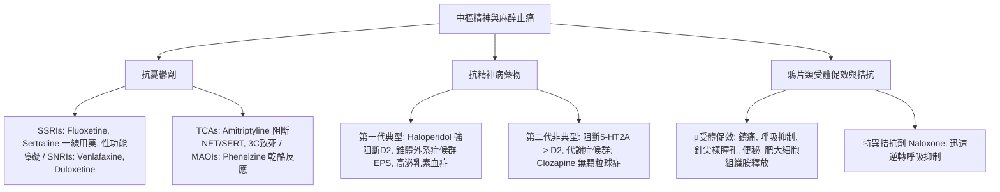

---

## 主題一：抗憂鬱藥物（Antidepressants）分類與毒性

### 1. 各大抗憂鬱劑機制與特徵對比表
| 藥物類別 | 代表藥物 | 作用機轉 | 臨床特點與一線定位 | 國考必考副作用與禁忌 |
| :--- | :--- | :--- | :--- | :--- |
| **選擇性血清素再吸收抑制劑 (SSRI)** | **Fluoxetine, Sertraline, Paroxetine, Escitalopram** | 高度選擇性阻斷血清素轉運體（SERT），增加突觸間隙 5-HT 濃度 | **各大憂鬱症、焦慮症、強迫症第一線首選**（需 2~4 週起效） | **性功能障礙（Erectile dysfunction / Anorgasmia，高達 40%）**、腸胃不適、失眠。合用 MAOI 引發**致死性血清素症候群（Serotonin syndrome）**！ |
| **血清素與正腎上腺素再吸收抑制劑 (SNRI)** | **Venlafaxine, Duloxetine** | 同時阻斷 SERT 與 NET | 伴隨慢性神經病變疼痛（如糖尿病神經痛、纖維肌痛症）之憂鬱症首選 | 舒張壓升高（去甲腎上腺素效應）、心悸。 |
| **三環抗憂鬱劑 (TCA)** | **Amitriptyline, Imipramine, Nortriptyline** | 阻斷 SERT 與 NET；同時強烈阻斷 $\alpha_1, M_1, H_1$ 受體 | 二線用藥，用於偏頭痛預防、神經痛、遺尿症 | **過量中毒三大死因（3Cs）**：**C**ardiotoxicity（阻斷心臟快鈉通道致 QRS 增寬、心律不整）、**C**oma（昏迷）、**C**onvulsions（抽搐）。**心毒性解毒劑為碳酸氫鈉（$NaHCO_3$）**！ |
| **單胺氧化酶抑制劑 (MAOI)** | **Phenelzine, Tranylcypromine** | 不可逆非選擇性抑制 MAO-A 與 MAO-B | 頑固性憂鬱症最後防線 | **乾酪反應（Cheese reaction）**：進食富含酪胺食物（紅酒、乳酪），酪胺無法被腸道 MAO-A 分解，大量釋放 NE 導致**致命性高血壓危象**！ |
| **非典型抗憂鬱劑** | **Bupropion** | 阻斷 NET 與 DAT（不影響 5-HT！） | **無性功能障礙副作用**，常用於戒菸 | **降低癲癇閾值（暴食症/癲癇患者禁用！）**。 |
| | **Mirtazapine** | 阻斷突觸前 $\alpha_2$ 自體受體及 $5-HT_2 / 5-HT_3$ | 刺激食慾、增加體重、強力鎮靜（老人憂鬱消瘦失眠首選） | 嗜睡、體重顯著增加。 |

---

## 主題二：抗精神病藥物（典型 vs. 非典型）

### 1. 第一代典型（FGA）vs. 第二代非典型（SGA）抗精神病藥
- **第一代典型（Typical FGAs：氟哌啶醇 Haloperidol、氯丙嗪 Chlorpromazine）**：
  - **作用機制**：強力高親和力阻斷中腦-邊緣系統及紋狀體的 **$D_2$ 受體**。
  - **核心療效**：專門控制陽性症狀（幻覺、妄想）。
  - **特徵副作用**：
    1. **錐體外系症候群（EPS）**：
       - **急性肌張力不全（Acute dystonia，數小時至數天）**：斜頸、動眼危象。治療：**抗膽鹼藥 Benztropine 或抗組織胺 Diphenhydramine**。
       - **靜坐不能（Akathisia，數天至數週）**：無法靜坐。治療：$\beta$ 阻斷劑 Propranolol。
       - **帕金森樣症狀（Parkinsonism，數週）**：震顫、齒輪僵硬。治療：Benztropine。
       - **遲發性運動不能（Tardive dyskinesia, TD，數月至數年）**：口唇不自主咀嚼吐舌。受體超敏引起，**抗膽鹼藥會使其惡化**！治療：改換 SGA 或使用 VMAT-2 抑制劑（Valbenazine）。
    2. **高泌乳素血症（Hyperprolactinemia）**：阻斷結節漏斗路徑 $D_2$，導致乳溢、閉經、男性女乳。
    3. **抗精神病藥惡性症候群（NMS）**：高熱、鉛管樣僵硬、肌酸激酶 CK 飆升。治療：**立即停藥，給予 Dantrolene 或 Bromocriptine**。
- **第二代非典型（Atypical SGAs：Clozapine, Olanzapine, Risperidone, Quetiapine）**：
  - **作用機制**：**阻斷 $5-HT_{2A}$ 受體力量強於 $D_2$ 受體**。
  - **核心療效**：對陰性症狀（社交退縮、情感淡漠）及認知症狀改善顯著，EPS 與高泌乳素風險極低。
  - **特徵副作用**：**代謝症候群（顯著體重增加、高血糖、高血脂，以 Olanzapine 與 Clozapine 最嚴重）**。
  - **氯氮平（Clozapine）神藥與魔鬼**：頑固型思覺失調症最終王牌，且唯一被證實能**降低自殺率**之抗精神病藥！但具 **1~2% 致死性無顆粒球症（Agranulocytosis）** 與心肌炎風險，**使用期間必須每週嚴格監測絕對嗜中性球計數（ANC）**！

---

## 主題三：鴉片類藥物（Opioids）與受體藥理

### 1. 鴉片受體（$\mu, \kappa, \delta$）效應與中毒急救
- **$\mu$ 受體（MOR）促效之生理全貌**：
  - 中樞鎮痛（Supraspinal & Spinal analgesia）、鎮靜、欣快感（Euphoria，成癮核心）。
  - **呼吸抑制（Respiratory depression）**：降低腦幹呼吸中樞對 $CO_2$ 之敏感度，為**鴉片過量致死之唯一直接原因**！
  - **針尖樣瞳孔（Pinpoint pupils / 縮瞳 Miosis）**：興奮動眼神經 Edinger-Westphal 核。
  - **便秘（Constipation）**：減緩胃腸推進蠕動。
  - **不耐受性現象**：幾乎所有鴉片效應在長期使用後皆會產生耐受性（Tolerance），**唯獨「縮瞳（Miosis）」與「便秘（Constipation）」終身不產生耐受性**！
- **國考代表藥物精華**：
  - **嗎啡（Morphine）**：促進肥大細胞非免疫性釋放組織胺（血管擴張低血壓、氣喘患者慎用）。其代謝物 M6G 具強效活性，腎衰竭時易蓄積中毒。
  - **芬太尼（Fentanyl）**：脂溶性極高，鎮痛效能為嗎啡之 100 倍，幾無組織胺釋放，常用於手術麻醉與貼片。
  - **美沙冬（Methadone）**：超長半衰期（$> 24$ 小時），口服生物利用率佳，用於**鴉片成癮戒斷之替代療法**。
  - **納洛酮（Naloxone）**：純粹 $\mu$ 受體競爭性拮抗劑，IV 迅速給予逆轉呼吸抑制，挽救鴉片中毒昏迷。

---

## 歷屆國考核心真題解析

### 【國考經典真題實戰】
**【試題編號】111-第一次-med2-051**
> **題目**：下列何者是全身麻醉劑thiopental的特性？
- (A) 因在體內有再分布的情形，具有長效的作用
- (B) 屬於速效型（rapid onset）麻醉藥
- (C) 因脂溶性低不易口服吸收
- (D) 會在肝臟快速代謝成有效代謝物，而延長作用時間

> **標準答案**：`B`
> 
> **【考點深度解析與選項拆解】**：
- **(A) 選項分析**：因在體內有再分布的情形，具有長效的作用。對照中樞受體調控、抗生素抗菌光譜或抗結核抗病毒之分子標靶，驗證其正誤性。
- **(B) 選項分析**：屬於速效型（rapid onset）麻醉藥。審查細胞壁生合成阻斷、核糖體 30S/50S 次單元抑制或 CYP450 酵素誘導/抑制特性，拆解命題陷阱。
- **(C) 選項分析**：因脂溶性低不易口服吸收。檢驗臨床特異性不良反應（如椎體外系反應 EPS、紅人症候群、視神經炎或骨髓抑制），確認干擾選項。
- **(D) 選項分析**：會在肝臟快速代謝成有效代謝物，而延長作用時間。綜合抗癲癇發作型態或抗黴菌作用機轉，比對題幹之核心考查重點。
> **【國考核心解題金鑰】**：本題精確選出 **(B)**。考生須融會貫通 GABA 受體異位調節、抗生素核糖體標靶與第一線抗結核 RIPE 之副作用，即可十拿九穩。

---
### 【國考經典真題實戰】
**【試題編號】111-第一次-med2-057**
> **題目**：下列藥物何者為H1拮抗劑，也適合用於緩解藥物引起的錐體外症狀（extrapyramidal symptoms）？
- (A) famotidine
- (B) haloperidol
- (C) diphenhydramine
- (D) cetirizine

> **標準答案**：`C`
> 
> **【考點深度解析與選項拆解】**：
- **(A) 選項分析**：famotidine。對照中樞受體調控、抗生素抗菌光譜或抗結核抗病毒之分子標靶，驗證其正誤性。
- **(B) 選項分析**：haloperidol。審查細胞壁生合成阻斷、核糖體 30S/50S 次單元抑制或 CYP450 酵素誘導/抑制特性，拆解命題陷阱。
- **(C) 選項分析**：diphenhydramine。檢驗臨床特異性不良反應（如椎體外系反應 EPS、紅人症候群、視神經炎或骨髓抑制），確認干擾選項。
- **(D) 選項分析**：cetirizine。綜合抗癲癇發作型態或抗黴菌作用機轉，比對題幹之核心考查重點。
> **【國考核心解題金鑰】**：本題精確選出 **(C)**。考生須融會貫通 GABA 受體異位調節、抗生素核糖體標靶與第一線抗結核 RIPE 之副作用，即可十拿九穩。

---
### 【國考經典真題實戰】
**【試題編號】111-第一次-med2-074**
> **題目**：Methadone可用於鴉片類藥物成癮的治療，關於該藥物的藥理特性，下列敘述何者正確？
- (A) 可以經由口服投與
- (B) 沒有成癮性
- (C) 為鴉片類受體的拮抗劑
- (D) 不會產生戒斷症狀

> **標準答案**：`A`
> 
> **【考點深度解析與選項拆解】**：
- **(A) 選項分析**：可以經由口服投與。對照中樞受體調控、抗生素抗菌光譜或抗結核抗病毒之分子標靶，驗證其正誤性。
- **(B) 選項分析**：沒有成癮性。審查細胞壁生合成阻斷、核糖體 30S/50S 次單元抑制或 CYP450 酵素誘導/抑制特性，拆解命題陷阱。
- **(C) 選項分析**：為鴉片類受體的拮抗劑。檢驗臨床特異性不良反應（如椎體外系反應 EPS、紅人症候群、視神經炎或骨髓抑制），確認干擾選項。
- **(D) 選項分析**：不會產生戒斷症狀。綜合抗癲癇發作型態或抗黴菌作用機轉，比對題幹之核心考查重點。
> **【國考核心解題金鑰】**：本題精確選出 **(A)**。考生須融會貫通 GABA 受體異位調節、抗生素核糖體標靶與第一線抗結核 RIPE 之副作用，即可十拿九穩。

---

 

<!-- CHAPTER 7 START -->

# 藥理學 第07章 抗生素藥理學：細胞壁與蛋白質合成抑制劑

## 核心知識體系架構
抗菌藥物學為微生物學與藥理學跨學科考查重心。涵蓋阻斷細菌細胞壁胜肽聚醣合成之 $\beta$-內醯胺類（Penicillins, Cephalosporins, Carbapenems, Monobactams）、糖胜肽類（Vancomycin）；以及靶向細菌核糖體抑制蛋白質合成之 30S 抑制劑（Aminoglycosides, Tetracyclines）與 50S 抑制劑（Macrolides, Clindamycin, Chloramphenicol, Linezolid）。

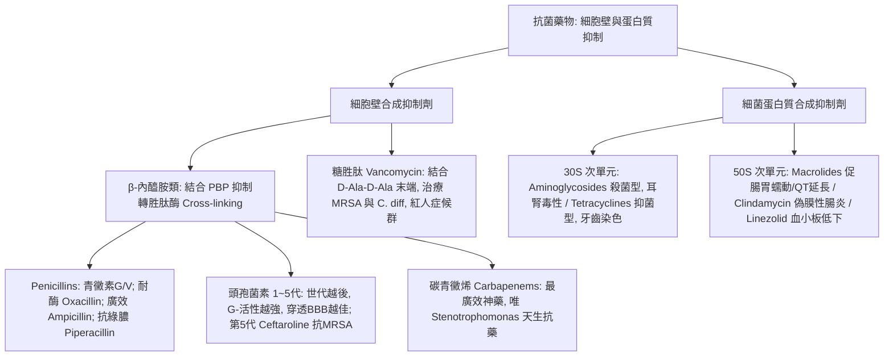

---

## 主題一：$\beta$-內醯胺類抗生素與萬古黴素

### 1. 五代頭孢菌素（Cephalosporins）世代演進與抗菌譜矩陣
| 世代分類 | 代表藥物 | 革蘭氏陽性菌（G+）活性 | 革蘭氏陰性菌（G-）活性 | 綠膿桿菌（P. aeruginosa）活性 | 穿透血腦屏障（BBB）能力 | 臨床關鍵首選適應症 |
| :--- | :--- | :--- | :--- | :--- | :--- | :--- |
| **第一代** | **Cefazolin（IV）, Cephalexin（PO）** | **極強**（MSSA、鏈球菌） | 弱（PEcK：Proteus, E. coli, Klebsiella） | 無 | **不可（無法入腦）** | **外科手術預防性抗生素首選（Cefazolin）**、蜂窩性組織炎。 |
| **第二代** | **Cefuroxime, Cefotetan, Cefoxitin** | 中等 | 中等（HEN PEcK：加上 Haemophilus, Enterobacter, Neisseria） | 無 | 差 | **Cefoxitin / Cefotetan** 具強抗厭氧菌（B. fragilis）活性，用於骨盆腔發炎（PID）及大腸手術。 |
| **第三代** | **Ceftriaxone, Cefotaxime, Ceftazidime** | 中等 | **極強** | **Ceftazidime 具綠膿活性**（Ceftriaxone 無抗綠膿活性！） | **極佳（能入腦）** | **細菌性腦膜炎首選（Ceftriaxone）**、淋病、嚴重院內外肺炎。Ceftriaxone 經膽道排泄，腎衰竭不需調劑量。 |
| **第四代** | **Cefepime** | **強** | **極強** | **極強（抗綠膿王牌）** | **極佳** | 嗜中性球低下發燒（Febrile neutropenia）、重症院內感染。 |
| **第五代** | **Ceftaroline** | **極強** | 良好 | 無 | 佳 | **唯一可結合變異 PBP-2a 並殺死 MRSA 之 $\beta$-內醯胺神藥**！ |

### 2. 萬古黴素（Vancomycin）作用機轉、抗藥性與毒性
- **作用機轉**：大型糖胜肽，專一性結合胜肽聚醣前驅物之 **D-丙胺醯-D-丙胺酸（D-Ala-D-Ala）末端**，以位阻立體障礙阻斷轉糖苷化與轉胜肽交聯。
- **抗藥性機轉（VRE / VRSA）**：細菌經質體介導將末端置換為 **D-Ala-D-Lac（乳酸）** 或 D-Ala-D-Ser，使 Vancomycin 結合親和力暴跌 1000 倍！
- **適應症**：**MRSA 嚴重全身感染首選（IV 給藥）**；口服不吸收，**口服劑型專門用於治療困難梭菌（C. difficile）引起的偽膜性結腸炎**。
- **特徵副作用**：
  1. **紅人症候群（Red man syndrome）**：因輸注速度過快誘發肥大細胞非免疫性釋放大量組織胺，導致全身紅斑潮紅發熱低血壓。**預防對策：減慢滴注速度（至少輸注 60 分鐘以上）或預先給予抗組織胺**。
  2. **耳毒性與腎毒性（Ototoxicity & Nephrotoxicity）**：合用 Aminoglycosides 時毒性倍增。

---

## 主題二：蛋白質合成抑制劑（30S 抑制劑 vs. 50S 抑制劑）

### 1. 抑制細菌核糖體蛋白質合成大對決
!!! tip "秒殺記憶口訣"

    **【核糖體次單元抑制劑速記口訣：Buy AT 30, CEL at 50】**
        - **30S 抑制劑**：**A**minoglycosides, **T**etracyclines。
        - **50S 抑制劑**：**C**hloramphenicol, **E**rythromycin（Macrolides）, **L**incosamides（Clindamycin）, **L**inezolid。

| 藥物分類 | 代表藥物 | 作用分子機轉 | 殺菌型 / 抑菌型 | 國考必背核心副作用與考點 |
| :--- | :--- | :--- | :--- | :--- |
| **胺基糖苷類 (Aminoglycosides)** | **Gentamicin, Tobramycin, Amikacin, Streptomycin** | 不可逆結合 **30S 次單元**，干擾校對導致 mRNA 錯讀，並阻斷多核糖體形成 | **殺菌型（Bactericidal，唯一的殺菌型蛋白抑制劑！）** | **濃度依賴性殺菌（Concentration-dependent killing）與顯著抗生素後效應（PAE）**。 四大毒性：**耳毒性（不可逆聽神經與前庭損害）、腎毒性（急性腎小管壞死 ATN）、神經肌肉阻斷（重症肌無力患者禁用！）、致畸胎**。需氧 G-桿菌專用。 |
| **四環黴素類 (Tetracyclines)** | **Doxycycline, Minocycline** | 可逆結合 **30S 次單元**，阻斷 aminoacyl-tRNA 進入核糖體 A 位點 | 抑菌型（Bacteriostatic） | **螯合多價陽離子（$Ca^{2+}, Fe^{2+}, Al^{3+}$）**，牛奶與制酸劑嚴重阻礙其吸收。 特徵毒性：**沉積於骨骼與牙齒導致牙齒永久變色及骨發育不全（孕婦及 8 歲以下兒童絕對禁用！）**、光敏感性。Doxycycline 為非典型病原體（肺炎黴漿菌、披衣菌、立克次體恙蟲病）首選！ |
| **巨環類 (Macrolides)** | **Azithromycin, Clarithromycin, Erythromycin** | 結合 **50S 次單元之 23S rRNA**，阻斷胜肽鏈移位（Translocation） | 抑菌型 | 1. 促腸胃蠕動（促胃動素受體促效，引起腹部痙攣腹瀉）。 2. **抑制肝臟 CYP3A4（除 Azithromycin 外）**，顯著推高 Theophylline, Warfarin 濃度。 3. **心臟 QT 間期延長（TdP 心室頻脈風險）**。非典型肺炎與百日咳首選。 |
| **克林達黴素 (Clindamycin)** | **Clindamycin** | 結合 **50S 次單元**，抑制胜肽基轉移酶反應 | 抑菌型 | **抗厭氧菌（橫膈膜以上厭氧菌首選）與 G+球菌**。 最惡名昭彰副作用：**徹底破壞腸道菌叢，引發困難梭菌過度增殖之偽膜性結腸炎（Pseudomembranous colitis）**！ |
| **氯黴素 (Chloramphenicol)** | **Chloramphenicol** | 結合 **50S 次單元**，阻斷胜肽基轉移酶 | 抑菌型 | 1. **灰嬰症候群（Gray baby syndrome）**：新生兒肝臟缺乏葡萄糖醛酸轉移酶（UGT），藥物蓄積引發發紺、循環衰竭。 2. 骨髓抑制（劑量相關貧血 vs. 不可逆再生不良性貧血 Aplastic anemia）。 |
| **噁唑烷酮類 (Linezolid)** | **Linezolid** | 結合 **50S 次單元之 23S 部位**，阻斷 70S 啟動複合物形成 | 抑菌型（對鏈球菌殺菌） | **抗抗藥性超級細菌（MRSA、VRE 萬古黴素抗藥性腸球菌）之王牌**。 特徵副作用：骨髓抑制（**血小板低下 Thrombocytopenia**）、周邊神經炎、**弱 MAOI 活性（合用 SSRI 誘發血清素症候群！）**。 |

---

## 歷屆國考核心真題解析

### 【國考經典真題實戰】
**【試題編號】111-第一次-med2-054**
> **題目**：關於抗生素抗藥性的成因及對抗策略，下列敘述何者錯誤？
- (A) 對vancomycin產生抗藥性的主要因素，是失去與細菌細胞壁肽聚醣（peptidoglycan）結合的能力
- (B) vancomycin合併cefotaxime可治療對penicillin產生抗藥性的肺炎鏈球菌（pneumococcus）感染
- (C) telavancin可治療對vancomycin產生耐受性的革蘭氏陽性菌感染
- (D) dalbavancin可治療對vancomycin產生抗藥性的腸球菌（enterococci）感染

> **標準答案**：`D`
> 
> **【考點深度解析與選項拆解】**：
- **(A) 選項分析**：對vancomycin產生抗藥性的主要因素，是失去與細菌細胞壁肽聚醣（peptidoglycan）結合的能力。對照中樞受體調控、抗生素抗菌光譜或抗結核抗病毒之分子標靶，驗證其正誤性。
- **(B) 選項分析**：vancomycin合併cefotaxime可治療對penicillin產生抗藥性的肺炎鏈球菌（pneumococcus）感染。審查細胞壁生合成阻斷、核糖體 30S/50S 次單元抑制或 CYP450 酵素誘導/抑制特性，拆解命題陷阱。
- **(C) 選項分析**：telavancin可治療對vancomycin產生耐受性的革蘭氏陽性菌感染。檢驗臨床特異性不良反應（如椎體外系反應 EPS、紅人症候群、視神經炎或骨髓抑制），確認干擾選項。
- **(D) 選項分析**：dalbavancin可治療對vancomycin產生抗藥性的腸球菌（enterococci）感染。綜合抗癲癇發作型態或抗黴菌作用機轉，比對題幹之核心考查重點。
> **【國考核心解題金鑰】**：本題精確選出 **(D)**。考生須融會貫通 GABA 受體異位調節、抗生素核糖體標靶與第一線抗結核 RIPE 之副作用，即可十拿九穩。

---
### 【國考經典真題實戰】
**【試題編號】111-第二次-第一階段-med2-052**
> **題目**：因肺炎鏈球菌感染導致的腦膜炎，下列藥物何者不適用？
- (A) cefuroxime
- (B) cefotaxime
- (C) ceftriaxone
- (D) vancomycin

> **標準答案**：`A`
> 
> **【考點深度解析與選項拆解】**：
- **(A) 選項分析**：cefuroxime。對照中樞受體調控、抗生素抗菌光譜或抗結核抗病毒之分子標靶，驗證其正誤性。
- **(B) 選項分析**：cefotaxime。審查細胞壁生合成阻斷、核糖體 30S/50S 次單元抑制或 CYP450 酵素誘導/抑制特性，拆解命題陷阱。
- **(C) 選項分析**：ceftriaxone。檢驗臨床特異性不良反應（如椎體外系反應 EPS、紅人症候群、視神經炎或骨髓抑制），確認干擾選項。
- **(D) 選項分析**：vancomycin。綜合抗癲癇發作型態或抗黴菌作用機轉，比對題幹之核心考查重點。
> **【國考核心解題金鑰】**：本題精確選出 **(A)**。考生須融會貫通 GABA 受體異位調節、抗生素核糖體標靶與第一線抗結核 RIPE 之副作用，即可十拿九穩。

---
### 【國考經典真題實戰】
**【試題編號】112-第一次-med2-055**
> **題目**：林先生因車禍受傷，傷口已化膿才就醫，經檢驗為β-lactamase positive金黃色葡萄球菌（Staphylococcus aureus）感染，下列何種抗生素最適合用於治療？
- (A) ampicillin
- (B) dicloxacillin
- (C) penicillin G
- (D) piperacillin

> **標準答案**：`B`
> 
> **【考點深度解析與選項拆解】**：
- **(A) 選項分析**：ampicillin。對照中樞受體調控、抗生素抗菌光譜或抗結核抗病毒之分子標靶，驗證其正誤性。
- **(B) 選項分析**：dicloxacillin。審查細胞壁生合成阻斷、核糖體 30S/50S 次單元抑制或 CYP450 酵素誘導/抑制特性，拆解命題陷阱。
- **(C) 選項分析**：penicillin G。檢驗臨床特異性不良反應（如椎體外系反應 EPS、紅人症候群、視神經炎或骨髓抑制），確認干擾選項。
- **(D) 選項分析**：piperacillin。綜合抗癲癇發作型態或抗黴菌作用機轉，比對題幹之核心考查重點。
> **【國考核心解題金鑰】**：本題精確選出 **(B)**。考生須融會貫通 GABA 受體異位調節、抗生素核糖體標靶與第一線抗結核 RIPE 之副作用，即可十拿九穩。

---

 

<!-- CHAPTER 8 START -->

# 藥理學 第08章 抗生素藥理學：核酸抑制、抗結核、抗黴菌與抗病毒

## 核心知識體系架構
本章匯集化療感染藥物四大關鍵領域：核酸合成抑制劑（喹諾酮類 Fluoroquinolones、葉酸拮抗磺胺類 Sulfonamides/Trimethoprim）；第一線抗結核黃金四聯組合（RIPE：Rifampin, Isoniazid, Pyrazinamide, Ethambutol）；抗黴菌藥物（Amphotericin B, Azoles, Echinocandins, Terbinafine）；以及抗病毒藥物（抗疱疹 Acyclovir, 抗流感 Oseltamivir, 抗愛滋 HAART 雞尾酒療法）。

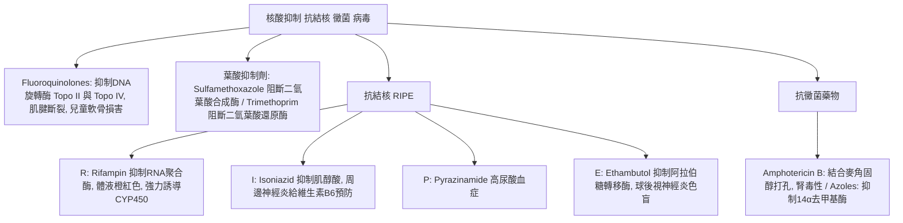

---

## 主題一：喹諾酮類（Fluoroquinolones）與葉酸拮抗劑

### 1. 氟喹諾酮類（Fluoroquinolones：Ciprofloxacin, Levofloxacin, Moxifloxacin）
- **作用機轉**：
  - 革蘭氏陰性菌（G-）：專一性抑制 **細菌 DNA 旋轉酶（DNA Gyrase / Topoisomerase II）**，阻斷 DNA 複製超螺旋解開。
  - 革蘭氏陽性菌（G+）：主要抑制 **拓撲異構酶 IV（Topoisomerase IV）**，阻止複製後染色體分離。
- **臨床分代特色**：
  - **Ciprofloxacin**：抗革蘭氏陰性桿菌（包括綠膿桿菌）極強，常用於複雜性泌尿道感染與炭疽病（Anthrax）。
  - **Levofloxacin / Moxifloxacin**：兼具優異肺炎鏈球菌及非典型病原活性，被譽為**「呼吸道喹諾酮（Respiratory Quinolones）」**。Moxifloxacin 不經腎臟排泄，不可用於治療泌尿道感染。
- **三大國考黑框特徵毒性**：
  1. **肌腱炎與肌腱斷裂（Tendinitis & Tendon rupture，尤以阿基里斯腱 Achilles tendon 最常受害）**，高齡與使用類固醇者風險更高。
  2. **損害幼年動物關節軟骨發育（孕婦及 18 歲以下兒童原則上禁用！）**。
  3. **心臟 QT 間期延長（誘發 TdP 心律不整）**。同四環黴素，金屬離子阻礙其吸收。

### 2. 磺胺類與甲氧苄啶（TMP-SMX / Bactrim）雙重阻斷機轉
- **雙重協同阻斷葉酸途徑**：
  - **磺胺甲惡唑（Sulfamethoxazole, SMX）**：與 PABA 結構類似，競爭性抑制 **二氫葉酸合成酶（Dihydropteroate synthase）**。
  - **甲氧苄啶（Trimethoprim, TMP）**：專一性競爭抑制 **細菌二氫葉酸還原酶（DHFR）**。
  - 單用為抑菌，兩者合用轉變為強效**殺菌型（Bactericidal）**！
- **臨床適應症**：**肺囊蟲肺炎（PCP / P. jirovecii）之第一線預防與治療首選神藥**；諾卡氏菌（Nocardia）感染首選。
- **國考特徵毒性**：
  - **新生兒核黃疸（Kernicterus）**：磺胺類競爭性置換血漿白蛋白上的膽紅素，游離膽紅素穿透 BBB 沉積於腦基底核（新生兒與臨產孕婦禁用）。
  - **過敏反應**：史蒂芬強生症候群（SJS/TEN）。
  - G6PD 缺乏者誘發**急性溶血性貧血**。

---

## 主題二：抗結核四大基石（RIPE 方案）

### 1. 第一線抗結核藥物（R-I-P-E）分子機轉與毒性矩陣
| 藥物代號 | 藥物名稱 | 作用分子標靶機轉 | 臨床特點 | 國考必背特徵副作用與處置對策 |
| :--- | :--- | :--- | :--- | :--- |
| **R** | **利福平（Rifampin）** | 結合並抑制細菌之 **DNA 依賴性 RNA 聚合酶**，阻斷 mRNA 轉錄 | 強效殺菌劑，能消滅細胞內外及乾酪性病灶內結核菌 | 1. **體液呈無害性橘紅色/橙紅色（紅眼淚、紅尿、汗水染色）**。 2. **極強之肝臟 CYP450 酵素誘導劑**（使口服避孕藥、Warfarin、HIV 蛋白酶抑制劑失效）。 |
| **I** | **異煙肼（Isoniazid, INH）** | 前驅藥經結核菌 **KatG 過氧化氫酶活化**，抑制 **肌醇酸（Mycolic acid）** 合成破壞細胞壁 | 殺菌型，單用用於潛伏性結核感染（LTBI）治療首選 | 1. **周邊神經病變（Peripheral neuropathy）**：促使維生素 B6（Pyridoxine）從尿液排出，**常規合併補充 Vitamin B6 即可預防**！ 2. 肝毒性（與年齡相關，慢乙醯化者易神經炎，快乙醯化者易肝毒）。 |
| **P** | **吡嗪醯胺（Pyrazinamide, PZA）** | 在酸性環境下被轉化為吡嗪酸（POA），破壞膜電位 | 酸性細胞內（巨噬細胞吞噬溶酶體內）殺滅緩慢生長結核菌之王牌 | 1. **高尿酸血症（Hyperuricemia）**：抑制尿酸排泄，可能誘發急性痛風發作。 2. 四藥中**肝毒性最強**！ |
| **E** | **乙胺丁醇（Ethambutol, EMB）** | 阻斷 **阿拉伯糖轉移酶（Arabinosyl transferase）**，破壞阿拉伯半乳聚醣細胞壁合成 | **唯一純抑菌型（Bacteriostatic）第一線抗結核藥**！ | **球後視神經炎（Retrobulbar Optic Neuritis）**：視力減退、**紅綠色盲（Red-green color blindness）**。需定期檢驗視力視野，幼童不易配合者慎用。 |

---

## 主題三：抗黴菌與抗病毒藥物精萃

### 1. 抗黴菌藥物分子靶點分類
- **兩性黴素 B（Amphotericin B）**：直接結合黴菌細胞膜上的 **麥角固醇（Ergosterol）**，形成孔隙使細胞膜通透性增加，電解質流失。**重症全身黴菌感染終極王牌**。惡名昭彰毒性：**輸注反應（寒顫發高燒 Shake and bake）** 及 **嚴重腎毒性（低血鉀、低血鎂、貧血）**，微脂體劑型（Liposomal AmpB）可顯著減輕毒性。
- **唑類抗黴菌藥（Azoles：Fluconazole, Voriconazole, Itraconazole）**：抑制 **$14\alpha$-去甲基酶（CYP51）**，阻斷羊毛固醇轉化為麥角固醇。**Voriconazole 為侵襲性麴菌病（Aspergillosis）首選**（特徵副作用：短暫視覺障礙、視物變形）。Fluconazole 為隱球菌腦膜炎維持治療首選。
- **棘白黴素類（Echinocandins：Caspofungin, Micafungin）**：抑制 **$\beta-(1,3)$-D-葡聚醣合成酶**，破壞細胞壁。治療念珠菌血症與難治性麴菌病。

### 2. 抗病毒藥物三大代表
- **阿昔洛韋（Acyclovir）**：
  - 專一性由 HSV/VZV 病毒之 **胸苷激酶（Thymidine kinase, TK）進行第一步單磷酸化**，再由宿主酵素轉為三磷酸形式，抑制病毒 DNA 聚合酶並終止鏈延伸。
  - **高度安全性**：未感染之正常細胞無病毒 TK，不會活化藥物。副作用：IV 給藥可能引發結晶性腎病變（Crystalline nephropathy，充分輸液可預防）。
- **奧司他韋（Oseltamivir / 克流感 Tamiflu）**：
  - 專一性競爭抑制 **A 型與 B 型流感病毒的神經氨酸酶（Neuraminidase）**，阻止新生病毒顆粒從感染宿主細胞表面出芽釋放。**發病 48 小時內投藥效果最佳**。
- **愛滋病雞尾酒療法（HAART）**：至少聯合三種抗反轉錄病毒藥物（通常為 2 NRTIs + 1 INSTI 整合酶抑制劑）。**Zidovudine（AZT）** 阻斷逆轉錄酶，特徵副作用為骨髓抑制貧血。

---

## 歷屆國考核心真題解析

### 【國考經典真題實戰】
**【試題編號】111-第一次-med2-056**
> **題目**：下列何種藥物對於細菌之dihydrofolic acid reductase具有專一性的高親和力？
- (A) sulfamethoxazole
- (B) trimethoprim
- (C) pyrimethamine
- (D) methotrexate

> **標準答案**：`B`
> 
> **【考點深度解析與選項拆解】**：
- **(A) 選項分析**：sulfamethoxazole。對照中樞受體調控、抗生素抗菌光譜或抗結核抗病毒之分子標靶，驗證其正誤性。
- **(B) 選項分析**：trimethoprim。審查細胞壁生合成阻斷、核糖體 30S/50S 次單元抑制或 CYP450 酵素誘導/抑制特性，拆解命題陷阱。
- **(C) 選項分析**：pyrimethamine。檢驗臨床特異性不良反應（如椎體外系反應 EPS、紅人症候群、視神經炎或骨髓抑制），確認干擾選項。
- **(D) 選項分析**：methotrexate。綜合抗癲癇發作型態或抗黴菌作用機轉，比對題幹之核心考查重點。
> **【國考核心解題金鑰】**：本題精確選出 **(B)**。考生須融會貫通 GABA 受體異位調節、抗生素核糖體標靶與第一線抗結核 RIPE 之副作用，即可十拿九穩。

---
### 【國考經典真題實戰】
**【試題編號】112-第一次-med2-052**
> **題目**：關於rifampin產生的作用，下列敘述何者錯誤？
- (A) 抗藥性產生可能是結合到DNA聚合酶的能力降低
- (B) 於開放性肺結核病，必須與isoniazid併用，以預防抗藥性的發生
- (C) 會加速methadone或anticoagulants排除，是因為能誘發細胞色素P450（cytochrome P450）
- (D) 與其他rifamycin類的藥物會有交叉抗藥性（cross-resistance）產生

> **標準答案**：`A`
> 
> **【考點深度解析與選項拆解】**：
- **(A) 選項分析**：抗藥性產生可能是結合到DNA聚合酶的能力降低。對照中樞受體調控、抗生素抗菌光譜或抗結核抗病毒之分子標靶，驗證其正誤性。
- **(B) 選項分析**：於開放性肺結核病，必須與isoniazid併用，以預防抗藥性的發生。審查細胞壁生合成阻斷、核糖體 30S/50S 次單元抑制或 CYP450 酵素誘導/抑制特性，拆解命題陷阱。
- **(C) 選項分析**：會加速methadone或anticoagulants排除，是因為能誘發細胞色素P450（cytochrome P450）。檢驗臨床特異性不良反應（如椎體外系反應 EPS、紅人症候群、視神經炎或骨髓抑制），確認干擾選項。
- **(D) 選項分析**：與其他rifamycin類的藥物會有交叉抗藥性（cross-resistance）產生。綜合抗癲癇發作型態或抗黴菌作用機轉，比對題幹之核心考查重點。
> **【國考核心解題金鑰】**：本題精確選出 **(A)**。考生須融會貫通 GABA 受體異位調節、抗生素核糖體標靶與第一線抗結核 RIPE 之副作用，即可十拿九穩。

---
### 【國考經典真題實戰】
**【試題編號】113-第二次-第一階段-med2-052**
> **題目**：下列關於trimethoprim與sulfamethoxazole（TMP-SMZ）之敘述，何者正確？
- (A) 皆能抑制二氫蝶酸合成酶（dihydropteroate synthase）以阻斷DNA合成
- (B) TMP：SMZ=1：5配方是因為TMP脂溶性較高
- (C) 可使用在泌尿道感染，但無法用於治療肺囊蟲肺炎（P jirovecii pneumonia）
- (D) TMP-SMZ藥物的多數副作用主要來自於TMP

> **標準答案**：`B`
> 
> **【考點深度解析與選項拆解】**：
- **(A) 選項分析**：皆能抑制二氫蝶酸合成酶（dihydropteroate synthase）以阻斷DNA合成。對照中樞受體調控、抗生素抗菌光譜或抗結核抗病毒之分子標靶，驗證其正誤性。
- **(B) 選項分析**：TMP：SMZ=1：5配方是因為TMP脂溶性較高。審查細胞壁生合成阻斷、核糖體 30S/50S 次單元抑制或 CYP450 酵素誘導/抑制特性，拆解命題陷阱。
- **(C) 選項分析**：可使用在泌尿道感染，但無法用於治療肺囊蟲肺炎（P jirovecii pneumonia）。檢驗臨床特異性不良反應（如椎體外系反應 EPS、紅人症候群、視神經炎或骨髓抑制），確認干擾選項。
- **(D) 選項分析**：TMP-SMZ藥物的多數副作用主要來自於TMP。綜合抗癲癇發作型態或抗黴菌作用機轉，比對題幹之核心考查重點。
> **【國考核心解題金鑰】**：本題精確選出 **(B)**。考生須融會貫通 GABA 受體異位調節、抗生素核糖體標靶與第一線抗結核 RIPE 之副作用，即可十拿九穩。

---

 

<!-- CHAPTER 9 START -->

# 藥理學 第09章 抗腫瘤化療、標靶藥物與免疫調節抑制劑

## 核心知識體系架構
腫瘤與免疫藥理學為國考大熱門，涵蓋細胞週期非專一性（CCNS：烷化劑、鉑類、抗腫瘤抗生素）與細胞週期專一性（CCS：S期抗代謝藥、M期微管抑制劑）；分子標靶藥物（酪胺酸激酶抑制劑 TKIs、單株抗體 mAbs）；以及器官移植與自體免疫之免疫抑制劑（鈣調磷酸酶抑制劑、mTOR 抑制劑、抗代謝物）。

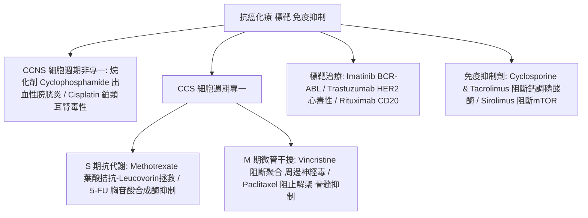

---

## 主題一：傳統化療藥物之器官特異性毒性與防護解毒劑

### 1. 國考必背「化療毒性與救援劑（Antidote/Rescue）」黃金配對矩陣
| 化療藥物類別 | 代表藥物 | 作用分子機轉 | 國考特徵致命毒性 | 專一性防護劑 / 解毒劑 / 救援劑 |
| :--- | :--- | :--- | :--- | :--- |
| **氮芥烷化劑** | **環磷醯胺（Cyclophosphamide）** | 於鳥嘌呤 $N^7$ 位形成 DNA 股間交聯 | 代謝產物**丙烯醛（Acrolein）** 濃縮於膀胱，引發**致死性出血性膀胱炎（Hemorrhagic cystitis）** | **美司鈉（MESNA）**：含強親核性硫醇基（-SH），於尿中直接中和 Acrolein；搭配大量輸液。 |
| **鉑類配合物** | **順鉑（Cisplatin）** | 結合於 DNA 鏈內形成雙加合物，破壞雙螺旋 | **嚴重腎毒性（急性腎小管壞死 ATN）**、周邊神經耳毒性、重度致吐 | **阿米福汀（Amifostine）**（游離基清除劑減輕腎毒性）；積極靜脈輸液維持高尿量。 |
| **葉酸抗代謝藥** | **甲氨蝶呤（Methotrexate, MTX）** | 競爭性強烈抑制 **二氫葉酸還原酶（DHFR）**，阻斷 dTMP 與嘌呤合成 | **嚴重骨髓抑制**、口腔黏膜炎潰瘍、肝纖維化、腎小管沉澱結晶 | **亞葉酸鈣（Leucovorin / 5-甲醯四氫葉酸）**：直接繞過受阻的 DHFR，提供活性四氫葉酸救援正常造血細胞（**Leucovorin Rescue**）！ |
| **嘧啶抗代謝藥** | **5-氟尿嘧啶（5-FU）** | 活化為 5-dUMP，與葉酸形成共價複合物抑制 **胸苷酸合成酶（Thymidylate synthase）** | 骨髓抑制、手足症候群（Hand-foot syndrome） | **Leucovorin 增效**（與 MTX 反向！Leucovorin 增強 5-FU 與胸苷酸合成酶之結合）；**Uridine 救急解毒**。 |
| **蒽環抗腫瘤抗生素** | **多柔比星（Doxorubicin / 阿黴素 Adriamycin）** | 嵌合於 DNA 鹼基間，抑制拓撲異構酶 II，並產生活性氧自由基（ROS） | **蓄積性擴張型心肌病變（Cardiotoxicity / 充血性心衰竭）** | **右雷佐生（Dexrazoxane）**：鐵離子螯合劑，阻止鐵與 Doxorubicin 複合物生成心毒性自由基。 |
| **植物鹼微管抑制** | **長春新鹼（Vincristine）** | 結合微管蛋白 Tubulin，**阻斷微管聚合（Inhibit polymerization）**，滯留於中期 | **周邊神經病變（Peripheral neuropathy：手指麻木麻痺、腸麻痺麻痺性腸阻塞）**，骨髓抑制極輕 | 嚴格維持腸道通暢；**絕對嚴禁鞘內注射（Intrathecal injection，致死性腦水腫腦壞死！）**。 |
| **紫杉醇類** | **太平洋紫杉醇（Paclitaxel）** | 超穩定微管結構，**阻止微管解聚（Prevent depolymerization）**，細胞無法分裂 | **重度骨髓抑制**（嗜中性球低下）、過敏性休克（溶劑聚氧乙烯蓖麻油誘發，給藥前需預處理類固醇與抗組織胺） | G-CSF 白血球生長因子支持。 |
| **抗腫瘤抗生素** | **博來黴素（Bleomycin）** | 螯合鐵離子產生自由基，誘發 DNA 單股與雙股斷裂 | **肺纖維化（Pulmonary fibrosis，高濃度吸氧會加重毒性！）**、皮膚色素過度沉積；無骨髓抑制 | 治療期間定期監測肺功能 DLCO。 |

---

## 主題二：標靶治療藥物（Targeted Therapy）

### 1. 酪胺酸激酶抑制劑（TKIs）與單株抗體（mAbs）
- **伊馬替尼（Imatinib / Gleevec）**：
  - 專一性小分子抑制 **BCR-ABL 融合酪胺酸激酶**，亦抑制 c-Kit 與 PDGFR。
  - **慢性骨髓性白血病（CML，$t(9;22)$ 費城染色體）及胃腸道基質瘤（GIST）首選神藥**。
- **曲妥珠單抗（Trastuzumab / Herceptin）**：
  - 人源化單株抗體，專一性拮抗 **HER2/neu（ErbB2）受體** 細胞外結構域。
  - **HER2 陽性侵襲性乳癌首選**。
  - **特徵毒性：擴張性心肌病變（Cardiotoxicity）**，臨床表現為無症狀 LVEF 下降（多數可逆），**嚴禁與 Doxorubicin 合用**以防嚴重加重心臟衰竭！
- **利妥昔單抗（Rituximab）**：
  - 抗 **CD20 單株抗體**，透過 ADCC 及補體依賴性細胞毒性（CDC）清除 B 細胞。
  - 治療 **彌漫大 B 細胞淋巴瘤（DLBCL）及重度類風濕性關節炎**。用藥前必須常規篩檢 B 型肝炎以防猛爆性肝炎復發。

---

## 主題三：器官移植免疫抑制劑（Immunosuppressive Agents）

### 1. 鈣調磷酸酶抑制劑（CNIs）vs. mTOR 抑制劑
- **環孢素（Cyclosporine）vs. 他克莫司（Tacrolimus / FK506）**：
  - **分子機制**：
    - Cyclosporine 結合細胞質內之 **親環素（Cyclophilin）**。
    - Tacrolimus 結合細胞質內之 **FKBP-12**。
    - 兩者複合物皆能專一性**抑制鈣調磷酸酶（Calcineurin / 磷酸酶）** $\to$ 阻止轉錄因子 NFAT 去磷酸化 $\to$ NFAT 無法入核 $\to$ **完全阻斷白介素-2（IL-2）之轉錄與 T 細胞活化增殖**！
  - **器官移植抗急性排斥第一線基石用藥**。
  - **特徵副作用**：**腎毒性（Nephrotoxicity，入球小動脈收縮，兩者皆具）**、神經毒性、高血壓、高血鉀。**Cyclosporine 特有：牙齦增生（Gingival hyperplasia）與多毛症（Hirsutism）**；Tacrolimus 無牙齦增生但高血糖糖尿病風險較高。
- **西羅莫司（Sirolimus / 雷帕黴素 Rapamycin）**：
  - 亦結合於 FKBP-12，但複合物**不抑制 Calcineurin**，而是專一性**抑制 mTOR 激酶（哺乳類雷帕黴素標靶）** $\to$ 阻斷 IL-2 受體下游信號傳導。
  - **最大優勢：幾乎沒有腎毒性（Kidney-sparing！）**，常用於腎功能受損之移植患者。特徵副作用：高血脂（高膽固醇、高甘油三酯）、骨髓抑制（貧血、血小板低下）、傷口癒合不良。

---

## 歷屆國考核心真題解析

### 【國考經典真題實戰】
**【試題編號】111-第一次-med2-055**
> **題目**：關於化療藥busulfan之敘述，下列何者錯誤？
- (A) 作用於DNA而抑制癌細胞增生與複製
- (B) 與cyclophosphamide同屬於烷化劑（alkylating agent），常用於治療乳癌
- (C) glutathione S-transferase活性增加時易引起抗藥性
- (D) 常見副作用為噁心、嘔吐

> **標準答案**：`B`
> 
> **【考點深度解析與選項拆解】**：
- **(A) 選項分析**：作用於DNA而抑制癌細胞增生與複製。核對抗腫瘤標靶受體、降血糖酵素抑制、抗痛風發炎或藥物動力學參數公式，確認其藥理學機轉。
- **(B) 選項分析**：與cyclophosphamide同屬於烷化劑（alkylating agent），常用於治療乳癌。檢視特徵性器官毒性（如心臟毒性、出血性膀胱炎、乳酸中毒或特定解毒劑），剖析考選部高頻命題陷阱。
- **(C) 選項分析**：glutathione S-transferase活性增加時易引起抗藥性。評估競爭性與非競爭性拮抗曲線位移、零級與一級消除速率，釐清易混淆概念。
- **(D) 選項分析**：常見副作用為噁心、嘔吐。比對臨床適應症或器官特異性代謝酵素，驗證題幹核心考查重點。
> **【國考核心解題金鑰】**：本題精準鎖定標準答案 **(B)**。考生須牢記化療毒性防護劑對應關係（如 Cyclophosphamide 對 MESNA、MTX 對 Leucovorin）、糖尿病口服新藥與重金屬解毒劑，即可秒殺奪冠。

---
### 【國考經典真題實戰】
**【試題編號】111-第一次-med2-061**
> **題目**：下列何種藥物的主要作用受體不位在細胞膜上，而是在細胞內部？
- (A) erlotinib
- (B) metoclopramide
- (C) prednisolone
- (D) diphenhydramine

> **標準答案**：`C`
> 
> **【考點深度解析與選項拆解】**：
- **(A) 選項分析**：erlotinib。核對抗腫瘤標靶受體、降血糖酵素抑制、抗痛風發炎或藥物動力學參數公式，確認其藥理學機轉。
- **(B) 選項分析**：metoclopramide。檢視特徵性器官毒性（如心臟毒性、出血性膀胱炎、乳酸中毒或特定解毒劑），剖析考選部高頻命題陷阱。
- **(C) 選項分析**：prednisolone。評估競爭性與非競爭性拮抗曲線位移、零級與一級消除速率，釐清易混淆概念。
- **(D) 選項分析**：diphenhydramine。比對臨床適應症或器官特異性代謝酵素，驗證題幹核心考查重點。
> **【國考核心解題金鑰】**：本題精準鎖定標準答案 **(C)**。考生須牢記化療毒性防護劑對應關係（如 Cyclophosphamide 對 MESNA、MTX 對 Leucovorin）、糖尿病口服新藥與重金屬解毒劑，即可秒殺奪冠。

---
### 【國考經典真題實戰】
**【試題編號】111-第二次-第一階段-med2-053**
> **題目**：下列何者為抗微小管藥物（anti-microtubule drug），可抑制癌細胞分裂而產生抗癌作用？
- (A) capecitabine
- (B) cabazitaxel
- (C) cladribine
- (D) chlorambucil

> **標準答案**：`B`
> 
> **【考點深度解析與選項拆解】**：
- **(A) 選項分析**：capecitabine。核對抗腫瘤標靶受體、降血糖酵素抑制、抗痛風發炎或藥物動力學參數公式，確認其藥理學機轉。
- **(B) 選項分析**：cabazitaxel。檢視特徵性器官毒性（如心臟毒性、出血性膀胱炎、乳酸中毒或特定解毒劑），剖析考選部高頻命題陷阱。
- **(C) 選項分析**：cladribine。評估競爭性與非競爭性拮抗曲線位移、零級與一級消除速率，釐清易混淆概念。
- **(D) 選項分析**：chlorambucil。比對臨床適應症或器官特異性代謝酵素，驗證題幹核心考查重點。
> **【國考核心解題金鑰】**：本題精準鎖定標準答案 **(B)**。考生須牢記化療毒性防護劑對應關係（如 Cyclophosphamide 對 MESNA、MTX 對 Leucovorin）、糖尿病口服新藥與重金屬解毒劑，即可秒殺奪冠。

---

 

<!-- CHAPTER 10 START -->

# 藥理學 第10章 內分泌藥理學：糖尿病、甲狀腺與皮質類固醇

## 核心知識體系架構
內分泌藥理涵蓋糖尿病口服降血糖藥（Biguanides, SGLT2i, GLP-1RA, DPP-4i, Sulfonylureas, TZDs）與胰島素製劑；抗甲狀腺藥物與甲狀腺素補充；全身性皮質類固醇之抗發炎免疫抑制與 HPA 軸抑制撤退症候群；以及性荷爾蒙調節劑（SERMs, 芳香酶抑制劑）。

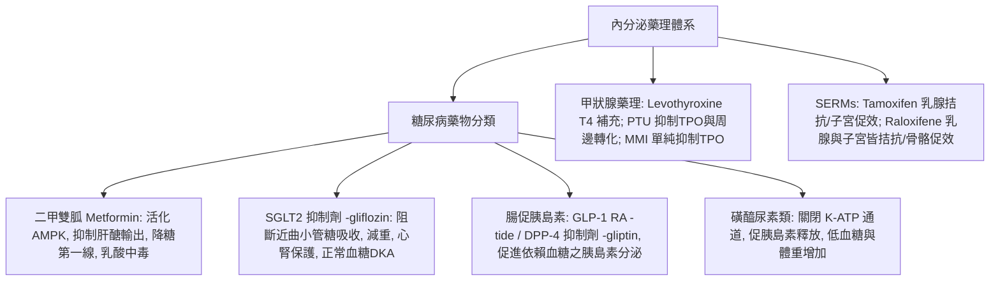

---

## 主題一：口服降血糖藥物（OADs）機轉與心腎保護

### 1. 六大類降血糖藥物精準考點對比表
| 藥物分類 | 代表藥物 | 作用分子機轉 | 低血糖風險 | 體重變動 | 國考必背關鍵考點與致命禁忌 |
| :--- | :--- | :--- | :--- | :--- | :--- |
| **雙胍類 (Biguanides)** | **二甲雙胍（Metformin）** | 活化 **AMPK 蛋白激酶** $\to$ 抑制肝臟糖質新生；增加周邊組織胰島素敏感度 | **極低（不刺激胰島素）** | **輕度減輕或持平** | **第 2 型糖尿病終身第一線首選神藥**。 致命禁忌：**乳酸中毒（Lactic acidosis）**！在 eGFR $< 30\text{ mL/min}$、嚴重肝衰竭、敗血休克或接受含碘顯影劑檢查時**必須停藥**！ |
| **SGLT2 抑制劑** | **Empagliflozin, Dapagliflozin** | 專一性阻斷腎臟近曲小管 **SGLT2 轉運蛋白**，促進尿中葡萄糖排泄（約 70g/天） | **極低** | **顯著減輕** (2~3 kg) | **ASCVD、心衰竭（HFrEF/HFpEF）及慢性腎臟病（CKD）證實降低死亡率首選神藥**！ 特徵副作用：**生殖泌尿道真菌感染（念珠菌陰道炎/龜頭炎）**、**正常血糖性糖尿病酮酸中毒（Euglycemic DKA）**。 |
| **GLP-1 受體促效劑 (GLP-1 RA)** | **Semaglutide, Liraglutide, Dulaglutide** | 活化 GLP-1 受體 $\to$ **葡萄糖濃度依賴性刺激胰島素分泌**、抑制升糖素、延緩胃排空、中樞抑制食慾 | **極低** | **大幅減輕** (最強減肥藥) | **ASCVD 與肥胖首選**。注射劑型為主（Semaglutide 有口服劑型）。 黑框警告：**甲狀腺髓質癌（MTC）或第 2 型多發性內分泌腫瘤（MEN2）個人或家族史者禁用**！急性胰臟炎風險。 |
| **DPP-4 抑制劑** | **Sitagliptin, Linagliptin** | 競爭性抑制 DPP-4 酵素，**延長內生性 GLP-1 與 GIP 的半衰期** | **極低** | 持平 | 口服耐受性極佳，幾乎無低血糖或胃腸副作用。**Linagliptin 經膽道排泄，嚴重腎功能不全者無需調整劑量**！ |
| **磺醯尿素類 (Sulfonylureas)** | **Glipizide, Glimepiride, Glyburide** | 專一性結合併關閉 $\beta$ 細胞的 **$K_{ATP}$ 通道（SUR1）** $\to$ 去極化 $\to$ 刺激胰島素持續胞吐 | **極高（低血糖首因）** | **增加** (1~3 kg) | 老年人易引發長效型致死性低血糖。**Glyburide（Glibenclamide）代謝產物具活性且經腎排泄，腎衰竭禁用**！ |
| **噻唑烷二酮類 (TZDs)** | **Pioglitazone, Rosiglitazone** | 結合併活化核受體 **PPAR-$\gamma$**，上調 GLUT4 與脂聯素，改善胰島素阻抗 | **極低** | **顯著增加** | 特徵副作用：**液體滯留與下肢水腫（心衰竭 NYHA Class III/IV 絕對禁用！）**、骨質疏鬆與病理性骨折。 |

---

## 主題二：性荷爾蒙調節劑（SERMs 與芳香酶抑制劑）

### 1. 選擇性動情素受體調節劑（SERMs）組織特異性大對決
- **他莫昔芬（Tamoxifen）**：
  - **乳腺組織**：**動情素受體拮抗劑（Antagonist）** $\to$ 治療與預防 ER 陽性乳癌。
  - **骨骼組織**：**促效劑（Agonist）** $\to$ 預防停經後骨質疏鬆。
  - **子宮內膜**：**微弱促效劑（Partial Agonist）** $\to$ **長期使用刺激子宮內膜增生，顯著增加子宮內膜癌（Endometrial cancer）風險**！
  - 增加深層靜脈血栓（DVT）與肺栓塞風險；引發熱潮紅。
- **雷洛昔芬（Raloxifene）**：
  - **乳腺組織**：**拮抗劑（Antagonist）** $\to$ 降低乳癌風險。
  - **骨骼組織**：**促效劑（Agonist）** $\to$ **停經後骨質疏鬆症第一線預防與治療首選**！
  - **子宮內膜**：**拮抗劑（Antagonist！）** $\to$ **完全不刺激子宮內膜，絕對不增加子宮內膜癌風險**！
- **芳香酶抑制劑（Aromatase Inhibitors：Anastrozole, Letrozole, Exemestane）**：
  - 阻斷周邊脂肪組織中之 **芳香酶（CYP19A1）**，徹底阻斷雄烯二酮轉化為動情素。
  - **停經後婦女 ER 陽性晚期乳癌之第一線荷爾蒙治療首選**！骨質流失與骨折風險高。

---

## 歷屆國考核心真題解析

### 【國考經典真題實戰】
**【試題編號】111-第一次-med2-060**
> **題目**：王先生因甲狀腺癌接受手術切除後，出現倦怠、嗜睡、水腫等現象。在醫院抽血檢查發現有甲狀腺機能低下 （hypothyroidism）的情況，並有上呼吸道感染造成的輕微發燒與咳嗽。依據上述情形，他比較不適合使用下 列那一種藥物？
- (A) levothyroxine
- (B) dextromethorphan
- (C) methimazole
- (D) acetaminophen

> **標準答案**：`C`
> 
> **【考點深度解析與選項拆解】**：
- **(A) 選項分析**：levothyroxine。核對抗腫瘤標靶受體、降血糖酵素抑制、抗痛風發炎或藥物動力學參數公式，確認其藥理學機轉。
- **(B) 選項分析**：dextromethorphan。檢視特徵性器官毒性（如心臟毒性、出血性膀胱炎、乳酸中毒或特定解毒劑），剖析考選部高頻命題陷阱。
- **(C) 選項分析**：methimazole。評估競爭性與非競爭性拮抗曲線位移、零級與一級消除速率，釐清易混淆概念。
- **(D) 選項分析**：acetaminophen。比對臨床適應症或器官特異性代謝酵素，驗證題幹核心考查重點。
> **【國考核心解題金鑰】**：本題精準鎖定標準答案 **(C)**。考生須牢記化療毒性防護劑對應關係（如 Cyclophosphamide 對 MESNA、MTX 對 Leucovorin）、糖尿病口服新藥與重金屬解毒劑，即可秒殺奪冠。

---
### 【國考經典真題實戰】
**【試題編號】111-第二次-第一階段-med2-059**
> **題目**：下列何種狀況比較不適合用octreotide 治療？
- (A) 胃泌素瘤
- (B) 食道靜脈瘤出血
- (C) 急性便秘
- (D) 胰島素瘤

> **標準答案**：`C`
> 
> **【考點深度解析與選項拆解】**：
- **(A) 選項分析**：胃泌素瘤。核對抗腫瘤標靶受體、降血糖酵素抑制、抗痛風發炎或藥物動力學參數公式，確認其藥理學機轉。
- **(B) 選項分析**：食道靜脈瘤出血。檢視特徵性器官毒性（如心臟毒性、出血性膀胱炎、乳酸中毒或特定解毒劑），剖析考選部高頻命題陷阱。
- **(C) 選項分析**：急性便秘。評估競爭性與非競爭性拮抗曲線位移、零級與一級消除速率，釐清易混淆概念。
- **(D) 選項分析**：胰島素瘤。比對臨床適應症或器官特異性代謝酵素，驗證題幹核心考查重點。
> **【國考核心解題金鑰】**：本題精準鎖定標準答案 **(C)**。考生須牢記化療毒性防護劑對應關係（如 Cyclophosphamide 對 MESNA、MTX 對 Leucovorin）、糖尿病口服新藥與重金屬解毒劑，即可秒殺奪冠。

---
### 【國考經典真題實戰】
**【試題編號】112-第一次-med2-068**
> **題目**：使用吸入型皮質類固醇仍無法有效控制氣喘時，最適合併用下列何種藥物以預防氣喘發作？
- (A) ephedrine
- (B) formoterol
- (C) roflumilast
- (D) zileuton

> **標準答案**：`B`
> 
> **【考點深度解析與選項拆解】**：
- **(A) 選項分析**：ephedrine。核對抗腫瘤標靶受體、降血糖酵素抑制、抗痛風發炎或藥物動力學參數公式，確認其藥理學機轉。
- **(B) 選項分析**：formoterol。檢視特徵性器官毒性（如心臟毒性、出血性膀胱炎、乳酸中毒或特定解毒劑），剖析考選部高頻命題陷阱。
- **(C) 選項分析**：roflumilast。評估競爭性與非競爭性拮抗曲線位移、零級與一級消除速率，釐清易混淆概念。
- **(D) 選項分析**：zileuton。比對臨床適應症或器官特異性代謝酵素，驗證題幹核心考查重點。
> **【國考核心解題金鑰】**：本題精準鎖定標準答案 **(B)**。考生須牢記化療毒性防護劑對應關係（如 Cyclophosphamide 對 MESNA、MTX 對 Leucovorin）、糖尿病口服新藥與重金屬解毒劑，即可秒殺奪冠。

---

 

<!-- CHAPTER 11 START -->

# 藥理學 第11章 自泌素、呼吸、消化、抗痛風與抗發炎藥理學

## 核心知識體系架構
本章匯總自泌素（組織胺、前列腺素、白三烯素）；非類固醇抗發炎藥（NSAIDs 與選擇性 COX-2 抑制劑 Celecoxib）；痛風急性發作與慢性降尿酸治療策略；氣喘階梯式呼吸用藥；以及消化性潰瘍胃酸抑制劑。

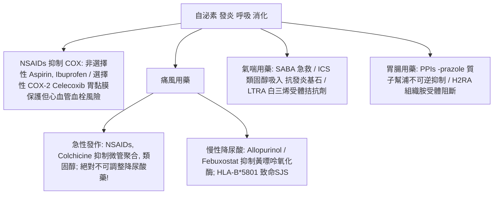

---

## 主題一：NSAIDs 分類、機轉與阿斯匹靈特異毒性

### 1. 非選擇性 NSAIDs vs. 選擇性 COX-2 抑制劑（Celecoxib）
- **環氧化酶雙異構酶（COX-1 vs. COX-2）**：
  - **COX-1（結構型 Constitutive）**：廣泛表現於全身，合成 $PGE_2$ 與 $PGI_2$ 保護胃黏膜屏障、維持腎小管血流，並在血小板合成 **$TXA_2$（促進血小板凝集與血管收縮）**。
  - **COX-2（誘導型 Inducible）**：由發炎細胞因子（IL-1, TNF-$\alpha$）在發炎組織中誘導表現，合成致炎前列腺素介導紅腫熱痛。在血管內皮細胞持續表現合成 **$PGI_2$（前列腺素前列環素，強烈抑制血小板凝集並擴張血管）**。
- **阿斯匹靈（Aspirin / 乙醯水楊酸 ASA）**：
  - **唯一不可逆性（Irreversible）共價乙醯化 COX-1 與 COX-2 的 NSAID**！
  - **低劑量抗血小板（81~100 mg/day）**：血小板無細胞核無法重新合成蛋白質，其 COX-1 被不可逆破壞後終身喪失生成 $TXA_2$ 之能力（持續 7~10 天血小板生命週期）。內皮細胞有核可再生 COX-2 生成 $PGI_2$。
  - **雷氏症候群（Reye's syndrome）**：兒童或青少年患病毒感染（水痘、流感）時若服用 Aspirin，可能引發猛爆性肝衰竭合併急性腦病變與脂肪肝（致死率高達 30%）。**兒童病毒發燒絕對禁用 Aspirin（首選 Acetaminophen）**！
- **選擇性 COX-2 抑制劑：塞來昔布（Celecoxib）**：
  - 專一性抑制 COX-2，不抑制 COX-1。**胃腸道潰瘍與出血風險顯著低於傳統 NSAIDs**。
  - **心血管血栓黑框警告**：抑制血管內皮生成抗凝的 $PGI_2$，但未抑制血小板生成促凝的 $TXA_2$，打破平衡導致心肌梗塞與中風風險升高！磺胺過敏者禁用。

---

## 主題二：痛風（Gout）藥理：急性發作 vs. 慢性降尿酸

### 1. 急性關節炎發作與慢性降尿酸兩階段處方策略
| 治療階段 | 推薦第一線首選藥物 | 作用分子機轉 | 國考必背關鍵考點與致命禁忌 |
| :--- | :--- | :--- | :--- |
| **急性痛風發作（Acute Flare）** | **高劑量 NSAIDs**（Indomethacin, Naproxen） 或 **秋水仙素（Colchicine）** 或 **全身性類固醇** | **秋水仙素（Colchicine）**：結合於微管蛋白（Tubulin）阻斷微管聚合，抑制嗜中性球趨化、遊走與吞噬尿酸結晶 | **急性期黃金鐵律：絕對不可隨意開始或停用降尿酸藥物（Allopurinol）！**（尿酸波動會撕裂痛風石晶體導致滑膜發炎劇烈惡化）。 Colchicine 特徵毒性：腹部絞痛、嚴重腹瀉、骨髓抑制。 |
| **慢性痛風降尿酸（Chronic / Intercritical）** | **別嘌醇（Allopurinol）** 或 **非布司他（Febuxostat）** | 專一性競爭性抑制 **黃嘌呤氧化酶（Xanthine Oxidase）**，阻斷次黃嘌呤與黃嘌呤轉化為尿酸 | **Allopurinol 致命過敏性重症（DRESS / SJS/TEN）**：**HLA-B*5801 基因陽性者（台灣漢人族群頻率高達 15~20%）風險極高**！衛福部健保規定用藥前**必須常規檢測 HLA-B*5801 基因**！ Febuxostat 為非嘌呤選擇性 XO 抑制劑，適合 HLA-B*5801 陽性或腎功能不全者。 |
| **促尿酸排泄劑** | **苯溴馬隆（Benzbromarone）、丙磺舒（Probenecid）** | 抑制腎近曲小管頂端膜之 **URAT1 轉運體**，阻斷尿酸再吸收，增加尿中排泄 | 僅適用於「腎臟排泄低下型」且**無腎結石之患者**；需大量飲水並鹼化尿液，嚴重腎結石或重度腎衰竭者禁用。 |

---

## 主題三：氣喘（Asthma）階梯式吸入用藥

### 1. 氣喘四大關鍵藥物類別
- **吸入型皮質類固醇（ICS：Fluticasone, Budesonide）**：
  - **持續性氣喘抗發炎之基石與第一線黃金治療**。局部吸入直達氣道，全身副作用極低。
  - 特徵局部副作用：**口腔念珠菌鵝口瘡（Oral candidiasis）** 與聲音嘶啞（Dysphonia）。**預防對策：使用吸藥輔助艙（Spacer）並在吸入後徹底以清水漱口吐出**。
- **長效 $\beta_2$ 促效劑（LABA：Salmeterol, Formoterol）**：
  - 舒張支氣管，維持 12 小時以上。**氣喘治療中絕對嚴禁單獨使用 LABA（Monotherapy）**！單用 LABA 無抗發炎作用且會掩蓋病情，大幅增加氣喘急性發作致死率；**必須強制與 ICS 複方合用**！
- **短效 $\beta_2$ 促效劑（SABA：Albuterol）**：急性氣喘發作呼吸困難之**第一線急救舒緩藥**。
- **白三烯素受體拮抗劑（LTRA：Montelukast, Zafirlukast）**：
  - 專一性阻斷 **$CysLT_1$ 受體**，特別適合用於**阿斯匹靈誘發型氣喘（Aspirin-exacerbated respiratory disease, AERD）** 及伴隨過敏性鼻炎之氣喘病患。

---

## 歷屆國考核心真題解析

### 【國考經典真題實戰】
**【試題編號】111-第一次-med2-053**
> **題目**：下列用於免疫調節及抗發炎藥物，何者的作用機轉非經由阻斷介白素（interleukin）功能？
- (A) canakinumab
- (B)\betanercept
- (C) tocilizumab
- (D) ustekinumab

> **標準答案**：`B`
> 
> **【考點深度解析與選項拆解】**：
- **(A) 選項分析**：canakinumab。核對抗腫瘤標靶受體、降血糖酵素抑制、抗痛風發炎或藥物動力學參數公式，確認其藥理學機轉。
- **(B) 選項分析**：etanercept。檢視特徵性器官毒性（如心臟毒性、出血性膀胱炎、乳酸中毒或特定解毒劑），剖析考選部高頻命題陷阱。
- **(C) 選項分析**：tocilizumab。評估競爭性與非競爭性拮抗曲線位移、零級與一級消除速率，釐清易混淆概念。
- **(D) 選項分析**：ustekinumab。比對臨床適應症或器官特異性代謝酵素，驗證題幹核心考查重點。
> **【國考核心解題金鑰】**：本題精準鎖定標準答案 **(B)**。考生須牢記化療毒性防護劑對應關係（如 Cyclophosphamide 對 MESNA、MTX 對 Leucovorin）、糖尿病口服新藥與重金屬解毒劑，即可秒殺奪冠。

---
### 【國考經典真題實戰】
**【試題編號】111-第一次-med2-068**
> **題目**：下列何種治療氣喘藥物可與病人血中IgE形成複合體，由肝臟吞噬細胞清除？
- (A) mepolizumab
- (B) tocilizumab
- (C) omalizumab
- (D) efalizumab

> **標準答案**：`C`
> 
> **【考點深度解析與選項拆解】**：
- **(A) 選項分析**：mepolizumab。核對抗腫瘤標靶受體、降血糖酵素抑制、抗痛風發炎或藥物動力學參數公式，確認其藥理學機轉。
- **(B) 選項分析**：tocilizumab。檢視特徵性器官毒性（如心臟毒性、出血性膀胱炎、乳酸中毒或特定解毒劑），剖析考選部高頻命題陷阱。
- **(C) 選項分析**：omalizumab。評估競爭性與非競爭性拮抗曲線位移、零級與一級消除速率，釐清易混淆概念。
- **(D) 選項分析**：efalizumab。比對臨床適應症或器官特異性代謝酵素，驗證題幹核心考查重點。
> **【國考核心解題金鑰】**：本題精準鎖定標準答案 **(C)**。考生須牢記化療毒性防護劑對應關係（如 Cyclophosphamide 對 MESNA、MTX 對 Leucovorin）、糖尿病口服新藥與重金屬解毒劑，即可秒殺奪冠。

---
### 【國考經典真題實戰】
**【試題編號】111-第一次-med2-070**
> **題目**：下列何種抗噁心嘔吐藥物最適合用於懷孕的婦女，其作用機轉是透過拮抗H1 receptor？
- (A) ondansetron
- (B) ranitidine
- (C) tiprolisant
- (D) Diclegis

> **標準答案**：`D`
> 
> **【考點深度解析與選項拆解】**：
- **(A) 選項分析**：ondansetron。核對抗腫瘤標靶受體、降血糖酵素抑制、抗痛風發炎或藥物動力學參數公式，確認其藥理學機轉。
- **(B) 選項分析**：ranitidine。檢視特徵性器官毒性（如心臟毒性、出血性膀胱炎、乳酸中毒或特定解毒劑），剖析考選部高頻命題陷阱。
- **(C) 選項分析**：tiprolisant。評估競爭性與非競爭性拮抗曲線位移、零級與一級消除速率，釐清易混淆概念。
- **(D) 選項分析**：Diclegis。比對臨床適應症或器官特異性代謝酵素，驗證題幹核心考查重點。
> **【國考核心解題金鑰】**：本題精準鎖定標準答案 **(D)**。考生須牢記化療毒性防護劑對應關係（如 Cyclophosphamide 對 MESNA、MTX 對 Leucovorin）、糖尿病口服新藥與重金屬解毒劑，即可秒殺奪冠。

---

 

<!-- CHAPTER 12 START -->

# 藥理學 第12章 毒理學、臨床解毒劑與藥動藥效動力學

## 核心知識體系架構
本章統整藥理學基本計量法則與臨床毒理學救急大成：藥效動力學（促效劑、部分促效劑、競爭性 vs. 非競爭性拮抗劑、受體儲備備用現象）；藥物代謝動力學（分佈體積 Vd、清除率 CL、半衰期、一級 vs. 零級消除動力學、生體利用率、CYP450 酵素誘導與抑制）；以及常見臨床中毒之專一性解毒劑（Antidotes）。

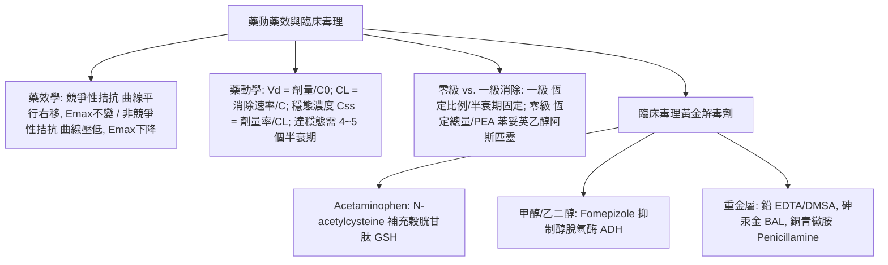

---

## 主題一：藥效動力學（Pharmacodynamics）基本曲線位移

### 1. 促效劑與拮抗劑量效曲線特徵對照矩陣
| 藥物受體交互作用型態 | 效價強度（Potency / $EC_{50}$）變動 | 最大效能（Efficacy / $E_{max}$）變動 | 量效曲線（Dose-Response Curve）幾何特徵 | 典型範例 |
| :--- | :--- | :--- | :--- | :--- |
| **完全促效劑 (Full Agonist)** | 基準值 | 100%（基準值） | 典型 S 型曲線 | 嗎啡（Morphine）於 $\mu$ 受體 |
| **部分促效劑 (Partial Agonist)** | 可高可低 | **顯著下降（$< 100\%$）** | 曲線頂部被壓低，無法達 100% 效能。在完全促效劑存在下表現為**競爭性拮抗**！ | **Buprenorphine**、Pindolol |
| **競爭性拮抗劑 (Competitive Antagonist)** | **效價下降（$EC_{50}$ 變大）** | **完全不變（$E_{max}$ 維持 100%）** | **曲線呈平行向右位移（Parallel shift to the right）**。只要給予極高濃度促效劑即可完全克服阻斷！ | **Atropine** vs. Ach；**Prazosin** vs. NE；**Naloxone** vs. Morphine |
| **非競爭性拮抗劑 (Non-competitive Antagonist)** | 效價通常不變 | **最大效能顯著下降（$E_{max} \downarrow$）** | **曲線被不可逆垂直壓低（Emax 降低）**，無法藉由增加促效劑濃度來克服！ | **Phenoxybenzamine**（不可逆阻斷 $\alpha$）；Ketamine |

---

## 主題二：藥物代謝動力學（Pharmacokinetics）核心方程式

### 1. 國考必背四大計算公式
1. **分佈體積（Volume of Distribution, $V_d$）**：
   $$V_d = \frac{\text{體內藥物總量 (Amount of drug in body)}}{\text{血漿藥物濃度 (Plasma drug concentration, } C_p)}$$
   - $V_d$ 極小（4~8 L，限於血漿）：大分子、高血漿蛋白結合率（如 Warfarin, Heparin）。
   - $V_d$ 極大（$> 1000\text{ L}$，遠超人體體重）：高脂溶性、深層組織脂肪/肌肉蓄積（如 Chloroquine, Digoxin）。血液透析無法清除。
2. **清除率（Clearance, $CL$）**：
   $$CL = \frac{\text{藥物消除速率 (Rate of elimination)}}{C_p} = k_e \times V_d$$
3. **半衰期（Half-life, $t_{1/2}$）**：
   $$t_{1/2} = \frac{0.693 \times V_d}{CL}$$
   - **重要臨床法則**：持續恆速給藥下，**達到 90% 穩態血中濃度（Steady-state concentration, $C_{ss}$）需要 3.3 個半衰期；達到 95% 以上穩態需要 4 至 5 個半衰期**！停止給藥後，體內藥物徹底清除亦需 4~5 個半衰期。
4. **維持劑量（Maintenance Dose, MD）與首劑負荷量（Loading Dose, LD）**：
   $$\text{Loading Dose} = \frac{C_{target} \times V_d}{F} \qquad \text{Maintenance Dose Rate} = \frac{C_{target} \times CL}{F}$$
   （$F$ 為口服生體利用率 Bioavailability，靜脈注射時 $F = 1$）。

### 2. 零級消除（Zero-order）vs. 一級消除（First-order）
- **一級消除動力學（First-order kinetics，絕大多數藥物）**：
  - **恆定比例消除**（單位時間內消除固定百分比，如每半衰期消除 50%）。
  - 消除速率與血漿濃度成正比；半衰期（$t_{1/2}$）為常數，不隨劑量改變。
- **零級消除動力學（Zero-order kinetics / 容量飽和動力學）**：
  - **恆定總量消除**（代謝酵素全數飽和，單位時間內僅能消除固定毫克數）。
  - **無固定半衰期**！當劑量微幅增加，血中濃度將呈現不成比例之指數型狂飆，極易中毒！
  - **國考三大零級消除神藥（口訣：PEA 豌豆）**：**P**henytoin（苯妥英）、**E**thanol（酒精）、**A**spirin（高劑量阿斯匹靈）。

---

## 主題三：臨床中毒常見物質與特異解毒劑（Antidotes）全覽

### 1. 國考最高頻毒物與解毒劑黃金總表
| 中毒物質 / 毒性藥物 | 臨床特徵表現 | 專一性首選解毒劑（Antidote） | 解毒分子機制 |
| :--- | :--- | :--- | :--- |
| **乙醯胺酚 (Acetaminophen / APAP)** | 48~72 小時猛爆性肝壞死、黃疸、AST/ALT 破萬 | **N-乙醯半胱胺酸（N-acetylcysteine, NAC）** | 補充細胞內耗竭的 **穀胱甘肽（GSH）**，解毒有毒中間代謝物 NAPQI |
| **甲醇 (Methanol) 與乙二醇 (Ethylene glycol)** | 嚴重高陰離子間隙酸中毒；甲醇致視神經水腫失明；乙二醇產草酸致急性腎衰竭 | **甲吡唑（Fomepizole）**（或口服/IV 高濃度乙醇 Ethanol） | 專一性競爭抑制 **醇脫氫酶（Alcohol dehydrogenase, ADH）**，阻斷其轉化為有毒甲酸/乙醇酸 |
| **一氧化碳 (CO)** | 櫻桃紅皮膚黏膜（罕見）、頭痛昏迷、乳酸中毒 | **100% 高濃度常壓氧** 或 **高壓氧艙（Hyperbaric $O_2$）** | 大幅縮短碳氧血紅素（HbCO）半衰期（由 300 分鐘縮短至 20 分鐘） |
| **氰化物 (Cyanide)** | 抑制粒線體細胞色素氧化酶，動靜脈血氧差縮小，重度乳酸中毒 | **羥鈷胺（Hydroxocobalamin）** 或 **亞硝酸鈉（$NaNO_2$）+ 硫代硫酸鈉（$Na_2S_2O_3$）** | 羥鈷胺直接結合生成無毒維生素 B12；亞硝酸鈉氧化血紅素生成高鐵血紅素搶奪氰基，硫代硫酸鈉提供硫基由硫氰酸酶轉化排泄 |
| **鉛中毒 (Lead toxicity)** | 腹絞痛、貧血伴嗜鹼性點彩紅血球（Basophilic stippling）、腕下垂橈神經麻痺 | 兒童：**DMSA（琥珀酸二巰）** 成人重症：**EDTA 鈣鈉（$CaNa_2\text{-EDTA}$）** 合併 **二巰基丙醇（BAL）** | 重金屬螯合劑，促進金屬水溶性經尿排出 |
| **砷中毒 (Arsenic) / 汞中毒 (Mercury)** | 蒜臭味呼氣、嚴重出血性腹瀉、多發性神經病變 | **二巰基丙醇（BAL / Dimercaprol）** 或 **DMSA** | 提供雙硫醇基（-SH）螯合重金屬 |
| **銅中毒 / 威爾森氏症 (Wilson's disease)** | 肝硬化、基底核退化震顫、角膜 KF 環（Kayser-Fleischer rings） | **青黴胺（Penicillamine）** 或 **曲恩汀（Trientine）** | 銅離子螯合劑 |
| **抗凝血藥 Warfarin 中毒** | INR 顯著延長、全身黏膜皮下嚴重出血 | 急性嚴重：**凝血胸原複合物（4F-PCC）** 次緊急：**維生素 K1（Phytonadione）** | 補充依賴維生素 K 之凝血因子 II, VII, IX, X |
| **肝素（Heparin）過量出血** | aPTT 顯著延長 | **硫酸魚精蛋白（Protamine sulfate）** | 帶高度強正電荷胜肽，與帶強負電荷的肝素分子形成化學中和複合物 |
| **$\beta$ 阻斷劑（$\beta$-blocker）中毒** | 嚴重竇性心搏過緩、低血壓、心因性休克 | **升糖素（Glucagon）** | 繞過被阻斷的 $\beta$ 受體，直接活化心肌細胞之 Gs-AC，提升 intracellular cAMP 恢復心跳！ |

---

## 歷屆國考核心真題解析

### 【國考經典真題實戰】
**【試題編號】111-第二次-第一階段-med2-051**
> **題目**：Warfarin 在人體內的代謝主要受到下列那兩種基因的多型性變異（polymorphism）影響？
- (A) CYP2C19 和VKORC1（vitamin K epoxide reductase complex subunit 1）
- (B) CYP2C9 和VKORC1
- (C) CYP2D6 和VKORC1
- (D) CYP2B6 和CYP2C19

> **標準答案**：`B`
> 
> **【考點深度解析與選項拆解】**：
- **(A) 選項分析**：CYP2C19 和VKORC1（vitamin K epoxide reductase complex subunit 1）。核對抗腫瘤標靶受體、降血糖酵素抑制、抗痛風發炎或藥物動力學參數公式，確認其藥理學機轉。
- **(B) 選項分析**：CYP2C9 和VKORC1。檢視特徵性器官毒性（如心臟毒性、出血性膀胱炎、乳酸中毒或特定解毒劑），剖析考選部高頻命題陷阱。
- **(C) 選項分析**：CYP2D6 和VKORC1。評估競爭性與非競爭性拮抗曲線位移、零級與一級消除速率，釐清易混淆概念。
- **(D) 選項分析**：CYP2B6 和CYP2C19。比對臨床適應症或器官特異性代謝酵素，驗證題幹核心考查重點。
> **【國考核心解題金鑰】**：本題精準鎖定標準答案 **(B)**。考生須牢記化療毒性防護劑對應關係（如 Cyclophosphamide 對 MESNA、MTX 對 Leucovorin）、糖尿病口服新藥與重金屬解毒劑，即可秒殺奪冠。

---
### 【國考經典真題實戰】
**【試題編號】111-第二次-第一階段-med2-066**
> **題目**：下列藥物中，何者對M3蕈毒性受體（M3 muscarinic receptor）的選擇性最高，因有較長半衰期，故一天只需服 藥一次即可用於治療成人尿失禁（urinary incontinence）？
- (A) darifenacin
- (B) tolterodine
- (C) oxybutynin
- (D) trospium

> **標準答案**：`A`
> 
> **【考點深度解析與選項拆解】**：
- **(A) 選項分析**：darifenacin。核對抗腫瘤標靶受體、降血糖酵素抑制、抗痛風發炎或藥物動力學參數公式，確認其藥理學機轉。
- **(B) 選項分析**：tolterodine。檢視特徵性器官毒性（如心臟毒性、出血性膀胱炎、乳酸中毒或特定解毒劑），剖析考選部高頻命題陷阱。
- **(C) 選項分析**：oxybutynin。評估競爭性與非競爭性拮抗曲線位移、零級與一級消除速率，釐清易混淆概念。
- **(D) 選項分析**：trospium。比對臨床適應症或器官特異性代謝酵素，驗證題幹核心考查重點。
> **【國考核心解題金鑰】**：本題精準鎖定標準答案 **(A)**。考生須牢記化療毒性防護劑對應關係（如 Cyclophosphamide 對 MESNA、MTX 對 Leucovorin）、糖尿病口服新藥與重金屬解毒劑，即可秒殺奪冠。

---
### 【國考經典真題實戰】
**【試題編號】111-第二次-第一階段-med2-069**
> **題目**：下列何種藥物對冷所引起的蕁麻疹（cold-induced urticaria）及類癌瘤（carcinoid tumor）的平滑肌症狀，具有改 善的作用？
- (A) ketanserin
- (B) ritanserin
- (C) cyproheptadine
- (D) ondansetron

> **標準答案**：`C`
> 
> **【考點深度解析與選項拆解】**：
- **(A) 選項分析**：ketanserin。核對抗腫瘤標靶受體、降血糖酵素抑制、抗痛風發炎或藥物動力學參數公式，確認其藥理學機轉。
- **(B) 選項分析**：ritanserin。檢視特徵性器官毒性（如心臟毒性、出血性膀胱炎、乳酸中毒或特定解毒劑），剖析考選部高頻命題陷阱。
- **(C) 選項分析**：cyproheptadine。評估競爭性與非競爭性拮抗曲線位移、零級與一級消除速率，釐清易混淆概念。
- **(D) 選項分析**：ondansetron。比對臨床適應症或器官特異性代謝酵素，驗證題幹核心考查重點。
> **【國考核心解題金鑰】**：本題精準鎖定標準答案 **(C)**。考生須牢記化療毒性防護劑對應關係（如 Cyclophosphamide 對 MESNA、MTX 對 Leucovorin）、糖尿病口服新藥與重金屬解毒劑，即可秒殺奪冠。

---

 

