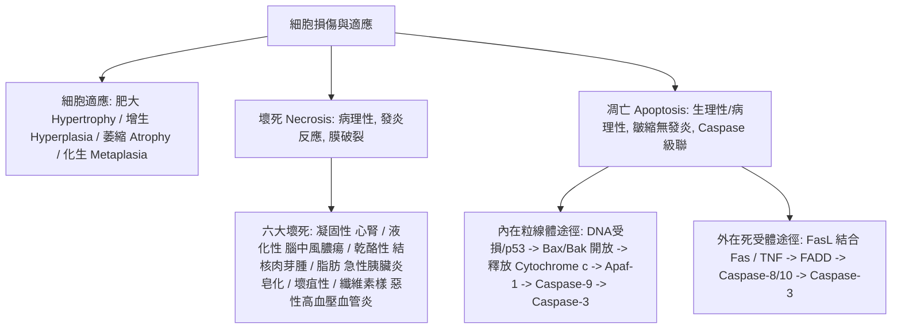
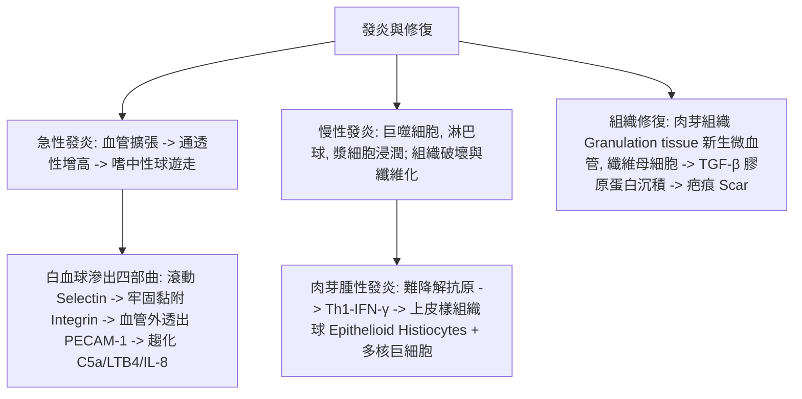
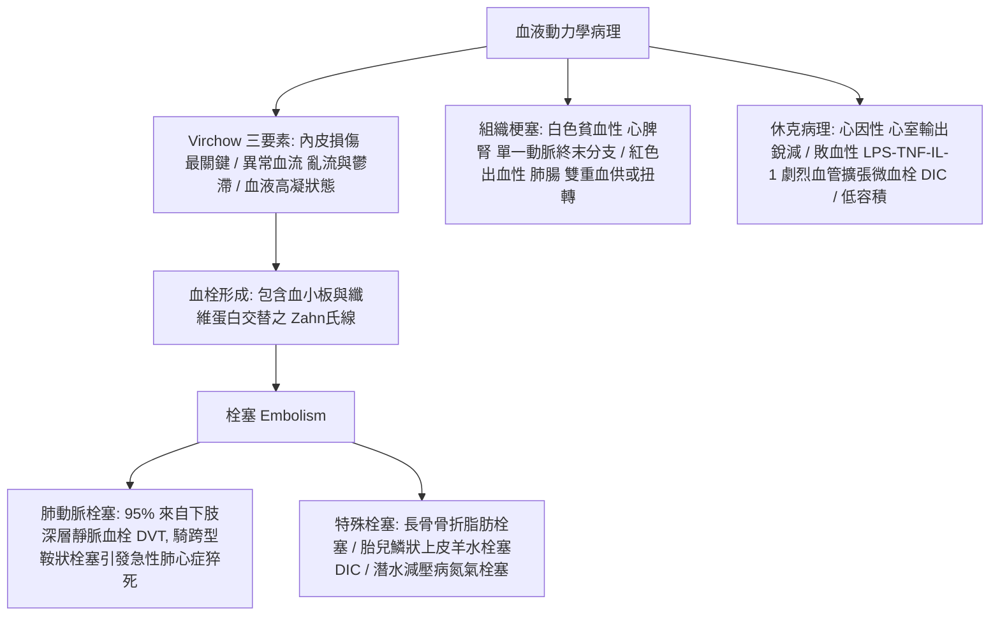
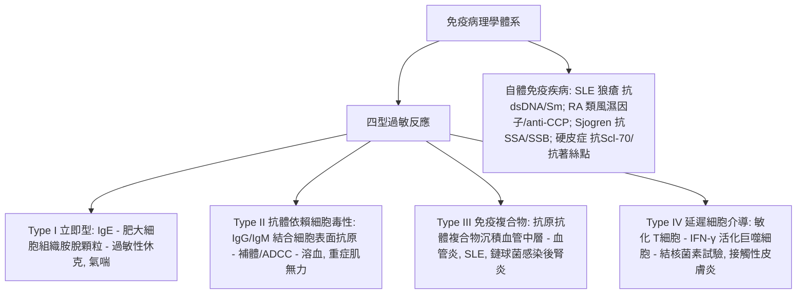
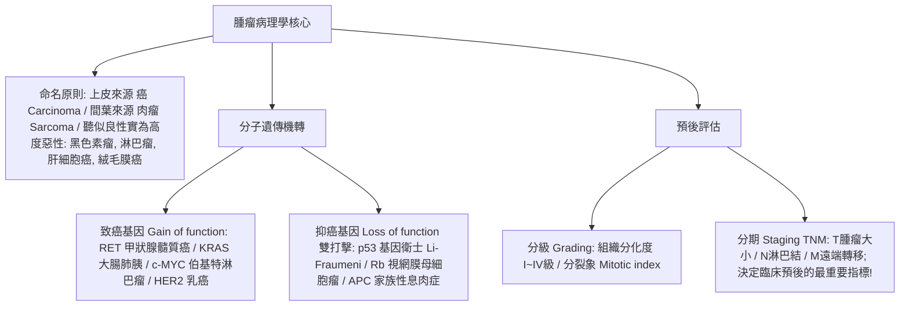
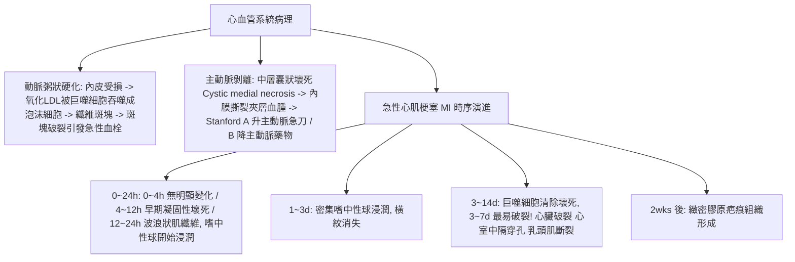
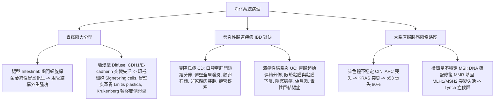
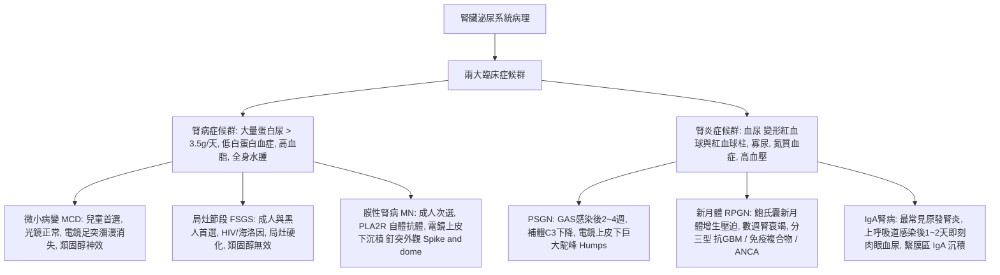
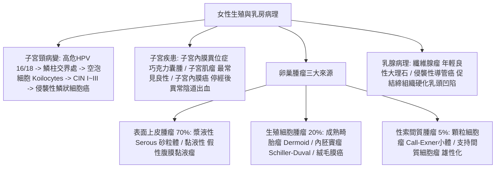

# 醫師專技高考一階段：人體病理學 考前衝刺手冊

> **考科卷別**：醫學（二） ｜ **題號範圍**：Q55 ~ Q80 (約 26 題)
>
> **複習導引**：細胞壞死凋亡、急慢性發炎肉芽腫、腫瘤分子致癌與各器官系統實體病理變化。

---

## 本科目章節目錄

1. [病理學 第01章 細胞損傷、壞死、凋亡與細胞適應](#chapter-1)
2. [病理學 第02章 急性與慢性發炎、組織修復與肉芽腫](#chapter-2)
3. [病理學 第03章 血液動力學障礙、血栓形成與休克](#chapter-3)
4. [病理學 第04章 免疫病理學：自體免疫與過敏反應](#chapter-4)
5. [病理學 第05章 腫瘤病理學：分子機轉、命名與分期](#chapter-5)
6. [病理學 第06章 心血管系統病理學：動脈粥狀硬化、心肌梗塞與心臟病](#chapter-6)
7. [病理學 第07章 呼吸系統病理學：肺炎、阻塞限制性肺疾患與肺癌](#chapter-7)
8. [病理學 第08章 消化系統病理學：胃腸、肝膽、胰臟腫瘤與發炎](#chapter-8)
9. [病理學 第09章 腎臟與泌尿生殖病理學：腎絲球腎炎與腫瘤](#chapter-9)
10. [病理學 第10章 女性生殖與乳房病理學：子宮、卵巢與乳癌](#chapter-10)
11. [病理學 第11章 造血與淋巴系統病理學：白血病與淋巴瘤](#chapter-11)
12. [病理學 第12章 內分泌、神經、骨骼肌肉病理學](#chapter-12)

---

<a id="chapter-1"></a>

<!-- CHAPTER 1 START -->

# 病理學 第01章 細胞損傷、壞死、凋亡與細胞適應

## 核心知識體系架構
病理學為臨床醫學之橋樑。本章奠定全身疾病之細胞病理基礎：細胞適應（肥大、增生、萎縮、化生）；可逆性損傷（細胞水腫、脂肪變性）vs. 不可逆性損傷（鈣超載、膜破裂、粒線體崩潰）；六大壞死型態（凝固性、液化性、乾酪性、脂肪、壞疽性、纖維素樣壞死）；以及細胞凋亡（Apoptosis）內在粒線體途徑與外在死受體途徑。



---

## 主題一：四大細胞適應（Cellular Adaptations）鑑別矩陣

### 1. 肥大、增生、萎縮與化生之病理特徵
| 適應型態 | 定義與細胞生物學機轉 | 生理性範例（Physiologic） | 病理性範例（Pathologic） | 癌變潛能（Malignant Potential） |
| :--- | :--- | :--- | :--- | :--- |
| **肥大 (Hypertrophy)** | **細胞體積增大**（蛋白質與細胞器合成增加）。通常見於**無分裂增生能力之永久細胞（Permanent cells）** | 懷孕時受動情素刺激之子宮平滑肌肥大；運動員骨骼肌增大 | 高血壓或主動脈瓣狹窄引發之**左心室同心性肥大（Left ventricular hypertrophy）** | 無 |
| **增生 (Hyperplasia)** | **細胞數目增多**（由幹細胞分裂驅動）。僅能發生於具分裂能力之細胞 | 懷孕或哺乳期乳腺小葉上皮增生；部分肝切除後殘存肝細胞代償性再生 | 長期動情素無對抗刺激之**子宮內膜增生（Endometrial hyperplasia）**；雄性素過量之**良性攝護腺增生（BPH）** | **有**（病理性增生若持續刺激易轉化為異生 Dysplasia 及癌症，但 BPH 不增加前列腺癌風險） |
| **萎縮 (Atrophy)** | **細胞體積縮小與數目減少**（蛋白質降解增加，泛素-蛋白酶體路徑與自噬體 Autophagy 活化） | 停經後子宮內膜萎縮；胚胎甲狀舌管退化 | 肢體骨折固定後的廢用性萎縮；神經去支配萎縮（脊髓灰質炎）；腦動脈粥狀硬化引起的腦萎縮 | 無 |
| **化生 (Metaplasia)** | 一種分化成熟的細胞型態被**另一種更能耐受逆境的分化成熟細胞型態所取代**（幹細胞重新編程 Reprogramming） | 無 | 1. **抽菸者氣道假複層纖毛柱狀上皮化生為複層鱗狀上皮（Squamous metaplasia）**。<br>2. **胃食道逆流（GERD）引起之 Barrett 食道：食道下段鱗狀上皮化生為胃腸道單層柱狀上皮（含杯狀細胞 Goblet cells）**。 | **高度癌變風險**！Barrett 食道顯著增加食道**腺癌（Adenocarcinoma）** 風險；氣道鱗狀化生易轉化為氣道**鱗狀細胞癌**！ |

---

## 主題二：六大壞死型態（Types of Necrosis）組織病理矩陣

### 1. 壞死型態、外觀病理與典型疾病對應表
| 壞死類型 | 顯微鏡下組織學病理特徵 | 肉眼（Gross）病理外觀 | 典型發生組織與代表性疾病 | 國考關鍵鑑別考點 |
| :--- | :--- | :--- | :--- | :--- |
| **凝固性壞死 (Coagulative Necrosis)** | 細胞輪廓骨架保留數天（**「幽靈細胞 Ghost cells」**），細胞核消失（核固縮、核碎裂、核溶解），細胞質嗜酸性增強 | 質地堅硬、灰白乾燥三角形梗塞灶 | **全身除中樞神經以外之所有實質器官缺血性梗塞（心肌梗塞、腎梗塞、脾梗塞）** | **蛋白質變性凝固佔優勢**，溶酶體水解被高熱或酸中毒抑制，細胞基本架構得以完整保留。 |
| **液化性壞死 (Liquefactive Necrosis)** | 組織被水解酶徹底消化溶解為液體黏稠物，細胞殘骸與嗜中性球形成膿液（Pus） | 軟化灶、囊腔（Cavity）、囊液 | 1. **大腦中樞神經系統缺血性中風梗塞（唯一例外！）**。<br>2. **細菌或真菌感染引發之局部化膿與腦/肝/肺膿瘍（Abscess）**。 | **水解酶消化佔絕對優勢**。大腦富含脂質與水分且缺乏纖維基質，微小神經膠細胞快速水解壞死腦組織。 |
| **乾酪性壞死 (Caseous Necrosis)** | 正常組織結構完全毀滅，呈現粉紅色無定形無結構之嗜酸性顆粒狀殘屑，周圍被上皮樣組織球與郎罕氏巨細胞包繞 | **豆腐渣樣、乾酪樣脆弱灰白色軟塊** | **結核桿菌感染（Mycobacterium tuberculosis / 肺結核、結核性淋巴結炎）**、全身性黴菌感染（組織胞漿菌） | 為凝固性壞死與液化性壞死的特殊複合形式，由結核菌細胞壁蠟質脂質（Cord factor）引起。 |
| **脂肪壞死 (Fat Necrosis)** | 壞死脂肪細胞邊緣模糊模糊，壞死區域內基質鈣鹽沉積，顯微鏡下呈現**藍紫色無定形顆粒沉著（皂化 Saponification）** | 白堊樣、白粉筆斑塊（Chalky white deposits） | **急性胰臟炎（Acute pancreatitis）**（活化脂肪酶水解腹膜後脂肪釋放游離脂肪酸，與 $Ca^{2+}$ 結合生成鈣皂）；**乳房外傷性脂肪壞死** | 常伴隨劇烈低血鈣（血鈣被大量消耗於皂化斑塊中，為重症急性胰臟炎不良預後指標！）。 |
| **纖維素樣壞死 (Fibrinoid Necrosis)** | 血管壁呈亮粉紅色、無結構均勻紅染樣變性，伴隨大量嗜中性球浸潤與紅血球外滲 | 血管壁脆弱、微小動脈瘤形成 | **惡性急進型高血壓（Malignant hypertension）**、**結節性多動脈炎（PAN）**、SLE、風濕熱阿少夫小體（Aschoff bodies） | **免疫複合物與血漿蛋白（纖維蛋白原 Fibrinogen）自受損血管內皮外滲並沉澱於血管中層**。 |
| **壞疽性壞死 (Gangrenous Necrosis)** | 肢端嚴重缺血引發之凝固性壞死（**乾性壞疽 Dry gangrene**）；若合併細菌腐敗感染液化則轉為 **濕性壞疽（Wet gangrene）** | 肢端發黑、皺縮乾癟或惡臭腫脹腐敗 | 糖尿病足、下肢周邊動脈阻塞疾病（PAOD）、腸扭轉腸壞疽 | 臨床外科常用術語，本質為多層組織凝固性壞死。 |

---

## 主題三：細胞凋亡（Apoptosis）分子調控機制

### 1. 內在粒線體途徑 vs. 外在死受體途徑大對決
- **內在途徑（Intrinsic / Mitochondrial Pathway，主要生理與應激途徑）**：
  1. DNA 嚴重受損、生長因子剝奪或內質網壓力 $\to$ 活化 **p53** 腫瘤抑制蛋白。
  2. p53 上調促凋亡 **BH3-only 蛋白（Puma, Noxa, Bim, Bid）**。
  3. 活化促凋亡效應蛋白 **Bax 與 Bak** $\to$ 在粒線體外膜形成通道，使粒線體膜通透性劇增（MOMP）。
  4. 粒線體釋放 **細胞色素 c（Cytochrome c）** 入細胞質。
  5. Cytochrome c 與 **Apaf-1（凋亡蛋白酶活化因子-1）** 及 dATP 結合成巨型輪狀 **凋亡體（Apoptosome）**。
  6. 凋亡體募聚並活化 **啟動型半胱天冬酶：Caspase-9**。
- **外在途徑（Extrinsic / Death Receptor-initiated Pathway）**：
  1. 細胞毒性 T 細胞（CTL）表面之 **FasL（CD95L）** 結合於標靶細胞表面之 **Fas 受體（CD95）**；或 TNF 結合於 TNFR1。
  2. 受體三聚體化，招募胞內轉接蛋白 **FADD（Fas-Associated Death Domain）**。
  3. FADD 募集並活化 **啟動型半胱天冬酶：Caspase-8 與 Caspase-10**。
- **共同執行終曲（Execution Phase）**：
  - 活化的 Caspase-9 或 Caspase-8 剪切並活化 **執行型半胱天冬酶：Caspase-3 與 Caspase-6, 7**！
  - Caspase-3 活化 CAD 內切核酸酶，將染色質 DNA 在核小體間隙精確切割為 **180~200 bp 的梯狀碎片（DNA Laddering，凋亡黃金標誌）**；細胞膜內翻將 **磷脂醯絲胺酸（Phosphatidylserine）** 暴露於細胞外表面，作為「Eat me」信號吸引巨噬細胞在**不引發任何急性發炎反應**下無聲吞噬清除！

---

## 歷屆國考核心真題解析

### 【國考經典真題實戰】
**【試題編號】111-第一次-med2-077**
> **題目**：胃食道逆流患者，於食道末端做切片檢查，發現良性柱狀上皮細胞，最可能為何種變化？
- (A) 異生（dysplasia）
- (B) 增生（hyperplasia）
- (C) 轉移（metastasis）
- (D) 化生（metaplasia）

> **標準答案**：`D`
> 
> **【考點深度解析與選項拆解】**：
- **(A) 選項分析**：異生（dysplasia）。核對細胞病理形態學變化（如嗜酸性增加、核碎裂或組織間質沉積），驗證其病理診斷符合性。
- **(B) 選項分析**：增生（hyperplasia）。比對發炎化學介質、自體抗體專一性或血栓形成 Virchow 三要素，剖析考選部常見陷阱。
- **(C) 選項分析**：轉移（metastasis）。辨析壞死亞型（凝固性 vs. 液化性）或過敏反應型別（Type I~IV），排除干擾選項。
- **(D) 選項分析**：化生（metaplasia）。綜合顯微鏡下特徵或器官代償極限，確認題幹命題之病理學核心機制。
> **【國考核心解題金鑰】**：本題精確選出 **(D)**。考生須精通細胞凋亡內在/外在路徑、六大壞死型態之組織學判讀及各型過敏反應分子媒介，即可秒殺破題。

---
### 【國考經典真題實戰】
**【試題編號】111-第一次-med2-082**
> **題目**：關於鼻腦白黴菌病（rhinocerebral mucormycosis）的敘述，下列何者正確？
- (A) 病菌產生外毒素傷害眼眶及腦部組織，是其快速造成這些感染部位壞死的最主要原因
- (B) 病菌的典型型態是菌絲體分節清楚，銳角分枝及較固定的寬度
- (C) 病菌屬雙態性真菌（dimorphic fungi），所以檢體送培養時需要特別告知實驗室需要延長培養時間
- (D) 易感因素（predisposing factors）包括嗜中性粒細胞低下（neutropenia）、使用類固醇與糖尿病等

> **標準答案**：`D`
> 
> **【考點深度解析與選項拆解】**：
- **(A) 選項分析**：病菌產生外毒素傷害眼眶及腦部組織，是其快速造成這些感染部位壞死的最主要原因。核對細胞病理形態學變化（如嗜酸性增加、核碎裂或組織間質沉積），驗證其病理診斷符合性。
- **(B) 選項分析**：病菌的典型型態是菌絲體分節清楚，銳角分枝及較固定的寬度。比對發炎化學介質、自體抗體專一性或血栓形成 Virchow 三要素，剖析考選部常見陷阱。
- **(C) 選項分析**：病菌屬雙態性真菌（dimorphic fungi），所以檢體送培養時需要特別告知實驗室需要延長培養時間。辨析壞死亞型（凝固性 vs. 液化性）或過敏反應型別（Type I~IV），排除干擾選項。
- **(D) 選項分析**：易感因素（predisposing factors）包括嗜中性粒細胞低下（neutropenia）、使用類固醇與糖尿病等。綜合顯微鏡下特徵或器官代償極限，確認題幹命題之病理學核心機制。
> **【國考核心解題金鑰】**：本題精確選出 **(D)**。考生須精通細胞凋亡內在/外在路徑、六大壞死型態之組織學判讀及各型過敏反應分子媒介，即可秒殺破題。

---
### 【國考經典真題實戰】
**【試題編號】111-第一次-med2-094**
> **題目**：酗酒的40歲男性，酒後因上腹痛且反射到後背來急診，病人血清消化酶（amylase）及脂肪酶（lipase）升高， 且有低血鈣情形，則病人最有可能出現下列何種病理變化？
- (A) 胰臟出血性壞死
- (B) 心臟廣泛性壞死
- (C) 胃潰瘍穿孔
- (D) 肝臟大塊性壞死

> **標準答案**：`A`
> 
> **【考點深度解析與選項拆解】**：
- **(A) 選項分析**：胰臟出血性壞死。核對細胞病理形態學變化（如嗜酸性增加、核碎裂或組織間質沉積），驗證其病理診斷符合性。
- **(B) 選項分析**：心臟廣泛性壞死。比對發炎化學介質、自體抗體專一性或血栓形成 Virchow 三要素，剖析考選部常見陷阱。
- **(C) 選項分析**：胃潰瘍穿孔。辨析壞死亞型（凝固性 vs. 液化性）或過敏反應型別（Type I~IV），排除干擾選項。
- **(D) 選項分析**：肝臟大塊性壞死。綜合顯微鏡下特徵或器官代償極限，確認題幹命題之病理學核心機制。
> **【國考核心解題金鑰】**：本題精確選出 **(A)**。考生須精通細胞凋亡內在/外在路徑、六大壞死型態之組織學判讀及各型過敏反應分子媒介，即可秒殺破題。


---

<br>

<a id="chapter-2"></a>

<!-- CHAPTER 2 START -->

# 病理學 第02章 急性與慢性發炎、組織修復與肉芽腫

## 核心知識體系架構
發炎反應為機體對抗感染與損傷之防衛武器。本章涵蓋急性發炎（血管口徑與通透性改變、嗜中性球白血球遊走四部曲：滾動、牢固黏附、透出、趨化）；發炎化學介質（組織胺、前列腺素、白三烯素、補體 C3a/C5a）；慢性發炎特徵；肉芽腫性發炎（Granulomatous Inflammation）之免疫病理；以及組織修復（肉芽組織形成與疤痕癒合）。



---

## 主題一：急性發炎白血球遊走渗出（Leukocyte Extravasation）四部曲

### 1. 血管內皮與嗜中性球分子黏附分子精準矩陣
| 遊走步驟階段 | 白血球表面受體分子 | 血管內皮細胞表面配體分子 | 調控介質因子 | 遺傳缺損疾病與國考考點 |
| :--- | :--- | :--- | :--- | :--- |
| **1. 滾動 (Rolling)** | **Sialyl-Lewis X 寡糖**、L-Selectin | **E-Selectin**（內皮）、**P-Selectin**（儲存於內皮 **Weibel-Palade 小體** 及血小板 $\alpha$ 顆粒） | 組織胺、凝血酶促使 P-selectin 快速外翻質膜；TNF-$\alpha$、IL-1 誘導 E-selectin 合成 | **白血球黏附缺乏症 2 型（LAD-2）**：岩藻糖轉運缺陷，缺乏 Sialyl-Lewis X，白血球無法滾動。 |
| **2. 牢固黏附 (Firm Adhesion)** | **整合素（$\beta_2$-Integrins：LFA-1 [CD11a/CD18], Mac-1 [CD11b/CD18]）** | **ICAM-1（CD54）**、VCAM-1 | 趨化因子活化白血球，使低親和力 Integrin 變構為高親和力狀態；TNF/IL-1 上調 ICAM-1 | **白血球黏附缺乏症 1 型（LAD-1）**：體染色體隱性遺傳 **CD18（$\beta_2$ 整合素次單元）突變**！白血球無法牢固黏附。<br>臨床特徵：**臍帶脫落嚴重延遲（$> 30$ 天）**、反覆壞死性皮膚黏膜感染、**感染病灶完全沒有膿液（Absent pus）**、血液中白血球極度增高。 |
| **3. 透出 (Transmigration / Diapedesis)** | **PECAM-1（CD31）** | **PECAM-1（CD31）** | 嗜中性球經內皮細胞間隙擠出血管外 | CD31 同型二聚體相互作用。 |
| **4. 趨化 (Chemotaxis)** | G 蛋白偶聯趨化受體 | 組織間隙化學趨化梯度 | **四大最強趨化因子（國考必考！）**：<br>1. **$C5a$**（補體裂解產物）<br>2. **$LTB_4$**（白三烯素 $B_4$）<br>3. **$IL-8$（CXCL8）**<br>4. **細菌甲醯胜肽（$fMLP$）** | 嗜中性球順濃度梯度向感染壞死核心阿米巴樣前進。 |

---

## 主題二：發炎化學介質（Chemical Mediators）速記

### 1. 關鍵發炎介質來源與特異功能
- **組織胺（Histamine）**：儲存於肥大細胞、嗜鹼性球顆粒中。受物理刺激、IgE（Type I 過敏）或補體 **$C3a, C5a$（過敏毒素 Anaphylatoxins）** 刺激釋放。**瞬時引起小動脈擴張及微血管後小靜脈內皮收縮（增加血管通透性，引起水腫）**。
- **花生四烯酸代謝產物（類二十烷酸 Eicosanoids）**：
  - **環氧化酶途徑（COX）**：
    - **$PGE_2$**：致熱（作用於下視丘）、致痛（敏化痛覺受器）、小動脈擴張。
    - **$PGI_2$（前列環素）**：血管擴張、強烈抑制血小板凝集。
    - **$TXA_2$（血栓素）**：血小板合成，強烈收縮血管、促進血小板凝集。
  - **脂氧化酶途徑（5-LOX）**：
    - **$LTB_4$**：最強嗜中性球趨化因子及活化劑。
    - **$LTC_4, LTD_4, LTE_4$（原稱慢反應過敏物質 SRS-A）**：極強之支氣管痙攣收縮劑（強度為組織胺 1000 倍！）及增加微血管通透性。

---

## 主題三：肉芽腫性發炎（Granulomatous Inflammation）病理學

### 1. 肉芽腫免疫形成機轉與組成要素
- **定義**：一種特殊形態之慢性發炎，機體面對**難以被嗜中性球或巨噬細胞消化清除的抗原或異物**時所啟動的延遲型第四型過敏反應（Type IV Hypersensitivity）。
- **細胞級聯對話核心**：
  1. 巨噬細胞吞噬難降解抗原，呈遞給抗原特異性 CD4+ T 細胞。
  2. 巨噬細胞釋放 **IL-12**，誘導 CD4+ T 細胞分化為 **Th1 細胞**。
  3. Th1 細胞分泌核心細胞因子：**干擾素-$\gamma$（IFN-$\gamma$）** 及 **TNF-$\alpha$**。
  4. **IFN-$\gamma$ 強烈活化巨噬細胞**，使其變形為具強大分泌與殺菌能力之 **上皮樣組織球（Epithelioid Histiocytes，肉芽腫之絕對必備診斷核心！）**。
  5. 多個上皮樣細胞互相融合，形成巨大多核巨細胞（**郎罕氏巨細胞 Langhans giant cells**，核呈馬蹄形或花環狀排列於周邊）。
  6. **TNF-$\alpha$** 負責維持肉芽腫之結構完整（使用抗 TNF 藥物如 Infliximab 會瓦解肉芽腫，導致潛伏結核病猛烈復發！）。
- **肉芽腫分類鑑別**：
  - **乾酪性肉芽腫（Caseating）**：中央有乾酪樣壞死（粉紅無定形殘屑）。見於：**結核病（TB）**、貓抓病（化膿性肉芽腫）、深層真菌感染。
  - **非乾酪性肉芽腫（Non-caseating）**：中央無壞死。見於：**類肉瘤病（Sarcoidosis，雙側肺門淋巴結腫大、非乾酪肉芽腫）**、克隆氏症（Crohn's disease）、異物肉芽腫（手術縫線、鈹中毒 Berylliosis）。

---

## 歷屆國考核心真題解析

### 【國考經典真題實戰】
**【試題編號】111-第一次-med2-076**
> **題目**：產生interleukin-17的T淋巴球缺乏，此狀況與下列何種病灶最有關？
- (A) 很多嗜中性白血球（neutrophils）浸潤的炎症
- (B) 尋常型天皰瘡（pemphigus vulgaris）
- (C) 類天皰瘡（bullous pemphigoid）
- (D) 冷膿瘍（cold abscess）

> **標準答案**：`D`
> 
> **【考點深度解析與選項拆解】**：
- **(A) 選項分析**：很多嗜中性白血球（neutrophils）浸潤的炎症。核對細胞病理形態學變化（如嗜酸性增加、核碎裂或組織間質沉積），驗證其病理診斷符合性。
- **(B) 選項分析**：尋常型天皰瘡（pemphigus vulgaris）。比對發炎化學介質、自體抗體專一性或血栓形成 Virchow 三要素，剖析考選部常見陷阱。
- **(C) 選項分析**：類天皰瘡（bullous pemphigoid）。辨析壞死亞型（凝固性 vs. 液化性）或過敏反應型別（Type I~IV），排除干擾選項。
- **(D) 選項分析**：冷膿瘍（cold abscess）。綜合顯微鏡下特徵或器官代償極限，確認題幹命題之病理學核心機制。
> **【國考核心解題金鑰】**：本題精確選出 **(D)**。考生須精通細胞凋亡內在/外在路徑、六大壞死型態之組織學判讀及各型過敏反應分子媒介，即可秒殺破題。

---
### 【國考經典真題實戰】
**【試題編號】111-第一次-med2-093**
> **題目**：關於炎症性腸病（inflammatory bowel disease）之敘述，何者錯誤？
- (A) 克隆氏症（Crohn disease）又稱區域性腸炎（regional enteritis）
- (B) 克隆氏症（Crohn disease）為全壁性發炎
- (C) 跳躍式病灶（skip lesion）為潰瘍性結腸炎（ulcerative colitis）的特徵
- (D) 潰瘍性結腸炎（ulcerative colitis）病人罹患大腸癌的機會比正常人高

> **標準答案**：`C`
> 
> **【考點深度解析與選項拆解】**：
- **(A) 選項分析**：克隆氏症（Crohn disease）又稱區域性腸炎（regional enteritis）。核對細胞病理形態學變化（如嗜酸性增加、核碎裂或組織間質沉積），驗證其病理診斷符合性。
- **(B) 選項分析**：克隆氏症（Crohn disease）為全壁性發炎。比對發炎化學介質、自體抗體專一性或血栓形成 Virchow 三要素，剖析考選部常見陷阱。
- **(C) 選項分析**：跳躍式病灶（skip lesion）為潰瘍性結腸炎（ulcerative colitis）的特徵。辨析壞死亞型（凝固性 vs. 液化性）或過敏反應型別（Type I~IV），排除干擾選項。
- **(D) 選項分析**：潰瘍性結腸炎（ulcerative colitis）病人罹患大腸癌的機會比正常人高。綜合顯微鏡下特徵或器官代償極限，確認題幹命題之病理學核心機制。
> **【國考核心解題金鑰】**：本題精確選出 **(C)**。考生須精通細胞凋亡內在/外在路徑、六大壞死型態之組織學判讀及各型過敏反應分子媒介，即可秒殺破題。

---
### 【國考經典真題實戰】
**【試題編號】111-第二次-第一階段-med2-076**
> **題目**：下列何者之典型病理變化，最不可能是肉芽腫性發炎（granulomatous inflammation）？
- (A) 痳瘋（leprosy）
- (B) 類肉瘤（sarcoidosis）
- (C) 潰瘍性大腸炎（ulcerative colitis）
- (D) 結核（tuberculosis）

> **標準答案**：`C`
> 
> **【考點深度解析與選項拆解】**：
- **(A) 選項分析**：痳瘋（leprosy）。核對細胞病理形態學變化（如嗜酸性增加、核碎裂或組織間質沉積），驗證其病理診斷符合性。
- **(B) 選項分析**：類肉瘤（sarcoidosis）。比對發炎化學介質、自體抗體專一性或血栓形成 Virchow 三要素，剖析考選部常見陷阱。
- **(C) 選項分析**：潰瘍性大腸炎（ulcerative colitis）。辨析壞死亞型（凝固性 vs. 液化性）或過敏反應型別（Type I~IV），排除干擾選項。
- **(D) 選項分析**：結核（tuberculosis）。綜合顯微鏡下特徵或器官代償極限，確認題幹命題之病理學核心機制。
> **【國考核心解題金鑰】**：本題精確選出 **(C)**。考生須精通細胞凋亡內在/外在路徑、六大壞死型態之組織學判讀及各型過敏反應分子媒介，即可秒殺破題。


---

<br>

<a id="chapter-3"></a>

<!-- CHAPTER 3 START -->

# 病理學 第03章 血液動力學障礙、血栓形成與休克

## 核心知識體系架構
血液動力學病理涵蓋水腫（充血性心衰竭、腎病症候群之 Starling 平衡被破壞）；出血與淤血（肉豆蔻肝 Nutmeg liver）；血栓形成之三大病因（Virchow's Triad：內皮受損、血流異常、高凝狀態）；動脈血栓 vs. 靜脈血栓（Zahn 氏線 Lines of Zahn）；各型栓塞（肺栓塞、脂肪栓塞、羊水栓塞、減壓病氣體栓塞）；梗塞型態（白色梗塞 vs. 紅色出血性梗塞）；以及休克（低血容量、心因性、感染性敗血性休克）之病理階段。



---

## 主題一：血栓形成（Thrombosis）與 Virchow 三要素

### 1. Virchow 氏三要素（Virchow's Triad）
1. **內皮細胞損傷（Endothelial Injury）**：**最關鍵也是單獨即可引發血栓形成之要素**！暴露內皮下膠原蛋白與馮維勒布蘭德因子（vWF），啟動血小板黏附與外在凝血途徑。見於動脈粥狀硬化潰瘍、心肌梗塞後心內膜壞死、嚴重高血壓、血管炎。
2. **血流動力學異常（Abnormal Blood Flow）**：
   - **亂流（Turbulence）**：造成局部內皮損傷與逆流渦流，見於動脈瘤、動脈粥狀硬化斑塊分叉處。
   - **血流鬱滯（Stasis）**：使血小板與內皮接觸時間增加，阻礙凝血因子被稀釋或清除。見於心房顫動（心房淤血栓塞）、長時間臥床、長途搭機（經濟艙症候群下肢靜脈血栓）。
3. **血液高凝狀態（Hypercoagulability）**：
   - **遺傳原發性**：**第 V 因子萊頓突變（Factor V Leiden，最常見遺傳性血栓成因！）**，使 Factor Va 無法被活性蛋白質 C（APC）裂解阻斷；凝血酶原 G20210A 基因突變；抗凝血酶 III（AT-III）缺乏；Protein C / Protein S 缺乏。
   - **後天次發性**：長期口服避孕藥（動情素刺激肝臟合成凝血因子）、惡性腫瘤（Trousseau 症候群遊走性血栓性靜脈炎）、抗磷脂質症候群（APS：抗心磷脂抗體、狼瘡抗凝物，假性 aPTT 延長但體內高血栓！）。

### 2. 動脈血栓 vs. 靜脈血栓精密對比
- **動脈血栓（Arterial Thrombi）**：
  - 常發生於內皮損傷或動脈粥狀硬化處（冠狀動脈、腦動脈、大腿動脈）。
  - **白血栓（White thrombi）**：以血小板和網狀纖維蛋白為主，含少量紅血球。生長方向朝向**心臟方向逆血流延伸**。
  - **Zahn 氏線（Lines of Zahn）**：顯微鏡下可見淡粉紅色血小板-纖維蛋白層與暗紅色富含紅血球層**交替排列之微細條紋，為「生前形成血栓」與「死後血液凝塊（Postmortem clot）」鑑別之黃金標誌**！
- **靜脈血栓（Venous Thrombi / 靜脈炎性血栓 Phlebothrombosis）**：
  - 常發生於下肢深層靜脈（膕靜脈、股靜脈、髂靜脈），血流鬱滯為主要誘因。
  - **紅血栓（Red thrombi / 停滯血栓）**：含極大量紅血球，質地軟如凝膠。順著**血流方向朝心臟延伸**。

---

## 主題二：各類栓塞（Embolism）與梗塞（Infarction）型態學

### 1. 致命栓塞四大類型比較表
| 栓塞類型 | 來源栓子物質構成 | 典型誘發病史情境 | 臨床表徵與組織病理特徵 |
| :--- | :--- | :--- | :--- |
| **肺動脈栓塞 (PTE)** | **$> 95\%$ 源自下肢深層靜脈血栓（DVT）** | 長期臥床手術後、骨科髖膝關節手術、長途飛行 | 突發胸痛、呼吸急促、咳血；大型**鞍狀栓塞（Saddle embolus）** 卡在肺動脈分叉處，引發**急性右心衰竭（急性肺心症 Cor pulmonale）與猝死**！ |
| **脂肪栓塞 (Fat Embolism)** | 骨髓破裂之脂肪球進入靜脈竇 | **長骨骨折（股骨或脛骨骨折）**、嚴重骨盆骨折後 24~72 小時 | **經典三聯徵（Triad）**：<br>1. **神經精神症狀（神智不清、昏迷）**<br>2. **進行性低血氧呼吸窘迫**<br>3. **上胸部與頸部皮膚瘀點（Petechial rash）**。冷凍切片油紅 O 染色陽性。 |
| **羊水栓塞 (Amniotic Embolism)** | 胎兒鱗狀上皮、胎毛、胎脂、黏蛋白進入母體子宮靜脈 | 困難分娩、胎盤早期剝離、子宮破裂破水時 | 突發嚴重低血壓休克、發紺、昏迷；羊水富含組織因子誘發**猛爆性瀰漫性血管內凝血（DIC）**，母體大出血死亡（死亡率 $> 60\%$）。肺微血管見胎兒鱗狀上皮細胞。 |
| **氣體栓塞 / 減壓病 (Decompression Sickness)** | 血液中溶解的**氮氣（$N_2$）** 因驟然減壓析出形成氣泡 | 深海潛水員過快上浮（**潛水夫病 The Bends**）；高空無加壓座艙急速爬升 | 氣泡阻塞肌肉關節引發劇痛（The Bends）；阻塞肺微血管引發氣梗與胸痛（The Chokes）；慢性反覆缺血引發長骨頭骨壞死（沉箱病 Caisson disease）。高壓氧艙治療。 |

### 2. 白色貧血性梗塞 vs. 紅色出血性梗塞
- **白色（貧血性）梗塞（White / Anemic Infarcts）**：
  - 發生於**組織緻密且為「終末動脈供血（End-arterial circulation）」之實質器官**。
  - 代表器官：**心臟（心肌）、脾臟、腎臟**。
  - 組織學：典型凝固性壞死，梗塞灶呈現界限清楚之三角形楔形（頂點指向血管阻塞處）。
- **紅色（出血性）梗塞（Red / Hemorrhagic Infarcts）**：
  - 發生於**具有「雙重血液供應（Dual blood supply）」、組織疏鬆鬆軟**、或**靜脈阻塞扭轉**、或**血流重新灌注（Reperfusion）** 之器官。
  - 代表器官：
    1. **肺臟（雙重血供：肺動脈 + 支氣管動脈）**。
    2. **小腸與大腸（雙重血供、組織疏鬆易積血；或腸扭轉引發靜脈回流受阻）**。
    3. **卵巢或睪丸扭轉**（靜脈先受壓閉塞，動脈仍持續泵入血液引發大量出血性壞死）。
    4. 缺血性腦中風溶解血栓後出血性轉化。

---

## 歷屆國考核心真題解析

### 【國考經典真題實戰】
**【試題編號】111-第一次-med2-084**
> **題目**：最常見的全身性血栓栓塞（systemic thromboembolism）栓子來源為：
- (A) 下肢深層靜脈
- (B) 左心室壁梗塞處
- (C) 主動脈動脈瘤
- (D) 下肢淺層靜脈

> **標準答案**：`B`
> 
> **【考點深度解析與選項拆解】**：
- **(A) 選項分析**：下肢深層靜脈。核對細胞病理形態學變化（如嗜酸性增加、核碎裂或組織間質沉積），驗證其病理診斷符合性。
- **(B) 選項分析**：左心室壁梗塞處。比對發炎化學介質、自體抗體專一性或血栓形成 Virchow 三要素，剖析考選部常見陷阱。
- **(C) 選項分析**：主動脈動脈瘤。辨析壞死亞型（凝固性 vs. 液化性）或過敏反應型別（Type I~IV），排除干擾選項。
- **(D) 選項分析**：下肢淺層靜脈。綜合顯微鏡下特徵或器官代償極限，確認題幹命題之病理學核心機制。
> **【國考核心解題金鑰】**：本題精確選出 **(B)**。考生須精通細胞凋亡內在/外在路徑、六大壞死型態之組織學判讀及各型過敏反應分子媒介，即可秒殺破題。

---
### 【國考經典真題實戰】
**【試題編號】111-第二次-第一階段-med2-082**
> **題目**：一個過去身體健康的25 歲女性，懷孕在某醫院婦產科定期接受產前檢查，檢查結果都正常，她後來自然產生 出一個足月男嬰，但在生產後她很快出現呼吸急促、心跳加快、發紺（cyanosis）與血壓下降，接著出現痙攣 與失去意識，請問下列情形是最可能出現在此病人的情況？
- (A) 肺動脈血管管腔出現空氣阻塞
- (B) 肺動脈血管管腔出現骨髓（bone marrow）
- (C) 肺動脈血管管腔中出現鱗狀上皮細胞（squamous epithelial cells）
- (D) 肺動脈血管管腔出現血栓栓塞（thromboembolism ）

> **標準答案**：`C`
> 
> **【考點深度解析與選項拆解】**：
- **(A) 選項分析**：肺動脈血管管腔出現空氣阻塞。核對細胞病理形態學變化（如嗜酸性增加、核碎裂或組織間質沉積），驗證其病理診斷符合性。
- **(B) 選項分析**：肺動脈血管管腔出現骨髓（bone marrow）。比對發炎化學介質、自體抗體專一性或血栓形成 Virchow 三要素，剖析考選部常見陷阱。
- **(C) 選項分析**：肺動脈血管管腔中出現鱗狀上皮細胞（squamous epithelial cells）。辨析壞死亞型（凝固性 vs. 液化性）或過敏反應型別（Type I~IV），排除干擾選項。
- **(D) 選項分析**：肺動脈血管管腔出現血栓栓塞（thromboembolism ）。綜合顯微鏡下特徵或器官代償極限，確認題幹命題之病理學核心機制。
> **【國考核心解題金鑰】**：本題精確選出 **(C)**。考生須精通細胞凋亡內在/外在路徑、六大壞死型態之組織學判讀及各型過敏反應分子媒介，即可秒殺破題。

---
### 【國考經典真題實戰】
**【試題編號】111-第二次-第一階段-med2-084**
> **題目**：下列何種出血性疾病，最可能造成微血管病性溶血性貧血（microangiopathic hemolytic anemia）？
- (A) 血栓性血小板減少性紫斑症（thrombotic thrombocytopenic purpura）
- (B) 馮維勒布蘭德病（von Willebrand disease）
- (C) 慢性免疫性血小板減少性紫斑症（chronic immune thrombocytopenic purpura）
- (D) 急性免疫性血小板減少性紫斑症（acute immune thrombocytopenic purpura）

> **標準答案**：`A`
> 
> **【考點深度解析與選項拆解】**：
- **(A) 選項分析**：血栓性血小板減少性紫斑症（thrombotic thrombocytopenic purpura）。核對細胞病理形態學變化（如嗜酸性增加、核碎裂或組織間質沉積），驗證其病理診斷符合性。
- **(B) 選項分析**：馮維勒布蘭德病（von Willebrand disease）。比對發炎化學介質、自體抗體專一性或血栓形成 Virchow 三要素，剖析考選部常見陷阱。
- **(C) 選項分析**：慢性免疫性血小板減少性紫斑症（chronic immune thrombocytopenic purpura）。辨析壞死亞型（凝固性 vs. 液化性）或過敏反應型別（Type I~IV），排除干擾選項。
- **(D) 選項分析**：急性免疫性血小板減少性紫斑症（acute immune thrombocytopenic purpura）。綜合顯微鏡下特徵或器官代償極限，確認題幹命題之病理學核心機制。
> **【國考核心解題金鑰】**：本題精確選出 **(A)**。考生須精通細胞凋亡內在/外在路徑、六大壞死型態之組織學判讀及各型過敏反應分子媒介，即可秒殺破題。


---

<br>

<a id="chapter-4"></a>

<!-- CHAPTER 4 START -->

# 病理學 第04章 免疫病理學：自體免疫與過敏反應

## 核心知識體系架構
免疫病理學涵蓋四型過敏反應（Gell & Coombs Types I~IV）；全身性自體免疫疾病（全身性紅斑狼瘡 SLE、類風濕性關節炎 RA、修格連氏症候群 Sjogren、全身性硬化症 Scleroderma）；器官移植排斥（超急性、急性細胞/體液、慢性排斥）；以及澱粉樣變性（Amyloidosis）。



---

## 主題一：Gell & Coombs 四型過敏反應大對決

### 1. 四大過敏型態免疫機轉與代表疾病矩陣
| 過敏反應類型 | 主要免疫球蛋白 / 免疫效應細胞 | 核心致病分子病理機制 | 起效時間 | 典型代表性疾病（國考必考歸類） |
| :--- | :--- | :--- | :--- | :--- |
| **Type I：立即型過敏（Immediate / Anaphylactic）** | **$IgE$ 抗體**、肥大細胞（Mast cells）、嗜鹼性球、嗜酸性球 | 抗原與結合在肥大細胞高親和力 $Fc\epsilon RI$ 受體上的 IgE 發生交聯，觸發脫顆粒釋放組織胺、白三烯素（$LTC_4, LTD_4$） | 數秒至數分鐘 | **全身性過敏性休克（Anaphylaxis，蜂螫、盤尼西林）**、過敏性氣喘、過敏性鼻炎、蕁麻疹、食物過敏。 |
| **Type II：抗體介導細胞毒型（Antibody-mediated）** | **$IgG$ 或 $IgM$ 抗體**、補體 MAC、巨噬細胞（ADCC） | 抗體專一性結合於**細胞表面或組織固定抗原**，透過三大機制致病：<br>1. 補體調理吞噬或溶解。<br>2. 補體與 Fc 受體介導發炎。<br>3. 抗體直接干擾受體功能。 | 數小時至數天 | 1. 補體溶解：**急性溶血性輸血反應**、新生兒溶血症、自體免疫溶血性貧血（AIHA）。<br>2. 基底膜損傷：**古德帕斯徹症候群（Goodpasture syndrome，抗 IV 型膠原蛋白 $\alpha_3$ 鏈抗體）**、尋常天皰瘡（Pemphigus vulgaris，抗 Desmoglein-3）。<br>3. 受體干擾：**Graves 病（抗 TSH 受體刺激抗體）**、**重症肌無力（抗 Ach 受體阻斷抗體）**。 |
| **Type III：免疫複合物型（Immune Complex-mediated）** | **循環抗原-抗體（$IgG/IgM$）複合物**、補體系統、嗜中性球 | **可溶性抗原與抗體在血流中形成中等大小複合物**，沉澱於毛細血管基底膜（血管壁、腎絲球、關節滑膜），活化補體釋放 $C5a$，招募嗜中性球釋放溶酶體酵素引發**纖維素樣壞死**。 | 數小時至數天 | 1. **全身性紅斑狼瘡（SLE）**。<br>2. **急性鏈球菌感染後腎絲球腎炎（PSGN）**。<br>3. **血清病（Serum sickness）**。<br>4. **阿圖斯反應（Arthus reaction，局部皮下免疫複合物性壞死）**。 |
| **Type IV：延遲型細胞介導過敏（Cell-mediated / Delayed）** | **敏化 T 淋巴球（CD4+ Th1/Th17 或 CD8+ CTL）**、活化巨噬細胞 | **無抗體參與！**<br>1. **CD4+ 延遲過敏**：Th1 釋放 IFN-$\gamma$ 活化巨噬細胞。<br>2. **CD8+ 直接細胞毒性**：穿孔素（Perforin）與顆粒酶（Granzyme）直接裂解標靶細胞。 | **24 至 72 小時（最慢！）** | 1. **結核菌素皮膚試驗（PPD / Mantoux test）**。<br>2. **接觸性皮膚炎（Contact dermatitis：毒藤、鎳金屬首飾手錶）**。<br>3. **多發性硬化症（MS）**、**第 1 型糖尿病（T1DM，胰島 $\beta$ 細胞破壞）**、Hashimoto 甲狀腺炎。<br>4. 急性細胞型移植排斥。 |

---

## 主題二：全身性紅斑狼瘡（SLE）自體抗體與病理表現

### 1. SLE 特異性自體抗體譜
- **抗核抗體（ANA）**：敏感度最高（$> 95\%$），為最佳**篩檢指標**，但特異度低（陰性可高度排除 SLE）。
- **抗雙股 DNA 抗體（Anti-dsDNA）**：**特異度極高（$> 95\%$）**！抗體力價與**狼瘡性腎炎（Lupus nephritis）活動度及病情嚴重度高度平行正相關**。
- **抗 Sm 抗體（Anti-Smith）**：對小核核糖核蛋白（snRNPs）之抗體，**特異度最高（幾乎 100% 確診標誌）**，但不隨疾病活動度波動。
- **抗組蛋白抗體（Anti-histone antibody）**：**藥物誘發型紅斑狼瘡（DILE）特異性抗體（陽性率 $> 95\%$）**（引發藥物首選記憶：**Hydralazine, Procainamide, Isoniazid**）。

### 2. 狼瘡性腎炎（Lupus Nephritis）組織病理分型
- **Class I**：微小間質性狼瘡腎炎。
- **Class II**：系膜增生性狼瘡腎炎。
- **Class III**：局部增生性狼瘡腎炎（受累腎絲球 $< 50\%$）。
- **Class IV：瀰漫增生性狼瘡腎炎（Diffuse Proliferative, DPN，受累 $> 50\%$）**：**最常見（佔 50%）且預後最差、最致命之類型**！毛細血管壁因大量內皮下免疫複合物沉積而呈顯微鏡下典型 **「金屬線圈環（Wire-loop lesions）」**；免疫螢光顯微鏡呈現 IgG, IgA, IgM, C3, C1q 全陽性之 **「滿堂彩（Full house pattern）」**！
- **Class V**：膜性狼瘡腎炎（表現為典型腎病症候群）。
- **Class VI**：晚期硬化性狼瘡腎炎。

---

## 主題三：器官移植排斥（Graft Rejection）時序分類

### 1. 超急性 vs. 急性 vs. 慢性排斥反應矩陣
| 排斥反應分類 | 起效時間範圍 | 核心致病免疫病理機制 | 組織病理學特徵 | 臨床對策與預防 |
| :--- | :--- | :--- | :--- | :--- |
| **超急性排斥 (Hyperacute)** | **數分鐘至數小時（術中吻合放血時即可見）** | **受體體內預先存在對抗供體抗原之預存抗體（Preformed antibodies）**（如 ABO 血型不合或抗 HLA 抗體）。抗體與移植血管內皮抗原結合，猛烈活化補體系統。 | 廣泛毛細血管微血栓形成、內皮壞死、**急性纖維素樣壞死伴隨瀰漫性移植物缺血變紫發黑壞死**。 | **不可逆轉！必須立即手術切除移植物**。術前常規進行 ABO 血型比對及交叉淋巴球毒性試驗（Cross-match）預防。 |
| **急性細胞型排斥 (Acute Cellular)** | **數天至數個月內** | **受體 CD4+ 及 CD8+ T 細胞介導（Type IV 過敏）**：受體 T 細胞受供體同種異型 MHC 分子（HLA）活化，CD8+ CTL 直接攻擊供體實質細胞與小管內皮。 | 腎間質大量單核細胞/淋巴球浸潤、**腎小管炎（Tubulitis）** 及內皮炎（Endothelitis）。 | **可逆！加大免疫抑制劑劑量（高劑量皮質類固醇脈衝治療 Pulse steroid 或抗 T 細胞抗體）多能逆轉。** |
| **急性體液/抗體型排斥 (Acute Humoral)** | 數天至數週內 | 受體新產生的同種異型抗體（Donor-specific antibodies, DSA），結合於移植血管內皮活化補體。 | 血管內皮炎，**毛細血管壁 C4d 補體沉澱強陽性（診斷標誌！）**。 | 血漿置換（Plasmapheresis）、靜脈注射免疫球蛋白（IVIG）、Rituximab。 |
| **慢性排斥 (Chronic Rejection)** | **數月至數年** | 混合性體液與細胞免疫反應，慢性間質纖維化。分泌生長因子刺激血管平滑肌增生。 | **血管壁同心性內膜纖維化增厚（加速性動脈硬化 Arteriosclerosis）、管腔嚴重狹窄、間質纖維化伴萎縮**。 | **不可逆！藥物治療反應極差，最終移植物衰竭，需重新登記換腎。** |

---

## 歷屆國考核心真題解析

### 【國考經典真題實戰】
**【試題編號】111-第一次-med2-081**
> **題目**：一般而言，下列那些腫瘤與DNA病毒有關，且被認為在愛滋病（acquired immune deficiency syndrome）患者 比在正常人容易得到？①腦部原發性B細胞淋巴癌 ②子宮頸鱗狀上皮細胞癌 ③卡波西氏肉瘤（Kaposi sarcoma）
- (A) ①②③
- (B) 僅①②
- (C) 僅②③
- (D) 僅①③

> **標準答案**：`A`
> 
> **【考點深度解析與選項拆解】**：
- **(A) 選項分析**：①②③。核對細胞病理形態學變化（如嗜酸性增加、核碎裂或組織間質沉積），驗證其病理診斷符合性。
- **(B) 選項分析**：僅①②。比對發炎化學介質、自體抗體專一性或血栓形成 Virchow 三要素，剖析考選部常見陷阱。
- **(C) 選項分析**：僅②③。辨析壞死亞型（凝固性 vs. 液化性）或過敏反應型別（Type I~IV），排除干擾選項。
- **(D) 選項分析**：僅①③。綜合顯微鏡下特徵或器官代償極限，確認題幹命題之病理學核心機制。
> **【國考核心解題金鑰】**：本題精確選出 **(A)**。考生須精通細胞凋亡內在/外在路徑、六大壞死型態之組織學判讀及各型過敏反應分子媒介，即可秒殺破題。

---
### 【國考經典真題實戰】
**【試題編號】112-第二次-第一階段-med2-081**
> **題目**：在心肌病變（cardiomyopathy）以心臟收縮功能障礙（systolic dysfunction）為主要致病機制的疾病中，下列何 者是可能的致病原因？①酒精成癮 ②doxorubicin 治療 ③TTN基因突變 ④類澱粉沉積（amyloidosis）
- (A) 僅①②
- (B) ①②③
- (C) 僅②③
- (D) 僅③④

> **標準答案**：`B`
> 
> **【考點深度解析與選項拆解】**：
- **(A) 選項分析**：僅①②。核對細胞病理形態學變化（如嗜酸性增加、核碎裂或組織間質沉積），驗證其病理診斷符合性。
- **(B) 選項分析**：①②③。比對發炎化學介質、自體抗體專一性或血栓形成 Virchow 三要素，剖析考選部常見陷阱。
- **(C) 選項分析**：僅②③。辨析壞死亞型（凝固性 vs. 液化性）或過敏反應型別（Type I~IV），排除干擾選項。
- **(D) 選項分析**：僅③④。綜合顯微鏡下特徵或器官代償極限，確認題幹命題之病理學核心機制。
> **【國考核心解題金鑰】**：本題精確選出 **(B)**。考生須精通細胞凋亡內在/外在路徑、六大壞死型態之組織學判讀及各型過敏反應分子媒介，即可秒殺破題。

---
### 【國考經典真題實戰】
**【試題編號】112-第二次-第一階段-med2-088**
> **題目**：下列有關氣喘的敘述，何者最不適當？
- (A) 與第二型輔助T細胞（TH2 cells）活化有關
- (B) 屬於第二型過敏反應
- (C) 可見到嗜酸性白血球增加
- (D) 支氣管黏液中有Curschmann spirals

> **標準答案**：`B`
> 
> **【考點深度解析與選項拆解】**：
- **(A) 選項分析**：與第二型輔助T細胞（TH2 cells）活化有關。核對細胞病理形態學變化（如嗜酸性增加、核碎裂或組織間質沉積），驗證其病理診斷符合性。
- **(B) 選項分析**：屬於第二型過敏反應。比對發炎化學介質、自體抗體專一性或血栓形成 Virchow 三要素，剖析考選部常見陷阱。
- **(C) 選項分析**：可見到嗜酸性白血球增加。辨析壞死亞型（凝固性 vs. 液化性）或過敏反應型別（Type I~IV），排除干擾選項。
- **(D) 選項分析**：支氣管黏液中有Curschmann spirals。綜合顯微鏡下特徵或器官代償極限，確認題幹命題之病理學核心機制。
> **【國考核心解題金鑰】**：本題精確選出 **(B)**。考生須精通細胞凋亡內在/外在路徑、六大壞死型態之組織學判讀及各型過敏反應分子媒介，即可秒殺破題。


---

<br>

<a id="chapter-5"></a>

<!-- CHAPTER 5 START -->

# 病理學 第05章 腫瘤病理學：分子機轉、命名與分期

## 核心知識體系架構
腫瘤學為國考病理最高頻單元。涵蓋良性 vs. 惡性腫瘤命名法則（癌 Carcinoma、肉瘤 Sarcoma、畸胎瘤 Teratoma、造釉細胞瘤等名詞特例）；癌症核心標誌（Hallmarks of Cancer）；原致癌基因（Proto-oncogenes）活化與抑癌基因（Tumor Suppressor Genes）雙重打擊學說（Knudson's Two-hit Hypothesis，p53, Rb, APC, BRCA1/2）；微小核糖核酸與表觀遺傳；腫瘤標記（Tumor Markers）；以及分級（Grading）vs. 分期（Staging TNM）。



---

## 主題一：腫瘤命名學與名詞陷阱大破解

### 1. 考選部「聽似良性、實為高度惡性」魔鬼名詞鑑別矩陣
| 醫學名詞 | 組織學來源與本質 | 生物學行為（良性 vs. 惡性） | 國考關鍵鑑別考點 |
| :--- | :--- | :--- | :--- |
| **黑色素瘤 (Melanoma)** | 神經脊來源之黑色素細胞 | **極度惡性（Malignant）** | 絕非良性痣！易早期血行轉移與淋巴轉移，BRAF V600E 突變常見。 |
| **淋巴瘤 (Lymphoma)** | 淋巴造血組織（B 或 T 淋巴球） | **絕對惡性（Malignant）** | 無良性淋巴瘤！包括霍奇金氏與非霍奇金氏淋巴瘤。 |
| **精原細胞瘤 (Seminoma)** | 睪丸生殖細胞（Germ cells） | **高度惡性（Malignant）** | 對放射線治療高度敏感，預後極佳。女性對應物為無性細胞瘤（Dysgerminoma）。 |
| **間皮瘤 (Mesothelioma)** | 胸膜、腹膜間皮細胞 | **高度惡性（Malignant）** | 與長期**石綿（Asbestos）暴露**具高度專一相關性。 |
| **肝細胞癌 (Hepatoma)** | 肝實質肝細胞 | **惡性（HCC）** | 舊稱 Hepatoma 易誤認為良性，實為肝細胞惡性腫瘤。 |
| **星狀膠質瘤 (Astrocytoma)** | 中樞神經星狀膠細胞 | **惡性（Grade II~IV）** | 第 IV 級膠質母細胞瘤（Glioblastoma multiforme, GBM）為最凶險腦瘤。 |
| **骨髓瘤 (Multiple Myeloma)** | 骨髓終末分化之漿細胞（Plasma cells） | **高度惡性（Malignant）** | 骨質溶骨性打孔病變（Punched-out lesions）、Bence-Jones 蛋白尿。 |
| **畸胎瘤 (Teratoma)** | 全能生殖細胞（含三胚層組織） | **成熟型為良性；未成熟型為惡性** | 卵巢成熟囊性畸胎瘤（皮樣囊腫 Dermoid cyst）多為良性；睪丸畸胎瘤在成人多為惡性！ |
| **錯構瘤 (Hamartoma)** | 該器官正常固有組織的**紊亂無序過度增生** | **完全良性（Benign）** | **非真正腫瘤**！肺錯構瘤（含軟骨、脂肪與上皮，X 光呈現「爆米花樣鈣化」）。 |
| **迷離瘤 (Choristoma)** | 正常組織出現在**異常解剖部位（異位組織 Heterotopia）** | **完全良性（Benign）** | **非真正腫瘤**！例如十二指腸黏膜下出現正常的胰臟組織（異位胰臟）。 |

---

## 主題二：致癌基因（Oncogenes）vs. 抑癌基因（TSGs）分子遺傳學

### 1. 核心原致癌基因（Proto-oncogenes：Gain-of-Function 顯性）
- **生長因子受體與酪胺酸激酶**：
  - **$RET$**：受體酪胺酸激酶，點突變見於 **MEN 2A、MEN 2B 及家族性甲狀腺髓質癌（MTC）**。
  - **$ERBB2$（$HER2/neu$）**：受體酪胺酸激酶基因放大，見於 **20% 侵襲性乳癌**及部分胃癌。
  - **$KIT$（$c-Kit$）**：幹細胞生長因子受體，見於 **胃腸道基質瘤（GIST）**（Imatinib 標靶）。
- **細胞內信號傳導蛋白**：
  - **$KRAS$**：GTPase 信號開關，點突變喪失水解 GTP 能力，持續發出增殖信號。見於 **大腸癌、胰臟腺癌（$> 90\%$）、肺腺癌**。
  - **$BRAF$**：絲胺酸/蘇胺酸激酶，**V600E 突變** 見於 **黑色素瘤、甲狀腺乳突癌（PTC）、毛細胞白血病**。
- **核內轉錄因子與抗凋亡蛋白**：
  - **$c-MYC$**：核轉錄因子，**$t(8;14)$ 染色體易位** 將 c-MYC 移至 IgH 增強子旁，見於 **伯基特淋巴瘤（Burkitt lymphoma）**。
  - **$N-MYC$**：基因放大見於 **神經母細胞瘤（Neuroblastoma）**，為重要不良預後指標。
  - **$BCL-2$**：粒線體抗凋亡蛋白，**$t(14;18)$ 染色體易位** 導致 BCL-2 過度表現阻斷凋亡，見於 **濾泡型淋巴瘤（Follicular lymphoma）**。

### 2. 抑癌基因（Tumor Suppressor Genes：Loss-of-Function 隱性雙打擊）
- **$TP53$（編碼 p53 蛋白，「基因組守護者 Guardian of the Genome」）**：
  - 當 DNA 受損時，p53 活化上調 **p21（CDK 抑制劑）** 使細胞週期停滯於 **G1/S 期檢查點** 進行修復；若 DNA 修復失敗，則誘導 Bax/Puma 啟動細胞凋亡。
  - **超過 50% 的人類惡性腫瘤存在 TP53 突變**！
  - **Li-Fraumeni 症候群**：體染色體顯性遺傳單一胚系 TP53 突變，青年期多發肉瘤、乳癌、腦瘤、白血病及腎上腺皮質癌。
- **$RB1$（編碼 Rb 蛋白，「細胞週期主閘門 Governor of the Cell Cycle」）**：
  - 抑制轉錄因子 **E2F**。未磷酸化（低磷酸化）之活性 Rb 緊密結合併鎖死 E2F，阻止細胞進入 S 期；當 Cyclin D-CDK4/6 將 Rb 磷酸化過後，E2F 釋放，細胞跨越 G1/S 檢查點。
  - 雙等位基因失活見於 **視網膜母細胞瘤（Retinoblastoma）** 及骨肉瘤（Osteosarcoma）。
  - **病毒致癌蛋白滅活機轉**：**高危險型 HPV 16/18 之 E6 蛋白促進 p53 泛素化降解**；**E7 蛋白結合併抑制 Rb**！

---

## 主題三：臨床高頻腫瘤標記（Tumor Markers）精準速查表

| 腫瘤標記物 | 臨床特異性腫瘤關聯 | 臨床非腫瘤良性狀況升高峰值 | 主要臨床價值 |
| :--- | :--- | :--- | :--- |
| **$\alpha$-胎兒蛋白 (AFP)** | **肝細胞癌（HCC）、睪丸卵黃囊瘤（Yolk sac tumor / 內胚竇瘤）** | 懷孕、肝炎、肝硬化 | 肝癌高危險群篩檢、睪丸非精原細胞瘤療效監測 |
| **癌胚抗原 (CEA)** | **大腸直腸癌（Colorectal cancer）**、胰臟癌、胃癌、乳癌 | 重度抽菸者、潰瘍性結腸炎、肝硬化 | **不適用於初篩**！專門用於術後復發監測與轉移追蹤 |
| **CA-125** | **卵巢表面上皮癌（漿液性卵巢癌 Serous carcinoma）** | 子宮內膜異位症、骨盆腔發炎、懷孕、腹水 | 停經後卵巢腫塊評估與術後復發監控 |
| **CA 19-9** | **胰臟腺癌（Pancreatic adenocarcinoma）**、膽道癌 | 膽汁鬱積、膽管炎、胰臟炎 | 胰臟癌診斷與預後評估（Lewis 抗原陰性者不表現） |
| **PSA（前列腺特異抗原）** | **前列腺腺癌（Prostate adenocarcinoma）** | 良性攝護腺肥大（BPH）、前列腺炎、直腸指檢後 | 前列腺癌篩檢與根治術後復發監控（游離 PSA 比率低提示惡性） |
| **hCG（人絨毛膜促性腺素）** | **妊娠絨毛膜癌（Choriocarcinoma）、葡萄胎、睪丸胚胎癌** | 懷孕 | 滋養層細胞腫瘤之絕對診斷與治癒指標 |

---

## 歷屆國考核心真題解析

### 【國考經典真題實戰】
**【試題編號】111-第一次-med2-078**
> **題目**：下列何種染色體／基因異常變化，常見於大部分的Ewing sarcoma family tumors（ESFT），並可據此作為分子 診斷ESFT？
- (A) trisomy 22
- (B) (11;22)(q24;q12) translocation
- (C) 1p19q co-deletion
- (D) N-MYC amplification

> **標準答案**：`B`
> 
> **【考點深度解析與選項拆解】**：
- **(A) 選項分析**：trisomy 22。核對腫瘤免疫組化染色（IHC）、心肌梗塞時序病理變化或胃腸道發炎組織切片特徵，審定其符合度。
- **(B) 選項分析**：(11;22)(q24;q12) translocation。審查致癌基因（Oncogene）與抑癌基因（TSG）突變模式、或克隆氏症與潰瘍性結腸炎之病變深度，剖析誘答陷阱。
- **(C) 選項分析**：1p19q co-deletion。檢驗微細組織學標誌（如印戒細胞、Aschoff小體、Charcot-Leyden結晶），排除干擾選項。
- **(D) 選項分析**：N-MYC amplification。綜合腫瘤TNM分期或併發症時間窗口，驗證題幹核心命題本意。
> **【國考核心解題金鑰】**：本題精準鎖定標準答案 **(B)**。考生須融會貫通心肌梗塞 24小時至2週之顯微鏡與破裂併發症演進、肺癌與胃腸道腫瘤之分子病理標誌，即可十拿九穩。

---
### 【國考經典真題實戰】
**【試題編號】111-第一次-med2-079**
> **題目**：7歲小男孩平時健康，最近因不小心跌倒，右腿呈現瘀傷疼痛。X光檢查發現右側遠端股骨（distal femur）有 一約0.3公分、偏離中軸且呈多葉狀（eccentric and lobulated）、放射線通透（radiolucency）之疑似腫瘤病 灶。根據上述，該病人最可能罹患的疾病是：
- (A) fibrous cortical defect
- (B) fibrous dysplasia
- (C) giant cell tumor
- (D) chondrosarcoma

> **標準答案**：`A`
> 
> **【考點深度解析與選項拆解】**：
- **(A) 選項分析**：fibrous cortical defect。核對腫瘤免疫組化染色（IHC）、心肌梗塞時序病理變化或胃腸道發炎組織切片特徵，審定其符合度。
- **(B) 選項分析**：fibrous dysplasia。審查致癌基因（Oncogene）與抑癌基因（TSG）突變模式、或克隆氏症與潰瘍性結腸炎之病變深度，剖析誘答陷阱。
- **(C) 選項分析**：giant cell tumor。檢驗微細組織學標誌（如印戒細胞、Aschoff小體、Charcot-Leyden結晶），排除干擾選項。
- **(D) 選項分析**：chondrosarcoma。綜合腫瘤TNM分期或併發症時間窗口，驗證題幹核心命題本意。
> **【國考核心解題金鑰】**：本題精準鎖定標準答案 **(A)**。考生須融會貫通心肌梗塞 24小時至2週之顯微鏡與破裂併發症演進、肺癌與胃腸道腫瘤之分子病理標誌，即可十拿九穩。

---
### 【國考經典真題實戰】
**【試題編號】111-第一次-med2-083**
> **題目**：遺傳性的視網膜母細胞瘤（familial retinoblastoma）之病患，最常繼發下列那一種惡性腫瘤？
- (A) Leukemia
- (B) Lymphoma
- (C) Osteosarcoma
- (D) Hepatoblastoma

> **標準答案**：`C`
> 
> **【考點深度解析與選項拆解】**：
- **(A) 選項分析**：Leukemia。核對腫瘤免疫組化染色（IHC）、心肌梗塞時序病理變化或胃腸道發炎組織切片特徵，審定其符合度。
- **(B) 選項分析**：Lymphoma。審查致癌基因（Oncogene）與抑癌基因（TSG）突變模式、或克隆氏症與潰瘍性結腸炎之病變深度，剖析誘答陷阱。
- **(C) 選項分析**：Osteosarcoma。檢驗微細組織學標誌（如印戒細胞、Aschoff小體、Charcot-Leyden結晶），排除干擾選項。
- **(D) 選項分析**：Hepatoblastoma。綜合腫瘤TNM分期或併發症時間窗口，驗證題幹核心命題本意。
> **【國考核心解題金鑰】**：本題精準鎖定標準答案 **(C)**。考生須融會貫通心肌梗塞 24小時至2週之顯微鏡與破裂併發症演進、肺癌與胃腸道腫瘤之分子病理標誌，即可十拿九穩。


---

<br>

<a id="chapter-6"></a>

<!-- CHAPTER 6 START -->

# 病理學 第06章 心血管系統病理學：動脈粥狀硬化、心肌梗塞與心臟病

## 核心知識體系架構
心血管病理學為臨床死亡率最高之大宗。涵蓋動脈粥狀硬化（Atherosclerosis）致病機轉（內皮損傷、脂質氧化、泡沫細胞 Foam cells、纖維帽破裂）；主動脈瘤與主動脈剝離（Stanford A vs. B）；缺血性心臟病與心肌梗塞（MI）之肉眼與顯微病理時序演進表（0h~2wks）；梗塞致命併發症之發生時間窗口；風濕熱（Aschoff 小體）與感染性心內膜炎；以及三大心肌病變。



---

## 主題一：急性心肌梗塞（MI）肉眼與顯微鏡下時序病理演進表

### 1. 國考最高頻「心肌梗塞病理時序黃金對照表」
| 梗塞後時間 (Time) | 肉眼病理所見 (Gross Features) | 顯微鏡下組織學特徵 (Microscopic Features) | 臨床血清標記與致命併發症 |
| :--- | :--- | :--- | :--- |
| **0 ~ 30 分鐘** | 無任何肉眼可見改變 | 電鏡下可見糖醣顆粒耗竭、粒線體水腫（可逆邊界） | 室顫猝死（VF）高危期 |
| **30 分鐘 ~ 4 小時** | 肉眼完全正常 | 光鏡下幾無可見改變；極罕見邊緣**波浪狀肌纖維（Wavy fibers）** | **心肌肌鈣蛋白（cTnI / cTnT）** 於 2~4 小時開始入血升高 |
| **4 ~ 12 小時** | 暗色斑駁斑（Dark mottling） | **早期凝固性壞死**：心肌細胞質**嗜酸性紅染（Hypereosinophilia）**、核固縮、微血管充血 | cTnI/cTnT 明顯升高；CK-MB 上升 |
| **12 ~ 24 小時** | 梗塞區暗紅伴蒼白邊緣 | 典型凝固性壞死：心肌細胞核溶解消失、**嗜中性球（Neutrophils）開始由周邊浸潤** | 心律不整高峰期 |
| **1 ~ 3 天** | 梗塞核心變軟、呈**黃褐色斑駁**伴周圍充血充血紅暈 | **嗜中性球大量密集浸潤達高峰**、心肌細胞完全壞死橫紋消失 | 心包膜炎（梗塞後心包摩擦音，壁層纖維素滲出） |
| **3 ~ 7 天** | **中心黃褐色極度軟化崩解**、邊緣充血肉芽組織長入 | 嗜中性球凋亡消失，**巨噬細胞（Macrophages）大量進駐**，全力吞噬清除壞死心肌殘屑 | **【最致命心臟機械破裂高峰期（3~7天）】**：<br>1. **心室游離壁破裂（Free wall rupture）** $\to$ 急性心包填塞（Cardiac tamponade）電機械分離猝死。<br>2. **心室中隔穿孔（VSR）** $\to$ 突發收縮期全心雜音、急性右心衰竭。<br>3. **乳頭肌斷裂（Papillary muscle rupture）** $\to$ 急性重度二尖瓣逆流、急性肺水腫休克。 |
| **7 ~ 14 天** | 梗塞區邊緣呈現顯著之**鮮紅色、微細顆粒狀帶** | **肉芽組織（Granulation tissue）發育成熟**：大量新生微血管增生、纖維母細胞分泌膠原蛋白 | 心室破裂風險逐漸下降 |
| **2 週 ~ 2 個月** | 梗塞區轉為灰白色堅硬凹陷 | 膠原蛋白持續交聯沉積，微血管減少，轉化為**無細胞之緻密膠原疤痕（Dense collagenous scar）** | **心室真性室壁瘤（True Ventricular Aneurysm）**（晚期收縮期膨出，好發左心室前壁心尖部，易附壁血栓形成及心衰竭）；**Dressler 症候群（梗塞後數週發生的自體免疫心包膜炎）**。 |

---

## 主題二：主動脈剝離（Aortic Dissection）病理學

### 1. 組織病理基礎與 Stanford 分型
- **致病病理基礎**：**主動脈中層退化 / 囊性中層壞死（Cystic Medial Necrosis）**。彈性纖維斷裂、平滑肌細胞喪失、細胞外基質黏多糖沉積。
- **高危危險因子**：
  1. **長期未控制之高血壓（Hypertension，最常見病因，佔 80%）**。
  2. **遺傳結締組織疾患**：**馬凡氏症候群（Marfan syndrome，FBN1 基因突變缺陷導致 Fibrillin-1 異常）**、Ehlers-Danlos 症候群。
  3. 主動脈二葉瓣畸形（Bicuspid aortic valve）、主動脈縮窄。
- **Stanford 分型與手術抉擇**：
  - **Stanford Type A（近端型，佔 65%）**：**撕裂口累及升主動脈（Ascending aorta）**（不論是否累及降主動脈）。
    - 致命威脅：逆向逆流破入心包腔導致急性心包填塞、撕裂冠狀動脈開口導致急性心肌梗塞、撕裂二尖/主動脈瓣環導致急性主動脈瓣逆流。
    - **處置：外科心臟急診開胸換血管（Emergency Surgery）**！
  - **Stanford Type B（遠端型，佔 35%）**：**撕裂口僅局限於左鎖骨下動脈遠端之降主動脈（Descending aorta）**。
    - **處置：優先以藥物嚴格控制血壓與心率（IV $\beta$ 阻斷劑 Esmolol/Labetalol 降 SBP $< 120\text{ mmHg}$）**，若有器官缺血則採動脈腔內覆膜支架置入術（TEVAR）。

---

## 主題三：風濕熱（Rheumatic Fever）與感染性心內膜炎

### 1. 風濕熱病理組織學特徵
- **致病機轉**：A 群 $\beta$ 溶血性鏈球菌（GAS / S. pyogenes）咽喉炎後 2~3 週，鏈球菌 **M 蛋白抗原與人體心肌肌凝蛋白產生「抗原分子擬態（Molecular mimicry）」** 引發之 Type II 自體免疫全心炎（Pancarditis）。
- **特異組織病理標誌（國考必考！）**：
  - **阿少夫小體（Aschoff Bodies）**：心肌間質周圍的肉芽腫樣病灶，中央為纖維素樣壞死，周圍環繞淋巴球、漿細胞及特異變性巨噬細胞。
  - **阿尼契科夫細胞（Anitschkow Cells / 毛毛蟲細胞 Caterpillar cells）**：活化的巨噬細胞，胞核內染色質濃縮成細長條狀，橫切面宛如貓眼（Owl-eye），縱切面呈波浪狀毛毛蟲樣。
- **瓣膜病變後遺症**：慢性風濕性心臟病最常侵犯 **二尖瓣（Mitral valve，佔 70%）**，其次為合併主動脈瓣。瓣膜邊緣增厚纖維化、腱索融合縮短，形成典型 **「魚嘴樣狹窄（Fish-mouth / Buttonhole stenosis）」**！

---

## 歷屆國考核心真題解析

### 【國考經典真題實戰】
**【試題編號】111-第一次-med2-085**
> **題目**：10歲男童，三週前發生咽炎，實驗室檢查發現anti-streptolysin O的效價升高，臨床表現為發燒、心臟炎、關節 痛及四肢有皮下結節；在此病患的心臟病灶中的那一種細胞對此病的診斷最具特異性？
- (A) Anitschkow細胞
- (B) Reed-Sternberg細胞
- (C) Cajal細胞
- (D) Purkinje細胞

> **標準答案**：`A`
> 
> **【考點深度解析與選項拆解】**：
- **(A) 選項分析**：Anitschkow細胞。核對腫瘤免疫組化染色（IHC）、心肌梗塞時序病理變化或胃腸道發炎組織切片特徵，審定其符合度。
- **(B) 選項分析**：Reed-Sternberg細胞。審查致癌基因（Oncogene）與抑癌基因（TSG）突變模式、或克隆氏症與潰瘍性結腸炎之病變深度，剖析誘答陷阱。
- **(C) 選項分析**：Cajal細胞。檢驗微細組織學標誌（如印戒細胞、Aschoff小體、Charcot-Leyden結晶），排除干擾選項。
- **(D) 選項分析**：Purkinje細胞。綜合腫瘤TNM分期或併發症時間窗口，驗證題幹核心命題本意。
> **【國考核心解題金鑰】**：本題精準鎖定標準答案 **(A)**。考生須融會貫通心肌梗塞 24小時至2週之顯微鏡與破裂併發症演進、肺癌與胃腸道腫瘤之分子病理標誌，即可十拿九穩。

---
### 【國考經典真題實戰】
**【試題編號】111-第一次-med2-086**
> **題目**：48歲男性因進展性心臟衰竭接受換心手術，切除下來的心臟呈擴大狀且重達600公克，病理檢查發現心臟四個 腔室都擴大，但兩側心室並無特別肥厚，冠狀動脈亦無狹窄。下列病理組織變化中，何者最不常見於此類心 臟中？
- (A) myocyte hypertrophy
- (B) interstitial fibrosis
- (C) small subendocardial scars
- (D) myofiber disarray

> **標準答案**：`D`
> 
> **【考點深度解析與選項拆解】**：
- **(A) 選項分析**：myocyte hypertrophy。核對腫瘤免疫組化染色（IHC）、心肌梗塞時序病理變化或胃腸道發炎組織切片特徵，審定其符合度。
- **(B) 選項分析**：interstitial fibrosis。審查致癌基因（Oncogene）與抑癌基因（TSG）突變模式、或克隆氏症與潰瘍性結腸炎之病變深度，剖析誘答陷阱。
- **(C) 選項分析**：small subendocardial scars。檢驗微細組織學標誌（如印戒細胞、Aschoff小體、Charcot-Leyden結晶），排除干擾選項。
- **(D) 選項分析**：myofiber disarray。綜合腫瘤TNM分期或併發症時間窗口，驗證題幹核心命題本意。
> **【國考核心解題金鑰】**：本題精準鎖定標準答案 **(D)**。考生須融會貫通心肌梗塞 24小時至2週之顯微鏡與破裂併發症演進、肺癌與胃腸道腫瘤之分子病理標誌，即可十拿九穩。

---
### 【國考經典真題實戰】
**【試題編號】114-第二次-第一階段-med2-082**
> **題目**：先天性心臟病中，長期處於下列何種狀況最容易造成肺高壓？
- (A) 明顯的心室中隔缺損（ventricular septal defect）
- (B) 典型的Fallot 氏四合症（classic tetralogy of Fallot）
- (C) 成人型導管後主動脈狹窄（adult form postductal coarctation of aorta）
- (D) 單獨的肺動脈瓣狹窄（isolated pulmonary stenosis）

> **標準答案**：`A`
> 
> **【考點深度解析與選項拆解】**：
- **(A) 選項分析**：明顯的心室中隔缺損（ventricular septal defect）。核對腫瘤免疫組化染色（IHC）、心肌梗塞時序病理變化或胃腸道發炎組織切片特徵，審定其符合度。
- **(B) 選項分析**：典型的Fallot 氏四合症（classic tetralogy of Fallot）。審查致癌基因（Oncogene）與抑癌基因（TSG）突變模式、或克隆氏症與潰瘍性結腸炎之病變深度，剖析誘答陷阱。
- **(C) 選項分析**：成人型導管後主動脈狹窄（adult form postductal coarctation of aorta）。檢驗微細組織學標誌（如印戒細胞、Aschoff小體、Charcot-Leyden結晶），排除干擾選項。
- **(D) 選項分析**：單獨的肺動脈瓣狹窄（isolated pulmonary stenosis）。綜合腫瘤TNM分期或併發症時間窗口，驗證題幹核心命題本意。
> **【國考核心解題金鑰】**：本題精準鎖定標準答案 **(A)**。考生須融會貫通心肌梗塞 24小時至2週之顯微鏡與破裂併發症演進、肺癌與胃腸道腫瘤之分子病理標誌，即可十拿九穩。


---

<br>

<a id="chapter-7"></a>

<!-- CHAPTER 7 START -->

# 病理學 第07章 呼吸系統病理學：肺炎、阻塞限制性肺疾患與肺癌

## 核心知識體系架構
呼吸系統病理涵蓋大葉性 vs. 小葉支氣管性肺炎病理分期；慢性阻塞性肺疾病（COPD：中心小葉型吸菸 vs. 全小葉型 $\alpha_1$-抗胰蛋白酶缺乏之肺氣腫、慢性支氣管炎 Reid 指數）；支氣管氣喘（Charcot-Leyden 結晶與 Curschmann 螺旋）；限制性肺疾病（特發性肺纖維化蜂窩肺、石綿肺鐵質小體）；以及四大原發性肺癌（腺癌、鱗狀細胞癌、小細胞肺癌、大細胞癌）之組織病理與分子標靶。

```mermaid
flowchart TD
    PulmPath[呼吸系統病理] --> Obstructive[阻塞性肺病: 氣道受阻 FEV1/FVC 顯著下降]
    Obstructive --> Emphysema[肺氣腫: 中心腺泡型 抽菸, 上葉 / 全腺泡型 α1-AT缺乏, 下葉]
    Obstructive --> Bronchitis[慢性支氣管炎: 咳痰持續3個月連續2年, 黏液腺肥大 Reid指數 > 0.5]
    Obstructive --> Asthma[氣喘: 支氣管平滑肌肥大, 基底膜增厚, 黏液栓含 Curschmann螺旋與 Charcot-Leyden結晶]
    PulmPath --> LungCancer[原發性肺癌四大類型]
    LungCancer --> Adeno[腺癌 40%: 周邊周邊, 女性非吸菸首位, 腺管黏液, TTF-1/Napsin A (+), EGFR/ALK突變]
    LungCancer --> Squamous[鱗狀癌 25%: 中央大氣道, 抽菸男性, 角化珠 Keratin pearls, 空洞化, 高血鈣 PTHrP]
    LungCancer --> SmallCell[小細胞癌 15%: 中央神經內分泌, 極惡性早期轉移, 燕麥細胞, 染色質胡椒鹽, 副腫瘤SIADH/Cushing]
```

---

## 主題一：四大原發性肺癌（Lung Carcinoma）病理全覽

### 1. 肺癌組織病理學、臨床特徵與分子標記矩陣
| 肺癌病理亞型 | 發生位置（中央 vs. 周邊） | 抽菸相關性與性別族群 | 顯微鏡下組織病理特徵 | 免疫組化標記（IHC）與驅動突變 | 臨床特徵與副腫瘤症候群（Paraneoplastic） |
| :--- | :--- | :--- | :--- | :--- | :--- |
| **肺腺癌 (Adenocarcinoma)** | **肺周邊實質（Peripheral）**，常侵犯肋膜 | **非吸菸者最常見**、女性最常見（但吸菸者中最常見的也是腺癌！） | 形成管腔腺管構造（Glands）、乳突狀生長、分泌**細胞內黏蛋白（Mucin positive，黏液卡紅染色陽性）** | **TTF-1 陽性**<br>**Napsin A 陽性**<br>驅動基因：**EGFR 突變（亞洲女性多見）**、**ALK 融合**、KRAS、ROS1 | 常伴隨肥大性肺性骨關節病變（杵狀指 Clubbing）；生長相對慢但早期發生血行轉移。 |
| **鱗狀細胞癌 (Squamous Cell Carcinoma)** | **肺門中央大氣道（Central）**，源自支氣管鱗狀化生 | **極高度與重度抽菸相關**（男性居多） | 1. **細胞間橋（Intercellular bridges / 橋粒）**。<br>2. **角化珠（Keratin pearls / 扁平上皮旋渦）**。<br>3. 腫瘤中心缺血**極易發生大空洞化（Cavitation）**！ | **p40 陽性**<br>**p63 陽性**<br>CK5/6 陽性 | **副腫瘤症候群：分泌副甲狀腺素相關胜肽（PTHrP），引發惡性腫瘤高血鈣症（Hypercalcemia）**！ |
| **小細胞肺癌 (Small Cell Carcinoma / SCLC)** | **肺門中央大氣道（Central）**，起源自 Kulchitsky 神經內分泌細胞 | **極高度與重度抽菸相關** | 1. 細胞微小如淋巴球（**燕麥細胞 Oat cells**），胞質極少。<br>2. 核染色質細緻均勻呈**「細鹽與胡椒粉狀（Salt-and-pepper chromatin）」**，核仁不明顯。<br>3. **Azzopardi 效應**（壞死血管壁被釋放的 DNA 深藍色沉著）。分化極差。 | **嗜鉻粒蛋白 A（CgA）陽性**<br>**突觸小泡蛋白（Synaptophysin）陽性**<br>CD56 陽性<br>普遍存在 **TP53 與 RB1 雙突變** | **侵襲性最強、轉移極早極廣**，就診時多已廣泛轉移，**無法手術**（對化放療初起敏感）。<br>副腫瘤症候群極多：<br>1. **異位 ACTH 分泌**（引發庫欣症候群 Cushing syndrome）。<br>2. **異位 ADH 分泌**（引發抗利尿激素分泌不當症候群 SIADH）。<br>3. **Lambert-Eaton 肌無力症候群**（抗 P/Q 型電壓鈣通道抗體）。 |
| **大細胞未分化癌 (Large Cell Carcinoma)** | 肺周邊或中央 | 與抽菸高度相關 | 細胞多形性巨大，缺乏腺管或鱗狀分化特徵，無神經內分泌標記 | 排除性診斷（TTF-1, p40 均陰性） | 生長迅速，早期轉移，預後不良。 |

---

## 主題二：慢性阻塞性肺疾病（COPD）病理分類

### 1. 肺氣腫（Emphysema）兩種關鍵型態鑑別
- **中心腺泡型肺氣腫（Centriacinar / Centrilobular Emphysema）**：
  - **累及呼吸性細支氣管（近端腺泡），遠端肺泡囊保留**。
  - **好發部位：兩肺上葉（Upper lobes）**（通氣高、煙霧濃聚）。
  - **致病原因：重度抽菸（Cigarette smoking，佔 95%）**。香菸煙霧吸引嗜中性球釋放彈性蛋白酶（Elastase），破壞肺泡彈性纖維壁。
- **全腺泡型肺氣腫（Panacinar / Panlobular Emphysema）**：
  - **自呼吸性細支氣管至終末肺泡囊整顆腺泡均勻擴張破壞**。
  - **好發部位：兩肺下葉基底部（Lower lobes）**。
  - **致病原因：$\alpha_1$-抗胰蛋白酶缺乏症（$\alpha_1$-Antitrypsin deficiency / AATD）**。常染色體共顯性遺傳（PiZZ 基因型），因缺乏組織抗蛋白酶防衛，導致體內內生性蛋白酶無制約水解彈性纖維；且異常突變蛋白滯留於肝細胞粗糙內質網，形成 PAS 染色陽性耐澱粉酶小滴，合併**幼年型肝硬化**！

---

## 歷屆國考核心真題解析

### 【國考經典真題實戰】
**【試題編號】111-第一次-med2-091**
> **題目**：下列何者為引起急性呼吸窘迫症候群（ARDS）最常見的原因？
- (A) 外物吸入（aspiration）
- (B) 外傷（trauma）
- (C) 輸血反應（transfusion reaction）
- (D) 肺炎（pneumonia）

> **標準答案**：`D`
> 
> **【考點深度解析與選項拆解】**：
- **(A) 選項分析**：外物吸入（aspiration）。核對腫瘤免疫組化染色（IHC）、心肌梗塞時序病理變化或胃腸道發炎組織切片特徵，審定其符合度。
- **(B) 選項分析**：外傷（trauma）。審查致癌基因（Oncogene）與抑癌基因（TSG）突變模式、或克隆氏症與潰瘍性結腸炎之病變深度，剖析誘答陷阱。
- **(C) 選項分析**：輸血反應（transfusion reaction）。檢驗微細組織學標誌（如印戒細胞、Aschoff小體、Charcot-Leyden結晶），排除干擾選項。
- **(D) 選項分析**：肺炎（pneumonia）。綜合腫瘤TNM分期或併發症時間窗口，驗證題幹核心命題本意。
> **【國考核心解題金鑰】**：本題精準鎖定標準答案 **(D)**。考生須融會貫通心肌梗塞 24小時至2週之顯微鏡與破裂併發症演進、肺癌與胃腸道腫瘤之分子病理標誌，即可十拿九穩。

---
### 【國考經典真題實戰】
**【試題編號】112-第一次-med2-077**
> **題目**：下列何項器官或組織的再生能力最強？
- (A) 肺
- (B) 肌肉
- (C) 胰
- (D) 肝

> **標準答案**：`D`
> 
> **【考點深度解析與選項拆解】**：
- **(A) 選項分析**：肺。核對腫瘤免疫組化染色（IHC）、心肌梗塞時序病理變化或胃腸道發炎組織切片特徵，審定其符合度。
- **(B) 選項分析**：肌肉。審查致癌基因（Oncogene）與抑癌基因（TSG）突變模式、或克隆氏症與潰瘍性結腸炎之病變深度，剖析誘答陷阱。
- **(C) 選項分析**：胰。檢驗微細組織學標誌（如印戒細胞、Aschoff小體、Charcot-Leyden結晶），排除干擾選項。
- **(D) 選項分析**：肝。綜合腫瘤TNM分期或併發症時間窗口，驗證題幹核心命題本意。
> **【國考核心解題金鑰】**：本題精準鎖定標準答案 **(D)**。考生須融會貫通心肌梗塞 24小時至2週之顯微鏡與破裂併發症演進、肺癌與胃腸道腫瘤之分子病理標誌，即可十拿九穩。

---
### 【國考經典真題實戰】
**【試題編號】112-第一次-med2-087**
> **題目**：α1-抗胰蛋白酶缺乏症（α1-antitrypsin deficiency）造成之肺氣腫類型多屬於下列何者？
- (A) 全腺泡型肺氣腫（panacinar emphysema）
- (B) 中心型肺氣腫（centriacinar emphysema）
- (C) 遠端腺泡型肺氣腫（distal acinar emphysema）
- (D) 不規則型肺氣腫（irregular emphysema）

> **標準答案**：`A`
> 
> **【考點深度解析與選項拆解】**：
- **(A) 選項分析**：全腺泡型肺氣腫（panacinar emphysema）。核對腫瘤免疫組化染色（IHC）、心肌梗塞時序病理變化或胃腸道發炎組織切片特徵，審定其符合度。
- **(B) 選項分析**：中心型肺氣腫（centriacinar emphysema）。審查致癌基因（Oncogene）與抑癌基因（TSG）突變模式、或克隆氏症與潰瘍性結腸炎之病變深度，剖析誘答陷阱。
- **(C) 選項分析**：遠端腺泡型肺氣腫（distal acinar emphysema）。檢驗微細組織學標誌（如印戒細胞、Aschoff小體、Charcot-Leyden結晶），排除干擾選項。
- **(D) 選項分析**：不規則型肺氣腫（irregular emphysema）。綜合腫瘤TNM分期或併發症時間窗口，驗證題幹核心命題本意。
> **【國考核心解題金鑰】**：本題精準鎖定標準答案 **(A)**。考生須融會貫通心肌梗塞 24小時至2週之顯微鏡與破裂併發症演進、肺癌與胃腸道腫瘤之分子病理標誌，即可十拿九穩。


---

<br>

<a id="chapter-8"></a>

<!-- CHAPTER 8 START -->

# 病理學 第08章 消化系統病理學：胃腸、肝膽、胰臟腫瘤與發炎

## 核心知識體系架構
消化系統病理涵蓋胃腸腫瘤（Barrett 食道腺癌、胃癌兩大分類 Laurén 腸型 vs. 瀰漫型、發炎性腸道疾病 IBD 克隆氏症 vs. 潰瘍性結腸炎、大腸腺癌經典 APC-KRAS-p53 腺瘤-腺癌演進序列 vs. 微衛星不穩定性 MSI/Lynch 症候群）；肝膽疾病（病毒性肝炎、酒精性肝病 Mallory-Denk 小體、肝硬化門脈高壓、肝細胞癌 HCC）；以及急性/慢性胰臟炎與胰臟腺癌（Trousseau 症候群）。



---

## 主題一：發炎性腸道疾病（IBD：Crohn's Disease vs. Ulcerative Colitis）

### 1. 克隆氏症（CD）vs. 潰瘍性結腸炎（UC）黃金鑑別矩陣
| 組織病理與臨床比較維度 | 克隆氏症（Crohn's Disease, CD） | 潰瘍性結腸炎（Ulcerative Colitis, UC） |
| :--- | :--- | :--- |
| **病灶解剖分佈範圍** | **消化道任何部位（從口腔到肛門均可發生）**，最常侵犯**末端迴腸與迴盲部（Terminal ileum）**。**直腸常被豁免（Rectal sparing）**。 | **完全局限於大腸（結腸與直腸）**。**100% 必然累及直腸**，並逆行向近端連續蔓延。 |
| **分佈模式（Distribution）** | **跳躍性分佈（Skip lesions）**，病變腸段與正常腸段相間。 | **完全連續性瀰漫分佈（Continuous lesions）**，無跳躍性病灶。 |
| **腸壁受累深度** | **透壁性全層發炎（Transmural inflammation）**（波及黏膜、黏膜下層、肌肉層至漿膜層）。 | **僅局限於黏膜層與黏膜下層（Mucosa & Submucosa）**，肌層與漿膜層正常。 |
| **內視鏡與肉眼病理** | 1. 深度縱向裂隙狀潰瘍（Knife-like fissures）。<br>2. 黏膜呈**鵝卵石鋪路樣外觀（Cobblestone appearance）**。<br>3. 腸壁肥厚纖維化狹窄（鉛管樣、線徵 String sign）。<br>4. 腸繫膜脂肪爬升包裹腸壁（**爬行脂肪 Creeping fat**）。 | 1. 廣泛淺表糜爛性黏膜潰瘍，易出血。<br>2. 殘存再生黏膜凸起形成大量**發炎性偽息肉（Pseudopolyps）**。<br>3. 腸壁通常變薄，無顯著纖維化狹窄。 |
| **顯微鏡下特徵病理** | **非乾酪性肉芽腫（Non-caseating granulomas，診斷特異性 50%）**、全層淋巴濾泡聚積。 | **隱窩膿瘍（Crypt abscesses，嗜中性球浸潤腺體管腔）**、隱窩結構扭曲萎縮。**無肉芽腫！** |
| **主要腸道併發症** | 腸道狹窄阻塞、**瘻管形成（Fistulas：腸-腸、腸-膀胱、腸-皮膚）**、腹腔膿瘍、肛周膿瘍與肛裂。 | **毒性巨結腸症（Toxic megacolon，肌層神經叢麻痺穿孔）**、急性大出血。 |
| **癌變風險（Colorectal Cancer）** | 有中度增加。 | **顯著高度增加（隨病程超過 8~10 年呈指數型上升，需定期結腸鏡篩檢）**！ |
| **血清自體抗體** | **ASCA（抗釀酒酵母抗體）陽性**。 | **p-ANCA（抗嗜中性球細胞質抗體）陽性（高達 70%）**。 |

---

## 主題二：胃癌（Gastric Cancer）Laurén 分型

### 1. 腸型胃癌（Intestinal-type）vs. 瀰漫型胃癌（Diffuse-type）
- **腸型胃癌（Intestinal Type）**：
  - **致病病因**：高度與 **幽門螺旋桿菌（H. pylori）慢性感染**、抽菸、飲食高鹽與亞硝酸鹽相關。
  - **病理演進路徑**：慢性表淺性胃炎 $\to$ 萎縮性胃炎 $\to$ **腸化生（Intestinal metaplasia）** $\to$ 異生（Dysplasia） $\to$ 浸潤癌。
  - **顯微病理**：形成明確的**腺管構造（Glands）**，腫瘤細胞黏附緊密，肉眼常呈隆起蕈狀潰瘍外生型腫塊。好發於胃竇部與胃小彎。
- **瀰漫型胃癌（Diffuse Type）**：
  - **致病病因**：與 H. pylori 無必然關聯！主要源自 **$CDH1$ 基因突變缺陷**，導致鈣黏蛋白 **E-cadherin（上皮細胞間黏附分子）喪失**！
  - **顯微病理**：癌細胞喪失細胞間黏附力，成單個或小簇瀰漫浸潤於胃壁全層。細胞內富含大量黏蛋白小滴，將細胞核推向質膜周邊壓扁，呈現顯微鏡下經典 **印戒細胞（Signet-ring cells）**！
  - **皮革胃（Linitis Plastica）**：腫瘤引發劇烈之促結締組織增生反應（Desmoplasia），胃壁廣泛增厚變硬如皮革囊袋，胃蠕動完全喪失。
  - **遠端特異轉移模式**：
    - **Krukenberg 腫瘤**：胃癌（尤以印戒細胞癌）經腹腔種植轉移至**雙側卵巢**，卵巢間質內見大量產黏液印戒細胞。
    - **Virchow 淋巴結**：經胸導管轉移至**左鎖骨上淋巴結**。
    - **Sister Mary Joseph 結節**：經淋巴轉移至**肚臍周圍皮下結節**。

---

## 主題三：大腸直腸腺癌（CRC）兩條經典分子致癌路徑

### 1. 染色體不穩定路徑（CIN）vs. 微衛星不穩定路徑（MSI）
- **路徑一：染色體不穩定性腺瘤-腺癌序列（Adenoma-Carcinoma Sequence / CIN，佔 80%）**：
  - **Step 1（啟動 Initiation）**：第 5 號染色體長臂上的 **$APC$ 抑癌基因雙等位基因失活突變**（或家族性大腸息肉症 FAP 的胚系遺傳） $\to$ $\beta$-catenin 降解受阻，轉位入核啟動增殖，正常黏膜出現**早期腺瘤（Early adenoma）**。
  - **Step 2（生長）**：原致癌基因 **$KRAS$ 活化突變**，細胞生長失控，發展為**大型腺瘤（Late adenoma）**。
  - **Step 3（惡性轉化）**：**$TP53$ 抑癌基因雙打擊失活**及 DCC 缺失，細胞獲得浸潤與轉移能力，演變為**浸潤性大腸腺癌（Invasive carcinoma）**！
  - 腫瘤多見於遠端乙狀結腸與直腸，呈環狀「蘋果核樣（Apple-core sign）」狹窄阻塞。
- **路徑二：微衛星不穩定性路徑（Microsatellite Instability / MSI，佔 15~20%）**：
  - **分子機制**：**DNA 錯配修復（Mismatch Repair, MMR）系統基因失活**（$MLH1, MSH2, MSH6, PMS2$）。
  - **遺傳型：Lynch 症候群（遺傳性非息肉病性結直腸癌 HNPCC）**：體染色體顯性遺傳 MSH2 或 MLH1 胚系突變。
  - **散發型**：$MLH1$ 啟動子發生高甲基化修飾（Epigenetic silencing / CpG island methylator phenotype, CIMP）。
  - 腫瘤好發於**近端右側結腸（升結腸、盲腸）**，外觀呈息肉樣外生隆起，組織學常伴隨大量腫瘤浸潤淋巴球（TILs），預後相對較 CIN 路徑佳。

---

## 歷屆國考核心真題解析

### 【國考經典真題實戰】
**【試題編號】111-第二次-第一階段-med2-078**
> **題目**：關於體染色體遺傳疾病（autosomal inheritable disease）的敘述，下列何者正確？
- (A) 酵素蛋白缺陷所引起的遺傳性疾病以顯性遺傳疾病（autosomal dominant disease）為主
- (B) 家族性高膽固醇血症（familial hypercholesterolemia）為LDL 蛋白結構異常所致，以顯性遺傳疾病為主
- (C) 高雪氏症（Gaucher disease）以隱性（recessive）遺傳為主，為葡萄糖腦苷脂（glucocerebroside）接受器 （receptor）蛋白結構異常所致
- (D) 埃勒斯–丹洛斯症候群（Ehlers-Danlos syndromes）因是纖維性膠原蛋白（fibrillar collagen）結構或合成異常所 致，所以顯性或隱性遺傳兼具

> **標準答案**：`D`
> 
> **【考點深度解析與選項拆解】**：
- **(A) 選項分析**：酵素蛋白缺陷所引起的遺傳性疾病以顯性遺傳疾病（autosomal dominant disease）為主。核對腫瘤免疫組化染色（IHC）、心肌梗塞時序病理變化或胃腸道發炎組織切片特徵，審定其符合度。
- **(B) 選項分析**：家族性高膽固醇血症（familial hypercholesterolemia）為LDL 蛋白結構異常所致，以顯性遺傳疾病為主。審查致癌基因（Oncogene）與抑癌基因（TSG）突變模式、或克隆氏症與潰瘍性結腸炎之病變深度，剖析誘答陷阱。
- **(C) 選項分析**：高雪氏症（Gaucher disease）以隱性（recessive）遺傳為主，為葡萄糖腦苷脂（glucocerebroside）接受器 （receptor）蛋白結構異常所致。檢驗微細組織學標誌（如印戒細胞、Aschoff小體、Charcot-Leyden結晶），排除干擾選項。
- **(D) 選項分析**：埃勒斯–丹洛斯症候群（Ehlers-Danlos syndromes）因是纖維性膠原蛋白（fibrillar collagen）結構或合成異常所 致，所以顯性或隱性遺傳兼具。綜合腫瘤TNM分期或併發症時間窗口，驗證題幹核心命題本意。
> **【國考核心解題金鑰】**：本題精準鎖定標準答案 **(D)**。考生須融會貫通心肌梗塞 24小時至2週之顯微鏡與破裂併發症演進、肺癌與胃腸道腫瘤之分子病理標誌，即可十拿九穩。

---
### 【國考經典真題實戰】
**【試題編號】112-第一次-med2-081**
> **題目**：下列造成腹水（ascites）的原因中，何種原因的積液所含的蛋白質濃度最高？
- (A) 細菌性腹膜炎（peritonitis）
- (B) 腎病症候群（nephrotic syndrome）
- (C) 肝硬化（liver cirrhosis）
- (D) 營養不良（malnutrition）

> **標準答案**：`A`
> 
> **【考點深度解析與選項拆解】**：
- **(A) 選項分析**：細菌性腹膜炎（peritonitis）。核對腫瘤免疫組化染色（IHC）、心肌梗塞時序病理變化或胃腸道發炎組織切片特徵，審定其符合度。
- **(B) 選項分析**：腎病症候群（nephrotic syndrome）。審查致癌基因（Oncogene）與抑癌基因（TSG）突變模式、或克隆氏症與潰瘍性結腸炎之病變深度，剖析誘答陷阱。
- **(C) 選項分析**：肝硬化（liver cirrhosis）。檢驗微細組織學標誌（如印戒細胞、Aschoff小體、Charcot-Leyden結晶），排除干擾選項。
- **(D) 選項分析**：營養不良（malnutrition）。綜合腫瘤TNM分期或併發症時間窗口，驗證題幹核心命題本意。
> **【國考核心解題金鑰】**：本題精準鎖定標準答案 **(A)**。考生須融會貫通心肌梗塞 24小時至2週之顯微鏡與破裂併發症演進、肺癌與胃腸道腫瘤之分子病理標誌，即可十拿九穩。

---
### 【國考經典真題實戰】
**【試題編號】112-第一次-med2-091**
> **題目**：有關肝臟的威爾森氏病（Wilson disease），下列何種生化檢查的診斷價值最低？
- (A) 血清的銅離子濃度
- (B) 血清的銅藍蛋白（ceruloplasmin）濃度
- (C) 肝臟的銅離子濃度
- (D) 尿液的銅離子濃度

> **標準答案**：`A`
> 
> **【考點深度解析與選項拆解】**：
- **(A) 選項分析**：血清的銅離子濃度。核對腫瘤免疫組化染色（IHC）、心肌梗塞時序病理變化或胃腸道發炎組織切片特徵，審定其符合度。
- **(B) 選項分析**：血清的銅藍蛋白（ceruloplasmin）濃度。審查致癌基因（Oncogene）與抑癌基因（TSG）突變模式、或克隆氏症與潰瘍性結腸炎之病變深度，剖析誘答陷阱。
- **(C) 選項分析**：肝臟的銅離子濃度。檢驗微細組織學標誌（如印戒細胞、Aschoff小體、Charcot-Leyden結晶），排除干擾選項。
- **(D) 選項分析**：尿液的銅離子濃度。綜合腫瘤TNM分期或併發症時間窗口，驗證題幹核心命題本意。
> **【國考核心解題金鑰】**：本題精準鎖定標準答案 **(A)**。考生須融會貫通心肌梗塞 24小時至2週之顯微鏡與破裂併發症演進、肺癌與胃腸道腫瘤之分子病理標誌，即可十拿九穩。


---

<br>

<a id="chapter-9"></a>

<!-- CHAPTER 9 START -->

# 病理學 第09章 腎臟與泌尿生殖病理學：腎絲球腎炎與腫瘤

## 核心知識體系架構
腎臟與泌尿生殖病理為國考經典硬核考點。涵蓋腎病症候群（Nephrotic syndrome：微小病變 MCD、局灶節段性硬化 FSGS、膜性腎病 MN）vs. 腎炎症候群（Nephritic syndrome：鏈球菌感染後 PSGN、急進性新月體 RPGN、IgA 腎病 Berger's disease、膜增生性 MPGN）；電鏡與免疫螢光沉積部位鑑別；以及腎細胞癌（RCC）、膀胱尿路上皮癌與前列腺腺癌。



---

## 主題一：腎病症候群 vs. 腎炎症候群病理全圖譜

### 1. 核心腎絲球疾患顯微鏡（LM）、電鏡（EM）與免疫螢光（IF）三合一鑑別矩陣
| 疾病名稱 | 臨床症候群與好發族群 | 光學顯微鏡（LM）病理表現 | 電鏡（EM）超微結構關鍵特徵 | 免疫螢光（IF）沉積模式 | 臨床特點與預後 |
| :--- | :--- | :--- | :--- | :--- | :--- |
| **微小病變腎病 (MCD / Minimal Change Disease)** | **兒童腎病症候群最常見（佔 90%）** | **光鏡完全正常（看似正常）**；近曲小管上皮細胞含脂質小滴（類脂性腎病） | **足細胞足突瀰漫性融合與消失（Effacement of foot processes）** | **陰性（無免疫複合物沉積）** | **高選擇性蛋白尿（主要為白蛋白）**。對皮質類固醇治療反應極神速（神藥 Response $> 90\%$），不留後遺症。 |
| **局灶節段性腎絲球硬化 (FSGS)** | **成人與非裔黑人腎病症候群最常見**；HIV 感染、海洛因成癮、重度肥胖 | **部分（局灶 Focal）腎絲球的部分毛細血管網（節段 Segmental）發生硬化與透明變性** | 足突廣泛融合與消失；足細胞自基底膜剝離 | 通常陰性；硬化區可見非特異性 IgM 與 C3 陷縮沉著 | **非選擇性蛋白尿**。對類固醇反應極差，50% 於 10 年內進展至終末期腎衰竭；換腎後極易高頻復發！ |
| **膜性腎病 (Membranous Nephropathy, MN)** | 白人成人腎病症候群最常見；**85% 為抗原原發性（抗 PLA2R 抗體）**；次發於 HBV/HCV、SLE（Class V）、實體腫瘤 | 毛細血管壁廣泛均勻瀰漫性增厚 | **上皮下（Subepithelial）電子緻密物沉積**，基底膜向外突出包繞沉積物，銀染色呈 **「釘突樣（Spike and dome pattern）」** | **顆粒狀（Granular）** 沿 GBM 沉積 IgG 與 C3 | 易合併腎靜脈血栓形成（RVTs，因大量尿中流失抗凝血酶 III）。對類固醇反應差。 |
| **急性鏈球菌感染後腎炎 (PSGN)** | **兒童腎炎症候群最常見**；A 群鏈球菌咽喉炎或膿痂疹感染後 2~4 週 | 腎絲球瀰漫性增大、細胞過度增生（內皮細胞與繫膜細胞增生，大量嗜中性球浸潤） | **上皮下（Subepithelial）巨大「駝峰狀」沉積物（Subepithelial Humps）** | **粗大顆粒狀（Lumpy-bumpy / Starry-sky）** 沿毛細血管壁與繫膜區沉積 IgG, IgM, C3 | 典型症狀：**可樂色或茶色血尿（Tea-colored urine）**、眼眶周圍水腫、血清補體 **$C3$ 大幅下降**，ASO 效價升高。兒童 $> 95\%$ 完全自癒康復。 |
| **急進性新月體腎炎 (RPGN)** | 暴發性腎炎症候群，數週至數月內進展至無尿性急性腎衰竭 | **鮑氏囊腔內形成典型「新月體（Crescents）」**（由增生的壁層上皮細胞與巨噬細胞構成，伴隨纖維蛋白 Fibrin 滲出沉積） | 基底膜嚴重斷裂穿孔 | **分三大免疫亞型（國考必考！）**：<br>1. **Type I（抗 GBM 抗體型）**：**線性（Linear）沉積 IgG/C3**（如 Goodpasture 症候群，肺出血+腎炎）。<br>2. **Type II（免疫複合物型）**：**顆粒狀（Granular）沉積**（SLE, PSGN 惡化）。<br>3. **Type III（微免疫/無沉積 Pauci-immune）**：**IF 陰性！血清 ANCA 陽性**（肉芽腫性多血管炎 GPA 為 c-ANCA/PR3；微小多血管炎 MPA 為 p-ANCA/MPO）。 | 預後凶險，需緊急給予大劑量皮質類固醇、環磷醯胺合併血漿置換！ |
| **IgA 腎病 (Berger's Disease)** | **全世界最常見之原發性腎絲球腎炎**；好發於兒童與青年男性 | 繫膜細胞與基質局灶或瀰漫性增生 | **繫膜區（Mesangial）電子緻密物大量沉積** | **繫膜區專一性粗顆粒狀 IgA（及 C3）強烈沉積** | **臨床金特徵：在上呼吸道或腸胃道黏膜感染當天或 1~2 天內，突發無痛性肉眼可見血尿（Synpharyngitic hematuria，潛伏期極短！不同於 PSGN 的數週延遲）**。反覆發作。 |

---

## 主題二：泌尿生殖系腫瘤病理學

### 1. 腎細胞癌（Renal Cell Carcinoma, RCC）
- **亮細胞型腎細胞癌（Clear Cell RCC，佔 70~80% 最常見）**：
  - 起源：**近曲小管（Proximal convoluted tubule）上皮**。
  - 分子遺傳學：第 3 號染色體短臂（$3p$）缺失，導致 **$VHL$ 抑癌基因突變失活** $\to$ 缺氧誘導因子 HIF-1$\alpha$ 無法被泛素化降解 $\to$ 大量轉錄 VEGF 與 PDGF 促進血管狂暴增生。
  - 顯微病理：細胞質清亮透明（富含大量甘油三酯與肝醣，石蠟切片中被溶劑洗脫），間質微血管網極其豐富。
  - **侵襲轉移特徵**：**極具血行侵襲傾向，直接侵犯腎靜脈形成瘤栓（Tumor thrombus），並沿下腔靜脈（IVC）向上蔓延直達右心房**！
  - 典型副腫瘤分泌：**紅血球生成素（EPO $\to$ 次發性紅血球增多症）**、PTHrP（高血鈣）、腎素（高血壓）。

### 2. 前列腺腺癌（Prostate Adenocarcinoma）
- **發生解剖分區**：**70~80% 好發於前列腺「周邊帶（Peripheral zone）」**（良性攝護腺增生 BPH 則好發於圍繞尿道的「移行帶 Transition zone」）。因此前列腺癌早期無排尿障礙，**直腸指檢（DRE）可輕易觸摸到後葉堅硬結節**。
- **組織病理與 Gleason 評分系統**：
  - 顯微鏡下失去正常基底細胞層（p63 染色陰性），腺體排列擁擠、核仁異常肥大突出。
  - **Gleason 評分**：完全依據**腺體結構架構異型度分級（1~5 分）**，取主要分型與次要分型分數相加（例如 $3 + 4 = 7$ 分），為評估前列腺癌侵襲性與預後的最核心指標！
- **骨轉移特徵**：極易經 Batson 脊椎靜脈叢血行轉移至腰椎骨與骨盆骨，呈現典型 **成骨性/造骨性骨轉移（Osteoblastic / Osteosclerotic bone metastases）**，血清鹼性磷酸酶（ALP）顯著升高。

---

## 歷屆國考核心真題解析

### 【國考經典真題實戰】
**【試題編號】111-第二次-第一階段-med2-094**
> **題目**：65 歲男病人呈現嚴重的蛋白尿。腎臟切片檢查顯示腎絲球病變中並無免疫複合體或補體沉積。根據本題圖示 及病人臨床表現，下列腎病中何者是最可能的病理診斷？
- (A) membranous nephropathy
- (B) diabetic glomerulopathy
- (C) minimal change nephropathy
- (D) IgA nephropathy

> **標準答案**：`B`
> 
> **【考點深度解析與選項拆解】**：
- **(A) 選項分析**：membranous nephropathy。核對腎絲球光鏡/電鏡特徵、淋巴造血免疫組化分型或神經內分泌病理標記，評定其診斷相符性。
- **(B) 選項分析**：diabetic glomerulopathy。審查染色體特異性易位標誌、基因突變靶點或微細包涵體結構，剖析考選部經典誘答陷阱。
- **(C) 選項分析**：minimal change nephropathy。檢驗臨床症候群歸屬（如腎病 vs. 腎炎、Hodgkin vs. Non-Hodgkin），排除混淆選項。
- **(D) 選項分析**：IgA nephropathy。綜合顯微鏡下典型特徵（如孤兒安妮眼、砂粒體、Auer小體），確認題幹之核心命題意旨。
> **【國考核心解題金鑰】**：本題標準答案為 **(B)**。考生須牢記腎絲球沉積物部位（上皮下 vs. 內皮下）、白血病/淋巴瘤染色體標記及甲狀腺乳突癌核特徵，即可秒殺奪冠。

---
### 【國考經典真題實戰】
**【試題編號】112-第一次-med2-093**
> **題目**：有關腎臟微小病變（minimal-change disease）之特徵，下列敘述何者最適當？
- (A) 最主要的病理變化為腎小球中的壁上皮細胞（parietal epithelial cells）的足突消失
- (B) 腎小球的基底膜變厚
- (C) 近側腎小管上皮有脂質沉積
- (D) 在人類此疾病已證實與血管新生因子（angiopoietin-like 1）有密切關係

> **標準答案**：`C`
> 
> **【考點深度解析與選項拆解】**：
- **(A) 選項分析**：最主要的病理變化為腎小球中的壁上皮細胞（parietal epithelial cells）的足突消失。核對腎絲球光鏡/電鏡特徵、淋巴造血免疫組化分型或神經內分泌病理標記，評定其診斷相符性。
- **(B) 選項分析**：腎小球的基底膜變厚。審查染色體特異性易位標誌、基因突變靶點或微細包涵體結構，剖析考選部經典誘答陷阱。
- **(C) 選項分析**：近側腎小管上皮有脂質沉積。檢驗臨床症候群歸屬（如腎病 vs. 腎炎、Hodgkin vs. Non-Hodgkin），排除混淆選項。
- **(D) 選項分析**：在人類此疾病已證實與血管新生因子（angiopoietin-like 1）有密切關係。綜合顯微鏡下典型特徵（如孤兒安妮眼、砂粒體、Auer小體），確認題幹之核心命題意旨。
> **【國考核心解題金鑰】**：本題標準答案為 **(C)**。考生須牢記腎絲球沉積物部位（上皮下 vs. 內皮下）、白血病/淋巴瘤染色體標記及甲狀腺乳突癌核特徵，即可秒殺奪冠。

---
### 【國考經典真題實戰】
**【試題編號】113-第一次-med2-084**
> **題目**：下列何種疾病最可能藉由抑制前列腺素E2（prostaglandin E2）來治療？
- (A) 開放動脈導管（patent ductus arteriosus）
- (B) 心房中膈缺損（atrial septal defect）
- (C) 心室中膈缺損（ventricular septal defect）
- (D) 主動脈閉鎖（aortic atresia）

> **標準答案**：`A`
> 
> **【考點深度解析與選項拆解】**：
- **(A) 選項分析**：開放動脈導管（patent ductus arteriosus）。核對腎絲球光鏡/電鏡特徵、淋巴造血免疫組化分型或神經內分泌病理標記，評定其診斷相符性。
- **(B) 選項分析**：心房中膈缺損（atrial septal defect）。審查染色體特異性易位標誌、基因突變靶點或微細包涵體結構，剖析考選部經典誘答陷阱。
- **(C) 選項分析**：心室中膈缺損（ventricular septal defect）。檢驗臨床症候群歸屬（如腎病 vs. 腎炎、Hodgkin vs. Non-Hodgkin），排除混淆選項。
- **(D) 選項分析**：主動脈閉鎖（aortic atresia）。綜合顯微鏡下典型特徵（如孤兒安妮眼、砂粒體、Auer小體），確認題幹之核心命題意旨。
> **【國考核心解題金鑰】**：本題標準答案為 **(A)**。考生須牢記腎絲球沉積物部位（上皮下 vs. 內皮下）、白血病/淋巴瘤染色體標記及甲狀腺乳突癌核特徵，即可秒殺奪冠。


---

<br>

<a id="chapter-10"></a>

<!-- CHAPTER 10 START -->

# 病理學 第10章 女性生殖與乳房病理學：子宮、卵巢與乳癌

## 核心知識體系架構
女性生殖與乳腺病理涵蓋子宮頸癌前病變（CIN / SIL）與高危險型 HPV（16, 18）；子宮內膜異位症（Chocolate cyst）與子宮內膜癌；卵巢腫瘤三大來源（表面上皮-間質腫瘤、生殖細胞腫瘤、性索-間質腫瘤）；以及乳腺良惡性病變（纖維腺瘤、葉狀腫瘤、乳腺導管原位癌 DCIS、侵襲性乳腺癌分子分型 Luminal A/B, HER2+, TNBC）。



---

## 主題一：子宮頸癌（Cervical Cancer）與 HPV 病毒病理學

### 1. 致病機轉與細胞病理學特徵
- **高危險型 HPV（High-risk HPV Types 16 & 18，佔 70%）**：
  - 感染子宮頸外口之 **鱗狀-柱狀上皮交界處（Squamocolumnar Junction / 轉型區 Transformation zone）**。
  - **核心致癌蛋白**：
    - **E6 蛋白**：專一性結合併促進 **p53 抑癌蛋白** 泛素化蛋白酶體水解，阻斷細胞凋亡。
    - **E7 蛋白**：結合併抑制 **Rb 抑癌蛋白**，游離轉錄因子 E2F，驅動細胞週期無序進入 S 期。
- **宮頸抹片特徵細胞學診斷：空泡細胞（Koilocytes）**：
  - 顯微鏡下可見複層鱗狀上皮細胞之**細胞核增大、深染、核膜皺縮如葡萄乾，胞核周圍出現界限清楚之巨大透明空暈（Perinuclear halo）**，為 HPV 病毒感染之絕對特徵性細胞病理標誌！
- **子宮頸上皮內贅瘤（CIN）分級**：
  - **CIN I（低度病變 LSIL）**：異型不典型增生細胞局限於上皮層下 **$1/3$**，多數（60%）可自發消退。
  - **CIN II（高度病變 HSIL）**：累及上皮層下 **$2/3$**。
  - **CIN III（高度病變 HSIL / 原位癌 CIS）**：異常未分化細胞佔據上皮層 **超過 $2/3$ 直至全層**，基底膜完整。需進行圓錐切除（LEEP/Cone biopsy）以防浸潤穿透基底膜發展為侵襲性鱗狀細胞癌。

---

## 主題二：卵巢腫瘤三大來源分類精萃

### 1. 卵巢腫瘤組織起源與特異組織學標誌矩陣
| 組織發生分類 | 腫瘤名稱 | 顯微鏡下特徵病理構造 | 腫瘤標記物與內分泌特徵 | 臨床特點與生物學行為 |
| :--- | :--- | :--- | :--- | :--- |
| **表面上皮-間質腫瘤 (65~70%)** | **漿液性囊腺癌 (Serous Carcinoma)** | 乳突狀分支生長、同心圓層狀鈣化小球——**砂粒體（Psammoma bodies）** | **CA-125 顯著升高**；常伴隨 **$BRCA1/BRCA2$ 突變** 及 **$TP53$ 突變** | 最常見之惡性卵巢癌（佔 50%），雙側累及多見，早期經腹膜廣泛種植轉移。 |
| | **黏液性囊腺瘤/癌 (Mucinous)** | 多房性巨大囊腔，內壁襯以富含中性黏蛋白的單層柱狀上皮（含杯狀細胞） | 腫瘤破裂可引發**腹膜假黏液瘤（Pseudomyxoma peritonei / 凝膠腹腔）** | 囊腫體積常極為龐大（可重達數十公斤）。常需排除闌尾原發黏液腺癌轉移！ |
| **生殖細胞腫瘤 (15~20%)** | **成熟囊性畸胎瘤 (Dermoid Cyst)** | 囊內含有毛髮、皮脂、牙齒、軟骨、骨骼及甲狀腺組織（全三胚層組織） | 若甲狀腺組織佔優勢稱為**卵巢甲狀腺腫（Struma ovarii）**，可分泌甲狀腺素引發甲狀腺毒症！ | 青年女性最常見之卵巢腫瘤，**良性**。偶可發生惡性轉化（以皮膚成分轉化為鱗狀細胞癌最常見）。 |
| | **無性細胞瘤 (Dysgerminoma)** | 細胞巨大、多角形、胞質富含肝醣透明清亮，被**富含淋巴球浸潤的纖維間質小梁分隔** | **LDH 升高**、hCG 微量升高 | 睪丸精原細胞瘤之女性對應物，年輕女性惡性生殖細胞瘤最常見。對放療極度敏感。 |
| | **內胚竇瘤 (Yolk Sac Tumor / 卵黃囊瘤)** | **席-杜氏小體（Schiller-Duval Bodies）**：中心為一根毛細血管，外被單層立方形腫瘤細胞包繞，外周環繞空腔，宛如腎小球樣結構！ | **$\alpha$-胎兒蛋白（AFP）極度升高**！胞質內外見 PAS 陽性透明小球 | 兒童與年輕女性高度惡性腫瘤，生長極速。 |
| **性索-間質腫瘤 (5~10%)** | **顆粒細胞瘤 (Granulosa Cell Tumor)** | **考-艾氏小體（Call-Exner Bodies）**：腫瘤細胞呈濾泡樣排列，圍繞嗜酸性粉染中心物；細胞核具縱行深溝，呈 **「咖啡豆樣核（Coffee-bean nuclei）」** | **大量分泌動情素（Estrogen）**！引起幼女**性早熟**、成人子宮內膜增生過度、停經後異常陰道出血及乳腺增生 | 低度惡性潛能，有晚期復發傾向（術後 10~20 年）。可伴發子宮內膜腺癌。 |
| | **支持-間質細胞瘤 (Sertoli-Leydig Tumor)** | 類似睪丸小管構造，間質見 Reinke 結晶 | **大量分泌雄性素（Androgens / 睪固酮）** | 引發女性男性化（多毛、聲音低沉、陰蒂肥大、閉經乳腺萎縮）。 |

---

## 主題三：乳腺癌（Breast Carcinoma）病理學

### 1. 侵襲性乳腺癌組織學亞型與分子分類
- **侵襲性導管癌（Invasive Ductal Carcinoma, IDC，佔 70~80% 最常見）**：
  - 顯微鏡下癌細胞呈巢狀、索狀排列，伴隨劇烈之促纖維基質增生反應（Desmoplasia），**腫瘤質地堅硬如石、邊緣不規則**。
  - 牽拉 Cooper 懸韌帶引起**皮膚局部凹陷（Dimpling）**；阻塞真皮真皮淋巴管引發淋巴水腫，呈現典型 **「橘皮樣外觀（Peau d'orange）」**；侵犯大導管引起乳頭回縮。
- **侵襲性小葉癌（Invasive Lobular Carcinoma, ILC，佔 10~15%）**：
  - **分子病理：$CDH1$ 基因突變缺陷，導致 E-cadherin 蛋白完全喪失**！
  - 顯微鏡下癌細胞缺乏黏附力，成單行無分支排列，呈典型 **「單行雁隊樣排列（Indian file pattern）」**，同心圓環繞正常導管。多中心性與**雙側乳房同時累及（Bilateral）機率極高**！
- **四種分子免疫組化分型（IHC）與臨床預後**：
  1. **Luminal A 型**：$ER(+), PR(+), HER2(-)$，Ki-67 低。預後最好，對荷爾蒙治療（Tamoxifen/芳香酶抑制劑）反應極佳。
  2. **Luminal B 型**：$ER(+), PR(+), HER2(-/+)$，Ki-67 高。侵襲性較高。
  3. **HER2 過度表現型**：$ER(-), PR(-), HER2(3+)$。侵襲性強，對抗 HER2 標靶單株抗體（Trastuzumab / Herceptin）具神效。
  4. **三陰性乳癌（Triple-Negative Breast Cancer, TNBC）**：$ER(-), PR(-), HER2(-)$。好發於年輕女性及 **$BRCA1$ 突變攜帶者**。侵襲性最高、內臟與腦轉移早、預後最差，對荷爾蒙與標靶治療均無效，僅能依靠常規化療。

---

## 歷屆國考核心真題解析

### 【國考經典真題實戰】
**【試題編號】114-第一次-med2-097**
> **題目**：完全性葡萄胎（complete hydatidiform mole）最常見的染色體核型為：
- (A) 46,XX
- (B) 69,XXY
- (C) 69,XXX
- (D) 92,XXXY

> **標準答案**：`A`
> 
> **【考點深度解析與選項拆解】**：
- **(A) 選項分析**：46,XX。核對腎絲球光鏡/電鏡特徵、淋巴造血免疫組化分型或神經內分泌病理標記，評定其診斷相符性。
- **(B) 選項分析**：69,XXY。審查染色體特異性易位標誌、基因突變靶點或微細包涵體結構，剖析考選部經典誘答陷阱。
- **(C) 選項分析**：69,XXX。檢驗臨床症候群歸屬（如腎病 vs. 腎炎、Hodgkin vs. Non-Hodgkin），排除混淆選項。
- **(D) 選項分析**：92,XXXY。綜合顯微鏡下典型特徵（如孤兒安妮眼、砂粒體、Auer小體），確認題幹之核心命題意旨。
> **【國考核心解題金鑰】**：本題標準答案為 **(A)**。考生須牢記腎絲球沉積物部位（上皮下 vs. 內皮下）、白血病/淋巴瘤染色體標記及甲狀腺乳突癌核特徵，即可秒殺奪冠。


---

<br>

<a id="chapter-11"></a>

<!-- CHAPTER 11 START -->

# 病理學 第11章 造血與淋巴系統病理學：白血病與淋巴瘤

## 核心知識體系架構
造血與淋巴病理為高難度兵家必爭之地。涵蓋急性白血病（ALL vs. AML 鑑別、Auer 小體、MPO、APL $t(15;17)$ 全反式視黃酸 ATRA 治療）；慢性白血病（CLL 抹片塗抹細胞 Smudge cells vs. CML $t(9;22)$ 費城染色體）；霍奇金氏淋巴瘤（Reed-Sternberg 細胞分型與 CD15/CD30 標記）；非霍奇金氏淋巴瘤（瀰漫大 B 細胞淋巴瘤 DLBCL、濾泡型 $t(14;18)$、伯基特淋巴瘤 $t(8;14)$ 滿天星外觀）；以及多發性骨髓瘤（CRAB 診斷標準）。

```mermaid
flowchart TD
    HemePath[造血與淋巴系統病理] --> AcuteLeukemia[急性白血病 芽細胞 Blast > 20%]
    AcuteLeukemia --> ALL[ALL 急性淋巴性: 兒童首位, TdT (+), CALLA/CD10 (+), t(12;21) 預後佳]
    AcuteLeukemia --> AML[AML 急性骨髓性: 成人多見, MPO 髓過氧化酶 (+), 胞質見針狀 Auer 小體]
    AML --> APL[APL 急性前骨髓性 M3: t(15;17) PML-RARA 融合, 爆發DIC, ATRA 全反式視黃酸分化標靶]
    HemePath --> Lymphoma[淋巴瘤分類]
    Lymphoma --> HL[霍奇金氏 HL: 典型雙核貓眼 Reed-Sternberg 細胞, CD15 (+), CD30 (+), CD45 (-)]
    Lymphoma --> NHL[非霍奇金氏 NHL: B細胞為主; 濾泡型 t(14;18) BCL-2; 伯基特 t(8;14) c-MYC 滿天星]
    HemePath --> Myeloma[多發性骨髓瘤: 漿細胞惡性腫瘤, CRAB 高血鈣/腎衰竭/貧血/打孔骨病灶, M蛋白高峰]
```

---

## 主題一：急性白血病（ALL vs. AML）與 APL 特異分化標靶

### 1. 急性淋巴母細胞白血病（ALL）vs. 急性骨髓性白血病（AML）
| 鑑別維度指標 | 急性淋巴母細胞白血病（ALL） | 急性骨髓性白血病（AML） |
| :--- | :--- | :--- |
| **好發流行病學族群** | **兒童最常見惡性腫瘤（峰值年齡 2~5 歲）**，治癒率高達 90%；成人預後差。Down 氏症候群 5 歲後高危。 | **以老年成人為主（中位年齡 65 歲）**；若發生於幼童常為 Down 氏症候群 5 歲前（急性巨核細胞性 M7）。 |
| **骨髓切片原始細胞** | **原始淋巴母細胞（Lymphoblasts）$> 20\%$**。染色質凝聚、核仁少、胞質極少。 | **原始骨髓母細胞（Myeloblasts）$> 20\%$**。細胞較大、核仁明顯。 |
| **細胞化學染色** | **TdT（末端去氧核苷酸轉移酶）陽性**（DNA 聚合酶，未成熟淋巴細胞特異標記）；**PAS 染色呈粗顆粒狀陽性**；MPO 陰性。 | **MPO（髓過氧化酶）強陽性**；Sudan Black B（SBB）陽性；TdT 通常陰性。 |
| **特異胞質結構標誌** | 無 Auer 小體。 | **阿爾氏小體（Auer Rods）**：由結晶熔合之溶酶體顆粒構成之嗜苯胺藍針狀包涵體，**只要看見 Auer 小體即可 100% 確診 AML**！ |
| **免疫表型標記（IHC）** | **B-ALL（佔 85%）**：CD10（CALLA）、CD19、CD20。<br>**T-ALL（佔 15%）**：CD2、CD3、CD7（好發於青少年男性，常伴隨**巨大前縱隔腔胸腺腫塊**）。 | CD13、CD33、CD34、CD117。 |

### 2. 急性前骨髓細胞白血病（APL / AML-M3 型）與 ATRA 奇蹟
- **細胞遺傳學特徵**：染色體易位 **$t(15;17)(q24;q21)$**，形成 **$PML-RARA$ 融合致癌基因**。
- **致病機轉**：突變的維生素 A 酸受體（RAR$\alpha$）對生理濃度視黃酸不敏感，將前骨髓細胞分化強行鎖死凍結於未成熟階段。
- **臨床特徵**：腫瘤細胞質內含大量粗大成束之柴捆樣 Auer 小體（Faggot cells）。細胞崩解釋放促凝組織因子，**極易引發猛爆性瀰漫性血管內凝血（DIC），顱內大出血致死**！
- **標靶治療首選**：**全反式視黃酸（ATRA / All-trans retinoic acid）** 合併三氧化二砷（$As_2O_3$），給予超高藥理劑量直接強迫分化阻斷解除，使未成熟前骨髓細胞分化為成熟嗜中性球凋亡，DIC 迅速消退，治癒率 $> 90\%$！

---

## 主題二：淋巴瘤（霍奇金氏 HL vs. 非霍奇金氏 NHL）

### 1. 霍奇金氏淋巴瘤（Hodgkin Lymphoma）組織病理學
- **特異診斷性腫瘤細胞：里德-斯滕伯格細胞（Reed-Sternberg Cells / R-S 細胞）**：
  - 源自生發中心生發失能之 B 細胞。
  - 顯微鏡下呈**巨大雙核或多核，兩核對稱排列如鏡中倒影，核仁巨大如包涵體呈嗜酸性紅染，周圍環繞透明暈，宛如「貓頭鷹雙眼（Owl-eyes appearance）」**！
  - **特異免疫組化標記（國考必考！）**：**CD15 陽性、CD30 陽性、CD45（LCA）陰性、CD20 通常陰性**！
  - 腫瘤本體極少（R-S 細胞僅佔全腫瘤切片之 1~5%），切片絕大多數由 R-S 細胞釋放細胞因子吸引過來的反應性良性發炎細胞（淋巴球、組織球、嗜酸性球、漿細胞）構成。
- **四大組織學亞型**：
  1. **結節硬化型（Nodular Sclerosis，佔 70% 最常見）**：年輕女性好發，常累及前縱隔與頸部淋巴結。膠原帶將組織分割為結節，見特徵性 **腔隙型 R-S 細胞（Lacunar cells）**。預後極佳。
  2. **混合細胞型（Mixed Cellularity）**：含大量嗜酸性球，與 **EB 病毒（EBV）高度相關（$> 70\%$）**。
  3. **富於淋巴球型（Lymphocyte-rich）**：預後最好。
  4. **淋巴球耗竭型（Lymphocyte-depleted）**：老年人多見，R-S 細胞多，預後最差。

### 2. 非霍奇金氏淋巴瘤（NHL）三大經典分子亞型
- **瀰漫大 B 細胞淋巴瘤（DLBCL）**：**成人最常見之非霍奇金氏淋巴瘤（佔 30~40%）**。侵襲性高度惡性，腫瘤細胞瀰漫破壞淋巴結結構，細胞體積為正常淋巴球 4~5 倍大。快速增大之無痛淋巴結腫塊。
- **濾泡型淋巴瘤（Follicular Lymphoma）**：成人第二常見之低度惡性惰性淋巴瘤。染色體易位 **$t(14;18)(q32;q21)$**，將第 18 號染色體的 **$BCL-2$ 抗凋亡基因** 易位至第 14 號染色體的 **免疫球蛋白重鏈（IgH）啟動子** 旁，導致 BCL-2 持續過度表現，濾泡生發中心細胞無法凋亡。切片生發中心缺乏易染體巨噬細胞，且 **BCL-2 染色強陽性（正常淋巴濾泡生發中心 BCL-2 應為陰性！）**。
- **伯基特淋巴瘤（Burkitt Lymphoma）**：
  - 人類生長最迅速之高度惡性腫瘤（Ki-67 指數幾近 100%）！
  - 染色體易位 **$t(8;14)(q24;q32)$**，將 **$c-MYC$ 轉錄因子原致癌基因** 易位至 IgH 旁，引發暴發性細胞分裂增殖。
  - **顯微鏡下「滿天星外觀（Starry-sky pattern）」**：深藍染之密集成片單形性 B 淋巴細胞背景（暗空），穿插吞噬了大量凋亡碎片之良性淺染巨噬細胞（繁星）！
  - 地方型好發於非洲兒童下頜骨腫瘤（100% 與 EBV 相關）；散發型好發於腹部迴盲部。

---

## 歷屆國考核心真題解析

### 【國考經典真題實戰】
**【試題編號】111-第一次-med2-088**
> **題目**：有關缺鐵性貧血（iron deficiency anemia）的敘述，下列何者正確？
- (A) 紅血球會比正常小且顏色較淺
- (B) 較常發生於男性
- (C) 在西方國家，最常見的原因是飲食攝取不足
- (D) 血漿的總鐵結合力（total iron-binding capacity）會降低

> **標準答案**：`A`
> 
> **【考點深度解析與選項拆解】**：
- **(A) 選項分析**：紅血球會比正常小且顏色較淺。核對腎絲球光鏡/電鏡特徵、淋巴造血免疫組化分型或神經內分泌病理標記，評定其診斷相符性。
- **(B) 選項分析**：較常發生於男性。審查染色體特異性易位標誌、基因突變靶點或微細包涵體結構，剖析考選部經典誘答陷阱。
- **(C) 選項分析**：在西方國家，最常見的原因是飲食攝取不足。檢驗臨床症候群歸屬（如腎病 vs. 腎炎、Hodgkin vs. Non-Hodgkin），排除混淆選項。
- **(D) 選項分析**：血漿的總鐵結合力（total iron-binding capacity）會降低。綜合顯微鏡下典型特徵（如孤兒安妮眼、砂粒體、Auer小體），確認題幹之核心命題意旨。
> **【國考核心解題金鑰】**：本題標準答案為 **(A)**。考生須牢記腎絲球沉積物部位（上皮下 vs. 內皮下）、白血病/淋巴瘤染色體標記及甲狀腺乳突癌核特徵，即可秒殺奪冠。

---
### 【國考經典真題實戰】
**【試題編號】112-第一次-med2-085**
> **題目**：6歲男童兩週來出現面色蒼白、精神不佳。病童血液中紅血球、血小板、白血球數目減少。男童之前曾有類似 感冒症狀，也服用過抗生素與退燒藥。骨髓切片檢查發現骨髓中約80%～90%都是脂肪組織，造血母細胞 （blast cells）數目並未明顯增加。造血細胞形態大致正常。下列有關病人的敘述，何者最適當？
- (A) 最常見的感染性病因是黴漿菌感染
- (B) 此類疾病以原發性（idiopathic）引起的最多
- (C) 此類病人大多會因為脾臟出現造血功能而腫大
- (D) 化療藥物中以taxol類為最常見病因

> **標準答案**：`B`
> 
> **【考點深度解析與選項拆解】**：
- **(A) 選項分析**：最常見的感染性病因是黴漿菌感染。核對腎絲球光鏡/電鏡特徵、淋巴造血免疫組化分型或神經內分泌病理標記，評定其診斷相符性。
- **(B) 選項分析**：此類疾病以原發性（idiopathic）引起的最多。審查染色體特異性易位標誌、基因突變靶點或微細包涵體結構，剖析考選部經典誘答陷阱。
- **(C) 選項分析**：此類病人大多會因為脾臟出現造血功能而腫大。檢驗臨床症候群歸屬（如腎病 vs. 腎炎、Hodgkin vs. Non-Hodgkin），排除混淆選項。
- **(D) 選項分析**：化療藥物中以taxol類為最常見病因。綜合顯微鏡下典型特徵（如孤兒安妮眼、砂粒體、Auer小體），確認題幹之核心命題意旨。
> **【國考核心解題金鑰】**：本題標準答案為 **(B)**。考生須牢記腎絲球沉積物部位（上皮下 vs. 內皮下）、白血病/淋巴瘤染色體標記及甲狀腺乳突癌核特徵，即可秒殺奪冠。

---
### 【國考經典真題實戰】
**【試題編號】115-第一次-med2-078**
> **題目**：有關病毒感染與疾病的關係，下列何者錯誤？
- (A) human papillomavirus 與毛樣白斑病（hairy leukoplakia）
- (B) human herpesvirus 8 與原發性體液淋巴瘤（primary effusion lymphoma）
- (C) Epstein-Barr virus 與淋巴結外鼻腔型自然殺手／T 細胞淋巴瘤（extranodal nasal type NK/T-cell lymphoma）
- (D) JC polyomavirus 與進行性多灶性白質腦病（progressive multifocal leukoencephalopathy）

> **標準答案**：`A`
> 
> **【考點深度解析與選項拆解】**：
- **(A) 選項分析**：human papillomavirus 與毛樣白斑病（hairy leukoplakia）。核對腎絲球光鏡/電鏡特徵、淋巴造血免疫組化分型或神經內分泌病理標記，評定其診斷相符性。
- **(B) 選項分析**：human herpesvirus 8 與原發性體液淋巴瘤（primary effusion lymphoma）。審查染色體特異性易位標誌、基因突變靶點或微細包涵體結構，剖析考選部經典誘答陷阱。
- **(C) 選項分析**：Epstein-Barr virus 與淋巴結外鼻腔型自然殺手／T 細胞淋巴瘤（extranodal nasal type NK/T-cell lymphoma）。檢驗臨床症候群歸屬（如腎病 vs. 腎炎、Hodgkin vs. Non-Hodgkin），排除混淆選項。
- **(D) 選項分析**：JC polyomavirus 與進行性多灶性白質腦病（progressive multifocal leukoencephalopathy）。綜合顯微鏡下典型特徵（如孤兒安妮眼、砂粒體、Auer小體），確認題幹之核心命題意旨。
> **【國考核心解題金鑰】**：本題標準答案為 **(A)**。考生須牢記腎絲球沉積物部位（上皮下 vs. 內皮下）、白血病/淋巴瘤染色體標記及甲狀腺乳突癌核特徵，即可秒殺奪冠。


---

<br>

<a id="chapter-12"></a>

<!-- CHAPTER 12 START -->

# 病理學 第12章 內分泌、神經、骨骼肌肉病理學

## 核心知識體系架構
本章匯集系統病理三大重鎮：甲狀腺腫瘤（乳突癌、濾泡癌、髓質癌、未分化癌）；嗜鉻細胞瘤與腎上腺神經母細胞瘤；中樞神經腫瘤（膠質母細胞瘤、腦膜瘤、神經鞘瘤）與退化性腦病（阿茲海默症、巴金森氏症）；以及肌肉骨骼腫瘤（骨肉瘤、尤文氏肉瘤、軟骨肉瘤）。

```mermaid
flowchart TD
    SysPath[系統病理三大重鎮] --> Thyroid[甲狀腺腫瘤]
    Thyroid --> Papillary[乳突癌 80%: 孤兒安妮眼核, 偽包涵體, 砂粒體 Psammoma, 淋巴轉移, 預後極佳]
    Thyroid --> Follicular[濾泡癌 15%: 必須見包膜或血管侵犯! 早期血行轉移, 細針抽吸 FNA 無法鑑別]
    Thyroid --> Medullary[髓質癌 5%: 濾泡旁 C細胞, 降鈣素 Calcitonin 沉積為澱粉樣變性 Amyloid, RET 突變]
    SysPath --> CNS[中樞神經系統病理]
    CNS --> Glioblastoma[膠質母細胞瘤: 最常見最惡性原發腦瘤, 蝴蝶膠質瘤, 假柵狀壞死 Pseudopalisading]
    CNS --> Alzheimer[阿茲海默症: 大腦萎縮, 細胞外 Aβ 類澱粉斑塊 + 細胞內過度磷酸化 Tau 神經原纖維纏結]
    SysPath --> Bone[骨腫瘤: 骨肉瘤 青年膝周, 骨樣基質, Codman三角 / 尤文氏肉瘤 小圓藍細胞 t(11;22) 洋蔥皮]
```

---

## 主題一：甲狀腺癌（Thyroid Carcinomas）四大病理分型

### 1. 甲狀腺惡性腫瘤病理組織學鑑別矩陣
| 甲狀腺癌病理亞型 | 盛行率佔比與族群 | 顯微鏡下絕對核心病理特徵 | 分子基因突變特徵 | 轉移途徑與臨床預後 |
| :--- | :--- | :--- | :--- | :--- |
| **乳突癌 (Papillary Thyroid Carcinoma, PTC)** | **最常見（佔 80%）**；兒童或青年女性；曾有幼年頭頸部電離輻射史 | **診斷純粹依靠特異細胞核特徵（不論有無乳突結構！）**：<br>1. **毛玻璃樣核 / 孤兒安妮眼核（Orphan Annie eye nuclei）**：染色質極度透明蒼白。<br>2. **核溝（Nuclear grooves）**。<br>3. **核內偽包涵體（Intranuclear pseudoinclusions）**。<br>4. 同心圓同心層狀鈣化小球——**砂粒體（Psammoma bodies）**。 | **$BRAF\ V600E$ 突變（佔 50%）**<br>$RET/PTC$ 染色體重排 | **早期經淋巴結轉移至頸部淋巴結**；生長緩慢，10 年存活率 $> 95\%$，**預後極佳**！ |
| **濾泡癌 (Follicular Carcinoma, FTC)** | 第二常見（佔 10~15%）；好發於缺碘地區與中老年女性 | 形成正常樣大小不一之濾泡構造。<br>**鑑別良性濾泡腺瘤（Adenoma）與惡性濾泡癌之唯一黃金標準：徹底切片必須看見「完整包膜被穿透侵犯（Capsular invasion）」或「腫瘤細胞侵犯穿透血管（Vascular invasion）」**！ | **$RAS$ 點突變**<br>$PAX8-PPARG$ 融合基因 | **細針抽吸活檢（FNA）無法鑑別濾泡腺瘤與濾泡癌（因無法評估包膜完整性！）**。<br>**極少淋巴轉移，主要經血行轉移（Hematogenous）至骨骼與肺臟**！ |
| **髓質癌 (Medullary Carcinoma, MTC)** | 佔 5%；約 25% 為家族性（**MEN 2A 或 MEN 2B 症候群**） | 起源自神經脊的 **甲狀腺濾泡旁細胞（C 細胞）**。未分化多角形細胞巢，間質中伴隨有大量 **無定形嗜酸性澱粉樣蛋白沉積（Amyloid deposits）**（剛果紅染色於偏光顯微鏡下呈典型**蘋果綠雙折射 Apple-green birefringence**）！ | **胚系或體細胞 $RET$ 原致癌基因點突變** | **腫瘤分泌大量降鈣素（Calcitonin）**，為手術療效監測與復發追蹤之絕對敏感指標；腫瘤偶可分泌 VIP 引起頑固性腹瀉。 |
| **未分化癌 (Anaplastic Carcinoma)** | 最罕見（$< 2\%$）；老年人（$> 65$ 歲） | 細胞極度多形性巨大，大量巨核瘤細胞與梭形肉瘤樣細胞，核分裂象極多。廣泛侵犯頸部肌肉氣管食道。 | **$TP53$ 突變** 普遍存在 | **侵襲性最強、最凶險之人類腫瘤之一**！診斷後迅速壓迫氣道窒息，中位存活期僅 3~6 個月，致死率 100%。 |

---

## 主題二：中樞神經系統腫瘤與神經退化疾患

### 1. 膠質母細胞瘤（Glioblastoma, GBM）vs. 腦膜瘤（Meningioma）
- **膠質母細胞瘤（Glioblastoma / WHO Grade IV 星狀細胞瘤）**：
  - 成人最常見之原發性惡性腦腫瘤（好發大腦半球白質）。
  - 肉眼常侵犯胼胝體跨越兩側大腦半球，呈典型 **「蝴蝶狀膠質瘤（Butterfly glioma）」**，伴隨廣泛出血與黃色壞死。
  - **顯微鏡下兩大特異診斷標誌**：
    1. **假柵狀壞死（Pseudopalisading necrosis）**：壞死核心周圍由密集的腫瘤細胞成柵欄狀圍繞。
    2. **血管內皮增生（Microvascular proliferation / 血管球樣小體 Glomeruloid body）**。GFAP 染色強陽性。預後極差（中位存活期約 1 年）。
- **腦膜瘤（Meningioma / WHO Grade I）**：
  - 成人第二常見原發腦瘤，起源自蛛網膜顆粒細胞（Cap cells）。多為良性，生長於大腦半球凹面或大腦鐮旁，包膜完整壓迫腦實質但不浸潤。
  - **顯微組織學特徵**：腫瘤細胞呈緻密 **旋渦狀排列（Whorls）**，中央伴隨大量層狀鈣化之 **砂粒體（Psammoma bodies）**。女性居多（表現動情素與黃體素受體，懷孕期間可加速增大）。

### 2. 阿茲海默症（Alzheimer's Disease, AD）病理學
- **肉眼神經病理**：瀰漫性大腦皮質萎縮，**腦迴變窄、腦溝加深**，側腦室代償性擴大（腦積水 Ex-vacuo）；海馬迴（Hippocampus）萎縮最顯著。
- **顯微組織學兩大黃金病理標記**：
  1. **老年斑 / 神經炎斑塊（Senile / Neuritic Plaques，細胞外沉積）**：由 **類澱粉蛋白 $\beta$（$A\beta_{42}$）** 核心沉澱聚集而成，外周環繞退變神經突觸與活化星狀細胞/微神經膠細胞。源自澱粉樣前驅蛋白（APP）被 $\beta$ 與 $\gamma$-分泌酶異常剪切所致。
  2. **神經原纖維纏結（Neurofibrillary Tangles, NFTs，細胞內沉積）**：神經元胞質內火焰狀纏結，由 **異常過度磷酸化之 Tau 蛋白（Hyperphosphorylated tau protein）** 構成（Tau 蛋白原本職責為穩定微管微管結構，過度磷酸化後脫落聚集導致細胞骨架崩潰）。

---

## 主題三：骨腫瘤（Bone Tumors）組織病理學

### 1. 骨肉瘤（Osteosarcoma）vs. 尤文氏肉瘤（Ewing Sarcoma）
- **骨肉瘤（Osteosarcoma）**：
  - 最常見之原發性骨惡性腫瘤，好發於 10~20 歲青少年。
  - 好發解剖部位：**長骨幹骺端（Metaphysis），尤以「膝關節周圍（股骨遠端、脛骨近端）」佔 60%**。
  - **顯微鏡下診斷金標準：惡性間葉梭形細胞「直接產生未礦質化的粉紅色骨樣基質（Osteoid matrix）」**！
  - **X 光特徵影像**：骨膜被腫瘤頂起掀開形成 **Codman 三角（Codman triangle）**，骨外針狀骨膜反應呈 **日光放射狀外觀（Sunburst pattern）**。易血行轉移至肺。
- **尤文氏肉瘤（Ewing Sarcoma）**：
  - 好發於 10~15 歲兒童與少年，起源自神經外胚層。
  - 好發解剖部位：**長骨骨幹骨髓腔（Diaphysis）** 及骨盆骨。
  - **顯微鏡下病理**：均勻一致的 **小圓藍細胞腫瘤（Small round blue cells）**，胞質富含肝醣（PAS 染色陽性），形成荷馬-賴特氏菊形團（Homer-Wright rosettes）。
  - **特異染色體易位**：**$t(11;22)(q24;q12)$**，生成 **$EWS-FLI1$ 融合致癌轉錄因子**！
  - **X 光影像**：骨膜呈多層同心圓層狀沉積，呈現典型 **「洋蔥皮樣骨膜反應（Onion-skin appearance）」**。

---

## 歷屆國考核心真題解析

### 【國考經典真題實戰】
**【試題編號】111-第二次-第一階段-med2-080**
> **題目**：暴露於下列物質，何者最不易引起周邊及中樞神經的病變？
- (A) Acrylamide
- (B) Ketones
- (C) Formaldehyde
- (D) Mercury

> **標準答案**：`C`
> 
> **【考點深度解析與選項拆解】**：
- **(A) 選項分析**：Acrylamide。核對腎絲球光鏡/電鏡特徵、淋巴造血免疫組化分型或神經內分泌病理標記，評定其診斷相符性。
- **(B) 選項分析**：Ketones。審查染色體特異性易位標誌、基因突變靶點或微細包涵體結構，剖析考選部經典誘答陷阱。
- **(C) 選項分析**：Formaldehyde。檢驗臨床症候群歸屬（如腎病 vs. 腎炎、Hodgkin vs. Non-Hodgkin），排除混淆選項。
- **(D) 選項分析**：Mercury。綜合顯微鏡下典型特徵（如孤兒安妮眼、砂粒體、Auer小體），確認題幹之核心命題意旨。
> **【國考核心解題金鑰】**：本題標準答案為 **(C)**。考生須牢記腎絲球沉積物部位（上皮下 vs. 內皮下）、白血病/淋巴瘤染色體標記及甲狀腺乳突癌核特徵，即可秒殺奪冠。

---
### 【國考經典真題實戰】
**【試題編號】112-第二次-第一階段-med2-078**
> **題目**：下列病毒中，何者引起的主要臨床表徵是因其會造成潛伏感染（latent infection），感染並潛藏在感覺神經元 細胞內所致？①單純疱疹病毒（Herpes simplex virus） ②脊髓灰質炎病毒（Poliovirus） ③水痘帶狀皰疹病 毒（Varicella zoster virus）
- (A) ①②③
- (B) 僅①②
- (C) 僅②③
- (D) 僅①③

> **標準答案**：`D`
> 
> **【考點深度解析與選項拆解】**：
- **(A) 選項分析**：①②③。核對腎絲球光鏡/電鏡特徵、淋巴造血免疫組化分型或神經內分泌病理標記，評定其診斷相符性。
- **(B) 選項分析**：僅①②。審查染色體特異性易位標誌、基因突變靶點或微細包涵體結構，剖析考選部經典誘答陷阱。
- **(C) 選項分析**：僅②③。檢驗臨床症候群歸屬（如腎病 vs. 腎炎、Hodgkin vs. Non-Hodgkin），排除混淆選項。
- **(D) 選項分析**：僅①③。綜合顯微鏡下典型特徵（如孤兒安妮眼、砂粒體、Auer小體），確認題幹之核心命題意旨。
> **【國考核心解題金鑰】**：本題標準答案為 **(D)**。考生須牢記腎絲球沉積物部位（上皮下 vs. 內皮下）、白血病/淋巴瘤染色體標記及甲狀腺乳突癌核特徵，即可秒殺奪冠。

---
### 【國考經典真題實戰】
**【試題編號】112-第二次-第一階段-med2-098**
> **題目**：下列何種感染較不會引起周邊神經病變？
- (A) 結核分枝桿菌（Mycobacterium tuberculosis）
- (B) 白喉（diphtheria）
- (C) 水痘–帶狀皰疹（varicella-zoster）
- (D) 痲瘋（leprosy）

> **標準答案**：`A`
> 
> **【考點深度解析與選項拆解】**：
- **(A) 選項分析**：結核分枝桿菌（Mycobacterium tuberculosis）。核對腎絲球光鏡/電鏡特徵、淋巴造血免疫組化分型或神經內分泌病理標記，評定其診斷相符性。
- **(B) 選項分析**：白喉（diphtheria）。審查染色體特異性易位標誌、基因突變靶點或微細包涵體結構，剖析考選部經典誘答陷阱。
- **(C) 選項分析**：水痘–帶狀皰疹（varicella-zoster）。檢驗臨床症候群歸屬（如腎病 vs. 腎炎、Hodgkin vs. Non-Hodgkin），排除混淆選項。
- **(D) 選項分析**：痲瘋（leprosy）。綜合顯微鏡下典型特徵（如孤兒安妮眼、砂粒體、Auer小體），確認題幹之核心命題意旨。
> **【國考核心解題金鑰】**：本題標準答案為 **(A)**。考生須牢記腎絲球沉積物部位（上皮下 vs. 內皮下）、白血病/淋巴瘤染色體標記及甲狀腺乳突癌核特徵，即可秒殺奪冠。


---

<br>

