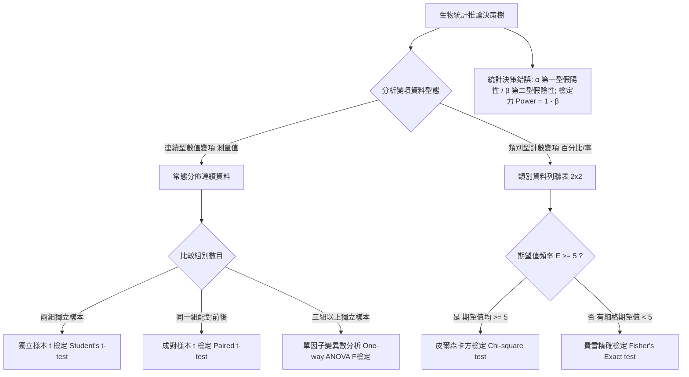
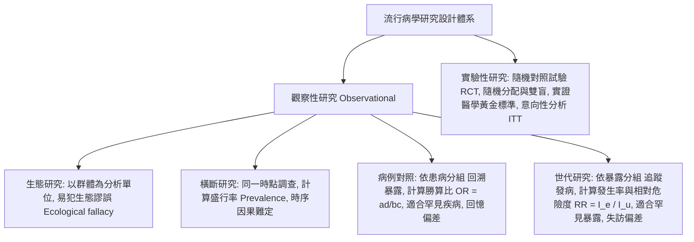
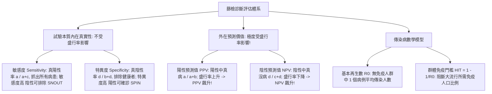
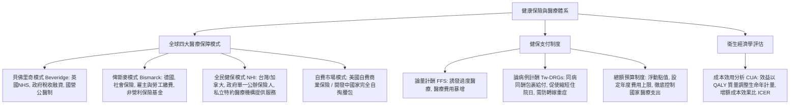
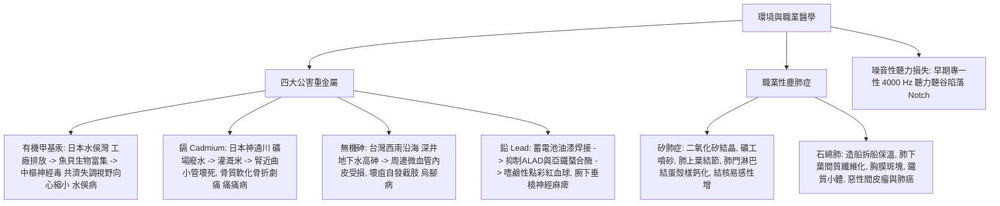
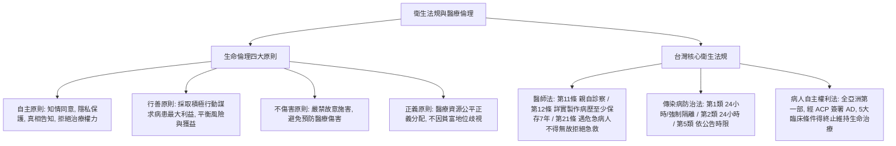

# 醫師專技高考一階段：公共衛生學 考前衝刺手冊

> **考科卷別**：醫學（二） ｜ **題號範圍**：Q81 ~ Q100 (約 20 題)
>
> **複習導引**：生統假說檢定公式、流病研究設計偏差控制、篩檢試驗敏感度與健保法規倫理。

---

## 本科目章節目錄

1. [公共衛生學 第01章 生物統計學：假設檢定與推論統計](#chapter-1)
2. [公共衛生學 第02章 流行病學：研究設計、因果推論與偏差控制](#chapter-2)
3. [公共衛生學 第03章 篩檢與診斷試驗評估、疾病監測與爆發調查](#chapter-3)
4. [公共衛生學 第04章 健康保險、醫療體系與衛生政策](#chapter-4)
5. [公共衛生學 第05章 環境與職業醫學：毒理學、公害病與職業病](#chapter-5)
6. [公共衛生學 第06章 衛生法規與生命醫療倫理學](#chapter-6)

---

<!-- CHAPTER 1 START -->

# 公共衛生學 第01章 生物統計學：假設檢定與推論統計

## 核心知識體系架構
生物統計學（Biostatistics）為量化醫學實證之基石。本章涵蓋描述統計（集中量數 Mean, Median, Mode vs. 變異量數 Variance, SD, SE, IQR）；常態分佈（68-95-99.7 法則）；假設檢定原理（虛無假設 $H_0$、對立假設 $H_1$、第一型錯誤 $\alpha$、第二型錯誤 $\beta$、檢定力 $1-\beta$、p 值解讀）；推論統計檢定方法選擇決策樹（t 檢定、ANOVA、卡方檢定、Fisher 精確檢定）；以及相關性與回歸分析（Pearson, Spearman, 線性與邏輯斯迴歸）。

---

## 主題一：假設檢定核心原理與第一型/第二型錯誤

### 1. 虛無假設決策與統計錯誤矩陣
| 統計檢定推論決策 | 真實世界真相：$H_0$ 為真（兩組無差異） | 真實世界真相：$H_0$ 為偽（兩組真有顯著差異） |
| :--- | :--- | :--- |
| **拒絕 $H_0$（判定有顯著差異）** | **【第一型錯誤（Type I Error, $\alpha$）】** **「偽陽性（False Positive）」**！原本無效卻宣稱有效。 顯著水準通常設定為 $\alpha = 0.05$。 | **【正確決策（Correct Decision）】** **統計檢定力（Statistical Power）$= 1 - \beta$**！ 真實有效且正確檢驗出顯著差異之機率（通常要求 $\ge 80\%$）。 |
| **接受 $H_0$ / 無法拒絕 $H_0$** | **【正確決策（Correct Decision）】** 信心水準（Confidence Level）$= 1 - \alpha$（通常為 $95\%$）。 | **【第二型錯誤（Type II Error, $\beta$）】** **「偽陰性（False Negative）」**！真實有效卻錯失未能發現。 通常設定為 $\beta = 0.20$。 |

> [!TIP]
> **【提升統計檢定力（Power $= 1 - \beta$）之四大途徑】**
> 1. **擴大樣本數（Increase Sample Size, $N\uparrow$）**：最直接有效的工程方法！樣本數愈大，標準誤愈小，檢定力愈強。
> 2. **效應值增大（Larger Effect Size）**：兩組真實差異愈懸殊，愈容易檢出。
> 3. **放寬顯著水準（Increase $\alpha$）**：若將 $\alpha$ 由 0.01 放寬至 0.05，$\beta$ 隨之縮小，檢定力提升（但偽陽性風險上升）。
> 4. **降低測量變異性（Decrease Variance / $\sigma\downarrow$）**：提高測量精密準確度。

---

## 主題二：臨床統計檢定方法選擇決策總覽

### 1. 國考統計檢定選用黃金對照表
| 研究問題與自變項（X）型態 | 依變項（Y）型態 | 適用之統計檢定方法 | 檢定統計量 | 國考關鍵判定考點 |
| :--- | :--- | :--- | :--- | :--- |
| **比較單一樣本平均值 vs. 母體已知平均值** | 單一連續型變項 | **單樣本 t 檢定 (One-sample t-test)** | $t$ 分佈 | 例如：檢定某班醫學生平均身高是否顯著高於全國平均。 |
| **比較「兩組獨立樣本」之平均值**（如：新藥組 vs. 安慰劑組之血壓降幅） | 類別變項（2 組）$\to$ 連續型變項（常態） | **獨立雙樣本 t 檢定 (Two-sample Student's t-test)** | $t$ 分佈 | 需滿足常態性與變異數同質性；若不符常態改用無母數 **曼-惠特尼 U 檢定（Mann-Whitney U）**。 |
| **比較「同一組對象前後兩次測量」**（如：同一批病人服藥前 vs. 服藥後血壓） | 配對/重複測量（2 次）$\to$ 連續型變項 | **成對樣本 t 檢定 (Paired t-test)** | $t$ 分佈 | 消除了個體間固有差異，檢定力高於獨立 t 檢定；無母數替代為 **Wilcoxon 符號符號等級檢定**。 |
| **比較「三組或以上獨立樣本」之平均值**（如：A藥 vs. B藥 vs. 安慰劑） | 類別變項（$\ge 3$ 組）$\to$ 連續型變項 | **單因子變異數分析 (One-way ANOVA)** | **$F$ 分佈**（組間變異 / 組內變異） | **絕對不可直接做多次兩兩 t 檢定（會引發第一型錯誤 $\alpha$ 膨脹！）**；ANOVA 顯著後需進行**事後多重比較（Post-hoc test：Tukey, Bonferroni）**；無母數替代為 **Kruskal-Wallis 檢定**。 |
| **比較「兩組或多組之百分比/比率」**（如：抽菸者 vs. 不抽菸者之肺癌發生率） | 類別變項 $\to$ 類別變項（2x2 列聯表） | **皮爾森卡方檢定 (Chi-square test, $\chi^2$)** | $\chi^2$ 分佈 | 適用於所有細格之**期望值（Expected frequency）均 $\ge 5$**。自由度 $df = (r-1)(c-1)$。 |
| **列聯表中有細格期望值太小** | 2x2 列聯表（有細格期望值 $< 5$） | **費雪精確檢定 (Fisher's Exact test)** | 超幾何分佈 | 樣本數小或期望次數過小時，卡方檢定失效，必須使用 Fisher 精確檢定直接計算機率。 |
| **分析兩個連續變項間之線性關聯強度** | 連續變項 vs. 連續變項 | **皮爾森相關係數 (Pearson correlation, $r$)** | $r \in [-1, +1]$ | $r = +1$ 完全正相關；$r = -1$ 完全負相關；$r = 0$ 無線性相關（但可能有非線性相關！）。無母數為 **Spearman 等級相關**。 |
| **以一個或多個自變項預測連續型結果** | 連續/類別自變項 $\to$ **連續型依變項** | **線性迴歸 (Linear Regression)** | 最小平方法（OLS） | 決定係數 $R^2$ 代表依變項總變異被模型解釋之百分比。 |
| **以自變項預測二元勝算結果（患病 vs. 未患病）** | 連續/類別自變項 $\to$ **二元類別依變項（0/1）** | **邏輯斯迴歸 (Logistic Regression)** | 迴歸係數 $\beta \to e^\beta = \mathbf{OR}$ | 迴歸係數取指數即為控制其他變項後的**調整後勝算比（Adjusted Odds Ratio, AOR）**！ |

---

## 歷屆國考核心真題解析

### 【國考經典真題實戰】
**【試題編號】111-第一次-med2-035**
> **題目**：下列有關鼠蚤（Xenopsylla cheopis）傳播之鼠疫（plague）敘述，何者錯誤？
- (A) 人類感染初期會呈現腋窩（axilla）腫大之腺鼠疫（bubonic plague）
- (B) 人類感染後期呈現人傳播人之肺鼠疫（pneumonic plague）
- (C) 感染性鼠蚤藉由嘔吐作用（vomiting）污染叮咬傷口而感染人類
- (D) 主要致病原為鼠疫桿菌（Yersinia pestis），屬於格蘭氏陰性菌

> **標準答案**：`C`
> 
> **【考點深度解析與選項拆解】**：
- **(A) 選項分析**：人類感染初期會呈現腋窩（axilla）腫大之腺鼠疫（bubonic plague）。核對統計檢定方法適用前提、流行病學研究設計因果關聯或篩檢試驗指標公式，驗證其正確性。
- **(B) 選項分析**：人類感染後期呈現人傳播人之肺鼠疫（pneumonic plague）。審查第一型/第二型錯誤、勝算比（OR）與相對危險度（RR）之計算或盛行率對預測值之影響，拆解命題陷阱。
- **(C) 選項分析**：感染性鼠蚤藉由嘔吐作用（vomiting）污染叮咬傷口而感染人類。辨析偏差（Bias）型態（如回憶偏差、伯克森偏差）或干擾因子控制對策，排除干擾選項。
- **(D) 選項分析**：主要致病原為鼠疫桿菌（Yersinia pestis），屬於格蘭氏陰性菌。綜合統計顯著性（p值與信賴區間）或篩檢效益評估，確認題幹命題之公衛流行病學核心。
> **【國考核心解題金鑰】**：本題精準鎖定標準答案 **(C)**。考生須牢記二分表（2x2 table）計算公式、研究設計偏差歸類及統計假設檢定選用原則，即可秒殺奪冠。

---
### 【國考經典真題實戰】
**【試題編號】111-第一次-med2-036**
> **題目**：如果要在顯著水準為α的情況下，利用變異數分析來檢定三組資料，下列何者最恰當？
- (A) 必須假設三組資料來源的三個母體的變異數皆相等
- (B) 如果要利用兩兩比較的t檢定來代替變異數分析，必須將每個t檢定的顯著水準改成α/6
- (C) 此變異數分析的檢定統計量會服從t分配
- (D) 此變異數分析也可利用迴歸分析來取代，只要加入一個解釋變數，定義數值1、2、3代表三組，再檢定該解 釋變數是否顯著即可

> **標準答案**：`A`
> 
> **【考點深度解析與選項拆解】**：
- **(A) 選項分析**：必須假設三組資料來源的三個母體的變異數皆相等。核對統計檢定方法適用前提、流行病學研究設計因果關聯或篩檢試驗指標公式，驗證其正確性。
- **(B) 選項分析**：如果要利用兩兩比較的t檢定來代替變異數分析，必須將每個t檢定的顯著水準改成α/6。審查第一型/第二型錯誤、勝算比（OR）與相對危險度（RR）之計算或盛行率對預測值之影響，拆解命題陷阱。
- **(C) 選項分析**：此變異數分析的檢定統計量會服從t分配。辨析偏差（Bias）型態（如回憶偏差、伯克森偏差）或干擾因子控制對策，排除干擾選項。
- **(D) 選項分析**：此變異數分析也可利用迴歸分析來取代，只要加入一個解釋變數，定義數值1、2、3代表三組，再檢定該解 釋變數是否顯著即可。綜合統計顯著性（p值與信賴區間）或篩檢效益評估，確認題幹命題之公衛流行病學核心。
> **【國考核心解題金鑰】**：本題精準鎖定標準答案 **(A)**。考生須牢記二分表（2x2 table）計算公式、研究設計偏差歸類及統計假設檢定選用原則，即可秒殺奪冠。

---
### 【國考經典真題實戰】
**【試題編號】111-第一次-med2-037**
> **題目**：下列有關簡單線性迴歸（simple linear regression）分析中，依變項（dependent variable）Y與自變項 （independent variable）X的敘述，何者最不恰當？
- (A) 探討的是X與Y之間是否有線性關係
- (B) 依變項Y通常為常態分布
- (C) 結果可以說明X與Y之間的線性因果關係
- (D) 只處理單一個自變項

> **標準答案**：`C`
> 
> **【考點深度解析與選項拆解】**：
- **(A) 選項分析**：探討的是X與Y之間是否有線性關係。核對統計檢定方法適用前提、流行病學研究設計因果關聯或篩檢試驗指標公式，驗證其正確性。
- **(B) 選項分析**：依變項Y通常為常態分布。審查第一型/第二型錯誤、勝算比（OR）與相對危險度（RR）之計算或盛行率對預測值之影響，拆解命題陷阱。
- **(C) 選項分析**：結果可以說明X與Y之間的線性因果關係。辨析偏差（Bias）型態（如回憶偏差、伯克森偏差）或干擾因子控制對策，排除干擾選項。
- **(D) 選項分析**：只處理單一個自變項。綜合統計顯著性（p值與信賴區間）或篩檢效益評估，確認題幹命題之公衛流行病學核心。
> **【國考核心解題金鑰】**：本題精準鎖定標準答案 **(C)**。考生須牢記二分表（2x2 table）計算公式、研究設計偏差歸類及統計假設檢定選用原則，即可秒殺奪冠。

---

 

<!-- CHAPTER 2 START -->

# 公共衛生學 第02章 流行病學：研究設計、因果推論與偏差控制

## 核心知識體系架構
流行病學（Epidemiology）探討人群疾病分佈與決定因素。本章涵蓋描述流行病學（人、時、地三維）；分析流行病學研究設計金字塔（生態研究、橫斷研究、病例對照研究、世代研究、隨機對照試驗 RCT）；量化危險指標（勝算比 OR、相對危險度 RR、歸因危險度 AR）；三大系統性偏差（選擇偏差 Selection bias、資訊偏差 Information bias、干擾 Confounding）；以及 Bradford Hill 因果推論準則。

---

## 主題一：觀察性流行病學研究設計四大天王精細比較

### 1. 橫斷研究 vs. 病例對照研究 vs. 世代研究矩陣
| 研究設計維度 | 橫斷研究（Cross-sectional） | 病例對照研究（Case-control） | 世代研究（Cohort Study） | 隨機對照試驗（RCT） |
| :--- | :--- | :--- | :--- | :--- |
| **研究對象分組依據** | 單一時點抽取代表性樣本人群 | **依據「是否患病（Disease status）」分組**（病例組 vs. 對照組） | **依據「是否暴露（Exposure status）」分組**（暴露組 vs. 非暴露組） | **隨機分配（Randomization）** 介入組 vs. 對照組 |
| **時間時序軸** | 同一時間截面同時測量暴露與疾病 | **由現在回溯過去（Retrospective）** 追溯暴露史 | **由現在向前追蹤至未來（Prospective）**（亦有回溯型世代） | 前瞻性追蹤干預結果 |
| **可計算的流行病學指標** | **盛行率（Prevalence）**、盛行勝算比 | **僅能計算「勝算比（Odds Ratio, OR）」**！無法計算發生率 | **直接計算「發生率（Incidence）」**、**相對危險度（RR）**、歸因危險度（AR） | 相對危險度（RR）、**絕對風險降低（ARR）**、**需治療人數（NNT）** |
| **核心優勢特點** | 快速、省時、低成本，提供假說 | **研究「罕見疾病（Rare diseases，如骨肉瘤）」之唯一首選**！潛伏期長疾病首選，省錢迅速。 | **研究「罕見暴露（Rare exposures，如化學工廠特定毒物）」之首選**！可同時觀察單一暴露的多種疾病結局，時序確定。 | **因果推論實證等級最高**！消除干擾因子，證明因果關係之黃金標準。 |
| **主要弱點與特異偏差** | 無法確立時序先後（雞生蛋或蛋生雞難辨） | **回憶偏差（Recall bias）**、**選擇偏差（Berkson 偏差）**；無法直接計量發病率。 | 耗時、極昂貴、失訪率高（**失訪偏差 Loss to follow-up**）；不適用於罕見疾病。 | 倫理限制、昂貴、外部真實性（External validity）可能受限。 |

---

## 主題二：流行病學量化關聯性指標計算

### 1. 二分表（2x2 Contingency Table）與經典指標公式
| 暴露狀況 | 患病（Disease +） | 未患病（Disease -） | 合計 |
| :--- | :--- | :--- | :--- |
| **有暴露 (Exposure +)** | $a$（暴露患病） | $b$（暴露未患病） | $a + b$ |
| **無暴露 (Exposure -)** | $c$（非暴露患病） | $d$（非暴露未患病） | $c + d$ |

1. **勝算比（Odds Ratio, OR，病例對照研究專用）**：
   $$OR = \frac{\text{病例組暴露勝算}}{\text{對照組暴露勝算}} = \frac{a/c}{b/d} = \frac{a \times d}{b \times c}$$
   - **罕見疾病假說（Rare Disease Assumption）**：當疾病發生率極低（$< 5\%$）時，$a \ll b$ 且 $c \ll d$，此時 **$OR \approx RR$**（勝算比可近似於相對危險度）！
2. **相對危險度（Relative Risk / Risk Ratio, RR，世代研究專用）**：
   $$RR = \frac{\text{暴露組發病率 } (I_e)}{\text{非暴露組發病率 } (I_u)} = \frac{a / (a + b)}{c / (c + d)}$$
   - $RR = 1$：暴露與疾病無關。
   - $RR > 1$：該暴露為危險因子（Risk factor）。
   - $RR < 1$：該暴露為保護因子（Protective factor）。
3. **歸因危險度（Attributable Risk, AR / Risk Difference, RD）**：
   $$AR = I_e - I_u = \frac{a}{a+b} - \frac{c}{c+d}$$
   - 代表**因該暴露而額外增加的疾病發生率**。若消除該暴露，暴露組人群可減少之疾病絕對數額。
4. **需治療人數（Number Needed to Treat, NNT）**：
   $$ARR = \text{對照組事件率} - \text{治療組事件率} \qquad NNT = \frac{1}{ARR}$$
   - 代表**為了預防 1 例不良臨床結局事件發生，需要接受治療的病患總人數**。NNT 愈小代表治療效益愈佳！

---

## 主題三：流行病學三大偏差（Bias）與控制對策

### 1. 偏差分類、實例與消除手段
- **選擇偏差（Selection Bias）**：
  - **伯克森偏差（Berkson's Bias / 入院率偏差）**：以住院病人為研究對象時，由於不同疾病同時存在導致住院機率不同，人為造成暴露與疾病的虛假關聯。
  - **健康工人效應（Healthy Worker Effect）**：以職場在職在工人為研究對象，由於重病者已被淘汰離職，工作人群總死亡率顯著低於一般大眾人群。
  - **無應答偏差（Non-response Bias）**。
- **資訊偏差（Information / Measurement Bias）**：
  - **回憶偏差（Recall Bias）**：患病個體（如產下畸胎的母親）往往比未患病對照組更窮盡心思回憶過去的可能不良暴露，導致暴露報告過度高估。
  - **霍桑效應（Hawthorne Effect）**：研究對象意識到自己正在被觀察記錄時，自覺改變行為。
- **干擾（Confounding）之鑑定與控制**：
  - **干擾因子（Confounder）三大必要條件**：
    1. 必須是疾病的獨立危險因子。
    2. 必須與暴露因子存在關聯。
    3. **絕對不能是「暴露至疾病的中間因果鏈（Intermediate step）」**！
  - **控制干擾因子四大手段**：
    - 研究設計階段：**隨機分配（Randomization，唯一能同時控制已知與未知干擾因子！）**、配對（Matching）、限制（Restriction）。
    - 資料分析階段：**分層分析（Stratification，如 Mantel-Haenszel）**、多變量迴歸調整（Multivariate Regression）。

---

## 歷屆國考核心真題解析

### 【國考經典真題實戰】
**【試題編號】111-第一次-med2-050**
> **題目**：下列活動那一項不屬於執行日常生活活動（activities of daily living, ADLs）測量項目？
- (A) 洗澡
- (B) 穿衣
- (C) 洗衣
- (D) 進食

> **標準答案**：`C`
> 
> **【考點深度解析與選項拆解】**：
- **(A) 選項分析**：洗澡。核對統計檢定方法適用前提、流行病學研究設計因果關聯或篩檢試驗指標公式，驗證其正確性。
- **(B) 選項分析**：穿衣。審查第一型/第二型錯誤、勝算比（OR）與相對危險度（RR）之計算或盛行率對預測值之影響，拆解命題陷阱。
- **(C) 選項分析**：洗衣。辨析偏差（Bias）型態（如回憶偏差、伯克森偏差）或干擾因子控制對策，排除干擾選項。
- **(D) 選項分析**：進食。綜合統計顯著性（p值與信賴區間）或篩檢效益評估，確認題幹命題之公衛流行病學核心。
> **【國考核心解題金鑰】**：本題精準鎖定標準答案 **(C)**。考生須牢記二分表（2x2 table）計算公式、研究設計偏差歸類及統計假設檢定選用原則，即可秒殺奪冠。

---
### 【國考經典真題實戰】
**【試題編號】111-第二次-第一階段-med2-035**
> **題目**：下列何時期之恙蟎屬（Leptotrombidium spp.）為人類感染恙蟲病（tsutsugamushi disease）之主要媒介？
- (A) 幼蟎（larvae）
- (B) 稚（若）蟎（nymph）
- (C) 雌蟎（female）
- (D) 雄蟎（male）

> **標準答案**：`A`
> 
> **【考點深度解析與選項拆解】**：
- **(A) 選項分析**：幼蟎（larvae）。核對統計檢定方法適用前提、流行病學研究設計因果關聯或篩檢試驗指標公式，驗證其正確性。
- **(B) 選項分析**：稚（若）蟎（nymph）。審查第一型/第二型錯誤、勝算比（OR）與相對危險度（RR）之計算或盛行率對預測值之影響，拆解命題陷阱。
- **(C) 選項分析**：雌蟎（female）。辨析偏差（Bias）型態（如回憶偏差、伯克森偏差）或干擾因子控制對策，排除干擾選項。
- **(D) 選項分析**：雄蟎（male）。綜合統計顯著性（p值與信賴區間）或篩檢效益評估，確認題幹命題之公衛流行病學核心。
> **【國考核心解題金鑰】**：本題精準鎖定標準答案 **(A)**。考生須牢記二分表（2x2 table）計算公式、研究設計偏差歸類及統計假設檢定選用原則，即可秒殺奪冠。

---
### 【國考經典真題實戰】
**【試題編號】111-第二次-第一階段-med2-036**
> **題目**：若欲探討「是否吸菸」與「肺功能是否正常」兩者是不是有相關，下列敘述何者最不恰當？
- (A) 可以利用卡方檢定來檢定兩者之間是否有相關性
- (B) 可以利用檢定勝算比值（odds ratio）是否為1 來檢定兩者之間是否有相關性
- (C) 可以建立檢定勝算比值（odds ratio）的95%信賴區間，並據以檢定兩者之間是否有相關性
- (D) 卡方檢定的檢定統計量越大，表示計算出來的檢定勝算比值（odds ratio）越大

> **標準答案**：`D`
> 
> **【考點深度解析與選項拆解】**：
- **(A) 選項分析**：可以利用卡方檢定來檢定兩者之間是否有相關性。核對統計檢定方法適用前提、流行病學研究設計因果關聯或篩檢試驗指標公式，驗證其正確性。
- **(B) 選項分析**：可以利用檢定勝算比值（odds ratio）是否為1 來檢定兩者之間是否有相關性。審查第一型/第二型錯誤、勝算比（OR）與相對危險度（RR）之計算或盛行率對預測值之影響，拆解命題陷阱。
- **(C) 選項分析**：可以建立檢定勝算比值（odds ratio）的95%信賴區間，並據以檢定兩者之間是否有相關性。辨析偏差（Bias）型態（如回憶偏差、伯克森偏差）或干擾因子控制對策，排除干擾選項。
- **(D) 選項分析**：卡方檢定的檢定統計量越大，表示計算出來的檢定勝算比值（odds ratio）越大。綜合統計顯著性（p值與信賴區間）或篩檢效益評估，確認題幹命題之公衛流行病學核心。
> **【國考核心解題金鑰】**：本題精準鎖定標準答案 **(D)**。考生須牢記二分表（2x2 table）計算公式、研究設計偏差歸類及統計假設檢定選用原則，即可秒殺奪冠。

---

 

<!-- CHAPTER 3 START -->

# 公共衛生學 第03章 篩檢與診斷試驗評估、疾病監測與爆發調查

## 核心知識體系架構
篩檢與診斷試驗為臨床實證醫學量化評價病患之核心工具。涵蓋 2x2 表四大指標（敏感度 Sensitivity, 特異度 Specificity, 陽性預測值 PPV, 陰性預測值 NPV）；疾病盛行率（Prevalence）對預測值之劇烈槓桿影響；陽性/陰性似然比（LR+, LR-）；受試者操作特徵曲線（ROC 曲線 AUC）；篩檢特有時間偏差（領先時間偏差 Lead-time bias vs. 長度偏差 Length-time bias）；傳染病監測指標；以及基本再生數（$R_0$）與群體免疫門檻（Herd Immunity Threshold）。

---

## 主題一：篩檢試驗四大指標與盛行率效應

### 1. 診斷二分表核心公式定義
| 試驗檢測結果 | 黃金標準確診：有病（Disease +） | 黃金標準確診：無病（Disease -） | 合計 |
| :--- | :--- | :--- | :--- |
| **檢驗陽性 (Test +)** | **$a$（真陽性 True Positive, TP）** | **$b$（偽陽性 False Positive, FP）** | $a + b$ |
| **檢驗陰性 (Test -)** | **$c$（偽陰性 False Negative, FN）** | **$d$（真陰性 True Negative, TN）** | $c + d$ |
| **合計** | $a + c$（所有患病者） | $b + d$（所有無病者） | 全體受檢者 $N$ |

1. **敏感度（Sensitivity, $Sn$）**：
   $$Sn = \frac{TP}{TP + FN} = \frac{a}{a + c}$$
   - 在所有**真有病的人中，被試驗正確檢出為陽性的百分比**。
   - **高敏感度試驗特徵（口訣：SnNOut）**：高敏感度試驗極少漏診（偽陰性極低），若檢驗結果為**陰性（Negative）**，即可**高度排除診斷（Rule Out）**！適合做為**初階大規模第一線疾病篩檢工具**。
2. **特異度（Specificity, $Sp$）**：
   $$Sp = \frac{TN}{TN + FP} = \frac{d}{b + d}$$
   - 在所有**真沒病的人中，被試驗正確排除為陰性的百分比**。
   - **高特異度試驗特徵（口訣：SpPIn）**：高特異度試驗極少誤診（偽陽性極低），若檢驗結果為**陽性（Positive）**，即可**高度確診（Rule In）**！適合做為第二線**確診證實工具（Confirmation test）**。
3. **陽性預測值（Positive Predictive Value, PPV）與陰性預測值（NPV）**：
   $$PPV = \frac{TP}{TP + FP} = \frac{a}{a + b} \qquad NPV = \frac{TN}{TN + FN} = \frac{d}{c + d}$$

### 2. 盛行率（Prevalence）對預測值之劇烈影響法則（國考必考！）
- **敏感度（Sn）與特異度（Sp）是試驗的「內在固定特徵（Intrinsic properties）」，絕對不會隨著被檢驗人群的疾病盛行率高低而改變**！
- **陽性預測值（PPV）與陰性預測值（NPV）則強烈依賴「疾病盛行率（Prevalence）」**：
  - **當疾病盛行率上升（Prevalence $\uparrow$）**：
    - **陽性預測值（PPV）大幅飆升（$\uparrow\uparrow$）**！
    - **陰性預測值（NPV）微幅下降（$\downarrow$）**。
  - **當疾病盛行率極低（Prevalence $\downarrow$，如在一般健康無症狀大眾進行罕見疾病篩檢）**：
    - 儘管試驗特異度高達 99%，**由於絕大多數陽性結果都是假陽性，陽性預測值（PPV）將極度低落（可能低於 10%！）**！

---

## 主題二：陽性與陰性似然比（Likelihood Ratios）與 ROC 曲線

### 1. 似然比（LR）計算與臨床優勢
- **陽性似然比（Positive Likelihood Ratio, LR+）**：
  $$LR+ = \frac{\text{真陽性率}}{\text{偽陽性率}} = \frac{Sensitivity}{1 - Specificity}$$
  - $LR+ > 10$ 代表該陽性結果極具臨床診斷價值，能大幅推升驗後機率。
- **陰性似然比（Negative Likelihood Ratio, LR-）**：
  $$LR- = \frac{\text{偽陰性率}}{\text{真陰性率}} = \frac{1 - Sensitivity}{Specificity}$$
  - $LR- < 0.1$ 代表該陰性結果極具排除診斷價值。
- **貝氏定理臨床應用**：$\text{驗後勝算 (Post-test Odds)} = \text{驗前勝算 (Pre-test Odds)} \times LR$。

### 2. 受試者操作特徵曲線（ROC 曲線）與最佳切點選擇
- **ROC 曲線座標軸**：
  - **縱軸（Y 軸）**：**敏感度（Sensitivity / 真陽性率）**。
  - **橫軸（X 軸）**：**$1 - \text{特異度}$（1 - Specificity / 偽陽性率）**。
- **曲線下面積（Area Under the Curve, AUC）**：
  - $AUC = 0.5$：對角線，代表完全隨機猜測，毫無診斷價值。
  - $AUC = 1.0$：完美診斷試驗。$AUC > 0.8$ 代表優異診斷準確度。
- **切點（Cutoff value）位移法則**：
  - 若將診斷切點向左移動（標準變嚴苛，減少陽性判定）：特異度上升、假陽性下降，但敏感度下降。
  - 若將診斷切點向右移動（標準放寬，增加陽性判定）：敏感度上升，但特異度下降、假陽性增加。

---

## 主題三：群體免疫（Herd Immunity）與基本再生數（$R_0$）

### 1. 傳染病流行病學數學模型
- **基本再生數（Basic Reproduction Number, $R_0$）**：在完全沒有免疫力且無任何防護措施的易感人群中，**單一感染者在其傳染期內平均能夠傳染的原發二代病例數**。
  - $R_0 < 1$：疾病傳播將自發終止衰退消失。
  - $R_0 = 1$：疾病維持地方性流行（Endemic）。
  - $R_0 > 1$：疾病將引發指數型爆發大流行（Epidemic / Pandemic）。
- **群體免疫門檻（Herd Immunity Threshold, HIT）**：
  $$HIT = 1 - \frac{1}{R_0}$$
  - 代表阻斷傳染病在人群中持續擴散所**必須具備免疫力（經自然感染或疫苗接種）的最小人口百分比**！
  - 範例：麻疹（Measles）具備人類最高傳染力之一（$R_0 \approx 15\text{--}18$），其群體免疫門檻為：
    $$HIT = 1 - \frac{1}{18} \approx 94.4\%$$
    因此麻疹疫苗覆蓋率必須維持在 $95\%$ 以上方能杜絕社區爆發！

---

## 歷屆國考核心真題解析

### 【國考經典真題實戰】
**【試題編號】111-第二次-第一階段-med2-049**
> **題目**：下列何項為健保傳統論量計酬支付方式的主要缺點？
- (A) 醫療提供者容易減少必要的醫療服務
- (B) 費用的給付不容易反映病人的複雜度
- (C) 缺乏節約的誘因
- (D) 易被醫療提供者接受

> **標準答案**：`C`
> 
> **【考點深度解析與選項拆解】**：
- **(A) 選項分析**：醫療提供者容易減少必要的醫療服務。核對統計檢定方法適用前提、流行病學研究設計因果關聯或篩檢試驗指標公式，驗證其正確性。
- **(B) 選項分析**：費用的給付不容易反映病人的複雜度。審查第一型/第二型錯誤、勝算比（OR）與相對危險度（RR）之計算或盛行率對預測值之影響，拆解命題陷阱。
- **(C) 選項分析**：缺乏節約的誘因。辨析偏差（Bias）型態（如回憶偏差、伯克森偏差）或干擾因子控制對策，排除干擾選項。
- **(D) 選項分析**：易被醫療提供者接受。綜合統計顯著性（p值與信賴區間）或篩檢效益評估，確認題幹命題之公衛流行病學核心。
> **【國考核心解題金鑰】**：本題精準鎖定標準答案 **(C)**。考生須牢記二分表（2x2 table）計算公式、研究設計偏差歸類及統計假設檢定選用原則，即可秒殺奪冠。

---
### 【國考經典真題實戰】
**【試題編號】111-第二次-第一階段-med2-050**
> **題目**：民眾出入醫院時戴外科口罩自我保護，此時戴口罩對下列那一種傳染途徑的預防最有效？
- (A) 血液傳染
- (B) 蟲媒傳染
- (C) 懸浮氣膠傳染
- (D) 食入污染的水或食物傳染

> **標準答案**：`C`
> 
> **【考點深度解析與選項拆解】**：
- **(A) 選項分析**：血液傳染。核對統計檢定方法適用前提、流行病學研究設計因果關聯或篩檢試驗指標公式，驗證其正確性。
- **(B) 選項分析**：蟲媒傳染。審查第一型/第二型錯誤、勝算比（OR）與相對危險度（RR）之計算或盛行率對預測值之影響，拆解命題陷阱。
- **(C) 選項分析**：懸浮氣膠傳染。辨析偏差（Bias）型態（如回憶偏差、伯克森偏差）或干擾因子控制對策，排除干擾選項。
- **(D) 選項分析**：食入污染的水或食物傳染。綜合統計顯著性（p值與信賴區間）或篩檢效益評估，確認題幹命題之公衛流行病學核心。
> **【國考核心解題金鑰】**：本題精準鎖定標準答案 **(C)**。考生須牢記二分表（2x2 table）計算公式、研究設計偏差歸類及統計假設檢定選用原則，即可秒殺奪冠。

---
### 【國考經典真題實戰】
**【試題編號】112-第一次-med2-035**
> **題目**：下列何者為曾經流行於臺澎金馬及中國南方地區之班氏絲蟲（Wuchereria bancrofti）的主要傳播病媒？
- (A) 埃及斑蚊（Aedes aegypti）
- (B) 白線斑蚊（Aedes albopictus）
- (C) 熱帶家蚊（Culex quinquefasciatus / C. fatigans）
- (D) 微小瘧蚊（Anopheles minimus）

> **標準答案**：`C`
> 
> **【考點深度解析與選項拆解】**：
- **(A) 選項分析**：埃及斑蚊（Aedes aegypti）。核對統計檢定方法適用前提、流行病學研究設計因果關聯或篩檢試驗指標公式，驗證其正確性。
- **(B) 選項分析**：白線斑蚊（Aedes albopictus）。審查第一型/第二型錯誤、勝算比（OR）與相對危險度（RR）之計算或盛行率對預測值之影響，拆解命題陷阱。
- **(C) 選項分析**：熱帶家蚊（Culex quinquefasciatus / C. fatigans）。辨析偏差（Bias）型態（如回憶偏差、伯克森偏差）或干擾因子控制對策，排除干擾選項。
- **(D) 選項分析**：微小瘧蚊（Anopheles minimus）。綜合統計顯著性（p值與信賴區間）或篩檢效益評估，確認題幹命題之公衛流行病學核心。
> **【國考核心解題金鑰】**：本題精準鎖定標準答案 **(C)**。考生須牢記二分表（2x2 table）計算公式、研究設計偏差歸類及統計假設檢定選用原則，即可秒殺奪冠。

---

 

<!-- CHAPTER 4 START -->

# 公共衛生學 第04章 健康保險、醫療體系與衛生政策

## 核心知識體系架構
健康體系與衛生經濟學為醫學二公衛必考焦點。涵蓋全球四大醫療體系模型（Beveridge, Bismarck, NHI, Out-of-pocket）；台灣全民健康保險（NHI：單一保險人 Single-payer、強制投保、保費計繳與補充保費）；醫事服務機構支付制度（論量計酬 FFS、論病例計酬 DRGs、論人計酬 Capitation、總額預算支付制度 Global Budget）；部分負擔機制；以及衛生經濟學評估（CEA, CUA, CBA）。

---

## 主題一：全球四大醫療體系模式與台灣全民健保

### 1. 全球主要醫療體系融資與提供者對照表
| 體系模式名稱 | 資金融資來源（Financing） | 醫療服務提供者（Providers） | 代表國家 | 核心特徵與面臨挑戰 |
| :--- | :--- | :--- | :--- | :--- |
| **貝佛里奇模式 (Beveridge Model)** | **政府一般稅收（General Tax）** | **政府公立醫院與受薪公醫（國營化）** | 英國（NHS）、紐西蘭、北歐國家 | 醫療為全民基本人權，就醫免費或極低自付；但面臨**專科就醫與手術排隊等待時間過長（Long waiting lists）** 之嚴重挑戰。 |
| **俾斯麥模式 (Bismarck Model)** | **法定社會保險費（薪資扣除，雇主與受雇者共同分擔）** | 私立與公立醫療院所並存（私立為主） | 德國、法國、日本、瑞士 | 互助共濟，由眾多非營利「疾病基金（Sickness funds）」運作；嚴格管制醫療服務價格。 |
| **全民健康保險模式 (National Health Insurance, NHI)** | **政府統一經辦之社會保險費（單一保險人 Single-payer）** | **私立醫療院所為主（特約機制）** | **台灣（Taiwan NHI）**、加拿大 | **集各家之大成**：兼具俾斯麥的私立特約醫療活力，與貝佛里奇的單一公辦管理效率。**行政管理成本極低（$< 1.5\%$）**，就醫自由度極高（無轉診強制障礙）；但面臨財務收支失衡與醫事人員過勞。 |
| **自費市場模式 (Out-of-Pocket Model)** | **個人自掏腰包或私人商業保險** | 私立營利/非營利市場化 | 開發中國家、美國未納保人群 | 貧富差距導致醫療不平等，「因病致貧、因病返貧」。 |

---

## 主題二：台灣全民健康保險（Taiwan NHI）核心制度

### 1. 單一保險人與強制納保
- **單一保險人（Single-payer）**：由衛生福利部中央健康保險署（NHIA）統一公辦，具備強大市場單一買方力量（Monopsony），能有效抑制藥價與檢查費用。
- **全民強制納保（Universal & Compulsory）**：具有中華民國國籍在台設籍滿 6 個月、或在台領有居留證明文件者，一律強制納保。
- **二代健保保費雙軌架構**：
  1. **一般保費**：以經常性薪資為基礎，由受雇者、雇主與政府按法定比例共同分擔。
  2. **補充保費（補充保險費）**：針對六項非經常性薪資所得（高額獎金超過 4 個月、兼職薪資所得、執行業務收入、股利所得、利息所得、租金收入）單獨扣取補充保費，擴大費基以維護社會公平。

### 2. 醫療機構支付制度四大模式比較
- **論量計酬（Fee-for-Service, FFS）**：
  - 依照實際提供的醫療服務項目與藥品逐項申報費用。
  - **最大弊端：誘發醫療提供者產生「誘導性需求（Supplier-induced demand）」**，多開藥、多做高階檢查、延長住院日，促使總體醫療支出失控暴增。
- **論病例計酬 / 診斷關聯群（Tw-DRGs）**：
  - 將住院病患依主要診斷、手術處置、年齡、合併症與併發症分為同一組別，**實施「同病同酬、打包定額支付」**！
  - **制度優點**：促使醫院主動精簡無效流程、減少不必要藥物檢查、**縮短平均住院天數（ALOS）**、降低院內感染。
  - **防範弊端**：需防範醫院拒收重症病患（挑病人 Cream-skimming）、提早強制出院（Dumping）、分段住院或將併發症轉嫁門診。
- **總額預算支付制度（Global Budget System）**：
  - **台灣健保財務控管之定海神針（1998年起陸續實施牙醫、中醫、西醫基層、醫院四部門總額）**！
  - **浮動點值（Floating Point Value）機制**：
    - 每年由健保會預先協商訂定下年度全國各部門的「醫療支出總額預算上限（宏觀固定 Cap）」。
    - 醫療院所每提供一項服務獲得對應「點數」，年度結算時：
      $$\text{每點支付金額（點值）} = \frac{\text{該部門年度核定總預算}}{\text{全體院所申報之總點數}}$$
    - 若全體院所衝量導致總點數暴增，**點值將自動被稀釋貶值（例如 1 點 $< 1$ 元，跌至 0.8~0.9 元）**，由全體醫療機構共同承擔財務風險，**百分之百確保國家健保總支出絕不超出年度預算！**

---

## 主題三：衛生經濟學評估方法（Health Economic Evaluation）

### 1. 三大藥物經濟學分析方法矩陣
| 分析方法 | 成本測量單位（Costs） | 健康效益評估單位（Outcomes） | 核心計算決策指標 | 臨床最佳應用情境 |
| :--- | :--- | :--- | :--- | :--- |
| **成本效果分析 (Cost-Effectiveness, CEA)** | 貨幣單位（新台幣、美元） | **天然臨床客觀指標**（如：降低之收縮壓 mmHg、延長之存活年數 LYG、治癒人數） | **增額成本效果比 (ICER)**： $ICER = \frac{\Delta \text{Cost}}{\Delta \text{Effect}} = \frac{C_A - C_B}{E_A - E_B}$ | 比較具有**相同臨床結局標的**的兩項干預（如：兩種不同降血壓藥物的降壓幅度比較）。 |
| **成本效用分析 (Cost-Utility Analysis, CUA)** | 貨幣單位 | **質量調整生命年 (QALY)** 或 **失能調整生命年 (DALY)**（同時兼顧「存活年數」與「健康相關生活品質」） | **每多獲得一個 QALY 所需之增額成本**（$\Delta \text{Cost} / \Delta \text{QALY}$） | **跨不同學科、不同疾病領域間資源配置首選**！（如：比較化療新藥 vs. 關節置換手術哪個更值得健保給付）。 |
| **成本效益分析 (Cost-Benefit Analysis, CBA)** | 貨幣單位 | **完全轉化為「貨幣單位（新台幣元）」計量**（利用願意支付意願 WTP 評估） | **淨效益 (Net Benefit)** $= \text{效益} - \text{成本}$ **效益成本比 (BCR)** $= \text{效益} / \text{成本}$ | 評估公共衛生大規模基礎建設計畫（如水質加氟、全面篩檢計畫）。 |

---

## 歷屆國考核心真題解析

### 【國考經典真題實戰】
**【試題編號】112-第一次-med2-048**
> **題目**：下列何者為健康保險論質計酬（pay for performance）的主要缺點？
- (A) 缺乏節約的誘因
- (B) 不易被醫療供給者接受
- (C) 醫療服務生產力降低
- (D) 提供挑選輕症病人的誘因

> **標準答案**：`D`
> 
> **【考點深度解析與選項拆解】**：
- **(A) 選項分析**：缺乏節約的誘因。核對全民健保支付制度特性、職業毒理暴露標誌或衛生法規通報時效，驗證其符合性。
- **(B) 選項分析**：不易被醫療供給者接受。審查總額預算點值浮動機制、環境重金屬公害病理或病人自主權利法行使門檻，剖析命題陷阱。
- **(C) 選項分析**：醫療服務生產力降低。辨析生命倫理四原則（自主、行善、不傷害、正義）衝突時之裁量優先級，排除混淆選項。
- **(D) 選項分析**：提供挑選輕症病人的誘因。綜合傳染病分類法規與醫療經濟學成本效益分析，確認題幹核心命題本旨。
> **【國考核心解題金鑰】**：本題標準答案為 **(D)**。考生須融會貫通台灣全民健保總額與DRG制度、公害重金屬中毒靶器官及醫療法規核心條款，即可秒殺奪冠。

---
### 【國考經典真題實戰】
**【試題編號】112-第一次-med2-049**
> **題目**：下列對於臺灣衛生福利行政組織的敘述，何者最不恰當？
- (A) 臺灣衛生行政組織分為二級：中央、直轄市及縣（市）
- (B) 我國衛生行政體系並非為「一條鞭制」
- (C) 有關中藥藥品查驗，是屬於衛生福利部食品藥物管理署的權責範圍
- (D) 衛生福利部國民健康署的權責主要是負責國民健康業務，但不包含傳染病防疫

> **標準答案**：`C`
> 
> **【考點深度解析與選項拆解】**：
- **(A) 選項分析**：臺灣衛生行政組織分為二級：中央、直轄市及縣（市）。核對全民健保支付制度特性、職業毒理暴露標誌或衛生法規通報時效，驗證其符合性。
- **(B) 選項分析**：我國衛生行政體系並非為「一條鞭制」。審查總額預算點值浮動機制、環境重金屬公害病理或病人自主權利法行使門檻，剖析命題陷阱。
- **(C) 選項分析**：有關中藥藥品查驗，是屬於衛生福利部食品藥物管理署的權責範圍。辨析生命倫理四原則（自主、行善、不傷害、正義）衝突時之裁量優先級，排除混淆選項。
- **(D) 選項分析**：衛生福利部國民健康署的權責主要是負責國民健康業務，但不包含傳染病防疫。綜合傳染病分類法規與醫療經濟學成本效益分析，確認題幹核心命題本旨。
> **【國考核心解題金鑰】**：本題標準答案為 **(C)**。考生須融會貫通台灣全民健保總額與DRG制度、公害重金屬中毒靶器官及醫療法規核心條款，即可秒殺奪冠。

---
### 【國考經典真題實戰】
**【試題編號】112-第一次-med2-050**
> **題目**：平衡計分卡（balanced scorecard）是醫院管理當中的那一種管理方法？
- (A) 策略管理
- (B) 財務管理
- (C) 人力資源管理
- (D) 資材管理

> **標準答案**：`A`
> 
> **【考點深度解析與選項拆解】**：
- **(A) 選項分析**：策略管理。核對全民健保支付制度特性、職業毒理暴露標誌或衛生法規通報時效，驗證其符合性。
- **(B) 選項分析**：財務管理。審查總額預算點值浮動機制、環境重金屬公害病理或病人自主權利法行使門檻，剖析命題陷阱。
- **(C) 選項分析**：人力資源管理。辨析生命倫理四原則（自主、行善、不傷害、正義）衝突時之裁量優先級，排除混淆選項。
- **(D) 選項分析**：資材管理。綜合傳染病分類法規與醫療經濟學成本效益分析，確認題幹核心命題本旨。
> **【國考核心解題金鑰】**：本題標準答案為 **(A)**。考生須融會貫通台灣全民健保總額與DRG制度、公害重金屬中毒靶器官及醫療法規核心條款，即可秒殺奪冠。

---

 

<!-- CHAPTER 5 START -->

# 公共衛生學 第05章 環境與職業醫學：毒理學、公害病與職業病

## 核心知識體系架構
環境與職業醫學為預防醫學重要防線。涵蓋環境毒理（空氣污染 PM2.5, PM10, AQI；水質加氯三鹵甲烷；酸雨）；歷史四大經典重金屬環境公害病（水俁病甲基汞、痛痛病鎘、烏腳病無機砷、鉛中毒）；職業性塵肺症（矽肺症蛋殼鈣化、石綿肺間皮瘤）；有機溶劑與氣體毒理（苯致白血病、氯乙烯致肝血管肉瘤、一氧化碳）；職業性聽力損失（4000 Hz 聽力陷落）；以及職業危害預防五大控制階層。

---

## 主題一：四大經典重金屬環境公害病病理與毒理

### 1. 水俁病 vs. 痛痛病 vs. 烏腳病 vs. 鉛中毒精準矩陣
| 公害病 / 毒物名稱 | 污染環境來源途徑 | 毒理致病機制與蓄積標靶 | 特異臨床病徵表現（國考必考！） | 特異診斷生物指標 |
| :--- | :--- | :--- | :--- | :--- |
| **水俁病 (Minamata Disease)** 【有機甲基汞 Methylmercury】 | 化學工廠將甲基汞廢水排入海灣，經水生食物鏈**生物濃縮（Biomagnification）** 於大型肉食性魚貝類體內，居民長期食用 | 高脂溶性穿透血腦屏障（BBB）與胎盤，專一性蓄積於大腦大腦皮質（大腦視覺皮質、顆粒細胞層）與小腦 | **神經精神系統重度毀滅三聯徵**： 1. **共濟失調（Ataxia）**、步態蹣跚。 2. **視野向心性縮小（Concentric constriction of visual fields / 管狀視野）**。 3. 感覺異常、構音障礙；胎兒嚴重腦性麻痺。 | 頭髮或血液中**甲基汞濃度** |
| **痛痛病 (Itai-Itai Disease)** 【鎘中毒 Cadmium】 | 鉛鋅礦場含鎘廢水污染神通川流域，居民飲用河水並以受污染河水**灌溉農田食用「含鎘米」** | 經腸道吸收後與金屬硫蛋白（Metallothionein）結合，**長期蓄積於腎臟近曲小管（半衰期長達 10~30 年！）** | 1. **近曲小管功能障礙（Fanconi 症候群）**：尿中流失大量低分子蛋白（$\beta_2$-微球蛋白）、鈣與磷。 2. **重度骨質軟化症（Osteomalacia）與骨質疏鬆**：全身多發性病理性骨折，患者骨痛徹骨呼喊「痛痛（Itai-Itai）」！ | 尿液中 **$\beta_2$-微球蛋白** 顯著升高；尿鎘 |
| **烏腳病 (Blackfoot Disease)** 【無機砷 Inorganic Arsenic】 | **台灣西南沿海地區（台南學甲、北門、嘉義布袋、義竹）**，居民因淺井水質鹹苦而改飲**深水井（深達 100~200 公尺之砷污染地下水）** | 砷與蛋白質硫醇基（-SH）結合抑制丙酮酸脫氫酶；劇烈損傷血管內皮細胞引發微血管病變 | **血栓閉塞性脈管炎（TAO 樣病變）**：下肢遠端微血管內皮增厚閉塞，足趾發黑、劇痛、壞死、乾性壞疽直至自發脫落！皮膚過度角化、雨滴樣色素沉著；**顯著增加膀胱癌、皮膚癌（Bowen 病）與肺癌風險**！ | 尿液無機砷與三價/五價砷代謝物；毛髮與指甲砷含量（米氏線 Mee's lines） |
| **職業性鉛中毒 (Lead Toxicity)** | 鉛蓄電池製造、鉛冶煉、拆船、含鉛油漆噴塗、金屬焊接煙霧吸入 | 1. 抑制血紅素合成關鍵酶：**$\delta$-ALAD** 及 **亞鐵螯合酶（Ferrochelatase）**。 2. 抑制紅血球膜 $Na^+/K^+$-ATPase。 | 1. 血液學：小球低色素性貧血，顯微鏡下見**嗜鹼性點彩紅血球（Basophilic stippling）**。 2. 神經毒：運動神經病變引發**垂腕症（Wrist drop / 橈神經麻痺）**、垂足症；兒童鉛腦病。 3. 消化道：鉛絞痛（嚴重心腹絞痛）；齒齦邊緣藍紫色 **「鉛線（Burton's lead line）」**。 | 血液鉛濃度（BLL）；尿中 $\delta$-ALA 增加；紅血球游離原紫質（FEP / ZPP）增加。解毒劑：**$CaNa_2\text{-EDTA}$, BAL, DMSA**。 |

---

## 主題二：職業性肺病（Pneumoconioses）與化學致癌物

### 1. 矽肺症 vs. 石綿肺病理鑑別
- **矽肺症（Silicosis）**：
  - **暴露職業**：採礦、採石、隧道挖掘、噴砂工人、陶瓷玻璃製造。
  - **病理機制**：吸入微細 **結晶型游離二氧化矽（$\alpha$-Quartz）**，被肺泡巨噬細胞吞噬後破壞溶酶體膜釋放酵素，刺激纖維母細胞分泌膠原蛋白。
  - **X 光影像金標誌**：病變好發於 **兩肺「上葉（Upper lobes）」**，呈現同心圓層狀膠原玻璃樣「矽結節（Silicotic nodules）」；肺門淋巴結周邊鈣化呈現典型 **「蛋殼樣鈣化（Eggshell calcification）」**！
  - **結核併發症**：矽塵破壞巨噬細胞殺菌功能，患者罹患**肺結核（Silicotuberculosis）之風險飆升 30 倍**！
- **石綿肺（Asbestosis）與間皮瘤**：
  - **暴露職業**：拆船業、造船廠隔熱保溫、石綿瓦建材、剎車煞車皮摩擦片。
  - **病理特徵**：好發於 **兩肺「下葉（Lower lobes）」**，引發廣泛瀰漫性間質纖維化；壁層胸膜形成緻密不均勻之 **胸膜斑塊（Pleural plaques，石綿暴露最常見標誌）**。
  - **石綿小體（Asbestos bodies / 鐵質小體 Ferruginous bodies）**：金褐色啞鈴狀或串珠狀纖維，中央為石綿纖維，外被含鐵血黃素與蛋白質包裹。普魯士藍染色（Prussian blue）呈鮮藍色。
  - **惡性腫瘤關聯**：
    1. **支氣管肺癌（Bronchogenic Carcinoma）**：**石綿暴露引發的最常見惡性腫瘤**（抽菸加石綿具強烈協同致癌乘法效應，肺癌風險飆升 60 倍！）。
    2. **惡性間皮瘤（Malignant Mesothelioma）**：**與石綿暴露具高度專一特異性**（但與抽菸無關！），潛伏期長達 25~40 年，預後極度凶險。

---

## 主題三：職業性危害預防五大控制階層（Hierarchy of Controls）

### 1. 職業衛生防護優先順序金字塔（由最有效至最差）
1. **消除（Elimination，最有效！）**：在源頭徹底物理移除危害源（如停止使用劇毒化學品）。
2. **取代（Substitution）**：以低毒性或無毒替代物置換高毒物（如用水性塗料取代含苯有機溶劑油漆）。
3. **工程控制（Engineering Controls）**：隔絕人員與危害源（如製程密閉化、安裝局部排氣通風裝置 LEV、設備消音防護罩）。
4. **行政管理控制（Administrative Controls）**：改變工作方式與排班（如輪班作業限制單人每日暴露時數、標準作業流程 SOP、警示標誌、定期健康檢查）。
5. **個人防護裝備（Personal Protective Equipment, PPE，最末線且最差無奈之防衛！）**：佩戴 N95 口罩、防毒面具、防音耳塞耳罩、防護衣。極度依賴人員遵從度，無法消除環境危害本體。

---

## 歷屆國考核心真題解析

### 【國考經典真題實戰】
**【試題編號】112-第二次-第一階段-med2-047**
> **題目**：關於醫藥分業的敘述，下列何者最不恰當？
- (A) 醫師在醫療急迫情形或無藥事人員執業的偏鄉地區，可以調劑藥品
- (B) 醫藥分業是醫師專司診斷、鑑別診斷、處置、治療及開立處方箋，而不調劑
- (C) 藥事人員調劑應符合優良藥品調劑作業規範，以提供專業藥事調劑服務
- (D) 醫師法中之「交付藥劑」，與藥事法中之「調劑」應等同視之，為醫師調劑權之法源依據

> **標準答案**：`D`
> 
> **【考點深度解析與選項拆解】**：
- **(A) 選項分析**：醫師在醫療急迫情形或無藥事人員執業的偏鄉地區，可以調劑藥品。核對全民健保支付制度特性、職業毒理暴露標誌或衛生法規通報時效，驗證其符合性。
- **(B) 選項分析**：醫藥分業是醫師專司診斷、鑑別診斷、處置、治療及開立處方箋，而不調劑。審查總額預算點值浮動機制、環境重金屬公害病理或病人自主權利法行使門檻，剖析命題陷阱。
- **(C) 選項分析**：藥事人員調劑應符合優良藥品調劑作業規範，以提供專業藥事調劑服務。辨析生命倫理四原則（自主、行善、不傷害、正義）衝突時之裁量優先級，排除混淆選項。
- **(D) 選項分析**：醫師法中之「交付藥劑」，與藥事法中之「調劑」應等同視之，為醫師調劑權之法源依據。綜合傳染病分類法規與醫療經濟學成本效益分析，確認題幹核心命題本旨。
> **【國考核心解題金鑰】**：本題標準答案為 **(D)**。考生須融會貫通台灣全民健保總額與DRG制度、公害重金屬中毒靶器官及醫療法規核心條款，即可秒殺奪冠。

---
### 【國考經典真題實戰】
**【試題編號】112-第二次-第一階段-med2-048**
> **題目**：下列何項呼吸道疾病的防治方法是屬於預防醫學三段預防當中的第二段預防？
- (A) 均衡飲食，規律運動
- (B) 不吸菸或戒菸
- (C) 針對無呼吸道症狀者進行胸部X光檢查
- (D) 接種卡介苗

> **標準答案**：`C`
> 
> **【考點深度解析與選項拆解】**：
- **(A) 選項分析**：均衡飲食，規律運動。核對全民健保支付制度特性、職業毒理暴露標誌或衛生法規通報時效，驗證其符合性。
- **(B) 選項分析**：不吸菸或戒菸。審查總額預算點值浮動機制、環境重金屬公害病理或病人自主權利法行使門檻，剖析命題陷阱。
- **(C) 選項分析**：針對無呼吸道症狀者進行胸部X光檢查。辨析生命倫理四原則（自主、行善、不傷害、正義）衝突時之裁量優先級，排除混淆選項。
- **(D) 選項分析**：接種卡介苗。綜合傳染病分類法規與醫療經濟學成本效益分析，確認題幹核心命題本旨。
> **【國考核心解題金鑰】**：本題標準答案為 **(C)**。考生須融會貫通台灣全民健保總額與DRG制度、公害重金屬中毒靶器官及醫療法規核心條款，即可秒殺奪冠。

---
### 【國考經典真題實戰】
**【試題編號】112-第二次-第一階段-med2-049**
> **題目**：衛生計畫的評估準則中，下列那一個準則最符合「衛生資源的可近性、可用性及民眾對衛生服務的認知」之 說明？
- (A) 衛生計畫的合法性
- (B) 衛生計畫的可接受性
- (C) 衛生計畫的重要性
- (D) 衛生計畫的充分性

> **標準答案**：`B`
> 
> **【考點深度解析與選項拆解】**：
- **(A) 選項分析**：衛生計畫的合法性。核對全民健保支付制度特性、職業毒理暴露標誌或衛生法規通報時效，驗證其符合性。
- **(B) 選項分析**：衛生計畫的可接受性。審查總額預算點值浮動機制、環境重金屬公害病理或病人自主權利法行使門檻，剖析命題陷阱。
- **(C) 選項分析**：衛生計畫的重要性。辨析生命倫理四原則（自主、行善、不傷害、正義）衝突時之裁量優先級，排除混淆選項。
- **(D) 選項分析**：衛生計畫的充分性。綜合傳染病分類法規與醫療經濟學成本效益分析，確認題幹核心命題本旨。
> **【國考核心解題金鑰】**：本題標準答案為 **(B)**。考生須融會貫通台灣全民健保總額與DRG制度、公害重金屬中毒靶器官及醫療法規核心條款，即可秒殺奪冠。

---

 

<!-- CHAPTER 6 START -->

# 公共衛生學 第06章 衛生法規與生命醫療倫理學

## 核心知識體系架構
衛生法規與生命醫療倫理為醫師專技高考執業道德準則之法定考核重點。涵蓋醫師法（醫師執業執照、親自診察原則、不得無故拒絕急救義務、病歷製作與保存）；醫療法（醫療廣告管制、告知同意權 Informed Consent、人體試驗規範）；傳染病防治法（第一類至第五類法定傳染病報告時限與隔離處置）；病人自主權利法（預立醫療照護諮商 ACP、預立醫療決定 AD、五大臨床適用條件）；安寧緩和醫療條例（DNR 不施行心肺復甦術法定程序）；以及生命醫學倫理四大核心原則（Beauchamp & Childress：自主原則、行善原則、不傷害原則、正義原則）。

---

## 主題一：生命醫學倫理四大原則（Principles of Biomedical Ethics）

### 1. Beauchamp 與 Childress 四大倫理原則解析與衝突裁量
| 倫理原則名稱 | 核心內涵與醫學定義 | 具體臨床實踐作為 | 典型倫理兩難衝突情境與裁量準則 |
| :--- | :--- | :--- | :--- |
| **尊重自主原則 (Principle of Autonomy)** | 尊重具備決定能力的成年病患，依據其個人價值觀做出醫療抉擇的自主自決權力。 | 1. **知情同意（Informed Consent）**：充分告知診斷、治療方案、風險、替代療法後取得自願同意。 2. 尊重病患之醫療拒絕權（Right of refusal）。 3. 維護病患隱私與病情保密（Confidentiality）。 | **當病患自主權與醫師專業行善原則衝突時（如耶和華見證人信徒因宗教信仰堅決拒絕輸血）**：在病患具備完全判斷能力（Capacity）且被充分告知後，**病患的拒絕輸血權力受憲法保障，醫師應尊重其自主意願，不得強行輸血，轉而採取無血醫療替代方案**！ |
| **不傷害原則 (Principle of Non-maleficence)** | **「首先，不可造成傷害（Primum non nocere / First, do no harm）」**！嚴禁對病患施加不必要的生理或心理傷害。 | 避免投予無效或有害之藥物；手術時盡最大努力避免醫源性併發症；避免過度醫療與無效醫療延長痛苦。 | **雙重效應原則（Principle of Double Effect）**：為末期癌末病患投予大劑量嗎啡止痛（善意目標），預見可能次發抑制呼吸縮短壽命（副作用），若出於止痛目的且別無選擇，在倫理與法律上均被完全認可！ |
| **行善原則 (Principle of Beneficence)** | 醫師有道德義務採取積極有益之醫療行動，以謀求病患的健康利益與福祉。 | 積極提供最佳實證醫療、搶救急重症患者生命、提供預防保健。 | **家父長制（Paternalism）之限制**：醫師不得假借「為了你好（行善）」之名義，擅自剝奪隱瞞病情欺騙病患，侵犯其知情自主權。 |
| **正義原則 (Principle of Justice)** | 醫療資源之分配、醫療負擔與權利必須符合公平、公正與無歧視原則（分配正義 Distributive Justice）。 | 依醫療需求迫切性分檢檢傷（Triage）；不得因病患種族、性別、國籍、宗教或貧富地位而有醫療歧視。 | 巨災或器官移植時稀缺醫療資源之分配：應依醫學急迫度與預後效益分配，嚴禁金錢特權插隊。 |

---

## 主題二：傳染病防治法五大分類與報告時限

### 1. 法定傳染病分類、處置時限全覽
| 傳染病類別 | 報告通報法定時限 | 法定強制處置與隔離措施 | 典型代表疾病（國考必考分類！） |
| :--- | :--- | :--- | :--- |
| **第一類傳染病** | **應於 24 小時內通報** | **強制隔離於指定隔離治療機構**；病原體致死率高、傳播極速 | **天花、鼠疫、嚴重急性呼吸道症候群（SARS）、狂犬病**。屍體原則上應於 24 小時內火化。 |
| **第二類傳染病** | **應於 24 小時內通報** | 得施行隔離；常規疫調管制 | **登革熱、茲卡病毒感染症、傷寒、副傷寒、流行性腦脊髓膜炎、阿米巴痢疾、麻疹、德國麻疹、小兒麻痺症、漢他病毒症候群、白喉**。 |
| **第三類傳染病** | **應於 1 週內通報** （但急性病毒性肝炎、日本腦炎、腸病毒重症應於 **24 小時內** 通報！） | 採行防範措施；通常無需強制隔離 | **百日咳、破傷風、日本腦炎、結核病（TB，1週內通報）、腸病毒感染併發重症、梅毒、淋病、退伍軍人病**。 |
| **第四類傳染病** | 依中央主管機關公告之期限通報（通常為 **1 週內** 或 24 小時） | 監視疫情、監測與預警機制 | **恙蟲病、水痘、流感併發重症、鉤端螺旋體病、侵襲性肺炎鏈球菌感染症、庫賈氏病（CJD）**。 |
| **第五類傳染病** | 依中央主管機關公告之期限通報（通常為 **24 小時內**） | 依指揮中心命令實施緊急強制防治與隔離檢疫 | **新興傳染病（Emerging infectious diseases）**：**中東呼吸症候群冠狀病毒感染症（MERS-CoV）、伊波拉病毒出血熱、馬堡病毒出血熱、新型 A 型流感、嚴重特殊傳染性肺炎（COVID-19 初期）**。 |

---

## 主題三：病人自主權利法 vs. 安寧緩和醫療條例

### 1. 兩大尊嚴死法規精密對照
- **安寧緩和醫療條例（2000 年公布）**：
  - **適用對象極度狹窄**：**僅限於「末期病人（Terminal illness）」**（指罹患嚴重傷病，經醫師診斷認為不可治癒，且有醫學上之證據，近期內病程進行至死亡已不可避免者）。
  - **核心措施**：得簽署 **不施行心肺復甦術（DNR）** 或不施行維生醫療意願書；末期病人意識不清時，由其法定最近親屬出具同意書。
- **病人自主權利法（Patient Right to Autonomy Act，2019 年正式施行，全亞洲第一部完整自主專法！）**：
  - **前置法定程序**：意願人（具完全行為能力者）必須會同二等親內親屬至少一人及醫療委任代理人，至具資格醫療機構完成 **預立醫療照護諮商（Advance Care Planning, ACP）**，簽署 **預立醫療決定（Advance Directive, AD）**，經公證人公證或兩名見證人見證，並上傳健保署註記於健保卡。
  - **五大擴大法定臨床條件（遠遠超出單純末期病人！）**：
    1. **末期病人**。
    2. **處於不可逆轉之昏迷狀況（Irreversible coma）**。
    3. **永久植物人狀態（Persistent vegetative state）**。
    4. **極重度失智（Advanced dementia）**。
    5. **其他經中央主管機關公告之痛苦難以忍受、無法治癒且依當時醫療水準無其他合適解決方法之重症**。
  - **賦予意願人拒絕之權利**：意願人在上述 5 款條件經兩位專科醫師確診並經緩和醫療團隊會診確認後，得選擇 **「接受或拒絕維持生命治療（Life-sustaining treatment）」** 以及 **「人工營養與流體餵養（Artificial nutrition and hydration）」**！

---

## 歷屆國考核心真題解析

### 【國考經典真題實戰】
**【試題編號】113-第一次-med2-046**
> **題目**：下列何者不是渥太華憲章（The Ottawa Charter）所提出的五大行動綱領之一？
- (A) 制定健康的公共政策
- (B) 強化社會行銷內涵
- (C) 發展個人技能
- (D) 創造支持性環境

> **標準答案**：`B`
> 
> **【考點深度解析與選項拆解】**：
- **(A) 選項分析**：制定健康的公共政策。核對全民健保支付制度特性、職業毒理暴露標誌或衛生法規通報時效，驗證其符合性。
- **(B) 選項分析**：強化社會行銷內涵。審查總額預算點值浮動機制、環境重金屬公害病理或病人自主權利法行使門檻，剖析命題陷阱。
- **(C) 選項分析**：發展個人技能。辨析生命倫理四原則（自主、行善、不傷害、正義）衝突時之裁量優先級，排除混淆選項。
- **(D) 選項分析**：創造支持性環境。綜合傳染病分類法規與醫療經濟學成本效益分析，確認題幹核心命題本旨。
> **【國考核心解題金鑰】**：本題標準答案為 **(B)**。考生須融會貫通台灣全民健保總額與DRG制度、公害重金屬中毒靶器官及醫療法規核心條款，即可秒殺奪冠。

---
### 【國考經典真題實戰】
**【試題編號】113-第一次-med2-047**
> **題目**：衛生福利部組織中「疾病管制署」，前身是由衛生署組織架構的那些單位合併改制而來？
- (A) 防疫處、疫情指揮中心、預防醫學研究所、慢性病防治局
- (B) 防疫處、熱帶醫學研究所、預防醫學研究所、慢性病防治局
- (C) 防疫處、檢疫總所、預防醫學研究所、慢性病防治局
- (D) 血清疫苗製造所、檢疫總所、預防醫學研究所、慢性病防治局

> **標準答案**：`C`
> 
> **【考點深度解析與選項拆解】**：
- **(A) 選項分析**：防疫處、疫情指揮中心、預防醫學研究所、慢性病防治局。核對全民健保支付制度特性、職業毒理暴露標誌或衛生法規通報時效，驗證其符合性。
- **(B) 選項分析**：防疫處、熱帶醫學研究所、預防醫學研究所、慢性病防治局。審查總額預算點值浮動機制、環境重金屬公害病理或病人自主權利法行使門檻，剖析命題陷阱。
- **(C) 選項分析**：防疫處、檢疫總所、預防醫學研究所、慢性病防治局。辨析生命倫理四原則（自主、行善、不傷害、正義）衝突時之裁量優先級，排除混淆選項。
- **(D) 選項分析**：血清疫苗製造所、檢疫總所、預防醫學研究所、慢性病防治局。綜合傳染病分類法規與醫療經濟學成本效益分析，確認題幹核心命題本旨。
> **【國考核心解題金鑰】**：本題標準答案為 **(C)**。考生須融會貫通台灣全民健保總額與DRG制度、公害重金屬中毒靶器官及醫療法規核心條款，即可秒殺奪冠。

---
### 【國考經典真題實戰】
**【試題編號】113-第一次-med2-048**
> **題目**：下列何種支付制度最不容易控制醫療費用上漲？
- (A) 總額預算（global budget）
- (B) 論量計酬（fee for service）
- (C) 論病例計酬（case payment）
- (D) 論人計酬（capitation）

> **標準答案**：`B`
> 
> **【考點深度解析與選項拆解】**：
- **(A) 選項分析**：總額預算（global budget）。核對全民健保支付制度特性、職業毒理暴露標誌或衛生法規通報時效，驗證其符合性。
- **(B) 選項分析**：論量計酬（fee for service）。審查總額預算點值浮動機制、環境重金屬公害病理或病人自主權利法行使門檻，剖析命題陷阱。
- **(C) 選項分析**：論病例計酬（case payment）。辨析生命倫理四原則（自主、行善、不傷害、正義）衝突時之裁量優先級，排除混淆選項。
- **(D) 選項分析**：論人計酬（capitation）。綜合傳染病分類法規與醫療經濟學成本效益分析，確認題幹核心命題本旨。
> **【國考核心解題金鑰】**：本題標準答案為 **(B)**。考生須融會貫通台灣全民健保總額與DRG制度、公害重金屬中毒靶器官及醫療法規核心條款，即可秒殺奪冠。

---

 

